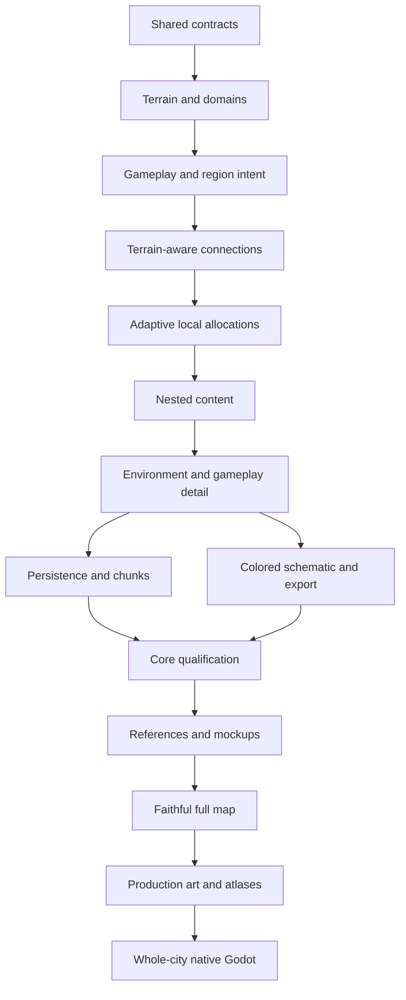

# ADVANCED WORLD GENERATION — MASTER ENGINEERING PLAN

**Delivery checkpoint (2026-11-02):** Supported-core technical gates S01 through
S10 are verified against their original task criteria.
S01 qualifies shared current contracts, actual parameter/seed effects, migrated
callers, dependency execution and recoverable completed operations. Terminal
reporting failure no longer relabels completed generation as failed.
[S01 evidence](evidence/2026-11-02-s01-core-gate-verification.json).
S02 qualifies supported terrain/domain controls, shared queries, hard
suitability, independent floors, optional environmental derivation and numeric
field inspection. Thirteen native and fourteen JavaScript checks, three CLI
exports and actual browser control checks pass.
[S02 evidence](evidence/2026-11-02-s02-core-gate-verification.json).
S03 qualifies declared gameplay intent, complete source requirements, bounded
region candidates, semantic progression roles and transactional objective edits.
Fourteen native checks, seven JavaScript checks, eight successful CLI operations
and four expected public refusals pass. Source-only examples retain original
ownership inputs; strict stale-receipt rejection remains.
[S03 evidence](evidence/2026-11-02-s03-core-gate-verification.json).
S08 qualifies current metadata/surface/interior/regional/domain protocols:
complete generated wall/doorway extraction, source identities, edit locality,
order, persistence, measured scale and original limits. Geometry packages use
schema 4 only. [S08 evidence](evidence/2026-11-02-s08-core-gate-verification.json).
S09 qualifies semantic palettes/layer controls, exact source geometry/export,
saved route evidence, independent-domain navigation and honest diagnostics.
The actual browser retains all 5000 supported metadata nodes after the batched
label fix; oversize/unsupported/malformed imports preserve the working view.
Three native scopes, forty JavaScript checks, seven public CLI publications and
source replay pass. Native SVG matches all 91 source footprints and 74 route
point sequences/widths. [S09 evidence](evidence/2026-11-02-s09-core-gate-verification.json).
S05 qualifies current regular, irregular, weighted and nested allocations,
terrain-sensitive ownership, roadless resource/interaction programs and owning
repair with protected anchors. The same complete 94-node/91-source program passes
on four terrains; ten native scopes, 28 independent checks and ten CLI publications
pass with six exact SDK/CLI worlds. Unknown root JSON renderer settings now refuse.
[S05 evidence](evidence/2026-11-02-s05-core-gate-verification.json).
S04 qualifies current terrain-aware connections, sparse required alternatives,
scoped network purposes/profiles, mixed guidance, explicit full-width junctions,
domain transfers and affected-route regeneration. Seventeen native scopes,43
independent checks,eight exact SDK/CLI worlds,replay and required-route refusal
pass. A fixed complete source program qualifies on four terrains; the integrated
irregular coastal settlement retains its confined grid,hillside and protected
shore. Unsupported surface levels reject; no automatic civil-engineering policy,
country-scale throughput or owner design approval is inferred.
[S04 evidence](evidence/2026-11-02-s04-core-gate-verification.json).
S06 qualifies current catalog ownership,complete nested source demand and
capacity,regular/convex source surroundings,interiors/openings/boundaries,optional
game-authored services and full source replay. New catalog-owned static/moving
component identities survive logical/physical expansion and edits without
changing source geometry. Nineteen native scopes,36 independent checks,eleven
public worlds,ten exact SDK/CLI comparisons,two replays and seven no-output
refusals pass. Identity metadata does not execute motion or certify animated
swept clearance. [S06 evidence](evidence/2026-11-02-s06-core-gate-verification.json).
S07's original population gate is verified: 18 native scopes, 49 independent
checks, two exact public worlds, replay and four expected refusals pass.
[S07 evidence](evidence/2026-11-02-s07-core-gate-verification.json).
S10 now qualifies the supported metadata core: all 63 original core tasks and
the 12 in-scope owner requirements are reviewed. Current builds, all 40 fixed
requests (39 worlds and one intended refusal), eight named native scopes,
62 independent JavaScript checks, full interior geometry/accounting, public SDK
source edits/replay and actual browser inspection pass.
[Final evidence, capability decisions and limits](evidence/2026-11-02-s10-core-gate-verification.json).
The design review is self-review against owner requirements; it does not approve
an individual game's composition or artwork. Game-authored catalogs and finite
rules remain inputs. Unsupported volume/import/runtime operations and measured
scale limits remain explicit. W11 and S11–S14 stay owner-deferred; no automatic
artwork or Godot work follows this core gate. Earlier dated increments retain
their historical scope; this checkpoint and the original audit own current status.

**Current placement execution (2026-11-02):** The shared placement owner now
reuses pure candidate geometry qualification from private accepted sessions.
Complete source-sized compound movement computes thirteen evaluations and
retains 78; source equipment dimensions invalidate all 56 equipment evaluations.
Current access, partial contacts, collision, relations, nogoods and final
feasibility remain live. Cold/warm worlds and canonical work are identical;
source replay authenticates execution reports. CLI initial world/checkpoint and
moved world/report match SDK exactly; an insufficient budget publishes nothing
and preserves the accepted checkpoint. No new placement count limits were added;
keys, geometry and reports share the existing serialized-cache byte cap.
Whole assignment search, global terrain/field dependency locality and broad
design/scale qualification remain open. Original stage/task scope is unchanged;
Godot remains deferred. [Evidence](evidence/2026-11-02-placement-evaluation-verification.json).

**Current S04 connection-level regeneration (2026-11-02):** Private accepted
sessions retain each qualified connection separately and expose exact execution
reports. Explicit routing boundaries isolate disjoint terrain dependencies;
interface/source validation and global rules retain their required wider checks.
All 94 nodes / 91 physical sources survive the coastal policy, terrain and
destination edits; complete warm worlds/work match clean generation. Source
endpoint heights are canonical without merging real levels; shared edge packets
avoid repeated trace work and composed joins retain climb costs. Fifteen native
scopes and eleven independent checks pass under original traversal limits.
Public CLI worlds, initial checkpoint and policy execution report match the SDK;
an insufficient budget refuses without publication or accepted-state changes.
[Evidence](evidence/2026-11-02-route-granularity-verification.json).
S04.8 finer placement execution, broader design/scale qualification and the
professional-generator goal remain open. Godot remains deferred.

**Current S04 combined coastal fixture (2026-11-02):** An irregular world
boundary, district-confined grid, hillside allocations, undeveloped shore and
complete nested building/equipment programs now run together through the shared
engine. Baseline/water retain 94 nodes, 91 physical sources and 74 directed paths;
the changed crossing preserves all source poses. A roadless variant retains all
content. Seven independent checks, actual CLI/SDK parity/replay and browser/SVG
review pass. No resource limits or engine algorithms changed.
[Reusable example](../examples/metadata/coastal-mixed-world/README.md),
[evidence](evidence/2026-11-02-coastal-mixed-world-verification.json).
This qualifies the combined technical fixture; S04.8 finer execution granularity,
broader design/scale qualification and the professional-generator goal stay open.

**Current S04 routing correction (2026-11-02):** Generated paths now qualify
height continuity at turns while retaining alternative arrival states. Search,
prescribed paths and rounding count permitted vertex climbs consistently.
Thirteen native scopes, seven independent JavaScript checks and public CLI
generation/replay/refusal pass; terrain-edit locality and source content survive.
S04 remains open against its original exit fixture and broader gates.
[Evidence](evidence/2026-11-02-route-junction-verification.json).

**Current — pin-conditioned design regeneration (2026-11-02):** The
session supplies protected destination coordinates before each design
candidate's regional solve and replays the same effective constraints.
Explicit conflicting pins refuse without fabricated candidate geometry.
Seed-change checks preserve the fixed arrival while three other regions move,
retaining complete content and routes. Protected-alternative, saved replay,
inspection and exact pinned-world CLI rollback checks pass. Broad world qualification stays open and Godot
is deferred. [S08](world-generation/stages/s08-deterministic-chunks-and-persistence.md).

**Current — protection-aware design alternatives (2026-11-02):** Active
session protections participate in bounded design selection. Reports retain
the attempted choices and their reasons; replay authenticates the same trace
under the protection policy of each edit. Catalog/origin conflict, compatible
selection, release, state preservation, replay, altered-trace refusal and
seeded-session/CLI checks pass. Broader
world qualification stays open and Godot is deferred.
[S08](world-generation/stages/s08-deterministic-chunks-and-persistence.md).

**Current — editable authored designs (2026-11-02):** The existing
regional session retains authored design/seed history, source-hash preconditions
and authenticated replay. Final SDK seed-edit, rollback-on-failure, restore and
source-only provenance checks pass. The CLI source-only edit preserves world
bytes and reuses all regional packets while changing the source pin. The broad world-generator gate stays
open and Godot is deferred. [S08](world-generation/stages/s08-deterministic-chunks-and-persistence.md).

**Current — coordinate-dependent density (2026-11-02):** A density dependency
analysis enables compact regional ownership and population for coordinate-only
fields, including references and clamps. Terrain-dependent densities preserve
their detailed faces. Analytic and complete physical-world regression checks
pass; a bounded checkerboard input generates all declared content and routes.
Complete-field viewer indexing is corrected. Broad world qualification remains
open; Godot deferred. [S10](world-generation/stages/s10-validation-diversity-and-core-gate.md).

**Current — fixed-corpus revalidation (2026-11-02):** Current Core retained
39 generated cases and one intended refusal in the existing 40-case fixed
corpus. Prior geometry fingerprints, independent interior/accounting checks,
saved JavaScript checks and the 91-node composition regression passed. This
does not close S10.2–S10.6 or qualify broader world design and scale. Godot is
deferred. [S10](world-generation/stages/s10-validation-diversity-and-core-gate.md).

**Current — seeded captured-design replay (2026-11-02):** Saved terrain capture,
seed derivation, complete design publication/replay and modified-receipt refusal
pass in the SDK. A portable authored-capture example generates and verifies in
the CLI. Broader world/gameplay qualification remains open; Godot deferred.
[S10](world-generation/stages/s10-validation-diversity-and-core-gate.md).

**Current — uniform membership area (2026-11-02):** A replayed compact region
with uniform density integrates its exact area without expanding the underlying
terrain mesh. Field-dependent densities and arbitrary masks still sweep source
terrain. The bounded rough-field geometry test passes; wider world scale and
quality remain open. Godot is deferred.
[S10](world-generation/stages/s10-validation-diversity-and-core-gate.md).

**Current — membership terrain integration (2026-11-02):** Area-weighted
population re-sweeps compact region memberships with declared density fields
and explicit masks against source terrain. Uneven-terrain equivalence and
regional weight regression tests pass; a 2.5 m captured example produces both
complete declared regions in the CLI. Broad world qualification remains open;
Godot is deferred. [S10](world-generation/stages/s10-validation-diversity-and-core-gate.md).

**Current — captured regional terrain (2026-11-02):** Regional planning and
assembly now support bounded terrain captures on the original lattice. The
two-region physical test, source replay and SDK/CLI comparison pass on the tested
build. A detailed-face fine-resolution input hit the cell budget; an explicit
membership version succeeds as described above. Broader world
qualification remains open. Godot is deferred.
[S10](world-generation/stages/s10-validation-diversity-and-core-gate.md).

**Current — supplied regional heightfields (2026-11-02):** Complete supplied
fields flow through shared regional planning and physical world assembly with
source validation, bounded work and replay. A two-region SDK/CLI physical world
passes; selective supplied-field streaming and broad
world qualification remain open. Godot deferred.
[S10](world-generation/stages/s10-validation-diversity-and-core-gate.md).

**Current — generated terrain kind proof (2026-11-02):** The joint owner can
prove a missing mandatory kind across both patches and generated terrain, with
terrain work charged and a verified seeded physical-world control. Direct
heightfield/capture ownership inputs were subsequently added; broad qualification remains open; Godot
deferred. [S10](world-generation/stages/s10-validation-diversity-and-core-gate.md).

**Current — non-city terrain and missing-kind proof (2026-11-02):** A fixed
exploration-terrain matrix records complete physical worlds and refusal. The
joint owner now proves an absent patch terrain kind before consuming program
alternatives; invalid settings, budgets and current CLI behavior are checked.
Broad world qualification remains open; Godot deferred.
[S10](world-generation/stages/s10-validation-diversity-and-core-gate.md).

**Current — metadata source editing (2026-11-02):** The public SDK workflow
generates and revises developer-authored recipe sources using the existing
reported session, with clean replay, failed-edit preservation and physical
content checks. Broad game-world qualification remains open; Godot deferred.
[S10](world-generation/stages/s10-validation-diversity-and-core-gate.md).

**Current — joint preferred-anchor search (2026-11-02):** Shared partition
feedback can reconsider earlier preferred anchors while keeping fixed anchors
and hard relationships. Analytic, budget, three-region physical/replay and
SDK/CLI checks pass; broad world qualification remains open, Godot deferred.
[S02](world-generation/stages/s02-terrain-and-spatial-domains.md).

**Current — relationship-aware preferred anchors (2026-11-02):** Shared
partition qualification retries bounded, suitable alternatives for a rejected
preferred point. A complete declared physical example preserves its content and
distance rule; replay, SDK/CLI and partition/pin regressions pass. Exhaustive
joint search and broad world qualification remain open; Godot deferred.
[S02](world-generation/stages/s02-terrain-and-spatial-domains.md).

**Current — shared-partition terrain preferences (2026-11-02):** Distinct
soft intent preferences select qualified anchors inside final shared partitions.
Three-region physical generation, replay, independent scores and SDK/CLI pass;
global optimization and broad world qualification remain open. Godot deferred.
[S02](world-generation/stages/s02-terrain-and-spatial-domains.md).

**Current — continuous-cell terrain preference (2026-11-02):** The bounded
regional anchor search samples inset cell points as well as centers. Single-cell
and four-region physical examples preserve required constraints and replay;
shared partition preference and broad world qualification remain open. Godot
deferred. [S02](world-generation/stages/s02-terrain-and-spatial-domains.md).

**Current — terrain-preferred regional anchors (2026-11-02):** Game-authored
terrain preference can explicitly guide bounded region anchor selection without
relaxing hard suitability or clearance. A four-region physical counterfactual,
replay and SDK/CLI equality pass. Broad world-design review and Godot remain
open. [S02](world-generation/stages/s02-terrain-and-spatial-domains.md).

**Current — editable blueprint publication (2026-11-02):** Blueprint-design
packets retain and verify their authored design as well as expanded source;
four-region SDK/CLI replay and altered-source refusals pass. Design edit history
and broad world qualification remain open; Godot deferred.
[S10](world-generation/stages/s10-validation-diversity-and-core-gate.md).

**Current — shared regional alternatives (2026-11-02):** Blueprint slots may
reference a common program option set. Four-region physical tests preserve
content, endpoints and routes, including a mixed-program seed; SDK/CLI and
replay checks pass. Broader generator qualification remains open; Godot deferred.
[S10](world-generation/stages/s10-validation-diversity-and-core-gate.md).

**Current — regional program policy selection (2026-11-02):** Explicit program
alternatives may supply their complete regional policy. A selected weight changed
physical allocation while preserving required routes and replay; other policy
dimensions and broader world-design qualification remain open. Godot deferred.
[S10](world-generation/stages/s10-validation-diversity-and-core-gate.md).

**Current — reusable seeded program alternatives (2026-11-02):** Blueprint
design slots reference declared program sources and use the existing seeded
terrain, partition and content-selection engine. Two complete worlds, source
replay and CLI/SDK parity pass; broad world-design acceptance remains open.
[S10](world-generation/stages/s10-validation-diversity-and-core-gate.md). Godot deferred.

**Current — seeded blueprint generation (2026-11-02):** The shared designer can
generate varied terrain and regional boundaries from a reusable blueprint and
one seed without fabricated program alternatives. Complete content, source
replay and SDK/CLI parity pass for two fixed seeds. Broader world diversity remains
open; Godot deferred. [S10](world-generation/stages/s10-validation-diversity-and-core-gate.md).

**Current — generic entrances on all rectangle sides (2026-11-02):** Site
grammar now follows an explicitly selected side entrance as well as front/rear
entrances, retaining full nested content and rotation. Geometry, replay and CLI
checks pass; arbitrary footprint frontage and broad world design remain open.
[S06](world-generation/stages/s06-nested-content-and-surroundings.md). Godot deferred.

**Current — off-center source entrances (2026-11-02):** Generic catalog
structures can generate their walkways and surroundings at an authored
off-center front/rear entrance. Repeated/nested content, rotation, source replay
and CLI parity pass. Broader world design remains open; Godot deferred.
[S06](world-generation/stages/s06-nested-content-and-surroundings.md).

**Current — physical bend-position fallback (2026-11-02):** A fixed 12-case
physical study identified a failed primary and viable alternate on the same
terrain. Feedback selected the declared alternate while preserving complete
programs and journeys; replay, independent checks and CLI parity pass. Broader
world design remains open; Godot deferred.
[S05](world-generation/stages/s05-adaptive-regions-and-partitions.md).

**Current — bend split source edges (2026-11-02):** Preserving exact source
edges at tangent intersections resolves the 150-unit offset-world refusal.
Complete physical generation, replay, independent geometry and CLI parity
pass; a separate physical retry to another offset is verified above. Godot deferred.
[S05](world-generation/stages/s05-adaptive-regions-and-partitions.md).

**Current — alternative bend positions (2026-11-02):** The shared area search
can choose among declared asymmetric bend positions with bounded, replayable
witnesses. Local fallback, regional/seeded worlds and the separate physical
position fallback pass. The earlier geometry refusal is fixed above.
[S05](world-generation/stages/s05-adaptive-regions-and-partitions.md). Godot deferred.

**Current — asymmetric region bends (2026-11-02):** A signed tangent offset
adds an authored non-centered boundary strategy to shared regional generation.
Analytic, physical-world, source replay and SDK/CLI checks pass; broader world
variety remains open. [S05](world-generation/stages/s05-adaptive-regions-and-partitions.md).
Godot is deferred.

**Current — blueprint revision workflow (2026-11-02):** The public SDK consumer
applies a shared program revision to four regional instances and verifies clean
generation, published replay, checkpoint restore and exact physical footprints.
Broader world design remains open; Godot is deferred.
[S01](world-generation/stages/s01-shared-world-contracts.md).

**Current — reusable regional blueprints (2026-11-02):** Complete game-authored
programs can be declared once and bound to multiple region instances before normal
world generation. SDK/CLI equality, replay, overrides and invalid inputs pass.
This is authoring support; full world-design and diversity gates remain open.
[S01](world-generation/stages/s01-shared-world-contracts.md). Godot deferred.

**Current — terrain-responsive connections (2026-11-02):** A fixed four-region
program reroutes around a newly forbidden wetland while retaining all content,
bidirectional paths and replay. Independent obstacle/clearance checks pass;
broader terrain and genre variety remain open. Godot remains deferred.
[S10](world-generation/stages/s10-validation-diversity-and-core-gate.md).

**Current — partition source-edge preservation (2026-11-02):** A corrected
intersection calculation allows the previously refused irregular coastal-edge
case to generate alongside the other three fixed cases. Required physical
programs and routes, replay and narrow-geometry refusal pass. The three mild
terrain fields still share one layout; broad adaptation remains open.
[S10](world-generation/stages/s10-validation-diversity-and-core-gate.md).

**Earlier — cross-terrain qualification (2026-11-02):** The same required
program generated on three mild terrain fields with identical region and route
shapes; an irregular coastal-edge domain exposed a geometry-resolution refusal.
The results and diagnostics are recorded in
[S10](world-generation/stages/s10-validation-diversity-and-core-gate.md).
Terrain-driven design variety and robust irregular domains remain open; Godot is deferred.

**Current — selective original-lattice terrain (2026-11-02):** Domain chunk
packages now retain shared surface masks and load pinned original-lattice
terrain windows alongside selected geometry. Captured/generated and authored
fields, seams, bounded querying, corruption, replay and package regressions pass.
Independent chunk generation, environment paging and native runtime streaming
remain open; Godot is deferred.
[S08](world-generation/stages/s08-deterministic-chunks-and-persistence.md).

**Current — persisted multi-domain chunks (2026-11-02):** One atomic pinned
package retains shared domain graph data and selectively reads per-domain chunk
packets. Floor and regional examples, independent hashes, tamper/cancellation,
reporting recovery and the existing single-world regression pass. Selective
terrain is now available above; native runtime streaming remains open; Godot is deferred.
[S08](world-generation/stages/s08-deterministic-chunks-and-persistence.md).

**Current — domain-qualified chunk selection (2026-11-02):** A validated
in-memory index selects local geometry across independent domains while keeping
shared transitions, journeys, progression and complete regional paths. Two
overlapping floors, a logical domain, partial regional selection, source
comparison, refusal cases and the single-world package regression pass. A
multi-domain disk package and selective terrain are available above; runtime streaming remains open;
Godot is deferred. [S08](world-generation/stages/s08-deterministic-chunks-and-persistence.md).

**Current — first multi-domain SDK world (2026-11-02):** Developers can publish
and restore a domain world without inventing an edit. Three physical/logical
framework sources, the existing edited flow, independent saved-data checks and
missing/existing-output refusals pass. This does not close world-design or
diversity gates; Godot remains deferred.
[S10](world-generation/stages/s10-validation-diversity-and-core-gate.md).

**Current — source-aware gated shared corridors (2026-11-02):** Each contributing
route retains its own directed track through shared corridor segments, with
source-specific gates and recorded turns. Reachable/inaccessible keys, bypass
refusal, source witnesses, regional/domain regressions, replay and SDK/CLI parity
pass. Runtime inventory, physical barriers and 3D movement remain open; Godot
is deferred. [S04](world-generation/stages/s04-terrain-aware-connections.md).

**Current — capability-aware qualified journeys (2026-11-02):** Domain journey
search now tracks persistent capabilities over generated physical routes and
explicit transitions, retaining them for return. A regional/two-floor key-and-gate
example, local gate, return-state counterexample, corridor safeguard, replay
and SDK/CLI parity pass. Source-aware shared-corridor gates are now supported as
described above; runtime inventory and 3D connectors remain open; Godot is deferred.
[S04](world-generation/stages/s04-terrain-aware-connections.md).

**Current — gameplay progression across domains (2026-11-02):** The shared
progression owner now evaluates domain-qualified nodes, explicit transitions,
milestones and capability gates. A four-region/two-floor example, missing
grant/return refusals, physical-journey coexistence, design candidate selection,
replay and SDK/CLI parity pass. This is logical progression; runtime inventory,
broader world diversity and physical 3D connectors remain open. Godot deferred.
[S03](world-generation/stages/s03-gameplay-topology-and-regions.md).

**Current — regional world and physical floors (2026-11-02):** A generated
four-region network connects to two independently generated physical floors.
Forward/return source continuity, missing-stairs refusal, publication replay,
independent JavaScript inspection and SDK/CLI parity pass. The composition
inspector separates generated routes from explicit domain changes. Continuous
3D connectors, runtime and broader world diversity remain open; Godot deferred.
[S03](world-generation/stages/s03-gameplay-topology-and-regions.md).

**Current — domain-aware regional design (2026-11-02):** Regional program
selection now tests each candidate against the composed world's required domain
journeys before accepting it. A generated four-region case rejects a logical-only
candidate, selects a physically routed alternative and replays the decision;
SDK/CLI parity and the direct-definition regression pass. This remains a bounded
authored-alternative search; wider world diversity and runtime remain open.
Godot is deferred. [S03](world-generation/stages/s03-gameplay-topology-and-regions.md).

**Current — positioned regional destinations (2026-11-02):** Generated
regional routes may connect non-solid positioned markers into independent
domains. Movement clearance, solid/terrain refusal, round-trip replay, the
port-based regression and SDK/CLI parity pass. Explicit domain changes do not
yet create physical connectors; broad world diversity and runtime movement
remain open. Godot is deferred. [S03](world-generation/stages/s03-gameplay-topology-and-regions.md).

**Current — regional and independent-domain composition (2026-11-02):** A
generated four-region network and separate logical domain compose into one
source-replayable world. Forward and return journeys retain their qualified
regional route evidence and explicit portal. SDK publication, inspectors and
CLI parity pass; a [runnable example](../examples/metadata/regional-domain-world/README.md)
is available. Physical cross-domain connectors,
broader world diversity and runtime movement remain open; Godot is deferred.
[S03](world-generation/stages/s03-gameplay-topology-and-regions.md).

**Current — domain journey checkpoints (2026-11-02):** A game can require
ordered, unavoidable qualified endpoints across physical or logical domains.
Multi-floor and logical examples, bypass/order refusal, replay and the existing
corridor regression pass. This constrains the declared graph; broader world
composition and runtime movement remain open. Godot is deferred.
[S04](world-generation/stages/s04-terrain-aware-connections.md).

**Current — qualified local corridor turns in independent domains (2026-11-02):**
Regional and domain journeys share one directed corridor graph. Generated
crossing rejection, qualified round trips, independent witness checks, replay,
SDK/CLI parity and regional, multi-floor and mixed-domain regressions pass.
Cross-domain corridor groups, broader regional/domain composition and runtime
movement remain open; Godot is deferred.
[S04](world-generation/stages/s04-terrain-aware-connections.md).

**Current — source-qualified multi-domain journeys (2026-11-02):** Independent
domains no longer connect unrelated routes merely because their coordinates
match. Real qualified-route counterexamples, multi-floor and mixed-domain
regressions, replay and SDK/CLI checks pass. Local domain corridor turns are
now supported as above; bounded regional/domain composition is described above.
[S04](world-generation/stages/s04-terrain-aware-connections.md).

**Current — regional interior-to-exterior journeys (2026-11-02):** The journey
graph connects interior room centers and declared entrances to exterior node or
port routes. A two-region source rejects a closed entrance and selects a complete
forward/return journey; replay and SDK/CLI checks pass. Broader multi-floor and
runtime movement remain open; Godot deferred.
[S04](world-generation/stages/s04-terrain-aware-connections.md).

**Current — qualified corridor turns in regional journeys (2026-11-02):**
Regional journey search uses local corridor segments and recorded directed
turns. A four-region world rejected overlapping paths without a junction and
selected their qualified-corridor alternative; source replay and SDK/CLI checks
pass. Cross-region corridor groups, broader interior design and broad world design
remain open; Godot deferred. [S04](world-generation/stages/s04-terrain-aware-connections.md).

**Current — source-qualified journey transfers (2026-11-02):** Regional
physical journey search no longer joins unrelated routes at matching coordinates;
transfers require the same declared port. Real four-region replay, a synthetic
undeclared-crossing counterexample, SDK/CLI and witness checks pass. Explicit
cross-region corridor groups, broader interior design and broad world design remain open;
Godot deferred. [S04](world-generation/stages/s04-terrain-aware-connections.md).

**Current — mandatory physical milestones (2026-11-02):** A regional journey
can require ordered named access ports and reject bypasses in its represented
directed route graph. A four-region world, counterexamples, replay and CLI
checks pass. Unrepresented movement and broad world design remain open; Godot
deferred. [S04](world-generation/stages/s04-terrain-aware-connections.md).

**Current — physical regional journeys (2026-11-02):** A design can require
profile-qualified, exactly joined local and regional route segments between
named access ports, including a return. A four-region logical-only alternative
was rejected and a physically routed program selected; replay and CLI checks
pass. Broader physical navigation and world design remain open; Godot deferred.
[S04](world-generation/stages/s04-terrain-aware-connections.md).

**Current — progression-aware program alternatives (2026-11-02):** Invalid
regional progression declarations fail before generation; a four-region design
rejects a disconnected program and selects an authored connected alternative.
Replay, CLI and saved-witness checks pass. Broader physical continuity and broad
world design remain open; Godot deferred.
[S03](world-generation/stages/s03-gameplay-topology-and-regions.md).

**Current — progression across generated regions (2026-11-02):** Regional
design can require directed milestones and persistent capabilities over actual
region-qualified local and cross-region links. One four-region world, rejection,
source replay, JavaScript and CLI checks pass. This is logical progression;
physical journey and broad world-design gates remain open. Godot deferred.
[S03](world-generation/stages/s03-gameplay-topology-and-regions.md).

**Current — world-wide content requirements (2026-11-02):** Regional design
can select complete programs using world totals or per-parent requirements across
regions, with bounded evaluation and attributed witnesses. A four-region
physical world, replay and SDK/CLI checks pass. Broader world design and the
professional generator remain open; Godot deferred.
[S03](world-generation/stages/s03-gameplay-topology-and-regions.md).

**Current — full-strength terrain cores (2026-11-02):** Authored landforms
can specify an inner radius and falloff transition for broad raised, lowered
or leveled areas. Analytic, window, captured-world, SDK/CLI and schematic
checks pass. Terrain variety and the full generator remain open; Godot deferred.
[S02](world-generation/stages/s02-terrain-and-spatial-domains.md).

**Current — multiple complete structures in regional selection (2026-11-02):**
A terrain-derived four-region fixture rejects an incomplete parent and selects
two complete physical structures with nested modules and retained local and
regional journeys. SDK replay, independent JavaScript inspection and CLI output
parity pass. Broader procedural world design remains unfinished; Godot deferred.
[S03](world-generation/stages/s03-gameplay-topology-and-regions.md).

**Current — archetype-specific nested requirements (2026-11-02):** Regional
requirements can narrow parent and part kinds to game-authored archetypes. A
three-parent physical world retains six nested parts and required journeys;
a separate four-region design passes selection and SDK/CLI replay. Broad world
design remains open; Godot deferred.
[S03](world-generation/stages/s03-gameplay-topology-and-regions.md).

**Current — per-parent content requirements (2026-11-02):** Regional design
can require each game-authored parent structure to contain the declared kinds
and counts of physical or logical parts. A four-region program selection,
uneven-parent checks, replay and SDK/CLI parity pass. Broader world design and
scale remain open; Godot deferred.
[S03](world-generation/stages/s03-gameplay-topology-and-regions.md).

**Current — directional landforms (2026-11-02):** A game can rotate and stretch
each authored hill, valley or ridge influence independently of terrain noise.
Analytic samples, protected detail, captured windows, a physical route and
SDK/CLI parity pass. Broader terrain and world design remain open; Godot deferred.
[S02](world-generation/stages/s02-terrain-and-spatial-domains.md).

**Current — connections in chunk packages (2026-11-02):** Loaded positioned
nodes now retain incident gameplay connections, including external endpoints,
direction and properties; conflicting loaded endpoint records are refused.
A 169-node, 52-chunk fixture passes source, integrity and replay checks.
Independent chunk generation and broader world design remain open; Godot deferred.
[S08](world-generation/stages/s08-deterministic-chunks-and-persistence.md).

**Current — semantic nodes in chunk packages (2026-11-02):** Selectively loaded
positioned members now retain their full node identity, parent and authored JSON
properties with typed geometry. A 169-node fixture passes source parity,
immutability, schema and tamper checks. Shared world dependencies and independent
generation remain open; Godot deferred.
[S08](world-generation/stages/s08-deterministic-chunks-and-persistence.md).

**Current — selective generated chunk loading (2026-11-02):** A bounded,
atomic source-bound geometry package allows consumers to load selected chunk
files after generation, with pinned manifest, seam deduplication and integrity
checks. A 52-chunk physical fixture passes parity, tamper and failure tests.
Independent chunk generation, native runtime and broader world design remain
open; Godot deferred.
[S08](world-generation/stages/s08-deterministic-chunks-and-persistence.md).

**Current — typed chunk geometry (2026-11-02):** Chunk geometry now preserves
footprint, reservation, site-feature, access-approach and route-segment roles,
source IDs, feature kinds and declared occupancy. The 169-node and two-region
regressions pass. Independent streaming and broader world design remain open;
Godot deferred. [S08](world-generation/stages/s08-deterministic-chunks-and-persistence.md).

**Current — chunk geometry selection (2026-11-02):** A source-bound in-memory
index returns complete, deduplicated coverage geometry and route centerlines
for selected storage chunks. A 169-node world passes seam, budget, source
isolation and published replay checks. Independent streaming and broader world
design remain open; Godot deferred.
[S08](world-generation/stages/s08-deterministic-chunks-and-persistence.md).

**Current — bounded route rounding alternatives (2026-11-02):** A two-region
world now recovers from a terrain-blocked rounded path by trying a smaller
game-authored deviation, preserving both directions and all ten nodes. Attempts,
shared budgets, replay and SDK/CLI parity are checked. Broad world design and
scale remain open; Godot deferred.
[S04](world-generation/stages/s04-terrain-aware-connections.md).

**Current — elliptical physical population (2026-11-02):** Optional axis
ratio and orientation extend the shared spiral grammar to ellipses and
elliptical spirals. One four-site world passes physical routes, terrain-driven
whole-shape rotation, replay, SDK/CLI and schematic checks; prior circular
outputs remain unchanged. Broader world-design and scale remain open; Godot
deferred. [S07](world-generation/stages/s07-environment-and-gameplay-population.md).

**Current — terrain-adaptive ring verification (2026-11-02):** A circular
four-site program now has verified use of the existing terrain-driven layout
adaptation: moving a protected area changes the selected orientation, while
all sites and two-way travel survive edits and replay. A fully blocked edit is
refused. Wider world-design and scale remain open; Godot deferred.
[S07](world-generation/stages/s07-environment-and-gameplay-population.md).

**Current — circular physical population (2026-11-02):** The shared spiral
grammar now supports constant-radius rings with tangent facing and normal
physical/route constraints. A four-site world, overlap refusal, source replay,
SDK/CLI comparison and saved schematic checks pass. Broader world design and
scale remain open; Godot deferred.
[S07](world-generation/stages/s07-environment-and-gameplay-population.md).

**Current — first-world SDK entry (2026-11-02):** A developer can now publish
and replay a procedural regional source without providing a fabricated edit.
One four-region source and one source-edit regression passed; broader world
design and scale remain open. Godot deferred.
[S10](world-generation/stages/s10-validation-diversity-and-core-gate.md).

**In progress — terrain-qualified path rounding (2026-11-02):** Optional
first-feasible route rounding retains endpoints and selected waypoints and
rechecks full-width terrain and work limits. One bidirectional water-obstacle
world passed SDK/CLI publication and replay, and a cutting curve was refused.
A two-region, ten-node world also passed two-way routing, source replay and
saved-layout/witness checks. A generated four-region network retained its 20
nodes, 12 physical sites and two-way links through replay. Broader world design
remains open; Godot deferred.
[S04](world-generation/stages/s04-terrain-aware-connections.md).

**Current — terrain-responsive boundary edits (2026-11-02):** Moving a barrier
changes both the chosen regional boundary and physical routes while preserving
48 nodes, 45 physical sites and required two-way journeys. Clean regeneration,
failed-edit preservation, exact source rollback, session replay and CLI parity
pass. This is one bounded terrain case; broad world-design and scale remain open.
Godot deferred. [S05](world-generation/stages/s05-adaptive-regions-and-partitions.md).

**Current — adaptive bent-region choices (2026-11-01):** The shared allocator
and physical feedback can select among bounded, game-authored bend alternatives.
A disconnected primary shape is rejected; a barrier-world alternate retains all
48 nodes and two-way journeys. Fixed seeds select different declared bends;
source replay, CLI/API parity and straight-partition regressions pass. Wider
world design and scale remain open; Godot deferred.
[S05](world-generation/stages/s05-adaptive-regions-and-partitions.md).

**Current — bent region boundaries (2026-11-01):** The shared area allocator
can generate bounded piecewise-linear bends instead of only straight split
lines. A four-region physical world has 5–6 genuine corners per region and
retains all 20 nodes and six directed paths; source replay, CLI parity, area and
overlap checks pass. This is one explicit grammar, not complete geographic or
world-design variety. Godot deferred. [S05](world-generation/stages/s05-adaptive-regions-and-partitions.md).

**Current — fixed-seed world variety study (2026-11-01):** Six unchanged-program
seeds generated and retained 20 nodes and six directed regional paths each.
They produced five network graphs and two authored program choices; source-size,
connectivity and path arithmetic checks pass. Most regions are quadrilaterals,
and this small fixture does not establish broad map quality or scale. Godot
deferred. [S10](world-generation/stages/s10-validation-diversity-and-core-gate.md).

**Current — earlier role qualification (2026-11-01):** Fully bound analyses
can reject impossible joint-network roles before generating physical candidates.
The previously over-budget 62-node world now passes under the default cap at
12.83 million work (previously 23.96 million), with identical local worlds and
connections. Deferred analyses fall back to normal physical resolution. This is
one bounded performance result; wider scale remains open. Godot deferred.
[S04](world-generation/stages/s04-terrain-aware-connections.md).

**Current — terrain-coupled role selection (2026-11-01):** Joint regional
terrain/count and authored-program search can reject a missing generated role
and select another complete program. One 62-node world and its three two-way
connections pass source replay and hard-limit checks. Its original 23.96 million
work was subsequently reduced as recorded above; broader performance remains open. Godot deferred.
[S03](world-generation/stages/s03-gameplay-topology-and-regions.md).

**Current — procedural-source SDK workflow (2026-11-01):** A public consumer
starts from a regional source and applies authored source revisions, with clean
generation comparison, published-world replay and history restore. One four-region
terrain-cost change and rollback preserve all content and paths; blocked edits
preserve the accepted baseline. Broader developer authoring and world quality
remain open; Godot deferred. [S10](world-generation/stages/s10-validation-diversity-and-core-gate.md).

**Current — role-aware regional program selection (2026-11-01):** Regional
composition can reject a physically generated candidate whose network role is
missing or ambiguous and try an authored alternative, charging the failed work.
A two-region physical world, replay, budget/attempt limits and the existing
designer regression pass. Broader dynamic search and whole-world quality
remain open; Godot deferred. [S03](world-generation/stages/s03-gameplay-topology-and-regions.md).

**In progress — generated regional endpoints (2026-11-01):** Regional networks
and the design composer resolve unique authored node kinds after local generation.
A terrain-dependent, 62-node/three-region world, physical routes, saved replay,
schematic witness and existing four-region regressions pass. Broader dynamic
composition search and whole-world design remain open; this does not complete
the generator. [S04](world-generation/stages/s04-terrain-aware-connections.md).

**Current — sampled-overlay routing (2026-11-01):** Exact-preserving sampled-envelope qualification reduces work for wholly traversable, unambiguous overlays. The previously budget-limited seeded lowest-cost example now generates and replays under the same limits; direct oracle and routing/regional regressions pass. This does not close broad routing scale or world-design gates. Godot deferred. [S04](world-generation/stages/s04-terrain-aware-connections.md).

**Current — regional design replay performance (2026-11-01):** Removed a duplicate full regional replay from design publication/read without relaxing source comparison or atomic dependency checks. Focused tamper, dependency and seeded-world checks pass; one local CLI verification comparison improved from 55.56s to 28.93s. Lowest-cost route scalability and broader world design/scale remain open; Godot deferred. [S08](world-generation/stages/s08-deterministic-chunks-and-persistence.md).

**Current — world seed across generation layers (2026-11-01):** One opt-in seed derives separate terrain-detail, regional-partition and program-selection streams. Two complete four-region examples retain required content/routes while varying terrain, geometry and program; source replay passes. Lowest-cost routing performance and broader design/scale remain open; Godot deferred. [S10](world-generation/stages/s10-validation-diversity-and-core-gate.md).

**Current — seeded regional program variety (2026-11-01):** Priority-aware regional composition explores changes across slots, and an explicit seed can choose different equal-priority authored physical programs. Two bounded four-region examples pass source replay; whole-world synthesis, design and scale remain open. Godot deferred. [S10](world-generation/stages/s10-validation-diversity-and-core-gate.md).

**Current — semantic regional connections (2026-11-01):** Regional design alternatives can resolve declared network endpoints from unique program roles, including alternatives with different root IDs. A four-region physical world, bounded refusal and source replay pass. Dynamic-count bindings and whole-world design/scale remain open; Godot deferred. [S03](world-generation/stages/s03-gameplay-topology-and-regions.md).

**Current — regional world design composition (2026-11-01):** A bounded, replayable designer evaluates complete game-authored program combinations against explicit content requirements, terrain and regional connections. A four-region physical example passes SDK/CLI and replay. This does not invent game intent or complete world-design and scale gates; Godot deferred. [S03](world-generation/stages/s03-gameplay-topology-and-regions.md).

**Current — protected generated positions (2026-11-01):** Session-level position protections survive replay and reject conflicting edits without publication, tested on 3D metadata and terrain-aware physical routes. They do not yet guide search or support dynamic/shape locks. Whole-world design remains open; Godot deferred. [S08](world-generation/stages/s08-deterministic-chunks-and-persistence.md).

**Current — semantic topology landmarks (2026-11-01):** Generated graph starts and exits can be resolved from unique game-defined kinds in an explicit scope. Replay, ambiguity refusal and physical routing pass for bounded examples. Whole-world synthesis and broader quality qualification remain open; Godot deferred. [S03](world-generation/stages/s03-gameplay-topology-and-regions.md).

**Current — bounded cross-genre workflow verification (2026-11-01):** Two 61-node PartialScope terrain examples and four authored SDK workflows passed generation and replay checks. These examples do not complete whole-world synthesis, broader quality or scale qualification. Godot remains deferred. [S10 evidence](world-generation/stages/s10-validation-diversity-and-core-gate.md).

**Current — combined rigid population rules (2026-11-01):** A population can rotate and then translate in one bounded candidate, including within coordinated scopes. Root, nested and joint fixtures preserve sources and journeys through replay, rollback, CLI and schematic checks. Engine-build receipt identities and broader world design remain open constraints; Godot deferred. [S07](world-generation/stages/s07-environment-and-gameplay-population.md), [S09](world-generation/stages/s09-layered-schematic-and-export.md).

**Current — authored rotation and mixed layout rules (2026-11-01):** Population placement supports bounded pivot rotations as well as translations in coordinated scopes. Root, oblique, nested and mixed-rule fixtures pass source and schematic checks while retaining physical sources and journeys. This does not complete world generation; Godot deferred. [S07](world-generation/stages/s07-environment-and-gameplay-population.md), [S09](world-generation/stages/s09-layered-schematic-and-export.md).

**Current — coordinated population scopes (2026-11-01):** Up to four declared population targets can be reconsidered together using a bounded joint search and aggregate work limit. A two-scope complete-physical fixture passes routes, source and checkpoint replay, rollback, CLI/SDK and schematic checks. Broader world design and Godot remain open. [S07](world-generation/stages/s07-environment-and-gameplay-population.md), [S09](world-generation/stages/s09-layered-schematic-and-export.md).

**Current — integrated population adaptation (2026-11-01):** Optional placement rules now generate and evaluate bounded authored translations in the ordinary world pipeline. Root spiral/path, two-parent program, source replay, rollback and schematic witness checks pass; later-stage failures remain terminal. Complete world generation and Godot remain open. [S07](world-generation/stages/s07-environment-and-gameplay-population.md), [S09](world-generation/stages/s09-layered-schematic-and-export.md).

**Current — population-selection CLI (2026-11-01):** The CLI publishes and verifies the replayable, rule-driven population-selection package. Real-process tests cover SDK parity and failure cases for one framework example. Registry plugin and complete world-design qualification remain open; Godot deferred. [S09](world-generation/stages/s09-layered-schematic-and-export.md).

**Current — rule-generated population translations (2026-11-01):** A finite authored movement rule generates alternatives for spiral, path, boundary and socket populations and persists through selection-package replay. Protected-terrain and two-parent local-program fixtures retain full sources and required journeys. This is bounded search, not complete world design; Godot deferred. [S07](world-generation/stages/s07-environment-and-gameplay-population.md).

**Current — replayable population-selection packages (2026-11-01):** Selection requests, ordered attempts and a full selected world can be atomically published and replayed together. Bounded tests cover changed inputs/receipt, failures and post-commit reporting. This is source consistency, not authenticity or complete world design; Godot deferred. [S09](world-generation/stages/s09-layered-schematic-and-export.md).

**Current — nested population alternatives (2026-11-01):** The shared population selector addresses named nested stages and reusable programs as well as root demands. Preserved physical members, required travel and replay pass in one- and two-parent fixtures. Complete world generation remains open; Godot deferred. [S07](world-generation/stages/s07-environment-and-gameplay-population.md).

**Current — authored population alternatives (2026-11-01):** Finite authored alternatives support different population grammars while retaining complete generation and all constraints. Spiral and path layouts, failure handling and replay pass on a protected-terrain fixture. This is not continuous optimization or complete world generation. Godot deferred. [S07](world-generation/stages/s07-environment-and-gameplay-population.md).

**Current — terrain-sensitive physical programs and rejection feedback (2026-11-01):** One four-site spiral program preserves content and two-way travel across flat and sloped terrain, while route costs respond to elevation. A protected site is refused with actionable CLI diagnostics; an explicitly authored redesign passes. This is bounded validation, not automatic redesign or a complete generator. Godot deferred. [S10](world-generation/stages/s10-validation-diversity-and-core-gate.md), [S03](world-generation/stages/s03-gameplay-topology-and-regions.md).

**Current — spiral source schematic validation (2026-11-01):** Saved views check faced and unfaced spiral templates, compiled bindings, anchors and positions across root, nested and reusable programs. Numeric member order, tamper refusal and public source replay pass; whole-source verification and broad world design remain distinct. Godot deferred. [S09](world-generation/stages/s09-layered-schematic-and-export.md).

**Current — spiral tangent-facing population (2026-11-01):** The shared physical population owner orients sources from the continuous spiral tangent with four facing modes. Independent derivative, nested-parent, contracting/swapped-axis, source replay and saved-schematic tests pass for bounded fixtures. Broad world design and Godot remain open. [S07](world-generation/stages/s07-environment-and-gameplay-population.md).

**Current — spiral physical population (2026-11-01):** An authored spiral grammar supports selected-axis metadata and 2D physical population with normal source, collision and route constraints. One four-site world and a higher-dimensional non-city hierarchy pass bounded checks; broader design remains open. Godot deferred. [S01](world-generation/stages/s01-shared-world-contracts.md).

**Current — weighted physical-layout adaptation (2026-11-01):** Existing bounded adaptation can retry a declared orientation after placement refusal while retaining weighted local programs and complete physical sources. A two-orientation fixture passes replay, edit/rollback, CLI/SDK and schematic checks; a 13-choice 2:3 case still refuses. Broader world design and Godot remain open. [S05](world-generation/stages/s05-adaptive-regions-and-partitions.md).

**Current — local program allocation weights (2026-11-01):** Area-balanced local intents may declare relative mass shares separately from minimum area, preserving interfaces, nesting and physical requirements. Analytic and full-source tests pass; blocked-approach cases remain explicit refusals. Broad world design and Godot remain open. [S05](world-generation/stages/s05-adaptive-regions-and-partitions.md).

**Current — weighted six-region world (2026-11-01):** Existing regional ownership weights produce distinct complete-world boundaries and routes while retaining 30 nodes, 18 source-sized sites and seven bidirectional journeys. Edits, replay, rollback and SDK/CLI/schematic checks pass for one bounded fixture; broad world-design and Godot remain open. [S05](world-generation/stages/s05-adaptive-regions-and-partitions.md).

**Current — independent regional allocation weights (2026-11-01):** Optional game-authored region shares are separate from required minimum area and remain constrained by source, suitability and routes. Analytic, holed/density, physical-world, edit/replay and SDK/CLI checks pass. General world design and Godot remain open. [S05](world-generation/stages/s05-adaptive-regions-and-partitions.md).

**Current — authored terrain falloff (2026-11-01):** Game-authored landforms support smooth, linear and quadratic distance profiles with identical omitted-default output. Analytic samples, protected windows, complete physical route counterfactual, edit/replay and SDK/CLI checks pass. Broader terrain/world design and Godot remain open. [S02](world-generation/stages/s02-terrain-and-spatial-domains.md).

**Current — bounded route probe for world variety (2026-11-01):** A second endpoint-focused probe enables a previously failing seed while preserving original limits and complete winning-set search. All 14 paths match a larger full-graph run; eight fixed seeds produce complete six-region worlds in this fixture. Broader design and Godot remain open. [S04](world-generation/stages/s04-terrain-aware-connections.md).

**Current — seeded complete regional variety (2026-11-01):** Two seeds on identical irregular terrain and six regional programs changed six ownership polygons and seven forward routes without losing any of 30 nodes, 18 physical sites or seven bidirectional journeys. SDK/CLI equality, saved replay and schematic checks pass for this bounded example; broad world design and Godot remain open. [S10](world-generation/stages/s10-validation-diversity-and-core-gate.md).

**Current — seeded regional split choices (2026-11-01):** A game-authored seed deterministically orders declared partition angles. Eight seeds produced six layouts in one three-region fixture; a holed and irregular 11-node connected world retained content through edits and saved replay. SDK/CLI and schematic checks pass for the bounded example. Wider qualification and complete game-world design remain open. [S05](world-generation/stages/s05-adaptive-regions-and-partitions.md).

**Current — directional irregular regional world (2026-11-01):** Two terrain orientations generate six complete regions within an irregular boundary, retaining 30 nodes, 18 sources and seven bidirectional links. One forward route changes shape and seven change cost; independent source/clearance checks, edits, replay and SDK/CLI parity pass. This bounded fixture is not broad or visual design acceptance; Godot deferred. [S10](world-generation/stages/s10-validation-diversity-and-core-gate.md).

**Current — directional terrain detail (2026-11-01):** Seeded terrain supports authored orientation and axis stretch, preserving identity defaults, protected landforms and original-lattice windows. Complete physical-world edit/replay and saved captured-viewer checks pass; the viewer also fixes protected-work validation. Broader world design, browser review and Godot remain open. [S02](world-generation/stages/s02-terrain-and-spatial-domains.md).

**Current — clamped suitability matrix (2026-11-01):** Twenty-three independent analytic ranges, empty requests, one-sided plateaus, intersecting requirements and distinct profile regions pass; a real sub-resolution strip still refuses. The physical terrain counterfactual and triangle oracle pass. Broader numerical/world-design qualification remains open; Godot deferred. [S02](world-generation/stages/s02-terrain-and-spatial-domains.md).

**Current — terrain clamp boundary correction (2026-11-01):** The formerly failing terrain setting now generates without dropping small geometry: the region planner skips only semantically redundant cuts at field-clamp bounds. Three independent area checks, full routes, edits/replay and region/terrain regressions pass. Affected saved plan work requires regeneration; broad world design and Godot remain open. [S02](world-generation/stages/s02-terrain-and-spatial-domains.md).

**Current — terrain roughness region counterfactual (2026-11-01):** Low/high settings alter suitable area and route cost while retaining the source and both paths. A valid middle setting exposed a numerical clipping refusal, resolved by the newer clamp-boundary correction; diagnostics retain the disputed input geometry and signed values, and no partial world is published. Broader region-setting coverage and world-design qualification remain open; Godot deferred. [S02](world-generation/stages/s02-terrain-and-spatial-domains.md).

**Current — terrain octave controls (2026-11-01):** Seeded terrain detail supports authored persistence and lacunarity with unchanged defaults. Analytic weighting, original-lattice windows, protection, bounds and a complete physical terrain/edit/replay example pass; SDK/CLI agree. Broader terrain/world design remains open; Godot deferred. [S02](world-generation/stages/s02-terrain-and-spatial-domains.md).

**Current — return-loop search oracle (2026-11-01):** Independent exhaustive enumeration agrees with generated directed return-loop selection in 2,430 small staged cases, including 891 impossible requests. Exact cycles, reachability, stage gates and degree bounds are checked. This does not qualify arbitrary/larger graphs or the full generator; Godot deferred. [S03](world-generation/stages/s03-gameplay-topology-and-regions.md).

**Current — directed stage return loops (2026-11-01):** Game-authored directed topology can request exact stage-local return links that close existing tree paths. A 25-node/two-cycle graph and a complete six-region physical return world pass reachability, gate, budget, edit/replay and saved-data checks. Arbitrary directed graphs, exhaustive return-search qualification and broader world design remain open; Godot deferred. [S03](world-generation/stages/s03-gameplay-topology-and-regions.md).

**Current — directed regional lifecycle and viewer (2026-11-01):** Six complete regions retain 30 nodes and seven one-way physical paths through seed edits, local-packet reuse, replay and rollback. The regional viewer now accepts directed topology and checks reachability; directed and bidirectional saved-data checks pass. SDK/CLI match on the current Core; browser review and broader world design remain open. Godot deferred. [S03](world-generation/stages/s03-gameplay-topology-and-regions.md).

**Current — directed generated topology (2026-11-01):** Game-authored rules may request an acyclic one-way stage graph with forward shortcuts. All 24 example destinations remain reachable through the mandatory gate, and a physical edge routes only forward. SDK/CLI replay, refusal, existing topology and default-output checks pass. Broader world design and Godot/artwork remain open. [S03](world-generation/stages/s03-gameplay-topology-and-regions.md).

**Current — real-world route allocation comparison (2026-11-01):** Two repeated fixed-input studies per engine version preserved byte-identical world data; mean generation-and-measurement allocations fell 28.36% for one compound world and 50.82% for one interior. This is bounded to two cases and is not a controlled timing or general scale guarantee. Broad world-design qualification remains open; Godot deferred. [S04](world-generation/stages/s04-terrain-aware-connections.md).

**Current — route geometry allocation (2026-11-01):** Shared segment intersection avoids per-call allocations for separated edges. Same-input geometry results and a complete 24-room world match the prior engine; surface, obstacle-routing, interior and source-replay checks pass. The measured microbenchmark is not a whole-world performance guarantee. Broad generator qualification remains open; Godot deferred. [S04](world-generation/stages/s04-terrain-aware-connections.md).

**Current — fixed world corpus revalidation (2026-11-01):** Current engine generated 39 fixed world/interior cases and explicitly refused one blocked case. Independent physical/path checks, 91-node mixed composition, three CLI replays and 44 saved-JavaScript checks pass. Broader diversity, browser review and the professional-generator gate remain open; Godot deferred. [S10](world-generation/stages/s10-validation-diversity-and-core-gate.md).

**Current — bidirectional arc layout (2026-11-01):** The shared arc grammar accepts signed sweeps, including clockwise open arcs and rings. Focused layout, nested program and CLI source-replay checks pass; positive-sweep world data matches the prior engine. This bounded grammar improvement does not qualify broad world design; Godot/artwork remain deferred. [S01](world-generation/stages/s01-shared-world-contracts.md).

**Current — crossing terrain edits (2026-11-01):** Moving a water blocker switches a required route between two real region spans while preserving all source content and both directions. Clean/incremental equality, checkpoint restore, blocked-edit rollback, CLI/SDK, JS and 7,872 independent samples pass. This is a bounded two-region case; broad world design and Godot/artwork remain open. [S04](world-generation/stages/s04-terrain-aware-connections.md).

**Current — alternate region crossings (2026-11-01):** Required region relationships retain all separate shared spans; bounded route search tries distinct spans before retrying one. A real water-blocked/hole case now uses a second span in both directions, retains all content, and passes replay, SDK/CLI, independent geometry and regression checks. Old region-interface receipts need regeneration; broader world design and Godot/artwork remain open. [S04](world-generation/stages/s04-terrain-aware-connections.md).

**Current — region-interface source validation (2026-11-01):** Direct routing now replays the supplied region plan before using its shared span, rejecting stale witnesses and geometry. Exact-budget, complete physical-world, source replay, CLI/SDK and existing interface regressions pass; geometry stays unchanged with additional charged validation work. Affected old route receipts require regeneration. Full world design remains open; Godot/artwork deferred. [S04](world-generation/stages/s04-terrain-aware-connections.md).

**Current — region-interface travel (2026-11-01):** Explicit routes can now cross a generated shared region boundary with port, full-width terrain/domain and bidirectional checks, including nested endpoint ownership. Complete world, SDK/CLI/replay, 1,056 independent samples and local/mixed interface regressions pass. Interface output now uses domain IDs; older interface packets must be regenerated. Broad world design and Godot/artwork remain open. [S04](world-generation/stages/s04-terrain-aware-connections.md).

**Current — shared regional boundaries (2026-11-01):** Game-authored partitioned region relations can require a continuous shared boundary span. Bounded terrain cut search, barrier and impossible cases, complete physical world, SDK/CLI/replay and schematic checks pass. This is an interface, not an automatic passage; full world-design gates remain open. Godot/artwork deferred. [S03](world-generation/stages/s03-gameplay-topology-and-regions.md).

**Current — stage loop caps and graph oracle (2026-11-01):** Gameplay stages can now cap extra connections, including zero, while retaining exact global counts and minimums. An independent exhaustive oracle agrees on 1,188 small cases; physical regional/replay, CLI, schematic and unchanged no-cap controls pass. Broad world-design gates remain open; Godot/artwork deferred. [S03](world-generation/stages/s03-gameplay-topology-and-regions.md).

**Current — alternative stage trees (2026-11-01):** Bounded deterministic parent-assignment search now finds a valid 2/1-loop gameplay graph previously rejected by the first seeded tree. Public CLI generation/replay, independent graph checks, true exhaustion/work limits, unchanged successful controls and six-region physical regression pass. Search does not enumerate every graph; broader world design and Godot/artwork remain open. [S03](world-generation/stages/s03-gameplay-topology-and-regions.md).

**Current — stage-specific gameplay loops (2026-11-01):** Game-authored topology stages can require a minimum share of an exact global loop count. Bounded selection, impossible-demand refusal, unchanged unconstrained worlds, SDK/CLI equality and a six-region physical world with fourteen routed directions pass. Search is limited to generated trees; broad design acceptance remains open. Godot/artwork deferred. [S03](world-generation/stages/s03-gameplay-topology-and-regions.md).

**Current — bent terrain contour facing (2026-11-01):** A real generated hill contour now retains four source-sized objects with independently checked 90°/45° segment headings and exact positions, plus save/reload and schematic validation. All four facing modes and the original terrain/edit/rollback contour regression pass. Broader world design remains open; Godot/artwork deferred. [S07](world-generation/stages/s07-environment-and-gameplay-population.md).

**Current — four contour-facing modes (2026-11-01):** Two complete physical worlds now exercise Along, Against, Left and Right, with all declared nodes/sites/routes and saved schematic checks. The longer original contour regression remains running after its analytic checks. Bent-world physical qualification and broad world-design gates remain open; Godot/artwork deferred. [S07](world-generation/stages/s07-environment-and-gameplay-population.md).

**Current — directional contour population (2026-11-01):** Source-sized members may face along or across generated contour segments, including multiple and reversed contours, using replayed per-member witnesses. A complete 37-node/19-route example and saved schematic checks pass; broader world-design and Godot/artwork remain open. [S07](world-generation/stages/s07-environment-and-gameplay-population.md).

**Current — shared-edge region-band fix (2026-11-01):** Canonical edge intersections prevent numerical seams from truncating a generated population band. The previously failing analytical river/terrain-edit regression, real narrow-gap refusal, source replay and eight directional region/allocation cases pass. Previously generated affected worlds require regeneration; broader world-design gates remain open. Godot/artwork deferred. [S07](world-generation/stages/s07-environment-and-gameplay-population.md).

**Current — directional region-band population (2026-11-01):** Generated region bands and local allocations can orient source-sized members along or across the authored band direction, with saved/replayed orientation witnesses. Eight focused physical cases and schematic tamper checks pass. An older region-population river-position regression fails identically on the pre-change binary and remains open. Full world-design acceptance remains open; Godot/artwork deferred. [S07](world-generation/stages/s07-environment-and-gameplay-population.md).

**Current — reusable spatial selection (2026-11-01):** A source-bound, detached chunk selection index validates once and returns deduplicated canonical member references across repeated selections. The 169-node seam/route fixture, source mutation, tamper, cancellation and publish/reload checks pass. This indexes an already generated world; streaming, independent chunk generation and broad scale remain open. Godot/artwork deferred. [S08](world-generation/stages/s08-deterministic-chunks-and-persistence.md).

**Current — regional allowed-network preflight (2026-11-01):** Regional rules now reject structurally disconnected allowed graphs and unavoidable bridges for declared single-link-failure resilience before expensive physical redesign. Possible graphs still require terrain routing. Focused network/preflight tests, a complete four-region saved replay and schematic checks pass. Broader world design remains open; Godot/artwork deferred. [S04](world-generation/stages/s04-terrain-aware-connections.md).

**Current — game-authored direct-link restrictions (2026-11-01):** Shared destination networks now accept forbidden undirected pairs, preventing routing and selection of those direct links while searching allowed neighbors. Required conflicts and invalid IDs refuse; impossible connected or redundant graphs remain unresolved. Scoped metadata and complete regional generation/replay, focused network tests and saved-JavaScript regional validation pass. Restrictions do not prevent indirect travel or physical proximity. Broader world-design, variety and scale gates remain open; Godot/artwork deferred. [S04](world-generation/stages/s04-terrain-aware-connections.md).

**Current — capacity member provenance (2026-11-01):** Generated capacity members now bind to their allocation, so stored-world and schematic validation detect missing plans or inconsistent member bindings. Mixed, terrain, regional, broad-world and supplied-source replay checks pass. Zero-member omissions require full source replay. The original world-design gate remains open; Godot/artwork deferred. [Evidence](evidence/2026-11-01-capacity-provenance-verification.json).

**Current — terrain-exact program choice (2026-11-01):** An explicitly authored capacity-aware mix satisfies the same gameplay demand with four dry-habitat or three reduced-habitat members, preserving exact source geometry. Independent finite-vector, physical generation, CLI, source replay and schematic checks pass. Broad game-world acceptance remains open; Godot/artwork deferred. [Evidence](evidence/2026-11-01-terrain-program-choice-verification.json).

**Current — terrain-owned capacity counts (2026-11-01):** Terrain-derived exact counts now combine with actual catalog or registered source capacities and stable variants. Insufficient capacity refuses rather than adding members; source replay, CLI, schematic, independent dry/wet equations and focused regressions pass. Broader world-design acceptance remains open; Godot/artwork deferred. [Evidence](evidence/2026-11-01-terrain-capacity-verification.json).

**Current — varied capacity in regional allocation (2026-11-01):** Three complete regional programs allocate space from their chosen source dimensions and retain required journeys. A separate three-source mixed program keeps each distinct polygon from analysis to placement. CLI, source replay, schematic and independent area checks pass. Broader world design remains open; Godot/artwork deferred. [Evidence](evidence/2026-11-01-regional-mixed-capacity-verification.json).

**Current — mixed-variant content capacity (2026-11-01):** Weighted source-sized variants now contribute their own capacities to a required program. Catalog and registered sources, physical placement, source replay, schematic validation and a mixed-world regression pass. The retired single-source receipt requires source-package regeneration. Broader game-world acceptance remains open; Godot/artwork deferred. [Evidence](evidence/2026-11-01-mixed-variant-capacity-verification.json).

**Current — protected terrain world integration (2026-11-01):** Two seeded terrain worlds retain complete nested compounds and three bidirectional paths, with full-width obstacle checks and source replay. Independent lattice and SDK/CLI equality checks pass. Broader game-world design remains open; Godot/artwork deferred. [Evidence](evidence/2026-11-01-protected-terrain-world-verification.json).

**Current — protected landform detail (2026-11-01):** Authored ridge/valley corridors can remain fixed while seeded terrain detail varies outside a smooth transition. Two saved worlds, independent sample checks, exact work and window replay pass; unprotected prior/current worlds match. Full terrain and world-design acceptance remain open; Godot/artwork deferred. [Evidence](evidence/2026-11-01-protected-landform-detail-verification.json).

**Current — weighted catalog variation (2026-11-01):** Game-authored weights now influence stable, source-sized variant selection within a charged work budget. Physical generation, CLI source replay and independent hash/distribution checks pass. Full world design/variety remains open; Godot/artwork deferred. [Evidence](evidence/2026-11-01-weighted-variation-verification.json).

**Current — exact choice exhaustion (2026-11-01):** A previously proven exhausted catalog choice is recognized before the alternative limit. Unseen choices retain their hard budget. Ranked-vector, composition and program checks pass; full world-design acceptance remains open. Godot/artwork deferred. [Evidence](evidence/2026-11-01-cursor-exhaustion-verification.json).

**Current — source-ground allocation (2026-11-01):** Joint regional planning now checks fixed nested ground demand before allocation and can select a complete fitting authored program. Two regional examples, source edits, replay, CLI and independent geometry pass. The joint regression now passes with the actual alternative-search budget and retained depth-limit trace; the bounded search limit remains in force. Original task statuses and broader world-design gates remain open; Godot/artwork deferred. [Evidence](evidence/2026-11-01-source-ground-allocation-verification.json).

**Current — nested ground demand (2026-11-01):** The existing capacity
preflight combines guaranteed disjoint solids across footprint-contained branches.
All required members and dimensions remain fixed; solid ancestors count once and
reservation-scoped escape remains unproven. Six native scopes, five CLI operations
and independent source/area equations pass. The fitting eight-node program retains
64% open ground; a 75% request refuses before placement. All 63 task/13 requirement
statuses remain; complete design/variety and browser/live-agent gates stay open.
Godot/artwork deferred. [S06 details](world-generation/stages/s06-nested-content-and-surroundings.md),
[exact evidence](evidence/2026-11-01-hierarchical-ground-capacity-verification.json).

**Current — complete published-source replay (2026-11-01):** The existing
metadata file owner now exposes `ReadPublishedAsync(directory, token)`. It reads
the published recipe/catalog/world through strict bounded storage, checks both
source digests, regenerates through the configured engine and compares the whole
result. `verify-metadata <directory>` exposes the same read-only check with normal
reporting and registry discovery. A coherent document missing a required member
now refuses package verification; changed/missing source files also refuse.
Five native scopes and the public consumer pass. Three exact package round trips
retain 16 nodes/11 physical sources and all declared routed connections. The
consumer replays eight more packages across wilderness, interiors, compounds and
topology, retaining 198 nodes/160 sources through edits and checkpoint restore.
Seven CLI verifications preserve every input file. This verifies the original
S06.6 technical acceptance at the complete-source reload boundary; other 62 task
and all 13 requirement statuses remain. Agreement with supplied source files is
not external approval. Broader design/variety/scale and browser/live-agent gates
remain open; Godot/artwork deferred.
[S06 owner](world-generation/stages/s06-nested-content-and-surroundings.md),
[public SDK workflow](../examples/worldcreator-workflow/README.md),
[exact sources, commands and limits](evidence/2026-11-01-published-source-replay-verification.json).

**Current — convex irregular site surroundings (2026-11-01):** The existing
site planner/resolver now retains authored convex plot boundaries and clips
declared bands to their actual inset edges. Required depth is supported across
the source frontage; access width and source bodies remain fixed. Complete
parent/fixture programs pass at four rotations and through plot edits/history.
Seven native scopes, four saved-JS checks and independent polygon equations pass.
Five full SDK/CLI states match; 15 sources/60 vertices, 10 nested fixtures and 20
ground features remain. Prior Core rejects the same irregular input; current and
prior rectangular packets match exactly. Terrain outside the actual plot leaves
all geometry unchanged; terrain inside required grounds rejects. Seven public
refusals publish nothing. Shared work/cancellation and registered-source validation
remain authoritative. All 63 task/13 requirement statuses remain; general concave
plots/irregular bodies, broader design/variety/scale and browser/live-agent gates
remain open. Godot/artwork deferred.
[S06 owner](world-generation/stages/s06-nested-content-and-surroundings.md),
[reusable program](../examples/metadata/irregular-site-program/README.md),
[exact sources, commands and limits](evidence/2026-11-01-irregular-site-grammar-verification.json).

**Current — S02.1/S02.4 terrain contract acceptance verified (2026-11-01):**
The existing terrain/environment owners distinguish all five query statuses,
genuine zero elevation, absent coverage, negative-origin affine fields, sampled
triangles and mismatched units. Game-authored water/slope rules change usable
area from 240 to 168/144/72 m² and move generated destinations to four distinct
positions while preserving source dimensions and required bidirectional travel.
Perfect preferences cannot override hard fields or exclusions. Eight native
scopes, three saved-JS checks, four exact SDK/CLI packets and independent
sampling/area/source/path/provenance equations pass. Source edits/history and
failed-edit preservation pass; flooded/uncovered requests publish nothing.
The C# generation kernel is unchanged. The original S02.1 and S02.4 technical
acceptances are now verified; other 61 task and all 13 requirement statuses
remain. Broader terrain/domain/world design, browser/live-agent gates and
remaining original acceptance remain open. Godot/artwork deferred.
[S02 owner](world-generation/stages/s02-terrain-and-spatial-domains.md),
[reusable counterfactuals](../examples/metadata/terrain-policy-counterfactuals/README.md),
[exact commands, source identity and limits](evidence/2026-11-01-terrain-policy-acceptance-verification.json).

**Current — S03.4 directed/stateful progression acceptance verified (2026-11-01):**
The current engine qualifies required directed reachability, self/mutual key locks,
ordered milestones and optional return safety. All 320 finite-set cases agree with
an independent saved-data oracle: 24 accepted, 296 refused. The supported
16-capability conjunction, exact state/work limits, cancellation, deterministic
witnesses, tamper rejection, history replay and failed-edit preservation pass.
Three native scopes and 11 saved-JS checks pass; two SDK/CLI packets match exactly.
Public self-lock/state-budget requests and three unknown nested-field requests
publish nothing. Existing strict storage validation owns unknown-field refusal;
the C# generation kernel is unchanged. This closes the original S03.4 technical
acceptance for declared persistent, nonconsumable capabilities. The other 62 task
statuses and all 13 requirement statuses remain. Full world design/variety/scale
and browser/live-agent gates remain open; Godot/artwork deferred.
[S03 owner](world-generation/stages/s03-gameplay-topology-and-regions.md),
[reusable input](../examples/metadata/capability-journey/README.md),
[commands, source identities and scope](evidence/2026-11-01-progression-acceptance-verification.json).

**Current — complete physical regional scale (2026-11-01):** Regional assembly
reuses the existing placement bounds index over whole node envelopes. Strictly
separated pairs omit exact collision work; reservations, closed contact, original
conflict order, source dimensions and public budgets remain hard. Eight regions
retain all 1,032 nodes/1,024 solids and reservations plus required bidirectional
travel at 687,476 regional work units. Prior Core needs 59,756,516 for the same
complete geometry and fails the normal 20-million budget. Five native scopes,
five saved-JS checks, two exact SDK/CLI packets and independent source/pair/travel
equations pass. All 63 task/13 requirement statuses remain; broad world design,
variety/scale, browser and live-agent gates remain open. Godot/artwork deferred.
[S08 qualification](world-generation/stages/s08-deterministic-chunks-and-persistence.md),
[reusable input](../examples/metadata/regional-physical-scale/README.md),
[exact evidence and limits](evidence/2026-11-01-regional-physical-scale-verification.json).

**Current — constraint-driven local area allocation (2026-11-01):** Existing
local area search now qualifies actual minimum areas and shared boundary spans.
Later/nested geometric constraints can reconsider an earlier declared area cut;
one interface calculator owns both qualification and saved output. All source
dimensions, required members and original finite bounds remain hard. Eleven
native scopes and17 saved-JS checks pass. Two full SDK/CLI worlds/history match;
two impossible requests publish nothing. Independent equations cover38 analytic
layouts/43 allocations, four full shared spans,32 nested layouts, four source
bodies/16 vertices, four travel directions and160 swept edges. Eight original
program exports qualify24 exact geometry/provenance comparisons; validation work
counts increase explicitly. Four public correlations contain ten terminal operations.
[S05 owner](world-generation/stages/s05-adaptive-regions-and-partitions.md),
[workflow](../examples/metadata/local-interface-search/README.md),
[exact sources, corrected fixture assumptions and scope](evidence/2026-11-01-local-constraint-search-verification.json).
All63 task/13 requirement statuses remain. Broader professional design/variety/
scale and browser/live-agent gates remain open; Godot/artwork deferred.

**Current — relationship-driven region search (2026-11-01):** Region distances
now qualify candidate strata through the existing area search before commit.
Later occupied components can reconsider earlier cuts; protected seed points remain
unchanged. Validated forced component assignments are now actually enforced. All
content, source dimensions and original finite work/attempt limits stay hard.
Eleven native scopes and17 saved-JS checks pass. Two full SDK/CLI worlds and edit
history match; two impossible requests publish nothing. Independent equations cover
11 analytic regions, five actual relationships,18 source bodies/72 vertices,20
travel directions and840 swept edges. Twenty prior unconstrained plan/world
comparisons retain geometry; only relation qualification work changes.
[S03](world-generation/stages/s03-gameplay-topology-and-regions.md),
[reusable workflow](../examples/metadata/region-relationship-search/README.md),
[exact sources, corrected fixture and retained failures](evidence/2026-11-01-region-relation-search-verification.json).
All63 task/13 requirement statuses remain. Broad professional design/variety/scale
and browser/live-agent gates remain open; Godot/artwork deferred.

**Current — fixed destinations in generated partitions (2026-11-01):** The
existing shared region-intent and area owners now retain exact chosen locations
inside generated connected partitions. Component and leaf clearance share one
signed-distance owner. Declared cut search can reconsider directed sides within
the original budgets; no point, source or required member is moved/dropped to fit.
Eleven native scopes and17 saved-JavaScript checks pass. Two complete SDK/CLI
worlds and full edit history match; blocked edit/direct requests publish nothing.
Independent checks retain18 bodies/72 source vertices,20 travel directions and
896 swept obstacle-edge checks. Eight original unpinned region plans and12 complete
world parts remain exact against prior Core. Four public correlations account for
ten terminal operations. [S05](world-generation/stages/s05-adaptive-regions-and-partitions.md),
[reusable inputs](../examples/metadata/protected-region-partitions/README.md),
[exact sources, failures and limits](evidence/2026-11-01-protected-partitions-verification.json).
All63 task/13 requirement statuses remain; broader design/variety/scale and browser/
live-agent gates remain open. Godot/artwork deferred.

**Current — public SDK entry workflow (2026-11-01):** The existing Core-only
consumer now includes regional definition edits, ordered publication, clean-world
comparison and full history restore. All modes propagate cancellation; argument,
file and existing-output failures are explicit. Four public consumer runs pass,
including the original eight varied worlds, four regional states and the complete
91-node three-domain program. Thirteen consumer checks and three native-console
cancellation probes pass;26 packet/checkpoint files match current qualified output,
and41 durable correlations retain terminal outcomes. The root/metadata/consumer
guides now lead to current metadata APIs and make visual setup conditional.
[SDK workflow](../examples/worldcreator-workflow/README.md),
[S01 owner](world-generation/stages/s01-shared-world-contracts.md),
[commands, exact source and limits](evidence/2026-11-01-developer-entry-verification.json).
Core algorithms are unchanged. All63 task/13 requirement statuses remain; broader
professional world-design/variety/scale gates stay open. Godot/artwork deferred.

**Current — consolidated core qualification and explicit remaining scope (2026-11-01):**
The original40-case fixed-demand corpus yields39 complete worlds and one intended
terrain refusal on the current Core. All39 prior geometries and77 histogram
denominators remain intact. Ten named native scopes and49 JavaScript checks pass,
including complete91-node composition, interior/source fidelity and physical/logical
journeys. [S10 scope and gate review](world-generation/stages/s10-validation-diversity-and-core-gate.md#current-consolidated-matrix-execution--2026-11-01),
[qualified commands/source identities](evidence/2026-11-01-core-qualification-verification.json).
S10.1's fixture-definition acceptance is now verified within implemented capabilities;
no other original task or requirement is closed. Current browser/design review and
live-agent qualification remain unverified, with local browser use disabled.
Broader professional-generator gates remain open; Godot/artwork are deferred.

**Current — regional overlay dependency invalidation (2026-11-01):** S04/S08
replace raw global-overlay packet fingerprints with the existing validated
regional surface projection. Whole relevant sources and closed contact remain;
global height/ownership dependencies and complete-world constraints stay hard.
Eleven native scopes,11 JavaScript checks, four exact public SDK/CLI worlds and
checkpoints, two refusals and12 durable correlations pass. The identical-harness
16-region comparison preserves80 nodes/48 sources and all journeys while retaining
15 packets. [S04 owner](world-generation/stages/s04-terrain-aware-connections.md),
[workflow](../examples/metadata/regional-overlay-invalidation/README.md),
[independent geometry, observations and remaining gates](evidence/2026-11-01-regional-overlay-invalidation-verification.json).
Browser review is NOT RUN because local browser use is disabled. This does not
close broader world-design, variety/scale, independent initial design, native
streaming or live-agent gates. All63 task/13 requirement statuses remain; Godot/artwork deferred.

**Current — transactional regional protection changes (2026-11-01):** S08 now
supports explicit add/release transitions through the existing definition/source
edit owners. Current accepted values and generated anchor poses become locks;
surviving receipts remain unchanged. Initial checkpoint authority and each
effective policy replay through ordinary history. Nine native scopes,21 JavaScript
checks, five exact SDK/CLI world/checkpoint pairs, two no-output refusals and14
durable reporting correlations pass. Independent complete source/terrain/path and
policy checks cover actual release/relocation/re-locking.
[S08 owner](world-generation/stages/s08-deterministic-chunks-and-persistence.md),
[developer example](../examples/metadata/regional-protection-changes/README.md),
[exact state and remaining gates](evidence/2026-11-01-regional-protection-changes-verification.json).
The world generator remains in progress: broader design quality/variety/scale,
graphical tools, native streaming and live-agent qualification stay open. All63
task/13 requirement scopes remain; Godot/artwork deferred.

**Current — reusable bounded regional demand generation (2026-10-31):** S08 adds
an opaque live generation plan over the existing regional engine. It freezes
source/dependency identities, retains explicitly requested complete packets,
supports resident reuse/explicit release, and assembles through the same global
seam/source/journey checks. Six named native scopes and16 JavaScript checks pass;
two SDK/CLI outputs are identical, two public refusals publish nothing, and all
six public correlations reach existing reporting services. Independent geometry
retains the whole crossing compound, every body, original terrain and both travel
directions. Related4/8/16-region regression preserves complete required content.
[S08 owner](world-generation/stages/s08-deterministic-chunks-and-persistence.md),
[workflow](../examples/metadata/regional-demand-generation/README.md),
[commands, exact state and limitations](evidence/2026-10-31-regional-demand-generation-verification.json).
Serialized retention is not a heap bound or infinite/native streaming. Derived
preparation can still perform global design work. Broader game-world quality,
variety/scale, editor and live-agent gates remain open. All63 task/13 requirement
scopes remain as recorded; Godot/artwork deferred.

**Current — authored per-object controls and constrained contact design (2026-10-31):**
S08 adds explicit positions/orientations for expanded semantic members through the
same generation, editing, validation and checkpoint owners. S05 derives feasible
contact spans from actual source faces and parent boundaries when face centers
cannot fit. Whole sources, existing hard rules and original request budgets remain
mandatory. Four SDK/CLI packets are byte-identical; four typed refusals publish
nothing. Twelve native scopes,70 JavaScript checks, independent complete source/
pose/path geometry and actual browser SVG pass. All40 original matrix requests
remain, with39 generated worlds and the intended blocked-terrain refusal.
[S08 owner](world-generation/stages/s08-deterministic-chunks-and-persistence.md),
[inputs](../examples/metadata/pose-controls/README.md),
[commands, source identities and limits](evidence/2026-10-31-pose-controls-verification.json).
Finite2D pose controls do not close full interactive/domain editing, broad world
design/variety/scale, mutable protections, independent streaming or live-agent
gates. All63 task/13 requirement statuses remain as recorded; Godot/artwork deferred.

**Current — connected-program capacity and consolidated matrix (2026-10-31):**
All40 original requests are retained:39 worlds generate and deliberately blocked
terrain refuses. All 16 interior requests succeed, including the four
24-room programs with all fixtures, doorways, original source polygons and request
budgets. The shared solver distinguishes validated128-demand graph growth from
16-demand unrestricted search. Proven dependency backtracking and consistent
local trace accounting keep finite limits; generation/accounting/viewers share
the existing256-exclusion wall capacity. Twelve native scopes,56 JavaScript
checks, four byte-identical SDK/CLI worlds, four no-output refusals, independent
complete interior geometry and actual browser SVG qualify this bounded increment.
[S10 owner](world-generation/stages/s10-validation-diversity-and-core-gate.md),
[commands, exact sources/binaries and limitations](evidence/2026-10-31-connected-capacity-verification.json).
Broad game-world design, wider variety/scale, finer developer editing and
independent streaming remain open. All63 task/13 requirement statuses stay as
recorded; Godot/artwork are deferred. This is progress, not full goal completion.

**Current — physical ownership redesign (2026-10-31):** S05 now feeds complete
packing and required travel failures into the shared finite partition frontier.
Semantic cut keys allow internal-cut changes while retaining protected origins
and the root cut. Each ownership mask has its own component domain; coupled
terrain/count/complete-program search remeasures actual accepted habitat. The
shared choice cursor skips only proven exhausted exact domains, preserving all
declared alternatives and existing caps. Ten native scopes, 47 JavaScript checks,
two exact CLI worlds, four no-output refusals, independent six-world geometry and
actual SVG inspection pass. [S05](world-generation/stages/s05-adaptive-regions-and-partitions.md),
[inputs](../examples/metadata/physical-ownership-redesign/README.md),
[commands and limits](evidence/2026-10-31-physical-ownership-redesign-verification.json).
Broader world design, variety/scale, finer editing and independent streaming remain
open. All 63 task/13 requirement statuses are retained; Godot/artwork deferred.

**Current — terrain-qualified ownership partitions (2026-10-31):**
S05 now qualifies each candidate ownership against actual program terrain,
required suitable area, source-derived clearance and exact pins before selecting
it. Rejected terrain queries feed the existing authored-axis search; final base
anchors are reused. Five controls retain 50 nodes, 30 physical sources and all
30 directed paths. Source history, seven native scopes, 44 JavaScript checks,
two exact SDK/CLI worlds, four no-output refusals, independent geometry and actual
browser export pass. See [S05](world-generation/stages/s05-adaptive-regions-and-partitions.md),
[inputs](../examples/metadata/terrain-qualified-partitions/README.md) and
[evidence](evidence/2026-10-31-terrain-qualified-partitions-verification.json).
Physical packing/global-route-driven repartitioning, full world design,
variety/scale, finer developer editing and independent streaming remain open.
All 63 task/13 requirement statuses are retained. Goal active; Godot/art deferred.

**Current — regional developer protections and location pins (2026-10-31):**
Developers can protect selected world/region inputs and retain generated regional
origins while editing reusable sources. Pins constrain actual terrain components,
clearance and complete physical generation. Real terrain edits move an unlocked
origin while preserving its locked counterpart and every nested source/journey.
Unrelated edits reuse the protected local packet. Checkpoints recapture controls
and replay history; attributed conflicts, cancellation and reporting outages
preserve authoritative state. Six native scopes,12JSchecks, two exact SDK/CLI
worlds/checkpoints and four typed no-output refusals pass. Independent checks
cover four worlds/40nodes/24bodies/24directed paths,186segment/obstacle checks,
six input hashes and two exact pin-clearance witnesses. Actual browser SVG keeps
all six bodies/48coordinates and two regional directions/20coordinates, with no
console warnings/errors. [Input/API example](../examples/metadata/regional-developer-controls/README.md),
[evidence and limits](evidence/2026-10-31-regional-developer-controls-verification.json).
Controls are fixed at session creation. Per-object pose editing, in-session
lock/unlock, broader joint/world design, variety/scale and independent streaming
remain unfinished. All63tasks/13requirements keep statuses; Godot/artwork deferred.

**Current — complete terrain-component assignments (2026-10-31):**
Physical feedback now searches bounded complete assignments of qualified terrain
components for authored-link and regional-network failures. It can move the
second endpoint or combine changes in two locations while preserving fixed
programs, every source dimension/member and all required journeys. Three controls
retain35nodes/21bodies and22directed paths. Native source edits, restore, failure
preservation and exact rollback pass. Nineteen JS checks, two exact SDK/CLI worlds,
four typed no-output refusals and214independent segment/obstacle checks pass.
The area owner refines solved cut planes to floating-point precision; genuinely
tiny geometry still refuses. [Input](../examples/metadata/complete-component-assignments/README.md),
[evidence and limits](evidence/2026-10-31-complete-component-assignments-verification.json).
Existing physical/count/source-composition regressions also pass. Full world
design/variety/scale, selective locks and independent streaming remain unfinished.
All63tasks/13requirements retain statuses. Godot/artwork deferred.

**Current — terrain-selected regional networks (2026-10-31):**
S04 now binds actual complete regional destinations/ports to the existing shared
terrain-aware network solver. Required links, bounded sparse selection and
declared redundancy retain source programs and exact physical routes. A cost-only
terrain edit changes graph selection and reuses local packets. Five controls
retain100nodes/60bodies and82directed local/regional paths; source sessions, restore,
failure preservation and rollback pass. Conservative full-span terrain-cost
search bounds retain the original cost9 demand and50-million-work limit.
Ten native scopes,18JSchecks, independent graph/cost/geometry and actual SVG,
two exact CLI worlds and four no-output refusals qualify this bounded increment.
[Reusable input](../examples/metadata/regional-networks/README.md),
[evidence and remaining limits](evidence/2026-10-31-regional-networks-verification.json).
Full world-design, variety/scale, selective locks and streaming remain unfinished.
All63tasks/13requirements retain statuses; Godot/artwork remain deferred.

**Current — procedural topology between world regions (2026-10-31):**
S03/S04 now reuse the shared staged topology/progression owner for named real
regional destinations. Six complete locations retain30nodes/18physical sources;
seven generated links provide two loops and14qualified directed paths. A source
seed edit reuses every exact local packet, with complete source replay, history
restore, failure preservation and exact rollback. Seven JS checks and independent
graph/geometry checks cover three technical worlds.
[Input and contract](../examples/metadata/regional-topology/README.md),
[evidence and bounded limits](evidence/2026-10-31-regional-topology-verification.json).
All63tasks/13requirements retain statuses. This increment leaves broad world
design/variety/scale, selective locks and streaming unfinished; Godot/art deferred.

**Current — nested upstream habitats in automatic ownership (2026-10-31):**
Regional spatial context now delegates nested terrain intent, source-demand
minima and local layouts to its declared population source. The shared source
owner binds actual ownership and qualifies complete source choices before
downstream habitat counts and independent consumer choices. Source-only consumers
retain honest zero-selection receipts backed by real upstream composition.

Five controls retain184nodes/164bodies,30nested regions/30allocations and110directed
journeys. All74discoveries and every original compound/module survive. A source
space-demand edit increases complete discoveries from21to32; protected terrain,
ownership rotation and rejected oversized source choices change actual geometry.
Native replay, edit/history/rollback,33JSchecks, two byte-equal SDK/CLI worlds,
four typed no-output refusals and3278independent segment/solid checks pass.
[Reusable input](../examples/metadata/nested-source-habitats/README.md),
[commands, hashes, retained failures and limits](evidence/2026-10-31-nested-source-habitats-verification.json).

Shared-face outline closure now preserves original cell coordinates/area and
vertex identity under the existing qualified-face predicate. An explicit longest
initial-edge boundary grammar derives population from actual accepted geometry.
No source resizing, arbitrary scatter, mandatory world grid or city code is added.
These technical controls do not close professional world design/variety/scale,
broader joint redesign, developer selective locks or independent streaming.
All63tasks/13requirements retain statuses. Goal IN PROGRESS; Godot/artwork deferred.

**Previous qualification — qualified upstream program ownership (2026-10-31):**
The existing generator now qualifies complete upstream source choices before
downstream expansion. Selected mixes, terrain regions and adapted layouts remain
source-owned facts; consumers retain every original member, entrance and journey
and may independently choose newly added content. Analysis uses actual accepted
habitat and retains original source identities and rejected/accepted composition.

Four technical controls retain48nodes/32bodies/28directed journeys.440m²/430m²
accepted allocations require three/two discoveries; a selected2400m² source
component requires two. Exact source dimensions and all10discoveries remain.
Native replay/edit/rollback,37JSchecks, two byte-equal SDK/CLI worlds, three typed
no-output refusals and304independent segment/solid checks qualify this increment.
[Reusable input](../examples/metadata/source-program-ownership/README.md),
[commands, hashes, retained attempts and limits](evidence/2026-10-31-source-program-ownership-verification.json).

That checkpoint removed the upstream-composition prerequisite; the current
qualification above combines it with ownership-relative nested source habitats.
Broader joint redesign, purposeful world design/variety/scale/editing, selective
locks and independent streaming remain open. All63tasks/13requirements retain their statuses.
Goal IN PROGRESS; Godot/artwork deferred.

**Previous qualification — nested spatial programs inside automatic ownership (2026-10-31):**
An explicit spatial context now binds boundary-free terrain-intent templates to
their actual computed ownership polygons. The existing joint owner defers unknown
region selection during catalog measurement, then resolves real nested regions,
source demand and local allocations before qualifying every body and journey.
Declared relative frames and automatic area layouts reuse the current geometry
owners; ownership boundaries do not specify streets or impose a world grid.

Five complete technical controls retain165nodes/135bodies,45nested regions,
45local allocations and170directed journeys. Source dimensions, eighteen module
offsets per world and all required programs survive terrain, source-size and
ownership-orientation changes. Mixed catalog search rejects oversized programs
and selects declared complete alternatives. Two source edits/history replay restore
exact original world bytes. Native,23JSchecks, two SDK/CLI byte-equal publications,
four typed no-output CLI refusals and independent native/actual SVG geometry pass.
[Reusable input](../examples/metadata/nested-ownership-world/README.md),
[commands, hashes, retained attempts and limits](evidence/2026-10-31-nested-ownership-verification.json).

This qualifies nested spatial composition within declared budgets, not broad world
design acceptance. Combining these contexts with upstream population-source
habitat/composition, broader joint redesign, purposeful world design/scale/editing,
selective locks and independent streaming remain open. All63tasks/13requirements
retain their statuses. Goal IN PROGRESS; Godot/artwork deferred.

**Previous qualification — spatial program analysis and qualified source habitats (2026-10-31):**
Complete surfaced world recipes can now analyze catalog choices followed by real
terrain-region alternatives through the same region-demand and ranked selection
owners used by generation. Exact bindings include region decisions. Failed
content-dependent region analyses retain choices, reasons and actual work;
independent source failures and finite limits remain hard.

Terrain counts can use an upstream source that adapts its local layout. The
existing generator qualifies that complete source, retains rejected/accepted
partitions and measures its accepted allocation. A downstream consumer whose
declared layout matches the original template inherits the qualified definition.
Required source members, sizes, access and journeys remain unchanged.

Four complete technical controls retain47nodes/34bodies and36directed paths.
Accepted440m²/430m² allocations require three/two full discoveries. Source edits,
failed-edit preservation, two-edit history replay and exact rollback pass. Native,
14JavaScript checks, two byte-identical SDK/CLI worlds, three typed no-output CLI
refusals and independent geometry/count/source equations qualify this increment.
[Reusable input](../examples/metadata/adapted-source-habitat/README.md),
[commands, hashes, retained failures and limits](evidence/2026-10-31-spatial-program-analysis-verification.json).

At that checkpoint automatic ownership rejected nested Regions/LocalLayouts;
the current explicit-context qualification is above. Direct surfaced-recipe
analysis remains a separately supported boundary. Unbound upstream source composition,
broader joint redesign, selective locks, streaming and complete-world design/scale
acceptance remain open. All63tasks/13requirements retain statuses. Goal IN PROGRESS;
Godot/artwork deferred.

**Previous qualification — joint terrain, complete programs and physical qualification (2026-10-31):**
The shared regional owner now searches complete catalog programs against each
actual candidate habitat. Terrain-derived counts can change the nested decision
list; the engine rebuilds it, measures complete source requirements, reallocates
ownership and accepts only stable counts, choices and fully qualified geometry.
Static source-fit proofs prune only their owning choices. Original dimensions,
required members, capacities, actor widths and finite budgets remain mandatory.

Three small terrain/source controls and one complete compound control retain
140nodes/131bodies,43required discoveries with43nested markers and90directed
paths. The compound preserves its original48-node/45-body base content, including
its12-node/9-body source phase,58×50m compounds and85%open-ground rule. A terrain
edit changes actual counts from5/5 to4/5. Terrain-only source contexts need no
fabricated building or placement stage. Two accepted source edits restore exactly;
rollback reproduces initial world bytes. Nine current-Core native scopes,7JSchecks,
SDK/CLI byte equality, three typed no-output CLI refusals and independent native
and actual exported-SVG geometry checks pass.
[Reusable input](../examples/metadata/joint-terrain-world/README.md),
[commands, hashes, retained failures and limits](evidence/2026-10-31-regional-joint-verification.json).

This qualifies the declared joint search, not complete-world design. Intent-region
and source-layout adaptation analysis, broader joint physical/partition redesign,
selective locks, independent streaming and world design/scale acceptance remain
open. The combined component policy qualifies a successful candidate; its failed
component-repair branch is not newly exercised here. All63tasks/13requirements
retain their statuses. Goal IN PROGRESS; Godot/artwork deferred.

**Previous qualification — source-driven regional edits and complete program history (2026-10-31):**
Developers can now start and edit a derived world from its reusable ownership
request through the existing session transaction. Source freezes before reporting
callbacks; both accepted base hashes are checked before derivation. The same
ownership/generation/cache/publication owners preserve actual selections, failures,
full source history and truthful commit/reporting outcomes.

The original, preferred-program and rollback states each retain12nodes/9bodies,
12required function units and ten directed paths. The catalog edit makes alpha's
complete preferred program feasible; beta/gamma retain private packets. Two
accepted edits restore exactly, including original world bytes on rollback.
Three current-Core native scopes and five JS checks pass. SDK source, explicit
definition and fresh-process CLI worlds/checkpoints match byte for byte at all
three accepted states. Three typed CLI failures publish nothing; independent
checks cover27body records,36function units and30directed paths across those
states (two distinct world designs, not three variety demonstrations).
[Reusable workflow](../examples/metadata/regional-program-choices/README.md),
[commands, hashes and limits](evidence/2026-10-31-regional-source-history-verification.json).

At that checkpoint, simultaneous terrain-count/program-choice solving was open;
the current bounded joint qualification is above. Intent-region/source adaptation,
broader redesign, locks, streaming and complete-world design remain open. All63tasks/13requirements retain their statuses. Goal
IN PROGRESS; Godot/artwork deferred.

**Previous qualification — complete program choices before regional allocation (2026-10-31):**
Regional generation now asks the existing ranked chooser for complete program
candidates, binds an exact selection, measures its actual source envelopes and
qualifies full physical content and travel. A proved pose-independent nested
source mismatch can reject only its owning program choice. Required functions,
children, source dimensions, costs, preference order and budgets remain mandatory.

Three controls retain36nodes/27bodies,36required function units and30directed
paths. Each preferred16mhost fails to contain its original18mpayload; declared
24m/28m alternatives retain every child and function. All three owning failures
are saved before full success; component feedback composes with the selected
program. Eight current-Core native scopes,28JSchecks, exact SDK/CLI publication,
three typed no-output refusals and independent geometry/SVG checks pass.
[Reusable request](../examples/metadata/regional-program-choices/README.md),
[commands, hashes, retained failures and limits](evidence/2026-10-31-regional-program-choices-verification.json).

The simultaneous terrain-count/program-choice gap recorded at that checkpoint
has the bounded qualification above. Intent-region choice analysis, source layout
adaptation, broader redesign, locks, streaming and complete-world design remain open. All original
63tasks/13requirements retain their statuses. Goal IN PROGRESS; Godot/artwork deferred.

**Previous qualification — regional physical connection feedback (2026-10-31):**
The regional owner now qualifies complete candidate worlds before accepting
terrain-component choices. Explicit bounded feedback retains a typed failed
connection and reuses the existing intent exclusion owner to revise only its
owning region's component. The route owner supplies a conservative exact terrain
disconnection witness; normal routes still enforce all solids and actor widths.
Source sizes, required members, ownership masks and budgets remain intact.

Three complete controls retain158nodes/149bodies and58directed paths. Two
initially disconnected controls select a reachable component; a third composes
terrain-count convergence and full physical qualification. Seven current-Core
native scopes,32JSchecks, SDK/CLI byte equality, typed no-output refusals and
independent body/path/disconnection/SVG checks pass. [Reusable reference](../examples/metadata/regional-physical-feedback/README.md),
[commands, source hashes, retained failures and limits](evidence/2026-10-31-regional-physical-feedback-verification.json).

This is regional connection feedback. General local packing/composition repair,
partition redesign, broader joint anchor assignments, selective locks, independent
streaming and complete-world design remain open. All63tasks/13requirements retain
their statuses and the full objective remains IN PROGRESS. Godot/artwork deferred.

**Previous qualification — coupled regional ownership and terrain-derived content (2026-10-31):**
The existing regional owner now measures counts on each actual candidate habitat
and feeds complete source-envelope requirements back into regional allocation.
Explicit finite iteration accepts reproduced area/clearance/weight requirements;
all initialization and attempts share the original work cap. Source habitat masks
inherit actual regional boundaries only through an explicit context declaration.
No city/genre branch, count relaxation, source-size reduction or fallback is added.

Four complete physical controls retain248nodes/236bodies,56required discoveries
and152directed paths. Larger source dimensions, reversed demand and a moved
protected terrain exclusion preserve complete programs; the terrain edit changes
actual content poses and paths. Six current-Core native scopes,35JSchecks,
byte-identical SDK/CLI output, typed no-output refusals and independent native/SVG
geometry checks qualify this bounded increment. [Reusable request](../examples/metadata/coupled-population-world/README.md),
[commands, hashes, failures and limits](evidence/2026-10-31-regional-coupling-verification.json).

Physical packing/path qualification still follows capacity convergence. Source
composition/adaptation analysis, coupled physical redesign, selective locks,
independent streaming and broad complete-world design remain open. All original
63tasks/13requirements remain retained and IN PROGRESS. Godot/artwork are deferred.

**Previous qualification — resolved-terrain program analysis (2026-10-31):**
The shared program owner now measures actual source habitats before expanding the
complete unplaced consumer. Terrain/water/wind preparation is shared with ordinary
generation. Existing region/layout and count owners retain source, field, mask,
catalog and rule provenance. Unplaced root-envelope expansion retains every
required member and original source dimensions without inventing positions.

Complete 248/270-node worlds preserve six compounds and all 19 two-way source
journeys. Independent checks cover 1010 physical bodies, 8128 body coordinates,
898 terrain-derived members, 152 directed paths and 46368 solid/pond clearances.
The original 5M analysis limit remains; separating habitat preparation from source
pose search yields 85728/85752 units for the baseline/bound-context controls.
A repaired source may retain a distinct selected recipe identity; exact habitat
and measurement data still match. SourceBindingWork now attributes the original
24 pre-attempt binding units in that repair receipt without changing its cap.
Ten current-Core native scopes, 27 JS checks, three exact SDK/CLI publications,
two no-output refusals and actual browser/SVG inspection qualify this increment.
[Reusable reference](../examples/metadata/terrain-demand/README.md),
[commands, source hashes, retained attempts and limits](evidence/2026-10-31-terrain-program-analysis-verification.json).

The resolved-habitat-only qualification did not resolve circular ownership/count design. At that checkpoint, joint regional solving,
source layout adaptation/composition analysis, selective locks, independent
streaming and broad complete-world design qualification remain open. All original
63 tasks/13 requirements are retained and overall completion remains IN PROGRESS.
Godot/artwork remain deferred.

**Previous qualification — density-aware regional ownership (2026-10-31):**
The existing ownership owner now applies explicit game-authored density to actual
terrain/environment pieces through the common mass-partition kernel. Required
source area, anchor clearance, complete nested programs, exclusions, open ground
and local/regional travel remain hard. No street/grid policy or alternate city
pipeline is introduced. Uniform controls retain every saved field except the
expected engine-build identity on each regional packet.

Seven complete outputs retain original source geometry and all required members;
independent checks cover 354 bodies, 2832 coordinates, 288 content placements and 76
directed paths. Affine, reversed, clamped, dependent, actual-elevation, piecewise,
generated-terrain and sampled-field measures qualify at their tested scope.
Seven native scopes, 18 JS checks, three CLI publications/four typed refusals,
source/history replay and exact browser/SVG geometry provide bounded evidence.
[Reusable inputs](../examples/metadata/density-owned-world/README.md),
[commands, source hashes, retained attempts and limits](evidence/2026-10-31-ownership-density-verification.json).

This advances terrain-driven regional variety; it does not close professional
world generation. Terrain-dependent count/composition analysis, coupled repair,
selective locks, independent streaming and broad complete-world design remain
open. All original 63 tasks/13 requirements are retained; overall completion remains
IN PROGRESS; Godot/artwork remain deferred.

**Previous qualification — portable complete population programs (2026-10-31):**
Explicit source context now inherits the caller's actual surface, origin and named
root anchors through the existing population owner. Static analysis retains both
source and consumer programs, source facts, relative layouts, access, connections
and installed provenance. Regional capacity measures complete root envelopes;
ordinary generation still qualifies every nested member, surroundings domain,
required open ground and original local/regional journey. No copied world poses,
source overrides, recursive sources or arbitrary placement are introduced.

The connected 336×224m control retains 48 nodes/45 physical sources and ten directed
journeys; the larger declared program retains 87/84 and sixteen journeys. Terrain
and source-size changes keep complete content. A one-region equipment-intent edit
preserves unrelated complete packets and replays source/history checkpoints.
Ten native scopes, 22 JS checks, public SDK/CLI equality/refusal, independent geometry
and actual browser/SVG inspection qualify this bounded complete composition.
[Reusable inputs](../examples/metadata/portable-population-world/README.md), [commands, source hashes and limits](evidence/2026-10-31-portable-population-verification.json).

This does not close broad world-design acceptance. Density-aware ownership,
terrain-dependent count/composition analysis, coupled repair, selective locks,
independent streaming and broad complete-world qualification remain open. All
original 63 tasks/13 requirements stay IN PROGRESS; Godot/artwork remain deferred.

**Previous qualification — source-domain content programs (2026-10-31):**
The existing C# population owner now derives required content from actual parent
site features or covered ground-material masks. Shared connected bands and area
partition/interior search retain source/node/material provenance, full bodies and
reservations, member counts, terrain constraints and exact source journeys. An
explicit nested parent-reservation boundary permits exterior content without
resizing the parent body; default footprint containment and final measured
open-ground/interior requirements remain hard. Missing domains, gaps, oversized
content, blocked paths and forged saved records refuse; failed edits preserve the
accepted snapshot and history.

Repeated/rotated/source-count/content-count/source-size controls qualify. Five
independent packets retain 76 content members, 608 body coordinates and 200 passage
clearance checks; the larger parent source retains 88m² per body. Nine native
scopes plus a clean-test rerun, 37 JavaScript checks, exact API/CLI packets, public
refusal/no-output controls and actual browser/SVG inspection qualify this bounded
increment. [Reusable inputs](../examples/metadata/source-domain-programs/README.md), [evidence and limits](evidence/2026-10-31-source-domains-verification.json).

This is a reusable content-domain capability, not full world-design acceptance.
Complete game-authored content composition, density-aware ownership, coupled
repair/analysis, selective locks, streaming and broad multi-world qualification
remain open. All original 63 tasks/13 requirements stay IN PROGRESS; Godot/artwork
remain deferred.

**Previous qualification — source-derived game ground cover (2026-10-31):**
Optional game-authored ground rules now compose actual terrain, placed source
footprints/reservations, site features, semantic/local allocations and realized
corridors through the current shared area arrangement. The engine preserves whole
source geometry, parent ownership and material/rule provenance. Declared priority
resolves overlays; conflicting top-priority materials refuse. No objects are
scattered and reservations do not imply completed or populated ground.

Every domain area is accounted as covered, excluded or unresolved. Strict material
coverage refuses unresolved intent; partial scope keeps it visible. Ordinary
metadata and regional generation, installed-catalog SDK planning, source-history
sessions, native replay and public CLI use the same owner. Cells are vector
arrangement pieces, independent of gameplay grids or render tiles. The inspector
renders continuous compound fills and retains exact per-cell inspection targets,
with a separate layer toggle and source-derived SVG coordinates.

The larger-source control changes80→88m² of material footprint while preserving
all site members/features; a40m² void changes assigned cover to9960m². Complete
regional composition retains15 nodes,9 physical sources and10 directed journeys.
Irregular/partial/registered/allocation/trail/edit controls, saved replay, refusal
preservation, work/source/cell limits and cancellation pass. Ten native scopes,
28 JavaScript checks and three CLI publications qualify this bounded increment.
Independent equations inspect13 packets,1406 cells,77 source references,15 physical
body checks and1249 potential cell overlaps. [Exact evidence and limits](evidence/2026-10-31-ground-cover-verification.json).

Ground material coverage does not prove complete objects, planting, activity,
interactions, world design, artwork or runtime streaming. Dense combined boundary
scale remains bounded by the existing area kernel. Complete game-authored content
composition, coupled repair/analysis, density-aware ownership, selective locks,
streaming and broad core/design qualification remain open. All original63 tasks/
13 requirements remain IN PROGRESS; Godot/artwork remain deferred.

**Previous qualification — complete program analysis and demand-derived ownership (2026-10-31):**
The public `AnalyzeProgram` API and ordinary generation now share one catalog
expansion implementation. Analysis retains complete nested membership, authored
relative coordinates, capacity/variation/mix choices, connections and exact source
and installed dependency provenance without inventing unbound coordinates.
Analysis is explicitly not a placed or physically validated world.

Optional regional `Capacity` measures actual expanded root envelopes using the
existing placement/footprint owner. The declared maximum coverage derives area;
source radius derives anchor clearance. Authored minima remain hard and authored
weight is a bias multiplied by required area. Nested sources are retained and are
not double-counted. Ordinary generation verifies the analyzed members and source
choices, then still performs full placement, access and route validation.

The source-size edit derives240→360 required square units and proportional
ownership while preserving15 members,9 physical sources and10 directed local/
regional journeys in both worlds. Independent generation, CLI byte equality,
source-history replay and failed-edit preservation pass. Analysis also qualifies
platformer/space/dungeon hierarchy, relative layouts, complete capacity/mix/
variation choices, repeated root bindings, rotated registered source clearance,
capture/dependency changes, exact work, size bounds and cancellation.

Nine focused native scopes plus the strengthened analysis rerun,20 JavaScript
checks, two CLI generations and independent whole-source/path/terrain equations
qualify this increment. Browser inspection and downloaded SVG retain15 members,
9 whole source polygons and10 physical paths. One pre-existing test warning remains;
CLI is clean. [Exact commands, source hashes, failures and limits](evidence/2026-10-31-program-ownership-demand-verification.json).

Uniform-area ownership and simple regional polygons remain bounded capabilities.
The newer portable-population qualification adds static source/consumer analysis; terrain-demand/composition coupling and placed SourceWorld analysis still refuse.
Density-aware ownership, complete ground-content design, coupled repair, selective
locks, streaming and broad complete-world design qualification remain open. All
original63 tasks/13 requirements and the full core/design gate remain IN PROGRESS.
Godot/artwork remain deferred.

**Previous qualification — derived generation ownership and program anchors (2026-10-31):**
Complete regional program templates can now omit ownership/domain polygons, root
origins and selected root anchor coordinates. The common area kernel derives
weighted full-domain ownership; the existing terrain region owner derives actual
suitable anchors. The current regional generator still expands/places every nested
program and qualifies all local and regional journeys. Excluded terrain stays
owned without becoming playable. Ownership does not impose streets or storage cells.

Complete rectangular, weighted, moved-void and concave controls retain15 nodes/
9 sources each.4/8/16-region controls retain20/40/80 nodes and12/24/48 sources at
the same extent, source dimensions, widths and budgets. Independent requests,
source edits, clean equality, saved source history and refusal preservation pass.
The identical small-unit harness fails on the prior engine's implicit1-unit²
threshold and passes now, preserving a complete0.25-unit² metadata domain.

Ten native scopes,22 JS checks, three CLI successes/two expected refusals and
actual80-node browser/SVG inspection qualify this bounded increment. Independent
checks cover seven complete physical packets:120 whole source polygons,40 derived
anchor clearances,14597 source-height equations,146 directed paths and12544 solid-
edge clearances. The final SVG retains80 nodes,48 whole sources,62 physical paths
and80 labels. One pre-existing test warning remains; CLI is clean.
[Exact source, commands, retained failures and limits](evidence/2026-10-31-derived-ownership-verification.json).

Initial ownership uses explicit uniform-area weights and simple outer boundaries.
Automatic source-demand weights, density-aware ownership, complete ground-content
generation, coupled repair, selective regional locks, streaming and broad complete-
world design qualification remain open. All original63 tasks/13 requirements and
the full core/design gate remain IN PROGRESS. Godot/artwork deferred.

**Previous qualification — catalog-driven region capacity (2026-10-31):**
Region demand now comes from actual expanded root program envelopes through the
existing placement/source owner. Game-authored coverage derives area minima;
source envelopes derive conservative anchor clearance. Larger sources enlarge
their derived region without losing required nested members. Content-dependent
region refusal advances bounded program selection and retains request/work counts.

The complete baseline, larger-source edit and selected-alternative worlds each
retain11 nodes,9 physical sources and10 directed physical paths. Clean/SDK/CLI
data, saved history, source invalidation and failed-edit preservation qualify.
Eight native scopes,11 JS checks, four CLI successes/two expected refusals and
actual browser/export inspection pass. Independent checks cover4752 source-height
equations,27 whole source polygons,30 directed paths and1056 solid-edge clearances.
The prior no-policy world is identical except two expected build-provenance IDs.
One pre-existing test warning remains; CLI is clean.
[Exact source, commands, failed attempts and limits](evidence/2026-10-31-region-demand-verification.json).

These are conservative capacity requirements, not packing or full ground-content
proofs. Automatic generation ownership, complete declared ground coverage, coupled
repair, selective regional locks, streaming and broader complete-world design
qualification remain open. All original63 tasks/13 requirements and the full
core/design gate remain IN PROGRESS. Godot/artwork deferred.

**Previous qualification — terrain-derived shared-component regions (2026-10-31):**
Several required semantic region intents can now share suitable connected terrain
through the common region and connected area owners. Hard minimum area/clearance,
protected seeds, holes and explicit distance relationships remain enforced.
The seedless framework example derives three regions, places three complete nested
programs and connects all destinations:11 nodes,9 physical sources and10 directed
paths. An outer-terrain edit retains all content and matches clean generation;
saved replay and failed-edit preservation pass. No source size, movement width,
terrain lattice or budget was reduced.

Ten focused native scopes, five saved-JS cases, two CLI successes/two expected
refusals and actual browser/SVG inspection qualify this bounded increment.
Independent equations check3168 saved heights,18 whole source polygons,20 directed
paths and768 segment/solid-edge clearances across the two complete packets.
One pre-existing test warning remains; CLI is clean.
[Source, exact commands and limitations](evidence/2026-10-31-region-partition-verification.json).

This is semantic subdivision with one normalized suitability profile and declared
split grammars. It does not derive independent generation ownership or completed
ground content; relationship rejection retries component assignments rather than
enumerating every feasible split. Automatic program-driven macro ownership,
coupled repair, selective locks, streaming and broad complete-world design remain
open. Original63 tasks/13 requirements and the full core/design gate remain
IN PROGRESS. Godot/artwork deferred.

**Previous qualification — transactional regional world editing (2026-10-31):**
The common regional pipeline now supports accepted snapshots, attributed source
edits, private packet/stage reuse, atomic publication and replayed source history.
Both source/world hashes protect edits. Every proposal requalifies global physical
constraints and paths; failed proposals preserve accepted state. Exact installed
dependency resolution supports historical configurations without serialized caches.

The complete16-region/80-node/48-source control grows to81 nodes/49 sources while
retaining15 exact neighboring packets. Clean generation, saved replay and full
rollback match.13 native scopes,12 saved JS checks, four CLI successes, four expected
CLI refusals,15 reporting-sink fault cases and32-edit replay pass. Independent checks
cover110 saved source-polygon checks,40464 height equations,136 directed paths and17076
all-solid edge clearances across four complete packets. The actual browser exposes
all three constituents and exports the richer world. One pre-existing test warning
remains; the new test warning was corrected and CLI is clean.
[Current source, exact commands and limits](evidence/2026-10-31-regional-session-verification.json).

The original63 tasks/13 requirements and full core/design gate remain IN PROGRESS.
Next: automatic macro-region/program derivation and coupled constraints/repair,
regional selective input locks, streaming and broad complete-world design
qualification. Godot/artwork remain deferred.

**Previous qualification — combined shared-coordinate world inspection (2026-10-31):**
The current publisher packages a single schematic and complete individual-region
packets. It reuses the ordinary renderer in scoped scene contexts, retaining exact
source metadata and shared coordinates rather than fabricating a combined world
document. Owner-qualified display identities handle repeated local IDs; only
terrain presentation is ownership-clipped. Saved paths retain width/direction and
selection exposes original source/owner/build context. Shared elevation/slope
scales, hierarchy, region focus, layer/semantic controls and full SVG export work.

Eight focused native scopes and twelve saved JS checks pass on the current binary.
Whole CLI, reversed saved-region assembly and SDK data are byte-identical. Actual
browser interactions and independent downloaded-SVG checks retain10/80 source
nodes,6/48 whole bodies,6/62 exact physical paths,12/96 entrances and10/80 labels.
Rejected imports preserve the complete live SVG; richer imports retain11 nodes and
cannot link to unrelated original packets. One intentional import error, initial
packaging mismatch and corrected horizontal-path focus issue are retained.
[Current evidence](evidence/2026-10-31-regional-inspection-verification.json).

The original63 tasks/13 requirements and full core/design gate remain IN PROGRESS.
Continue regional transactional edit/history and invalidation through existing
persistence/session owners, then macro derivation, coupled constraints/repair and
broad complete-world design qualification. Godot/artwork remain deferred.

**Previous qualification — independently generated shared-coordinate world regions (2026-10-31):**
The common metadata pipeline now generates a selected complete regional program,
persists its original-lattice terrain/source/build proof and assembles all declared
regions through the existing physical owners. Ownership polygons are independent
of storage cells. Whole seam-spanning sources retain one semantic owner and closed
neighbor references; different regions can reuse one recipe template/local IDs.
Current whole SDK, whole CLI and reversed saved-request assembly are byte-identical.

The complete10-node/6-source control retains nested members and actual outward/
return regional journeys; its richer edit retains11 nodes/7 sources and the exact
unchanged neighbor packet.4/8/16-region controls retain20/40/80 nodes,12/24/48
physical sources and6/14/30 directed regional journeys. Whole, reversed request,
declaration-order and complete saved replay match. Source dimensions, physical
sizes, counts and budgets remain declared; no grid or streets are imposed.

Eight current native scopes, six saved-JS tests, four CLI successes and seven
expected atomic CLI refusals pass. Independent equations verify2088 heights,
504 shared samples, all six baseline bodies, six directed paths and120 radius/
boundary checks. The same final harness fails on prior Core's missing final
cross-region dependency guard and passes on current Core. One existing test
warning remains; CLI is clean. Source/publisher/history failure attempts stay
preserved. Observed16-region generation allocated632956616 bytes in total and
the process reached192090112 bytes cumulative peak working set; these are
fixture observations, not universal performance or live-allocation ceilings.

Regional transactional edit history, automatic macro
ownership/coupled repair, independent storage-cell generation, runtime streaming
and the original63-task/13-requirement core/design gate remain open. Godot/artwork
deferred. No whole populated-world or visual acceptance is claimed.
[Current source, commands and limits](evidence/2026-10-31-regional-content-verification.json).

**Previous qualification — persisted bounded terrain capture (2026-10-31):**
Metadata generation now opts into saved original-lattice terrain windows through
the existing surface, session and publisher owners. The complete24-node/21-source/
7-program world stores1584 rather than263169 samples, retaining its world extent,
source dimensions, physical widths and budgets. Current full/capture geometry,
authored/network paths, costs and route work match exactly; source edits, saved
replay, checkpoints, rollback, cancellation and tamper refusal pass. Neighboring
captures share144 exact original samples.

Fourteen focused native scopes, seven JS tests, seven saved full-world JS packets
and both Release builds pass. Independent checks verify267057 heights,36 directed
paths,112 path segments and7280 radius/boundary checks. Actual browser inspection
qualifies saved terrain display, site details and SVG export. One existing test
nullable warning remains; CLI is clean. Expected CLI domain/precision refusals
preserve failed outcomes and publish nothing.

Logical membership regions can union across field planes while preserving exact
eligibility and source provenance; terrain-face consumers retain the default.
Original samples and whole-footprint/route checks remain authoritative. Bounded
source scans, early hard-anchor filtering and correctly scoped child dependencies
remove unrelated work; no counts, sizes or budgets were relaxed. The retained
exact-zero datum still rejects an attributed sub-resolution clamp sliver; this is
an explicit limit, not a successful case. Historical attempts remain preserved.

At that qualification independent content generation remained open. The current
generation-region increment above supersedes that gap for its declared bounds;
independent storage-cell/runtime streaming and the full core/design gate stay open.
Godot/artwork deferred.
[Qualified source, commands and limitations](evidence/2026-10-31-metadata-terrain-capture-verification.json).

**Previous qualification — window-backed regional terrain queries (2026-10-31):**
The common height-query contract now distinguishes global lattice geometry from
full or bounded storage. Direct regional surface queries generate only required
original-cell windows/halos; immutable restrictions avoid full-field regeneration
and cloning. Both storage variants share interpolation, cell ownership and cuts.
An outside-field authored-platform regression now retains global geometry with
explicitly empty storage; the identical final harness fails on prior Core.

Nine current native scopes pass. Regional cases compare3375 exact samples,12
traces,16 footprints and four full-width routes with identical costs/work/audits,
plus the outside-field route control. Independent checks cover5920 heights,239
planar cost intervals and72 radius/boundary comparisons. Seven saved JS packets
retain24 nodes/21 physical sources and84 exact directed paths; three terrain JS
tests pass. Final Release builds pass with one existing test warning; CLI is clean.
The prior full CLI world stays byte-identical. No source dimensions, counts,
movement widths or budgets were reduced or raised.

At that earlier qualification metadata publication retained complete terrain.
The current capture increment above supersedes that persistence limit; independent
content generation remains open. All63
original tasks/13 requirements and whole-world design gates stay in progress;
Godot/artwork deferred.
[Current API/example](../examples/metadata/terrain-windows/README.md) and [exact source/command evidence](evidence/2026-10-31-regional-window-verification.json).

**Current — independent terrain-window generation (2026-10-31):**
The existing terrain owner now evaluates requested original-lattice windows with
optional one-cell halos, saved replay and complete order-independent assembly.
Whole/window generation shares the same height evaluator; the old CLI world is
byte-identical. Independent equations cover264258 heights and9522 repeated seam
references. A399-sample request from a263169-sample source allocated101672 bytes
in the measured case; this is not a universal performance target.

Three current native scopes, three saved-JavaScript checks and both Release builds
pass. Tests retain one prior warning; CLI has none. Missing coverage, altered/stale
windows, source/count/work limits and cancellation refuse. Assembly cannot exceed
the source work bound. Source dimensions and work ceilings remain unchanged.
Metadata surface/routing still uses full fields; independent content chunks,
regional terrain consumption and broader world/design acceptance remain open.
The original63 tasks/13 requirements stay in progress; Godot/artwork deferred.
[API/example](../examples/metadata/terrain-windows/README.md) and [exact source/command evidence](evidence/2026-10-31-terrain-window-verification.json).

**Current — consolidated corpus and exact inspection (2026-10-31):**
The current CLI retains all40 study requests:23/24 general cases and12/16
rectangular/hexagonal interior cases generate. Five explicit refusals remain;
no required content, source dimensions or budget was reduced. Independent checks
retain all40 input pairs,77 histogram denominators and385792 interior swept-edge
checks. All35 accepted world documents plus the67-node fence world are byte-exact
before/after the renderer-only change.44 saved-JavaScript checks and a clean CLI
Release build pass. Actual pointer/keyboard review found and verified the marker
selection fix; original geometry remains C#-owned.

The preceding frozen746 Core also executed the mixed-layout controls, the complete
91-node source/terrain edit sequence and256/512/1024-source scale cases. Those
executions remain separately identified; they are not fresh native-harness checks
on the changed embedded-viewer binary. The chunk planner currently indexes complete
world data; independent chunk generation/streaming and seam/order gates remain open.
The original63 tasks/13 requirements and whole-world design gate stay open.
Godot/artwork remain deferred.
[Commands, source identities and current limitations](evidence/2026-10-31-core-design-review-verification.json).

**Current — physical fence assembly and attributed refusals (2026-10-31):**
An ordinary game-authored catalog now has a qualified67-node/63-source compound:
30 panels,31 posts, an explicit gate and full-width outward/return journeys.
C# uses existing boundary/facing grammars and actual solid-source route checks.
Independent complete polygon-arrangement comparison matches the intended perimeter:
12.04m² of solids, no unintended positive-area gaps/overlaps and one3.8m opening.

Closed-gate and too-wide-actor declarations refuse. The population coordinator now
retains original placement witnesses under source/attempt exhaustion. The identical
final test harness reproduces the missing-cause failure on prior Core. Five native
scopes,20 JS checks and three final Release builds pass; three complete160-node/
156-source worlds remain byte-identical to prior output, with clean/checkpoint replay.
One pre-existing test warning remains. Failed drafts/build attempts are retained.
[Contract](WORLD_METADATA.md#population-refusal-causes),
[reusable example](../examples/metadata/fenced-compound/README.md) and
[source-qualified evidence](evidence/2026-10-31-fence-assembly-verification.json).
This is an authored boundary program, not universal perimeter synthesis or gate
gameplay. The original63-task/13-requirement core/design gate stays open; Godot/art deferred.

**Current — game-authored constructed floor requirements (2026-10-30):**
The existing interior rule now accepts optional minimum clear area and fraction.
Native placement/interior feasibility and saved replay enforce both through the
existing accounting owner, including all generated domain walls and solid bodies.
The shared bounded geometry implementation remains one owner; no city/genre
dispatch, automatic filler, resized sources or larger search limits were added.

A conservative fixed-source capacity check reuses native closed wall geometry,
door-cut allowances and one disjoint descendant solid stage per room. It never
sums potentially overlapping stages. The complete16-room hexagonal request has
at most329.64m² clear, below335m²/90%, and now refuses before placement attempts.
Independent convex erosion and source/cut equations verify the bound; a tight
81.6288m² nested-solid overlap control remains accepted. Exact assembled failures
retain their original typed observation through the placement error chain.

Seven full160-node/156-source packets retain all mandatory sources and journeys.
Already-feasible required geometry is unchanged; all three undeclared-requirement
world packets exactly equal prior bytes. Clean generation, edits/checkpoints,
CLI/SDK equality and the required refusal pass; all42 prior accepted files survive.
Nine current native scopes,22 current saved-JavaScript checks,37 independent
interior scopes and six direct measured refusals pass. Actual browser review shows
338.57m² clear against335m²/90% with16 rooms/128 walls. Three Release builds pass;
the tests retain one pre-existing CS8602 warning, CLI/SDK have none.

This qualifies bounded planar floor intent/capacity, not actor clearance or whole-
world design. Earlier broad core matrices remain historical, not rerun on this
728-source revision. The original63-task/13-requirement core gate remains open;
Godot/artwork remain deferred.
[Contract](WORLD_METADATA.md#physical-source-accounting),
[reusable example](../examples/metadata/terrain-level-world/floor-intent/README.md) and
[source-qualified commands, failed attempts and independent evidence](evidence/2026-10-30-floor-intent-verification.json).

**Current — fixed-budget interior size/shape range (2026-10-30):**
The existing shared solver now checks metadata-supplied contact constraints against
already selected current-stage sites. Search and prescribed modes share predicate
acceptance; complete assignment, walls, openings and routes still revalidate all
contents. This prevents candidate-budget exhaustion caused by waiting until an
entire sixteen-room assignment is built before rejecting an impossible contact.
The two sixteen-room loop cases now generate at the unchanged2048 candidate cap.

Historical2026-10-30 result, superseded for connected-program capacity by the
currentS10 qualification linked above. These counts describe that earlier revision.
All sixteen declared size/shape attempts are retained. Twelve complete rectangular/
hexagonal cases at6/12/16 rooms generate; four24-room requests refuse the unchanged
16-demand searched-stage limit. Count errors report actual expansion and mode.
No cap, source shape/size, required fixture/edge or movement width was changed.
Independent checks cover272 physical sources,130 openings,260 directed routes and
385792 segment-to-solid edge clearances. Eight initial successful physical/graph
sets remain identical. The prior engine fails the new boundary-loop regression;
the current engine passes, including saved replay and full-width geometry.

The existing mixed-world24-case corpus remains23 generated/1 intentional terrain
refusal, with all23 prior successful physical/graph/progression sets identical.
Native capacity, prescribed scale and interior-population regressions pass; both
Release builds have zero warnings/errors. Seventeen size/shape and25 mixed-world
saved-JavaScript checks pass. Actual timing/allocation/peak observations are
retained without claiming a universal performance or whole-world design result.
[Declared inputs](../examples/metadata/generated-interiors/size-shape-range/study.json) and [commands, prior failures and source identities](evidence/2026-10-30-interior-size-shape-verification.json).
The63-task/13-requirement gate stays IN PROGRESS; Godot/artwork remain deferred.

**Current — connected contact-span layout grammar (2026-10-30):**
The common physical growth owner now derives staggered candidates from two already
placed graph neighbors. Their support faces must share a declared normal plane;
the intersection of their source-face translation intervals supplies the child
position. Both graph links and the direction remain in provenance. All ordinary
source, spacing, doorway-width, collision and swept-path checks remain required;
no source resizing, extra room, new grid, scatter or budget change is used.

Both previously unresolved branch-plus-loop cases now generate complete six-room,
six-fixture interiors with six actual doorways each. All eight controlled cases
pass. The full24-case corpus produces23 worlds and keeps the intentionally blocked
terrain refusal. All21 prior successful physical/graph/progression sets remain
identical; placement work/proofs change. Independent checks cover96 exact source
polygons,44 shared-boundary openings and88 directed routes; both new contact-pair
midpoints/gaps have source-face projection witnesses. Regression passes at0/23°,
fails on the isolated prior engine, and full-width wall/obstacle checks plus saved
replay pass. Connected/mixed-growth regressions and25 saved-JavaScript cases pass;
Release builds have zero warnings/errors. Finite grammar/scale and broader whole-
world design acceptance remain open; this does not prove all possible layouts.
[Commands, exact comparisons and retained limits](evidence/2026-10-30-contact-span-verification.json).
The63-task/13-requirement gate stays IN PROGRESS; Godot/artwork remain deferred.

**Current — early physical room-contact feasibility (2026-10-30):**
The existing interior owner now shares its exact doorway-contact calculation with
placement. Already placed room pairs must have the required shared span before
descendant programs run; full walls, openings and swept-path checks remain final.
The two retained branching-plus-loop requests now fail at root assignment with a
shared-boundary reason, rather than exhausting descendant-stage attempts. Actual
diagnostics retain126 descendant failures before and one root failure after for
each request. The supported candidate grammar still does not realize these two
requests; no geometric impossibility or added expressive range is claimed.

A new regression fails on the isolated prior engine and passes on the current
engine. Original/rotated/hexagonal interiors, replay/edits, basic interiors and
cross-domain journeys pass. The full24-case corpus remains21 generated/3 refused;
all21 node/connection/terrain/access/path/interior/progression sets are identical.
Placement work/proofs change. Twenty-five saved-JavaScript cases pass; build has
zero warnings/errors. Counts, sizes, widths and budgets are unchanged. Host
allocation/timing does not establish a performance improvement.
[Commands, retained diagnostics and exact comparisons](evidence/2026-10-30-interior-contact-verification.json).
The63-task/13-requirement core gate stays IN PROGRESS; Godot/artwork deferred.

**Current — controlled interior topology range (2026-10-30):**
The existing study now contains24 complete cases. Eight new cases hold six rooms,
six fixtures, exact physical sources and all budgets fixed while varying two
seeds, degree ceilings2/3 and extra connections0/1. Six generate, including two
physical loops; two retain attributed placement-attempt budget refusals. The
complete corpus produces21 worlds and retains three refusals. All24 source pairs
are pinned. Independent checks cover72 source polygons,32 exact shared-boundary
openings and64 directed paths in the new worlds; the original15 successful
node/graph/terrain/access/path/interior/progression sets remain identical.
Full older/current documents differ in contracts/digests; no full-byte equality
is claimed. Twenty-five full-corpus and twelve interior consumer/refusal tests
pass. This exposes a finite-search limit rather than proving universal interior
range or professional world-design acceptance.
[Inputs and results](../examples/metadata/generation-study/README.md) and [commands, checks and retained limits](evidence/2026-10-30-interior-topology-range-verification.json).
The original63-task/13-requirement audit stays IN PROGRESS; Godot/artwork deferred.

**Current — live inspection of the complete mixed world (2026-10-30):**
The actual browser reviewed all three independent domains of the 1,019-node
packet. Actual SVG downloads preserve 1,014 source footprints (4,056 vertices),
35 interior walls, six openings and all 128 directed routes, including shared
corridor segments and junctions. Collection navigation, selection, layer solo/
opacity/restoration, semantic filtering/palette, coordinates and fit were exercised.
Focused physical-world zoom was deadlocked for `engine-surface`; the common
camera now uses the existing physical-coordinate rule. Stable accessible names
were added for the inspection-layer selector and opacity slider. Eleven affected
JavaScript tests and a fresh warning-free CLI build/publication pass. Final world
JSON is byte-identical to the previously qualified complete source world.
[Actual exports, commands, source identities and retained failed attempts](evidence/2026-10-30-browser-inspection-verification.json).
This qualifies scoped technical inspection, not owner design, gameplay, artwork
or Godot acceptance. The original 63-task/13-requirement audit stays IN PROGRESS;
representative whole-world design, expressive range and terrain streaming remain
open. Godot/artwork remain deferred.

**Current — complete mixed-world resource qualification (2026-10-30):**
Four declared terrain-support profiles retain191/309/546/1019 nodes and
186/304/541/1014 physical members through complete create, validation, publication,
exact larger-hall edit, clean comparison and checkpoint restore. All original
compounds, structures, rooms, equipment and logical progression remain required.
The larger profiles contain118/236/473/946 exact1×1 landscape contributors; this
is not a thousand-building benchmark. An amount4 request refuses the unchanged
1024 demand ceiling without clamping or publishing a world.

The shared digest now streams native JSON bytes to SHA-256. Execution-cache
hashing/cloning, source equality and chunk digest/replay reuse an immutable standard
policy owned by WorldJson; mutable caller options and strict readers stay isolated.
Eighteen byte/digest/converter/refusal/isolation cases and32 concurrent hashes pass.
Baseline, streaming-only and final read-only-metadata variants preserve exact
world bytes, work and cache sizes across12 fresh-process cases. Streaming alone
barely changed lifecycle allocation; final cumulative allocation was12–15% lower
in these host observations. Allocation volume remains large; peak/timing variation
and actual Windows publication retries are retained, not treated as world changes.

Independent checks cover24 benchmark packets,10638 source/stratum equations and
1344 saved source steps including four exact external packets. The largest current
API/CLI/public SDK worlds and checkpoints match. Four affected native regressions,
28 saved-JavaScript checks and warning-free final Release builds pass.
[Complete profiles](../examples/metadata/composed-resources/README.md) and [commands, source/binary identities and limits](evidence/2026-10-30-composed-resources-verification.json).
The63-task/13-requirement audit remains IN PROGRESS. Whole-world design, broader
expressive range, largest-bound resource behavior and independent terrain paging/
streaming are not closed. Godot/artwork remain deferred; no browser/player/runtime
acceptance is claimed.

**Current — complete source-size and terrain counterfactuals (2026-10-30):**
The complete mixed world retains all 91 nodes and 86 physical members when its
production hall changes from an exact 10×6 source to 14×10. Parent sizes, required
counts, movement rules and generation limits remain fixed. Actual local approach/
path geometry changes. Changing only inland/coastal terrain patches then changes
source placement while preserving the enlarged hall and all unrelated domains.
The required terrain/outdoor/interior/logical journey and return remain qualified.
An 80×60 hall refuses with its parent-fit constraint and no partial publication.

The public Core-only SDK host now uses the same domain workflow owner for 1–32
ordered edits, checking clean equality after each commit and replaying the full
history. Domain errors return exit code1 with the original exception. Actual API,
CLI and final SDK worlds/checkpoints match at all three accepted states. Independent
checks measure nine exact hall polygons/ports and trace 426 source steps across
nine packets; nine saved-JavaScript checks pass. The single-edit SDK mode retains
exact worlds/checkpoints too. Clean test/SDK builds have no warnings/errors.
[Reusable sequence](../examples/metadata/source-terrain-morphology/README.md) and [commands, hashes and retained attempts](evidence/2026-10-30-morphology-verification.json).

No production Core algorithm change was needed for these counterfactuals; the Core
binary is identical to the semantic-opening increment. This is additional bounded
composition/morphology evidence, not a full genre/scale or design gate. The 63-task/
13-requirement audit remains IN PROGRESS. Godot/artwork are deferred; no browser
visual or player/runtime acceptance is claimed.

**Current — semantic generated-interior endpoints (2026-10-30):**
Domain transitions and journeys can now select a room-relative opening by declared
connection kind and canonical ID ordinal. The C# domain owner resolves actual
incident connections and qualifies the exact generated opening, recording its
connection ID, approach and width. Authors no longer generate a world merely to
discover a derived opening ID. Explicit opening IDs remain a supported current
input. Conflicting selectors, missing selected openings, insufficient width and
blocked approaches refuse without selecting another connector.

Selection retains at most a 128-ID prefix (129 transient) and uses the existing
transition ledger/cancellation. Complete 91-node/86-physical composition, exact
explicit-ID local worlds/journeys, ten independent full-sort opening/side/width
cases, a 10,005-edge prefix, rollback/replay and proof-tamper checks pass.
Actual CLI/public SDK/API worlds and checkpoints agree; independent tracing
checks 282 source steps across six packets. Three native domain/journey/session
regressions, six JavaScript checks and warning-free Release builds pass.
[Current inputs](../examples/metadata/composed-world/README.md) and [retained attempts, commands and hashes](evidence/2026-10-30-semantic-opening-verification.json).

This improves reusable authoring and composition. It does not close the 63-task/
13-requirement core audit, world-design/expressive-range or supported-scale gates.
Godot, production artwork and browser visual acceptance remain deferred/unqualified.

**Current — complete mixed-domain composition qualification (2026-10-30):**
The complete terrain-driven compound/landscape program now has a runnable
composition with physical outdoor structures, generated interiors, source-route
content and independent logical progression. All 91 nodes and 86 physical members
remain required. Explicit port/opening transitions join independent domains;
they do not invent connecting physical geometry or runtime behavior.

The inland-to-coastal source edit retains full counts and exact unrelated domain
data/cache reuse. Clean generation and full checkpoint replay agree. Removing
doors from the required journey refuses without publishing a partial edit.
Actual public SDK, CLI and test-host worlds/checkpoints are byte-identical.
Independent checks expand 282 source steps across six complete packets, checking
domain, direction, opening/segment endpoints and return continuity. Six saved
JavaScript checks preserve all world data; three Release builds have no warnings.

This increment adds reusable inputs and integration qualification; production
Core bytes are unchanged from the mixed-growth increment. Its seven prior native
regression scopes are retained evidence, not reported as new executions here.
[Example](../examples/metadata/composed-world/README.md) and [commands, hashes and limitations](evidence/2026-10-30-broad-composition-verification.json).
The 63-task/13-requirement audit remains IN PROGRESS. Broader world design,
representative expressive range and supported-scale resource qualification remain
open. No browser visual review, artwork or Godot acceptance is claimed.

**Current — mixed growth and fixed physical world intent (2026-10-30):**
The common placement owner now lets a connected growth subset coexist with
independently anchored physical sources in the same stage. Growth membership is
its root and declared link endpoints; disconnected link components refuse.
Other demands require consistent positive-weight exact pins. They place first,
then all grown bodies must satisfy original source, overlap, terrain, link and
feedback constraints around them. No arbitrary candidates, resized sources,
dropped members, larger budgets or second placement solver are introduced.

The exact same full indoor/outdoor input previously refused as a disconnected
growth graph. Current regional-route/network cases retain 27 nodes/26 physical
sources each: two real outside structures with ports, six rooms and original
fixtures, all twelve new equipment members and the metadata root. Source room,
wall, opening, entrance and regional/network paths remain exact after population.
Station-intent edits, clean equality, checkpoint replay, blocked-root rollback and
cancellation pass. Twelve independent candidate/rectangle oracles and saved-vertex
checks qualify eight forward/return journeys across four packets. Existing pure
connected branching/rotated/compact geometry is unchanged.

Actual current API/CLI worlds/checkpoints match. Seven affected native regression
scopes, four embedded-JavaScript packet checks and clean Release builds pass.
[Sources, commands, retained attempts and limitations](evidence/2026-10-30-mixed-growth-verification.json).
[Reusable inputs](../examples/metadata/mixed-growth-world/README.md).

This advances coherent physical composition, not whole-world design, arbitrary
volumes, all genres or unlimited scale. The 63-task/13-requirement core audit stays
IN PROGRESS. Godot/artwork and runtime playability remain deferred/unqualified.

**Current — reusable parent-scoped source-route programs (2026-10-30):**
One catalog program can now select a source connection incident on each actual
generated parent, by game-authored kind and canonical ID ordinal. The qualified
path departs from that parent; a source reverse trace is required when needed.
Missing selected paths/directions refuse without choosing another connection.
Selection is cancellable, charged to the existing placement ledger and bounded
to an ordinal prefix. Source bodies, required parts, paths and original limits remain intact.

The same program handles three or six parents without authored per-instance IDs
or copied coordinates. Branching/rotated/compact cases retain exact geometry from
the previous explicit per-parent declarations. A 13-to-25-node source-count edit
retains the identical program, matches clean generation and replays its full
checkpoint. Independent full-sort/link/direction/arc-length/body equations verify
48 members and 384 vertex coordinates across five packets. Twenty direct selector
oracle cases, reversed input order, missing/conflicting/range/direction refusals,
10,005-edge prefix input, work/cancellation and rollback checks pass.

Actual CLI/API world and checkpoint bytes match; the current explicit-ID source
edit workflow also passes unchanged. Three affected current native regression
scopes, six JavaScript packet/selector checks and warning-free Release builds pass.
[Sources, commands, scope and limitations](evidence/2026-10-30-parent-route-verification.json).
[Reusable inputs](../examples/metadata/parent-route-programs/README.md).

This advances reusable composition, not full professional-world design or every
genre/scale. Exact-parent incidence is supported; descendant/nearest-node inference
is not invented. The 63-task/13-requirement core audit remains IN PROGRESS. Godot/art deferred.

**Current — population composed with generated interiors (2026-10-30):**
The shared source/population and interior owners now accept generated interior
passages as sources for existing arc-length/facing grammars. All original room,
fixture, wall, opening and directed route records remain exact. Preserved paths
requalify against current solids, walls, terrain and actual endpoint poses at the
original width; new content cannot trigger route redesign. Standalone replay also
authenticates the original floor/path proof. Stage-budget failures retain bounded
placement/feasibility diagnostics. No source size/count/work limit was reduced or raised.

Branching, rotated and compact declarations retain 63 nodes and 60 physical
sources across the three main packets, including all 30 new equipment members.
Two lifecycle packets bring the inspected total to 89 nodes/84 physical sources.
Independent arc-length/tangent/body equations check all 42 derived members and
336 vertex coordinates. Source-size edits, checkpoint replay, rollback, blocked
passages, wall collisions, forged source proofs, current endpoint changes, work
and cancellation checks pass. Actual current API/CLI world and checkpoint bytes
match; six JavaScript packet/direction-witness checks and warning-free builds pass.

Three current-build regressions pass. Nine earlier same-increment regression runs
are retained separately because they preceded the final endpoint-identity guard.
[Exact sources, commands, failures and scope](evidence/2026-10-30-interior-population-verification.json).
[Reusable inputs](../examples/metadata/interior-population/README.md).

This qualifies bounded interior/content composition, not whole-world design,
arbitrary volumes, unlimited scale or every game genre. Per-instance incident
source-route selection is explicit in these inputs; reusable parent-scoped route
selection remains a next composition improvement. The 63-task/13-requirement core
audit stays IN PROGRESS. Godot/artwork remain deferred.

**Current — composed-world developer lifecycle (2026-10-30):**
Independent-domain sessions now share the awaited operation runner with single-world
sessions. Source/checkpoint snapshots, structured identity/outcomes, rollback,
serialized awaited edits/publications and explicit committed-state recovery apply
through API and CLI. Restore reports its actual action without inventing historical
edit events. Generation geometry, required content and work/capacity bounds are unchanged.

The public-Core-only SDK example runs the outdoor/two-floor workflow. API/SDK/CLI
baseline and edited world/checkpoint bytes match. Each of six packets retains all
21 nodes, 14 physical sources, two transitions and both 11-step journeys. Independent
source expansion verifies 132 directed journey steps. Fifteen postcommit sink cases,
callback/checkpoint mutation, early/late cancellation, rollback and lock contention
pass. Four actual CLI refusals publish nothing; six affected native regression
scopes, six embedded-JavaScript packet checks and warning-free Release builds pass.
[Sources, commands, retained failed attempts and limits](evidence/2026-10-30-domain-lifecycle-verification.json).

This qualifies composed-world lifecycle reliability, not full professional-world
design, arbitrary geometry, unlimited scale or every game genre. The existing
63-task/13-requirement audit and core design gate remain IN PROGRESS. Godot/art deferred.

**Current — complete physical population scale (2026-10-30):**
The shared placement/access owners now avoid repeated unrelated relationship
scans and repeated construction of the same positioned access set. A conservative
bounds hierarchy accelerates immutable prescribed candidates; exact polygon and
port blocking predicates remain authoritative. Bounds include source anchors,
contact/equality cases remain exact, and witness ordering is preserved. These are
query structures, not world grids or a new generation path.

Identical 256/512/1,024-source inputs retain every node, physical shape, reservation,
area stratum and chunk reference. At 1,024 members, canonical placement work falls
from 27,440,457 to 5,633,943 and measured transient allocation from 1,361,993,576 to
323,282,416 bytes. Original 20M root / 200M aggregate budgets and 1,024-site limits
are unchanged. Single-process timing/memory observations are not throughput guarantees.

The complete maximum-size case publishes, changes the authored density, matches
clean generation, rolls back oversized/cancelled proposals and replays its full
checkpoint. Actual CLI/JavaScript preserve all members; 1,025 sources refuse without
output. Independent moments/density/source/rectangle checks cover 3,840 strata and
1,734,784 separation pairs; index/pair oracles retain contact and anchor semantics.
[Sources, commands, measurements and limits](evidence/2026-10-30-population-scale-verification.json).
[Reusable exact inputs](../examples/metadata/population-scale/README.md).

This qualifies finite physical population scale, not whole-world composition or
streaming. Broader design/range/resource/reporting gates and the 63-task/13-requirement
audit remain IN PROGRESS. Godot and artwork remain deferred.

**Current — runnable developer world-authoring workflow (2026-10-30):**
The public SDK example now runs define → generate → publish/inspect → source edit →
checkpoint restore through the same C# engine for wilderness, generated interiors,
compound surroundings and topology-only content. The reported session lifecycle
uses the existing shared Log/Audit/Notification owner. Inputs detach before sink
callbacks; source/world/proposed-input/checkpoint identity and stage/reason outcomes
are correlated. Pre-commit failures/cancellation preserve accepted state. A failed
success sink exposes the actual committed session/output rather than a failed world.

Eight complete declarations retain 198 nodes, 160 physical sources and all 260
existing directed paths; public SDK/API/CLI world bytes match. Independent SHA-256,
hierarchy, scope, prior-content/path and durable ledger checks verify 96 API/SDK
events. Four invalid CLI edits publish nothing and retain accepted checkpoints.
Final native lifecycle/contract gates, nine JavaScript inspection cases and the
Release build pass. Eight earlier regression scopes remain separately source-qualified.

The full workflow exposed a current viewer defect: area-balanced program
reconstruction omitted the explicit AllowDisconnected=false field. The common
viewer now retains that current contract and rejects a tampered true value; no
layout, content, minimum, source geometry or budget changed. Original failures remain
in [the verification receipt](evidence/2026-10-30-session-workflow-verification.json).
[Runnable public SDK example](../examples/worldcreator-workflow/README.md).

This qualifies bounded developer workflows, not whole-world/game design or every
genre. Complete composition/design, representative range, larger-world limits and
remaining pure/optional-domain reporting stay open. The 63-task/13-requirement audit
remains IN PROGRESS; Godot/artwork remain deferred.

**Current — geometry-derived content facing (2026-10-30):**
The shared population/arc-length owners now derive optional per-member orientation
from authored paths/boundaries and accepted generated routes/source boundaries.
Developers select along/against, left/right or boundary inside/outside directions,
plus the existing source-local angular offset. Exact incoming tangents, selected
reverse paths, winding and filled-side holes determine the result. Fixed rotation
remains the default; unsupported grammars and source-world reorientation refuse.

The normal source owners rotate full polygons, reservations and access ports before
terrain, containment, collision and passage qualification. Eleven complete framework
cases retain 114 nodes, 103 physical sources and all 64 oriented members. Two separate
infeasible normal-facing inputs retain their original source/anchor/constraint scope
and refuse; tangential counterparts are distinct declarations. Source preservation,
translated frames, edited offsets, checkpoint replay and tamper/rollback checks pass.
Independent geometry and 13 JavaScript checks confirm the saved source transforms.
[Verification and limits](evidence/2026-10-30-population-facing-verification.json).
[Reusable developer inputs](../examples/metadata/population-facing/README.md).

This is geometric orientation metadata. Sprite-facing selection, animation,
continuous offset curves and full professional-world composition/design remain
separate. The 63-task/13-requirement core audit stays IN PROGRESS; Godot/art deferred.

**Current — source-derived surroundings (2026-10-30):**
The shared population owner now derives required members from accepted footprints,
reservations, region outlines and allocation outlines. Reusable nested programs
select their actual parent or a declared parent part. Inside/outside and hole-side
semantics are explicit; multiple boundary loops require a selection. Canonical
ordering and exact collinear reduction preserve source geometry. Every member has
purpose/provenance and a replayed world-coordinate boundary witness.

Source-dependent spacing failures reconsider only the involved owner poses.
Fixed future-member conflicts refuse directly. Ordinary local allocations may
explicitly retain disconnected ownership; the default remains connected. This
retains every clipped component and the original total minimum-area requirement,
without inventing bridges or claiming gameplay connectivity.

Nine complete framework examples retain 81 nodes, 72 physical sources and all
48 boundary members. Independent geometry checks, exact CLI/API output equality,
source edits, cancellation/rollback, checkpoint replay and witness tampering pass.
Actual CLI refusals preserve prior output. No genre switch, copied source outline,
source resizing, count reduction or larger search budgets are introduced.
[Verification, commands and limits](evidence/2026-10-30-generated-boundaries-verification.json).
[Reusable inputs](../examples/metadata/generated-boundaries/README.md).

This is segment-normal sampling, not continuous offset-curve construction, per-item
facing, automatic artwork or full professional-world composition acceptance.
The 63-task/13-requirement audit and core design gate remain IN PROGRESS.
Godot and artwork remain deferred.

**Current — reusable generation studies (2026-10-30):**
The C# MetadataGenerationStudy API and study-metadata CLI now evaluate complete
recipe/catalog variants through the same generator. Each case retains its actual
outcome, source/engine/dependency identities, geometry/hierarchy/graph fingerprints
and measured resource scope. Histograms preserve rejection and unavailable-value
denominators in declared comparable cohorts. No retries, count/source reduction,
implicit seed controls or genre switch are introduced.

The complete 16-case corpus spans nested compound programs, generated interiors,
terrain/ridge variants and progression graphs, including one deliberate exact
repeat. It produces 15 complete case packets and retains one unsatisfied-region
refusal. Independent source/hash, graph, rational polygon-union and route equations
verify 536 directed paths and 66 histograms. Ten current C# scopes, 16 JavaScript
cases and actual CLI refusals/publication checks pass. The study also qualifies
128 cases, detached callback-safe inputs and complete 9MiB rejected source storage.

Coverage measures classified source footprints, excluding generated walls,
corridors, terrain and reservations. Geometry fingerprints separately include
interior walls/openings. These measurements expose repetition and low source
coverage; they do not establish whole-world design quality or unlimited variety.
Full composition/design, representative expressive range, largest-world resource
bounds and remaining contract/API reporting gates stay open. Godot/art deferred.
[Verification and measured range](evidence/2026-10-30-generation-study-verification.json).
[Reusable corpus](../examples/metadata/generation-study/README.md).

**Current core audit and population coordination — 2026-10-30:**
The shared JSON owner now uses native .NET 10 duplicate-property rejection for
inline and partitioned inputs, including opaque authored properties. A reproduced
CLI ambiguity could publish conflicting `Scale` fields; the current CLI refuses
it without output and preserves the previous world. Root-contract inventory covers
16 current boundaries; optional visual consumers and full direct-API event coverage
remain unqualified.

Required root-region populations now attribute source/future separation failures
to the actual source pose for area, band and contour grammars. The immutable region
inputs and root frame authenticate that guard. Conflicts between two fixed future
members fail directly; moving unrelated source structures cannot repair them.
Counts, footprints, anchors, constraints and original work budgets stay intact.
All 17 final-Core affected C# scopes pass, including full prescribed, area and
contour worlds, edits, rollback and checkpoint replay. Current CLI publication
and refusals, five JavaScript cases and actual browser SVG checks pass. Earlier
failures and source-qualified commands remain in
[the audit receipt](evidence/2026-10-30-core-audit-verification.json).

Current CLI examples cover inland/coastal compound programs, a generated interior
and a non-settlement trail world. Independent checks preserve all 60 physical
members and 114 directed paths in each mixed example, including seven distinct
nested programs and 18 terrain-funded landscape members. These are bounded
framework examples. Allocation colors and unclaimed-suitability accounting do not
establish physical density, a finished city or owner design acceptance.

The 63-task/13-requirement audit remains active. Broad regression results identify
their earlier frozen source revision separately from the final affected regressions.
Expressive range, larger-world resource bounds, remaining contract/reporting owners
and the complete composition/design gate remain open. Godot and artwork are deferred.

**Current — original-lattice sampled regional dependencies (2026-10-30):**
Regional network searches now share one conservative sampled-cell window with a
one-cell halo for terrain features and private dependency fingerprints. Original
origins, steps, indices, heights and source provenance stay intact. Remote sample
edits outside a policy's window preserve its qualified search; local/shared-seam
edits invalidate the relevant policies. Full source validation still rejects an
invalid remote sample before reuse. Terrain recipes remain conservative whole-
recipe provenance dependencies. No source buffer is cropped or substituted.

The complete 24-node/21-physical-source case retains its original search budgets.
Eastern terrain increases measured walking ascent/descent costs under its original
permissive profile; a western slope reroutes the stricter supply network. Exact
undo restores the original source samples and paths. Warm worlds, work receipts,
checkpoint replay and actual CLI publication agree with clean generation.

Repeated sampled envelope checks use sufficient full-domain/mask geometry proofs
and exact original triangle gradients. Separated hazards permit acceptance; an
actual impassable interior witness proves rejection. Tangencies, tiny intersections
and potentially ambiguous boundary ownership use the existing exact area owner.
1,575 exact sample comparisons and 192 optimization/area-owner comparisons pass.
Independent integration covers 72 directed journeys, 208 complete-width envelopes
and 360 terrain/ascent/descent/guidance cost components.
[Commands, source hashes, retained failures and limits](evidence/2026-10-30-sampled-regions-verification.json).
[Delivered sampled recipes](../examples/metadata/regional-network-policies/README.md).

S04.8/S08.3 remain partial: dependency windows are conservative rectangles with a
halo; generated terrain recipe provenance and nonregional queries remain whole.
Parent stages/global source validation/publication replay may still execute, and
storage/streaming is not cell-local. The unchanged core requirement, variety and
mixed-settlement design gates remain open. Professional generator IN PROGRESS;
Godot/art deferred.

**Current — authored regional routing dependencies (2026-10-30):**
`MetadataNetworkRule.RoutingBoundary` now constrains the complete passage envelope
through the existing shared C# solver. `WorldSurfaceQuery.RestrictTo` snapshots that
domain and conservatively excludes disjoint terrain/exclusion/physical sources
from its query dependencies. Containing, crossing and touching sources remain in
full. Concave domains are supported; a region outside the world is rejected.
This is an explicit gameplay constraint, not an inference from selected paths.

At unchanged physical source poses and budgets, eastern water changes eastern
routes while the western search is reused. A western edit does the opposite;
removing water discovers the original clear passages. Shared-boundary terrain
invalidates both. Warm worlds and canonical work match clean generation exactly.
All 24 metadata nodes, seven parent programs and fourteen physical children remain.
Independent checks cover 84 directed journeys and 236 conservative passage
envelopes against region boundaries, solids, water and graph obligations.
Current CLI generation/edit/checkpoint replay and the delivered reusable recipes
agree with API world bytes. JavaScript preserves all exact source/path geometry.
[Commands, hashes and precise limits](evidence/2026-10-30-network-regions-verification.json).
[Reusable region-boundary examples](../examples/metadata/regional-network-policies/README.md).

S04.8/S08.3 remain partial: sampled heightfields conservatively retain complete
field dependencies, overlapping source polygons stay whole, and parent stages
may rerun. Publication/read validators still replay. Further sampled-cell and
parent-stage locality plus the unchanged core requirement/design audit remain
open. This does not complete the professional generator. Godot/art deferred.

**Current — bounded per-policy execution reuse (2026-10-30):**
The C# engine now reuses qualified independent network searches during both
allocation feedback and final generation. Removing one hierarchy-scoped policy
retains the other without recomputing its network search. Complete frozen terrain,
heightfield/walls, solid geometry, destinations, movement/profile/search/reuse
settings and engine identity determine the key. Scope and entrances are checked
before lookup. Terrain/solid changes conservatively invalidate complete-query keys.

The existing accepted-state cache owns at most four current policy entries and
1,028 execution records within its unchanged 128 MiB serialized-byte bound.
Session/domain reports distinguish computed, current-run and accepted-run reuse.
Warm searches retain their original logical budget charge and exact clean-world
work receipts. Checkpoints rebuild private state through source-history replay;
publication/read validators still replay their checks. A shared route-search
lower bound and qualified one-bend incumbent also resolve the retained reuse-cost
case under its original source sizes and search budgets.

Twenty-one C# scopes, five JavaScript checks, independent geometry/graph oracles,
current CLI generation/edit/cold comparisons and the final Release solution build
pass. Failed fixture assumptions and corrected reruns remain in the evidence.
The source audit still contains all 63 tasks and 13 requirements.
[Commands, hashes, corrections and limits](evidence/2026-10-30-network-memo-verification.json).

S04.8/S08.3 remain **PARTIAL_CURRENT_QUALIFICATION**: the previously observed
unchanged-policy search gap is resolved for complete-query policy keys. Finer
terrain-region invalidation and parent-stage locality remain open. This is shared
game-world framework work; no new city algorithm or compatibility path is added.
The professional generator and core gate remain IN PROGRESS. Godot/art deferred.

**Current — hierarchy-scoped network policy data (2026-10-30):**
S04.7 now has bounded technical qualification through the existing C# owners.
Reusable inputs compose a four-destination supply/street network and three-
destination footpaths with different widths, entrances and graph obligations.
Two purposeful hierarchy scopes retain all seven physical parents and fourteen
physical stations (24 metadata nodes / 21 physical sources). An explicit walking
passage joins the exact network entrance positions. The core production source
and binary are unchanged; there is no separate city or genre algorithm.

Water changes actual supply geometry at fixed poses/source sizes/budgets. Omitting
the supply policy emits no streets and preserves all content; renaming semantic
kinds preserves network geometry. Five C# scopes, five JavaScript checks, four
actual CLI publications, two no-output refusals and the final Release build pass.
Checkpoint restoration preserves the accepted edit/world report. Independent
checks cover 64 directions, 192 conservative passage envelopes and all twelve
selected supply-link removal cases. Browser/SVG checks retain all parts, source
paths and the distinct 1.2 m / 0.6 m route widths.
[Evidence and exact limits](evidence/2026-10-30-network-policies-verification.json).
[Reusable policy inputs](../examples/metadata/regional-network-policies/README.md).

The prior audit confirmed an S04.8/S08.3 gap (policy portion superseded above): removing one policy safely
recomputes unaffected network work because accepted-state caching is stage-
granular. The actual session stages and owning source are recorded in the
[incremental finding](evidence/2026-10-30-network-policies/incremental-gap.json).
The next action from that prior receipt was safe per-policy/per-region reuse.
Per-policy execution is now qualified above; continue finer region dependencies
and the remaining unchanged 63-task/13-requirement audit and
mixed-settlement design gate. S04/core remain IN PROGRESS. Scale/kind strings
are descriptive labels; profile/demand/graph settings drive behavior. Logical
link-failure tolerance is not physical-segment survival. Godot/art remain deferred.

**Current — joined grid/irregular regions with complete physical programs (2026-10-30):**
The shared engine now qualifies one irregular-boundary program containing a local
grid beside irregular allocations, all seven parent sites and fourteen physical
stations, and three explicit bidirectional interfaces. Regional alignment ends
at the shared boundary. At fixed catalog, node poses, source shapes and budgets,
removing guidance changes route geometry; adding water moves the selected
crossing from (50, 15.5) to (50, 7.75) and retains the rejected attempt.

The combined case exposed duplicate probe/final edge qualification and expensive
domain checks before hard terrain/solid rejection. The common planner now caches
exact directed point pairs within each request and qualifies terrain/solids first.
Both constraints remain mandatory. The existing suitability owner adds exact
boolean whole-footprint checks; full placement/report decomposition is preserved.
The same water input that exhausts the prior binary's budget now succeeds without
increasing budgets. Exhausted approach work identifies its route and interface.

Twenty-four C# scopes pass after a stale provenance assertion was reproduced on
the prior binary and replaced with explicit relation-construction/tamper checks.
The original failure remains recorded. Fifty-three analytic/report-equivalent
predicate cases, four JavaScript tests, three actual CLI publications and the
final Release build pass (zero warnings/errors). Independent checks cover all
18 directed journeys and 58 conservative passage envelopes. Actual browser
selection/focus and downloaded SVG retain 22 nodes, 21 physical source polygons,
seven reservations and all source paths/crossings.
[Exact sources, commands and limits](evidence/2026-10-30-mixed-route-regions-verification.json).

[Reusable inputs](../examples/metadata/mixed-route-regions/README.md) distinguish
allocated program area from built content: 7,823.5 m² allocated, 336 m² physical
footprints and 560 m² clearance reservations. This is the complete declared
reference scope, not an entire settlement. S04.5 bounded technical acceptance is
qualified; the S04 mixed-settlement design gate, S04.7 policy audit and the full
63-task/13-requirement core audit remain open. Godot and production art are deferred.

**Current — region-local route alignment (2026-10-30):**
The current-source audit found and implemented the missing S04.5 alignment
policy in the shared C# traversal and route owners. Game-authored polygon scopes
declare undirected unit axes and transverse-travel cost. Free-angle, aligned,
rotated and adjoining aligned/free-angle regions keep identical destinations,
terrain and content. Every candidate still qualifies terrain, passage width and
solids under unchanged search budgets. No global street grid is imposed.

One new C# scope, sixteen affected C# scopes, five JavaScript checks, four current
CLI publications and the full Release build pass. Independent rational geometry,
analytic route optima and fixed-demand network selection checks pass; unguided
world bytes match the prior engine. Actual browser inspection/toggle/download
checks retain exact source polygons and route coordinates. Cancellation after
area predicates is now checked for true and false callbacks. A stale tamper-test
expectation was reproduced on the prior binary; both receipt rejection boundaries
are now tested explicitly. Failed development runs remain in the evidence.
[Sources, commands, browser checks and limits](evidence/2026-10-30-route-guidance-verification.json).

S04.5 is partially qualified; its complete mixed-settlement/interface exit case
remains open. S04/S10/core remain IN PROGRESS. The 63-task/13-requirement current
audit continues, including urban-region policy and mixed-layout acceptance.
Godot and production artwork remain deferred.

**Current — independent coordinate-domain and floor navigation (2026-10-30):**
Each domain export now includes a bounded navigation receipt derived by the
existing C# collection publisher. The common viewer binds collection, current
domain, world/source identities and canonical child page before showing the
selector and declared transition links. Floors with identical local worlds stay
separate. A manual metadata load clears collection context; standalone exports
have none. Safe script-slot embedding preserves escaped source/placeholder text.

Five affected C# scopes, thirteen JS tests, six actual CLI publications, twelve
browser cases and the full Release build pass (zero warnings/errors). Independent
checks retain every local world/transition/journey proof in the two existing
reference collections, all seven upper-floor SVG nodes/labels and all six exact
translated footprints. Compiled extension ModuleId changes are recorded separately
from stable definition/world identities. [Source, commands, browser and independent evidence](evidence/2026-10-30-domain-navigation-verification.json).

The scoped S09 controls are now technically qualified for the current surface,
independent-floor/domain and topology capabilities. A physical volume viewer,
continuous 3D connectors, runtime transitions and Godot are not implemented or
implied. S09/core remain IN PROGRESS pending the complete S01–S10 requirement/
capability acceptance audit; the next action is that audit, with fixes for any
confirmed unmet core requirements. Art/Godot remain deferred.

**Current — explicit semantic inspection and presentation palette (2026-10-30):**
The shared inspector now filters exact C# LayerPlan node/label/logical-link
membership, including unassigned content, with source purpose, dependencies and
remaining scope. Semantic layers stay distinct from physical floors and drawing
order. Version-1 palette JSON supports declared layer IDs and safe hexadecimal
colors; local save/load/reset and SVG palette/filter receipts preserve world
identities. Constraint, capacity and terrain colors remain source-controlled;
physical context is explicitly unfiltered.

Four fresh CLI packets retain identical parsed worlds against current engine
baselines. Nine JavaScript tests and nine actual browser cases qualify membership
and palette validation, filtered nodes/links/labels, round-trip import/export,
changed-source/oversized-file refusal, physical diagnostics, unassigned content
and cross-world defaults. Downloaded SVG retains all 15 source nodes/labels and
12 links. [Source, commands, browser and independent evidence](evidence/2026-10-30-semantic-inspection-verification.json).

S09/core remain IN PROGRESS. The next concrete inspection task is native domain/
floor navigation at the existing domain publisher/viewer, followed by the remaining
S01–S10 requirement/design audit. Godot and production artwork remain deferred.

**Current — S09 renderer-layer inspection (2026-10-30):**
The shared JavaScript inspector now isolates an actual rendered layer, adjusts
its opacity, restores the previous layer view and displays pointer coordinates
through the native SVG screen transform. Physical units and diagram units remain
explicit. Successful world reload clears inspection state and rebuilds available
choices. SVG export retains all source nodes/labels and records display state.
Three fresh CLI publications, seven JavaScript regressions, four unchanged-world
consumer checks (664 nodes), actual browser controls/reload and downloaded SVG
checks pass. Only the two viewer resources changed; C# generation remains at the
preceding qualified source. [Source, commands and browser evidence](evidence/2026-10-30-layer-inspection-verification.json).

This closes the observed solo/opacity/readout gaps for renderer groups. It does
not close S09 or the core gate: configurable semantic palette, semantic layer-ID
inspection, supported floor/domain navigation and the remaining requirement audit
are still open. Keep Godot and production artwork deferred. Continue at the
existing viewer/domain export owners, then reconcile S01–S10 task acceptance;
no removed city implementation is involved.

**Current — source-traceable physical accounting (2026-10-30):**
The C# metadata exporter now publishes a bounded physical-accounting receipt and
review/summary measurements. Shared allocation facts supply actual footprints
and clearance envelopes; the existing surface arrangement owns polygon union.
Solid, reservation, physical-footprint and clearance-inclusive unions stay
separate from gross/suitable/allocated area. Nested wrappers never double-count
area, and every source remains listed. No world identity or geometry is changed.

Analytic overlap/concavity/contact/rotation/large-coordinate cases, source
movement/tamper, bounded refusal, zero-axis topology and cancellation qualify the
new owner. The full 577-node reference retains all 576 sources and measures
49,920 m² once in 1,202,258 work units. The wet reference separates 792 m² solid,
5,112 m² physical footprints and 5,896 m² including clearances. Per-domain reports
do not flatten independent spaces. [Commands, source identities and independent/browser evidence](evidence/2026-10-30-physical-accounting-verification.json).

This closes the known source-accounting publication gap. Remaining work is the
requirement-by-requirement S01–S10 bounded capability/design acceptance audit,
including explicit unsupported and unapproved scopes. Core/goal remain IN PROGRESS;
production art and Godot remain deferred.

**Earlier verified environment/dense increment (2026-10-30):**
Nineteen current C# scopes and three actual CLI publications pass with unchanged
source geometry, counts and limits. Drainage, occupied water, sampled/automatic
wind, retained water, 513×513 fields/lake geometry, numeric edits, chunk seams,
partitioned documents/domains and the full 22-edit/23-buffer history are qualified
within their declared cases. Four physical environment executions each retain
59 nodes/58 physical members and 82 directed paths. Current JavaScript reconstructs
and inspects all dense samples and both independent domains without changing data.

Independent checks reconstruct all 263,169 drainage-node inputs, incoming flow
and acyclicity; exact basin area/capacity and full-radius boat paths match. Actual
wet-patch union, wind scalar integration and retained-water triangle integration
pass. [Source/command/accounting evidence](evidence/2026-10-30-environment-matrix-verification.json).

Three complete physical references expose the same distinction: gross domain
26,550 m², solid footprint union 792 m², reservation union about 5,096 m² and
combined physical union about 5,112 m². These categories overlap; allocated
suitable region area is a separate quantity, and none is a world-completion
percentage. All references retain explicit partial scope and remaining content.

No C# defect required an engine change in this refresh. Stale missing-capability
statements in the canonical agent instructions and the Claude section pointer
were corrected; both static skill validators pass. Live-agent behavior remains
NOT RUN. Core/goal stay IN PROGRESS. Next: source-traceable physical accounting
at the existing metadata export owner, then the remaining S10 capability/design
acceptance audit. Production art and Godot remain deferred.

**Earlier verified inspection increment (2026-10-30):**
The common viewer now disables/clears unavailable layers on each successful load,
restores available defaults when switching worlds, and shows logical connections
by default when no route/channel geometry exists. Labels avoid screen overlap,
respect source visibility and selection/focus, and reveal detail on zoom. Markers
are capped at five screen pixels; saved geometry and selectable nodes stay exact.
Full SVG export restores original source labels, font sizes and marker radii.

Five fresh CLI packets retain all 667 nodes and identical parsed metadata
against their preceding engine outputs. Actual browser checks cover graph →
physical → graph file reload, terrain slope, six-label compound focus with zero
label overlaps, interior zoom (four to six labels), failed-load preservation of
all 577 nodes, and downloaded 43-label SVG export. [Commands, source identities and browser evidence](evidence/2026-10-30-schematic-capabilities-verification.json).

This resolves the observed unavailable-terrain control and sampled overview
clutter for these cases. Broad owner design acceptance is separate. Next: refresh
the remaining S10 optional dense/environment matrix and assess declared land-use/
coverage through the existing owners. Core stages/goal remain IN PROGRESS;
production art and Godot remain deferred.

**Earlier verified increment — resumable hierarchy and refreshed matrix (2026-10-30):**
The shared C# placement owner now uses heap-based demand frames and an explicit
nested-stage controller. Suspended assignments resume when descendants or final
route/access/gameplay checks reject them. Exact source geometry, required counts,
node/whole-assignment guards and original work/state/stage limits remain intact.
No thread-stack increase, city-specific route or compatibility engine was added.

All original scale programs generate and reload: 85/169/493/577 nodes with
20/40/108/128 child stages. The largest accounts for 4,150,730 placement-work
units. Fourteen affected C# scopes pass after correcting the new lifecycle test's
missing required purpose score; nine actual CLI publications include the full
577-node world. Independent checks cover seven representative worlds/196 directed
paths and all four complete scale hierarchies. Release build is clean. Lifecycle
checks qualify detached snapshots, resumed alternatives, exhaustion, cancellation
and suspended disposal. [Source identities, commands, measurements and retained failures](evidence/2026-10-30-heap-stages-verification.json).

This removes the scale crash recorded below. Overall S10/core acceptance remains
IN PROGRESS: graph-only terrain-control state and overview readability, declared
land-use/design assessment, a current optional dense/environment matrix and live
agent behavior still need qualification. Production art and Godot remain deferred.
The next dependency-ready task is S09 capability-aware inspection, followed by
S10's remaining capability/coverage/design assessment through the existing owners.

**Earlier consolidated core matrix — 2026-10-30 (historical failure, corrected below):**
The same current engine now has fresh ridge-pass, inland/coastal mixed-layout,
rectangular/rotated/expanded/hexagonal interior, geometry-free topology, mixed
independent-domain and capability-progression executions. Eight actual CLI
publications, seven independently checked local worlds/196 directed paths and
browser terrain/slope/selection/layer/focus/SVG journeys corroborate bounded
technical behavior. Complete solution Release build passes with zero warnings
and errors. This is not owner design approval or full-world land-use acceptance.

The matrix exposed and fixed intrinsic source-size refusal: required envelopes
now resolve once per invocation, remain exact, and are checked by necessary
translation-invariant directional widths against their parent/local boundary.
Reservations and fixed rotations participate. Pose-invariant failure returns to
the design/composition owner without inventing source-pose nogoods. The original
mixed-program oversized source now refuses within unchanged limits. Dedicated
straight/rotated/reservation/cross-rotation, replay and rollback checks pass.

The full matrix remains FAILED: 85/169-node scale cases generate/reload, but the
493-node case overflows the process stack in nested stage callback chaining;
577 is NOT RUN after that crash. Preserve both targets and all original content
and limits. Next action is a heap-based stage/backtracking controller at the
placement owner, not a larger thread stack, smaller program or legacy fallback.
The graph-only viewer also exposes a checked/enabled terrain control without a
terrain layer; current presentation capability state remains an open S09 gate.
[Current source, commands, failure and browser evidence](evidence/2026-10-30-core-matrix-verification.json).

S06/S08/S09/S10 and the professional generator remain IN PROGRESS. Godot and
artwork remain deferred. The active goal is not complete.

**Provisional structure relation increment — 2026-10-30:**
The shared C# placement owner now constructs analytic candidates around currently
selected structures. Distance links are symmetric. Empty current domains wait
for unresolved sources, then gain intersections; lookahead checks current
relations, nogoods and separation. Candidate sets remain branch-local while fixed
geometry qualification is cached. Global candidate/option/work/state ceilings
are unchanged. No grid/scatter, count reduction or source shrinking is used.

Four references qualify two provisional sources, a truly empty initial domain,
source backtracking and one program reused in two complete parent frames. All
4/4/4/9 nodes and 3/3/3/8 physical members remain. Independent catalog expansion,
source polygons, terrain, parent containment and every distance/separation rule
pass. Reverse links, successful edits/clean equivalence, failed-edit rollback,
exact budgets, typed/file replay and atomic CLI refusal are qualified.

An intrinsic domain-bound separation proof prevents a provably impossible 500m
clearance request in an 80m-scale domain from exhausting new branch candidates.
It uses the polygon owner's unchanged containment tolerance and numeric roundoff;
no constraint is weakened. Nine C# scopes, six actual CLI generations and two
JavaScript checks pass against matching final Core binaries. The large references
retain 248/270 nodes, 219/241 required population members and 38 directed paths;
six attempts account for 45436673/46588631 of the original 200M placement budget.
[Source identities, commands, independent geometry and limitations](evidence/2026-10-30-provisional-relations-verification.json).

S06/S07/S08/S09/S10 and the professional generator remain IN PROGRESS. Next:
consolidate the S10 capability/fixture matrix, terrain/domain/gameplay
counterfactuals, expressive range, current source/scale evidence and design gates.
Finite candidate search is not continuous feasibility or globally optimal
preferences. Godot and artwork remain deferred.

**Analytic fixed-anchor relation increment — 2026-10-30:**
The common C# placement owner now derives finite ordinary-search candidates from
declared minimum/ideal/maximum distance circles: pairwise intersections, semantic
boundary contacts and directions toward semantic vertices/authored anchors.
Full source/reservation/access/feedback checks and existing work/candidate limits
remain authoritative. Exact zero pins remain exact; nonzero distance comparisons
account only for operand-scaled floating-point roundoff. No grid, jitter, count
reduction or source resizing is introduced.

The catalog reference retains both required members at `(3,-4)` / `(3,4)`.
Moving one authored anchor gives `(4,-3)` / `(4,3)`. Rotation, translations up to
nine million units, tangencies, narrow bands, boundary contacts, minimum/maximum
selection, source/reservation checks, deterministic edits/replay, budgets and
atomic CLI refusal have [evidence](evidence/2026-10-30-relation-candidates-verification.json).
The full density references retain 248/270 nodes, 219/241 required population
members, all source sizes/centroids and 38 directed paths. Changed candidate
choices now take six provisional layouts and 45435689/46587647 placement-work
units within the unchanged 200M ceiling; this is a measured cost increase.

S06/S07/S08/S09/S10 and the professional generator remain IN PROGRESS. Next:
provisional demand-to-demand candidate derivation and the broader S10 terrain,
structure, domain and gameplay matrix. This is finite fixed-anchor construction,
not continuous packing or all-grammar completeness. Godot/artwork deferred.

**Complete-arrangement source coordination — 2026-10-30:**
The common C# coordinator now reconsiders complete provisional source assignments
when required population fails. Attributed spacing still uses compact node-pose
clauses; other typed consumer infeasibility uses a canonical whole-assignment
digest. Partial poses remain eligible, including assignments across repeated
nested programs with more than sixteen members. Non-pose dependencies remain
fixed, all counts/sizes/constraints are preserved, and existing budgets apply.
Only version-3 receipts execute; older generated packets require regeneration.

The route-content reference keeps the first preferred structure, moves the
conflicting second structure, recalculates its route, then places its required
feature at the exact declared route offset. Two attempts account for 20649
placement-work units. Exact sockets and eighteen-member nested assignments are
also tested. Selected source nodes/routes remain exact after commitment.
Successful edits equal clean generation; stale guards disappear; failed edits
preserve accepted state. Existing area/root/nested checks and both full density
references retain all 248/270 nodes and 219/241 required population members.

[Commands, independent geometry, source identities and limits](evidence/2026-10-30-complete-source-coordination-verification.json).
The professional generator and S06/S07/S08/S09/S10 remain IN PROGRESS. Next:
purposeful constraint-derived candidate coverage and the broader S10 terrain,
structure, domain and gameplay matrix. Finite candidate search does not guarantee
continuous packing or qualify every dependent grammar. Godot and artwork remain
deferred.

**Earlier node-clause increment — 2026-10-30 (receipt format superseded):**
Generated coordination clauses now identify allocated nodes, rather than local
demand names. The existing metadata placement owner checks global poses across
instantiated stages. Incomplete matches remain eligible; complete matches reject
before descendants are committed. Reusable programs are preserved. Ordinary
request-level demand nogoods remain authored local search constraints; generated
coordination no longer injects clauses there.

Version-2 receipts replace the old generated format without a compatibility
execution path. Nested source footprints are included in dependency invariants.
Unknown/unbound/duplicate members, invalid coordinates and oversized clauses
refuse; declaration bounds are checked before snapshot serialization. Existing
metadata work, attempt, clause and receipt limits remain fixed.

One/two repeated-parent references retain 4/7 nodes, 3/6 physical members and every
catalog/program instance. Parent frames and preferred first children stay exact;
second children move to satisfy 2m consumer spacing. Their 2/3 attempts account
for 21801/66729 of the original 200M planning ceiling. Independent source sizes,
parent containment and `sqrt(53)`m accepted child gaps pass.

Five focused C# scopes plus the zero-warning delivery rerun, six actual CLI
generations, atomic exhaustion refusal and nine JavaScript cases pass. Cross-stage
parent/child clauses, invalid members, demand-edit/clean equivalence, rollback and
checkpoint history are qualified. Root-pair and area cases remain supported.
The full baseline/richer references still retain 248/270 nodes, 219/241 required
population members, all prescribed centroids and 38 exact source directions.
[Sources, command versions and independent geometry](evidence/2026-10-30-nested-coordination-verification.json).

This qualifies nested spacing with the declared fixed-parent references, not
route/contour-dependent or general moving-parent repair, continuous optimal
packing or an exhaustive world solver. Next: source-dependent connection/content
constraints and purposeful constraint-derived candidates, followed by the broader
S10 terrain/structure/domain matrix. S06/S08/S09/S10 and the professional generator
remain IN PROGRESS. Godot and artwork remain deferred.

**Joint source-member coordination — 2026-10-30:**
The common coordinator now handles a witnessed spacing conflict between two
source root-stage members. It rejects their exact joint pose assignment; neither
individual pose is banned from other combinations. Source-envelope/dependency
checks, required counts, dimensions, clearance and existing planning limits stay
intact. Derived guard IDs avoid authored IDs, and both guards are preserved.

The analytic reference has two 2×2 sources: source spacing 1m, consumer spacing
2m. The initial `(10,5)` / `(7,5)` pair has only 1m clearance. The accepted pair
keeps preferred `(10,5)`, changes the second pose to `(1,1)` and has `sqrt(53)`m
clearance. Two attempts account for 17500/200M planning work. This is finite
candidate selection, not a nearest continuous packing claim.

Typed/file replay, missing/tampered proof refusal, attempt exhaustion, authored
constraint preservation, failed-edit/checkpoint preservation, actual CLI success
and atomic refusal, three JavaScript cases and independent geometry pass. The
original 248/270-node density references and area-composition/cache regressions
still pass on the current Core. [Exact sources, commands and limits](evidence/2026-10-30-source-pair-verification.json).

Root source pairs and invariant root-area population spacing are now qualified.
Nested/moving-parent and route/contour-dependent coordination remain open. Next:
extend the shared constraint context to those dependencies, including purposeful
constraint-derived candidates, while preserving full source and intent. S06/S09/
S10 and the professional generator remain IN PROGRESS. Godot/artwork deferred.

**Coordinated source and required population — 2026-10-30:**
The earlier spacing failure is resolved in the common C# pipeline. Source
layouts remain provisional until full consumer placement passes. A witnessed
source-root/area-member conflict creates a finite attributed pose nogood; source
placement is reconsidered while terrain, environment, region, allocation, root
and source-envelope dependencies stay fixed. Prescribed future centroids, source
dimensions, counts and required clearance are not changed. Accepted source nodes
and all nineteen source connections then remain exact.

Both original density references now pass: baseline has 248 nodes/247 physical
members and all 219 required population members; richer density has 270/269 and
all 241 members. Each uses three provisional source layouts, accounting for
25235930/25957340 placement work within the original 200M ceiling. Independent
linear-density integrals, weighted centroids, complete source-sized polygons,
one-meter root-envelope spacing and all 38 directed full-width paths pass.

Replayable receipts preserve original inputs and rejected/accepted source
identities. Provisional caches are isolated; only the accepted stage cache is
adopted, and terminal chunk identity includes the accepted receipt. Attempt/work
refusal, missing/tampered proof, multi-pose constraints, unsupported-socket refusal,
region/program-composition selection, successful demand edits, stale-guard removal,
no-op reuse, failed-edit rollback and checkpoint replay pass. Six focused C#
scopes plus extended session checks, three actual CLI generations, expected atomic
CLI refusal, three JavaScript cases and actual browser/SVG geometry have
[versioned evidence](evidence/2026-10-30-population-coordination-verification.json).

This qualifies invariant root-area spacing coordination, not a general solver
for source-source combinations, nested/moving parents, route/contour-derived
population or route-blockage repair. Those failures remain explicit; no arbitrary
repair, count reduction or global-optimality claim is introduced. Next: extend
shared coordinated constraints to those dependencies and continue the S10
structural/terrain/domain matrix. S05–S10 and the professional generator remain
IN PROGRESS. Godot and artwork remain deferred.

**Historical source-contact snapshot — 2026-10-29 (population conflict resolved 2026-10-30):**
The shared ordinary placement search now derives finite candidates from semantic
terrain/region boundary vertices and exact resolved source-envelope vertices.
Reservation geometry takes precedence when declared. Mesh tessellation edges do
not multiply this contact family; the existing suitability, union containment,
separation, access, dependent-stage and work/candidate limits remain mandatory.
No object is resized, dropped, randomly scattered or moved after source freezing.

The original source now keeps all six compounds, both forest research compounds,
29 nodes, 28 physical members and nineteen bidirectional routes. Five analytic
cases cover rotation, reservations and both coordinate limits; exact work,
cancellation, impossible packing and typed/file replay checks pass. Seven current
C# command scopes, actual source CLI generation, two JavaScript cases and
independent source/route arithmetic qualify this increment. These are finite
vertex contacts, not a complete packing or continuous optimization solver.
[Exact sources, commands and remaining limits](evidence/2026-10-29-source-contacts-verification.json).

**Full population remains unqualified:** the unchanged large terrain-demand test
now reaches prescribed population placement, retaining all 219 demanded members.
Independent geometry finds one 0.70045146045m reservation gap to a frozen research
compound where 1m is required. CLI refusal publishes no full-world metadata.
Do not lower counts, move a frozen source, relax clearance or change centroids as
an unrecorded repair. Next: coordinate upstream provisional source choices with
downstream population/clearance constraints before source commitment, preserving
the same complete inputs and bounded work. S05–S10 and the professional generator
remain IN PROGRESS. Godot and artwork remain deferred.

**Diverse physical programs and source-footprint anchors — 2026-10-29:**
The shared allocation-anchor owner now checks the actual rotated catalog source
footprint/reservation against the complete generated region union. When its
preferred anchor does not fit, bounded boundary/source contact candidates supply
verified alternatives. It does not shrink sources, fill protected holes, scatter
objects or claim a complete continuous packing solver. Early placement checks
reuse the physical-access owner to reject blocked approaches before descendants.
Constant-terrain classification queries avoid irrelevant outside edges; geometry
extraction and heightfield queries retain their original event sets and limits.

Two complete bounded examples retain seven different kind hierarchies: workshop,
depot, habitat, commons, field laboratory, outpost and lookout. Each contains 61
nodes, 60 physical members, 42 connected interactive destinations, 114 directed
journeys and 18 density-derived landscape members. Exact source sizes, required
counts, 25000m² minimum and original work budgets are preserved. Nine current C#
scopes, two actual CLI generations, four JavaScript cases, independent geometry/
source checks and browser selection/layers/fit/SVG export pass. This is technical
metadata qualification, not owner visual approval or complete-game acceptance.
[Exact sources, commands and limits](evidence/2026-10-29-diverse-programs-verification.json).

**Open observed failure:** the unchanged larger terrain-demand program still
refuses at root placement. The same failure reproduces with the prior delivery
binary: its finite representatives leave only three forest candidates for two
required research compounds, with no separated assignment. Measurement/count
checks pass before this failure. Do not lower counts, resize sources or raise
budgets to report success. Next: source-footprint/terrain-feature-derived site
candidates in the shared placement owner, then rerun this exact large program.
S05–S10 and the professional generator remain IN PROGRESS; Godot/artwork deferred.

**Physical loops and optional failure tolerance — 2026-10-29:**
Three complete compound programs retain all 21 nodes, 20 source-sized footprints,
20 bidirectional routes and 40 directed corridor journeys while realizing six
generated loops. Inland/inlet and larger-source comparisons retain counts,
constraints and non-grid growth. Independent source, containment, full-width
solid/water clearance and saved replay checks pass.

The existing corridor owner now optionally requires every selected directed
journey to survive loss of any one realized physical segment, both directions.
It searches only qualified same-group segments and explicit junction transitions,
saves complete alternate-step witnesses, and fails instead of treating shared
logical loops as independent geometry. Existing placement feedback receives the
attributed spatial failure. Work/cancellation, 4,096-check and 1,000,000-witness-
step bounds remain explicit; no geometry or mandatory content is relaxed.
Directed/bidirectional alternatives, shared-trunk/wrong-direction refusal,
hill edits, rollback, replay/tamper and atomic no-output failure pass. Eight C#
scopes, 14 current-packet JavaScript cases, CLI success/refusal, independent
geometry/failure checks and actual browser selection/focus/fit/SVG exports pass.
[Exact sources, commands and remaining limits](evidence/2026-10-29-physical-resilience-verification.json).

This is endpoint reachability under single-segment failures, not junction/area
hazard survival, conditional progression, required intermediate visits or an
exhaustive network redesign solver. The three compound cases do not request or
certify failure tolerance. S04/S06/S10 and the professional generator remain
IN PROGRESS. Next: continue broader structural, terrain and physical-content
qualification against the capability matrix. Godot/artwork remain deferred.

**Exact loop demand under degree constraints — 2026-10-29:**
The shared topology owner now searches loop combinations before committing them,
replacing greedy selection. It preserves the seeded stage trees, every member,
mandatory transitions, exact loop demand, degree limits and existing work bounds.
An observed six-destination/four-loop request previously refused after only three
greedy loops; the same source now succeeds. An independent edge-subset oracle
qualifies 224 feasible and 48 infeasible demands across 48 seeded one/two-stage
graphs. A 98-destination/196-connection case saturates degree four with 99 loops
at 470,917/1,000,000 work. Budget refusal, cancellation, rollback, replay and six
current C# regression scopes pass. The mixed-domain regression retains outdoor
terrain/lake/wind/routes, generated rooms and a geometry-free progression domain.
[Sources, commands and limits](evidence/2026-10-29-topology-capacity-verification.json).

This qualifies loop selection within generated trees, not an exhaustive search
over all possible trees or a complete physical world. Older topology packets
whose derivation/work differs must be regenerated. S03/S10 and the professional
generator remain IN PROGRESS. Next: continue the capability matrix's broader
structural, terrain and physical-content qualification. Godot/artwork deferred.

**Partitioned world and source-history persistence — 2026-10-29:**
The existing publishers/readers now share a streaming JSON codec: ordinary
compact JSON up to 8 MiB, then versioned manifests with ordered SHA256-addressed
1 MiB parts. Per-file and authored-input limits remain 16 MiB; reconstructed
generated documents/checkpoints are bounded separately at 256 MiB/256 parts.
The reader authenticates every part and the complete stream before typed source
validation. No native sample, required member, source history or work rule is
omitted, and no executable cache is loaded from disk.

The captured dense publication failure now succeeds with the same 263169 terrain/
drainage samples, 32768 m² minimum, 32-face cap, original work declarations and
complete source receipts. Its 64037963-byte world uses 62 parts; standalone flow
replay matches the original captured data. A 23982652-byte checkpoint preserves
all 22 accepted requests and 23 full terrain buffers, including the initial source.
A large two-domain/six-node collection retains physical-network and logical
forward/return journeys through the same root/child storage owner.

Strict corruption/order/size/path/cancellation cases, rehashed semantic tamper,
independent byte/source/history/SVG checks and actual browser part loading,
selection/layers/fit/export pass. Human property review is an explicit bounded
preview; stored properties remain complete. [Exact sources, commands and limits](evidence/2026-10-29-partitioned-storage-verification.json).

S08/S10 and the professional generator remain IN PROGRESS. The recorded dense
monolithic-file failure is resolved. Next: consolidate broader terrain/content
and structural-diversity qualification against the existing capability matrix,
addressing observed design/scale failures. Transport is not runtime spatial
streaming or whole-game/design acceptance. Godot and artwork remain deferred.

**Dense-field region extraction and editing — 2026-10-29:**
Shared region extraction now merges only exact compatible convex faces, retaining
all original terrain/scalar samples and masks. Exact binary-rational plane and
orientation predicates prevent rounded plane/corner collapse; different fields,
provenance and profile membership stay separate. Existing face/work limits remain.
Full 513×513 flat, four-slope, protected-void and sampled-scalar/clamp cases pass
with 32 retained/frontier references and 200M work. Dense drainage/lake API output
retains 263169 samples, four water patches, area 32768m² and capacity 4194304/3m³.

Numeric-buffer edits now report one complete before/after array digest without
raising the 4096-entry limit or bypassing protected element checks. Actual dense
CLI/read/edit/publication/checkpoint flow preserves a 32768m² minimum across a
one-meter basin relocation; insufficient support refuses and rolls back. The
final 59-node/58-physical-member world still retains seven complete compounds,
16 landscape members and 82 paths with its original ridge, minimum and budgets.
Independent rational source/union/outline/capacity/history checks and current
JavaScript packet checks pass. [Execution/source evidence and limits](evidence/2026-10-29-dense-regions-verification.json).

S02/S08/S10 and the professional generator remain IN PROGRESS. A concrete dense
hydrology publication probe refuses `METADATA_PUBLICATION_FILE_SIZE_LIMIT` with
no output directory. Next: bounded partitioned receipt/source-history persistence
through the existing owner, preserving per-file limits and every source member;
then broader structural/environment/scale qualification. Godot and artwork remain
deferred. Component or technical packet success is not whole-game acceptance.

**Network destinations across mixed domains — 2026-10-29:**
The shared domain owner now accepts explicit `NetworkRuleId` endpoints, so an
outdoor encounter can connect to another domain without an invented building.
References preserve exact saved network destinations and movement profiles.
Solid destinations retain their configured entrance approach and width; markers
have no fabricated entrance width. Port/opening/network selectors are exclusive.

A reusable 19-node input combines retained-water/wind/dry-region terrain,
a lake-avoiding destination network, six generated rooms with six fixtures,
and three geometry-free progression states. Both complete journeys retain
network segments, room passages, two transitions and a logical link. A level
1→1.5 edit recalculates outdoor paths, preserves every member and reuses unchanged
interior/logical stages. Clean generation equality, failed/cancelled-edit rollback,
source-bound publication/read and full checkpoint replay pass.

Eight affected C# scopes, a zero-warning final build, current CLI and existing-output
protection pass. An independent exact-decimal saved-source graph verifies both
baseline/edited forward and return journeys and missing-segment/required-local-path
refusals. See [source versions, execution evidence and limits](evidence/2026-10-29-mixed-domains-verification.json).

S10 and the overall generator remain IN PROGRESS. This closes the bounded
network-destination composition gap; dense-field/world-scale qualification and
wider structural/environment diversity remain open. No continuous 3D connector,
game transition runtime, all-genres acceptance, artwork or Godot is claimed.

**Retained-water/lake-level geometry — 2026-10-29:**
The existing water owner now derives explicitly requested retained bodies from
retained drainage terminals, declared levels/bounds/kinds and strict positive
depth. Connected terrain extraction preserves distinct basins, islands, voids
and dry zero-depth saddles. Bed planes, depth/capacity and source receipts remain
separate from flat occupied water planes. Closed terrain shorelines are required
by default; explicit clipping retains unresolved/deficit witnesses. Rates do not
infer water volume or levels. Source terrain and existing stream provenance remain.

Analytic basin/level/island/capacity checks, actual region/exact-site/boat effects,
level/source edits versus clean generation, wind/route dependency closure,
failed/cancelled-edit rollback, strict publication and source-history restoration
pass. The larger level edit preserves 59 nodes/58 physical members, seven complete
compounds, 16 landscape members and 82 paths with the original 1.8m ridge,
25000m² minimum, source geometry and budgets. A captured one-ULP contour seam
failure at level1.17 was corrected using the common generated-event convention
and complete topology rebuild, retaining the requested level and all selected cells.

Seven affected C# scopes, current CLI, four JavaScript checks, actual browser
selection/layer/fit/SVG export and independent saved SVG coordinates pass.
An exact rational native-triangle oracle checks 12 saved cases/13 bodies, including
the full edited world's 52.559833024118575m² area and 0.7883974953617774m³ geometric capacity.
See [exact source versions, checks and limits](evidence/2026-10-29-retained-water-verification.json).

S02/S08/S10 and the professional-generator objective remain IN PROGRESS. Next
qualification must widen terrain/domain/environment diversity and dense-field/
world-scale behavior through the existing shared owners. Dynamic storage/outflow,
broader retained-water policies and world/game design acceptance remain open;
production artwork and Godot are deferred. Technical schematics are not game art.

**Automatic wind recipe/session integration — 2026-10-29:**
Optional `WindMoisture` now derives after the effective occupied surface.
`wind-moisture` and `environment-input` stages preserve original authored
environment separately and feed existing region/allocation/suitability/path/
chunk consumers. Wind, evaporation, water and terrain edits invalidate the
dependent closure; authored-expression edits reuse wind derivation. Wind
reversal changes actual usable regions without dropping required destinations.

Source-bound receipts and environment markers replay on world/standalone read.
Publication also binds the original recipe's definition and authored environment,
rejecting mismatch before creating a directory. Population compilation preserves
source wind authority. Failed/cancelled proposals retain accepted state/cache;
edited worlds equal clean generation and complete source histories restore.

The larger automatic session retains 59 nodes/58 physical members, seven complete
compounds, 16 landscape members and all 82 directed paths across a wind edit.
Population-source and terrain-demand recomputation, clean equality, publication
and checkpoint restoration pass with the original 1.8m ridge, 25000m² minimum,
source dimensions and work budgets. Eight affected regression scopes pass on
the integration binary; four are rechecked on the final publication-guard binary.
Current CLI, three JavaScript artifact checks and independent 25-node wind/field
composition checks pass. See [source revisions, checks and remaining gates](evidence/2026-10-29-wind-metadata-verification.json).

S02/S08/S10 and the overall generator remain IN PROGRESS. The later retained
water increment above now qualifies bounded lake geometry/levels. Wider domain,
environment, dense-field and scale/design gates remain open. No whole-game or
all-genres acceptance is inferred; Godot and artwork remain deferred.

**Sampled environmental layers and wind-moisture core — 2026-10-29:**
Optional typed scalar grids now share terrain's triangle interpolation and
analytic gradients. The existing expression/clamp, whole-footprint, region,
density and exact-placement owners consume the same values. Distinct frames
and uncovered scalar queries refuse. A hidden wet-pocket test independently
predicts 14.08m² dry area from a 16m² domain; exact wet sites reject.

The optional C# wind-moisture grammar derives humidity/rainfall with explicit
direction, boundary humidity, condensation, elevation-rise and arbitrary-kind
evaporation controls. Strict upstream ordering, per-node ledgers, source terrain,
replay and finite budgets are checked. Air spans the terrain rectangle; ground
masks still gate consumers. It is a normalized game grammar, not physical global
atmospheric mass conservation. No ocean or terrain edits are introduced.

The larger sampled-field world passes with 59 nodes/58 physical members, all
seven complete compounds, 16 density-funded landscape members and 82 paths.
Independent barycentric integration matches 3664.285713902405m² support and
4203.305397515091 mass, including a positive humidity contribution. Nine affected
C# regression scopes, the existing 59/60-node edit/rollback/checkpoint lifecycle,
current CLI and three JavaScript artifact checks pass. See [checks, source snapshots and exact boundaries](evidence/2026-10-29-environment-wind-verification.json).

**Historical core-only boundary:** the earlier increment accepted generated
scalar snapshots as authored inputs. Automatic wind derivation, original/effective
environment receipts and stage invalidation are now qualified above. Lake levels,
wider environment/domain variety and scale/design gates remain open; Godot deferred.

**Physical water-world qualification — 2026-10-29:**
The previously failing larger water-bearing reference now generates, validates,
publishes and strictly reads back: 59 nodes/58 physical members, seven complete
compounds with 14 structures/7 yards/14 caches, 16 terrain-funded landscape
members and all 82 directed paths. The original 1.8m ridge, 25000m² minimum,
source footprints and work budgets are unchanged. All 140 active plus three
protected samples remain accounted for; two declared wet edges retain 22 patches.

Generated water fragments now share original envelope/terrain coordinate anchors
before their intersections become output geometry. The shared four-ULP operation
convention preserves distinct original coordinates; it is not an exact-arithmetic
proof. Partition trials cache complete-piece mass and integrate only crossed
pieces, avoiding unnecessary centroid/second-moment calculations. Final area,
mass, connectivity and clearance checks remain. The independent route oracle now
handles polygons, with analytic cases and rectangle-distance cross-checks.

Ten affected C# regression scopes pass. The existing dry-world 59/60-node
edit/clean-generation/rollback/publication/checkpoint lifecycle also passes.
An independent rational sweep gives identical 15.492779740504433m² unions for
retained water patches and the clipped source envelopes. Current CLI and tests
build without warnings. Earlier geometry, work-budget, test-oracle and fixture
assertion failures remain recorded. See [source revisions, checks and remaining gates](evidence/2026-10-29-water-physical-verification.json).
S02/S10 and the overall professional-generator objective remain IN PROGRESS;
generated climate/scalars, lake levels and broader variety/scale/design gates
remain open. Godot and production artwork are deferred.

**Water recipe/session and schematic integration — 2026-10-29:**
Optional `Water`/`WaterPlan` now preserve original drainage terrain while an
explicit `water-surface` stage supplies every actual terrain consumer. Current
small-reference tests qualify width/source/terrain/threshold edits versus clean
output, required regions/content or explicit refusal, cache invalidation,
failed/cancelled-edit rollback, strict publication/read and source-history restore.
The colored schematic checks saved witnesses, shows flow/width tooltips and
exports exact engine coordinates. Native SVG label bounds correct fit/export
clipping without including transparent hit targets.

Eight affected C# regressions and the existing 59/60-node dry-world lifecycle
pass. Nine JavaScript checks, current CLI packets, actual browser controls/SVG
export and independent saved-surface/SVG checks pass. [Evidence](evidence/2026-10-29-water-metadata-verification.json) and
[API/example](../examples/metadata/water/README.md) distinguish tested binaries and source revisions.

**Historical larger-reference failures:** the original outlet-only request
correctly refused the protected closed basin at sample70. An explicit retained
sink preserved that terrain. Subsequent geometry and work-budget failures are
resolved by the qualification above; their original inputs/diagnostics remain in
the earlier evidence. No counts, source geometry, ridge, minimum area or budgets
were relaxed. The small reference alone did not close these failures.

**Occupied water surface core — 2026-10-29:**
Threshold-selected drainage edges now produce declared-width, rounded wet
footprints through the shared envelope/face owners. They clip at field/domain/
void masks, retain original elevation planes and authored overlay precedence,
and preserve flow, widths, clipping and source-edge provenance. Uniform planes
compact to four patches in the straight-stream reference; nonuniform terrain
retains 92 explicit pieces. The shared numerical correction uses symmetric rays
and calculated-event canonicalization; distinct authored coordinates stay distinct.

Independent union area is 2.0391823164166367m², matching the analytic full-width
band. Real existing region, fixed-footprint placement and land/water traversal
consumers react to the new occupied surface. Curved tributary joins, masks,
raised/ambiguous overlays, negative translation, replay/tamper, limits and
cancellation pass. Eleven affected regressions and the complete existing
59/60-node connected-world edit/rollback/publish/restore lifecycle also pass. [Evidence](evidence/2026-10-29-water-core-verification.json)
and [API/example](../examples/terrain/water/README.md) own those earlier bounded claims. Water recipe/session wiring and visualization
are qualified by the later increments above; environmental scalars remain open. S02/S10 and the
whole generator remain IN PROGRESS; Godot deferred.

**Drainage recipe/session integration — 2026-10-29:**
Optional recipe `Drainage` now runs as a terrain-dependent stage and is stored as
`DrainagePlan`. Full document validation binds it to the current terrain/frame and
replays the calculation. Population sources preserve existing drainage facts;
chunks keep it as shared world data. Atomic metadata export writes a standalone
plan and summary totals; strict readers replay both standalone and embedded data.
Publication now enforces the reader's existing 16 MiB JSON-file bound before commit.

A four-node/three-landmark framework reference qualifies direct/staged equality,
source/outlet/height edits against clean generation, exact relevant cache
invalidation, protected extent, failed/cancelled edit rollback, publication/read,
changed-terrain/corrupt-plan refusal and full source-history restore. Six affected
C# regressions and actual CLI export pass; independent Python checks corroborate
saved flow/terrain/source/totals. [Evidence](evidence/2026-10-29-drainage-metadata-verification.json) and
[example/API](../examples/metadata/drainage/README.md) record scope and source identities. Water width/occupied
geometry, derived climate/scalars and drainage visualization remain unimplemented.
S02/S10 and the professional generator remain IN PROGRESS; Godot deferred.

**Optional sampled drainage core — 2026-10-29:**
The shared C# terrain core now accepts explicit sources and outlet/retained-basin
terminals on the existing heightfield triangle-edge graph. Non-uphill shortest
paths resolve flat terrain without elevation edits; every participating sample
must reach a declared terminal. Complete shared edge masks and overlay profiles
prevent hidden barriers, peaks and troughs from being crossed. Per-edge losses,
flow joins, terminal receipts, source identity and conservation totals replay.

Plane/flat/basin/disconnected inland cases, generated-heightfield replay,
source/outlet edits, input isolation, JSON/tamper, finite bounds and cancellation
pass. Three saved examples also pass independent Python geometry/flow checks;
four affected regressions pass. [Evidence](evidence/2026-10-29-drainage-core-verification.json) and
[API/examples](../examples/terrain/drainage/README.md) record exact bounds. This is a sampled game drainage
grammar, with explicit directional bias and per-sample rates; metadata/session
wiring, water width/geometry, downstream environmental fields and schematic
consumers remain unimplemented for generated drainage. S02.7 and the overall
world generator remain IN PROGRESS; Godot deferred.

**Validation replay qualification — 2026-10-29:**
Composite validation now shares the freshly computed adapted placement result
within one validation call. The result is single-use and bound to the exact
document, registry, document content and current registered policy identities.
Unversioned providers retain ordinary placement replay. Feedback-context checks,
source-world validation, standalone validators and all downstream checks remain.
No public contract, serialized authority or generation algorithm changes.

The unchanged 59-node/58-physical-member steep reference has exactly the same
complete world hash before and after. One measured pair reduced validation from
111.658s to 76.195s (31.8%); generation measured 66.227s then 76.129s, so this is
not a general throughput or generation-speed claim. Tests/CLI build without
warnings; focused tamper/context/dependency/cancellation checks, five affected
C# regression scopes, an adapted CLI export and eight JavaScript checks pass.
The full 59/60-node density-edit, clean-generation equivalence, failed-edit
rollback, publication and source-history restore run also passes.
See [evidence](evidence/2026-10-29-validation-replay-verification.json). S10, broad world variety/scale qualification and the
professional-generator objective remain IN PROGRESS; Godot/art/runtime deferred.

**Connected landscape partitions and frozen-source preservation — 2026-10-29:**
The shared area owner now supports declared finite axis alternatives at each
recursive mass cut. Both child supports stay connected; later semantic failures
roll back provisional leaves/cells. Saved attempts distinguish rejected,
superseded and selected cuts, retaining weighted mass and source geometry.
Population layout adaptation rejects candidates that differ from its accepted
source plan before reanchoring frozen compounds; source scope/replay validation
remains mandatory.

Two complete bounded reference worlds now generate: 59/60 nodes, 58/59 physical
members and 16/17 landscape members, preserving all seven compounds, fourteen
structures, seven yards, fourteen caches and 82 directed paths. The protected
1.8m ridge, 25000m² minimum, 0.1 grade, source dimensions and work ceilings stay
fixed. Counts follow the original density rule; the earlier 18-member assumption
for this steep case was incorrect and belonged to the gentle examples. The base
steep support mass is 4203.242661..., giving `floor(mass/250)=16` without truncation.
Analytic C-shaped/rotated/unequal-mass tests, a 32-attempt/three-superseded rollback
case, full edit/clean equivalence, failed-edit rollback, checkpoint replay, three
CLI packets and independent JavaScript geometry/tree/source checks have
[evidence](evidence/2026-10-29-connected-area-verification.json). UTF-8 viewer symbols are corrected and guarded.
This qualifies the declared bounded cases, not general connected division,
maximum-scale throughput, all-game expressive range or owner composition approval.
S05/S07–S10 and the full generator remain IN PROGRESS; Godot/art/runtime deferred.

**Bounded interior anchors and steep-terrain source program — 2026-10-29:**
Allocation anchors and area representatives now accept an explicit interior-
clearance policy through the existing shared region search. Area integration keeps
the true mass centroid separately; it never moves mass or discards disconnected
pieces. Stored point/clearance/upper-bound/evaluation witnesses replay through the
engine and are checked by the schematic. Unresolved layout exceptions retain all
rejected settings and consumed work. A holed 104m² support independently matches
its analytic largest-circle bound. The full steep source program now preserves
43 nodes/42 physical members/82 directed paths at unchanged source sizes, 25000m²
minimum, 0.1 grade and budgets, accepting the 20th declared layout setting. Five
existing geometry/adaptation/population regressions pass. CLI/Node checks and
source hashes are recorded in [evidence](evidence/2026-10-29-interior-anchors-verification.json).
At that checkpoint the later landscape phase was unqualified. The connected-
partition qualification above closes that bounded failure; full professional-
generator acceptance remains open.
S05/S06/S07–S10 and the overall goal remain IN PROGRESS; Godot/art/runtime deferred.

**Generated terrain integration and required-space orientation — 2026-10-29:**
The existing layout adaptation owner now supports declared `AreaRotation` steps
for `AreaBalanced` programs, with signed nearest-change history, unchanged hard
intent/density/source geometry, finite work/attempt bounds and replay. Conservative
edge/cell bounding-box broad phases replace exhaustive geometry comparisons at
the existing shared owners. Twelve independent triangulated topology/perimeter
cases cover rotations, holes, disconnection and point contacts. Three complete
61-node/60-physical-member flat/ridge/valley worlds retain 82 directed paths at
unchanged counts, source sizes, 25,000 m² region minimum, 0.1 grade limit and work
budgets. A previously failing identical heightfield input now publishes. Three
orientation cases, seven C# regression scopes, six CLI packets, explicit refusal,
eight Node checks and initial browser orientation rendering are qualified in
[the evidence](evidence/2026-10-29-area-landforms-verification.json). Steeper ridge layout/centroid failures remain unresolved;
the gentle cases do not establish terrain-responsive expressive range or occupied-
world design acceptance. S02/S05/S07–S10 and the full generator remain IN PROGRESS;
Godot/artwork/runtime remain deferred.

**Layered framework integration — 2026-10-29:** The existing engine now has a
complete inland/coastal integration qualification: terrain-selected region →
coordinate-free required macro/activity intents → seven source-sized compounds
and every required constituent → local/regional paths → density-funded landscape
→ canonical chunk storage. Each variant retains 61 nodes (60 physical), fourteen
structures, seven yards, fourteen caches and eighteen landscape members. All 42
interaction destinations connect through 35 local bidirectional routes and six
regional edges. Independent geometry/count/storage oracles, terrain edits,
rollback, checkpoint replay, two CLI exports, explicit infeasibility and nine
Node checks pass. No production algorithm changed in this increment. Read-only
browser inspection rendered both variants with no observed console warnings/errors;
interaction controls and owner design acceptance remain unqualified. Allocated
space is not occupied-world coverage. One controlled surface program does not
qualify all genres, whole-world synthesis or maximum scale. The full generator
and S03/S05–S10 remain IN PROGRESS; Godot/artwork/runtime remain deferred.
[Verification](evidence/2026-10-29-layered-world-verification.json).

**Terrain-derived required program spaces — 2026-10-29:** `AreaBalanced` now
accepts required program intents without local coordinates. The shared area owner
derives density-weighted spaces and centroid anchors, allocating mass in proportion
to each minimum-area requirement. Minima remain hard constraints; ordinary
environment population retains equal-mass behavior. Canonical source and generated
area/weight provenance stay separate. [Evidence](evidence/2026-10-29-program-spaces-verification.json) records analytical uniform,
unequal/odd-weight, linear-density and holed geometry, nested scopes, invalid-
centroid/input/budget/cancel refusal, and exact work limits. Four seven-node/two-
structure physical programs retain source dimensions and a required interface
route; density changes positions while content identities, terrain and regions
survive. Strategy selection, source/tamper replay, clean/edit equality, rollback,
checkpoints, four CLI exports/refusal and fifteen Node checks pass. Existing area
geometry, six-compound/194-member/19-route population, terrain-demand, anchor and
joint-layout regressions pass. S03/S05/S07/S08/S09/S10 and the full generator remain
IN PROGRESS. This is a bounded intent-to-space grammar, not autonomous game-purpose
design or proof of occupied-world coverage. Godot/artwork/runtime and browser/
design acceptance remain deferred/unqualified.

**Generated anchor partitions — 2026-10-29:** `AnchorBisection` now derives a
recursive cut tree from protected required-program anchors. Callers supply no
cut tree or grid. The current local owner computes principal anchor spread,
chooses balanced separable groups and retains the generated tree beside unchanged
canonical source. Existing terrain/parent clipping, connectedness, minimum areas,
interfaces and full source-sized placement remain mandatory. [Evidence](evidence/2026-10-29-anchor-partitions-verification.json)
records analytical three-program areas/spans, holes/concavity, rotation/translation,
single/nested scopes, ID collisions, a 32-leaf bound case, disconnected/resolution/
budget/cancel refusal and source/tamper replay. A seven-node/two-structure program
retains its physical content and interface route, supports strategy selection,
edits/rollback and checkpoint replay. Direct/alternative CLI packets, refusal,
four new and six existing-strategy Node checks pass. Existing binary/cut/strategy
regressions and the six-compound/194-member/19-route area population pass. S05/S08/
S09/S10 remain IN PROGRESS. Anchors and mandatory game content remain authored
intent; this does not synthesize whole-world purposes, roads or arbitrary layouts.
Godot/artwork/runtime and browser/design acceptance remain deferred/unqualified.

**Bounded metadata publication recovery — 2026-10-29:** Real owned Windows
directory and child-file locks reproduce rename codes 32 and 5 respectively;
the child-file case matches the earlier access-denied message. Releasing the same
handle permits the rename. The shared metadata publisher now makes at most four
rename attempts, with 50/150/350 ms cancellable waits, only for those Windows codes
while staging exists and the target remains absent. Published `publication.json`
retains the commit attempt and earlier failures. Dependency identities are checked
before every attempt; cleanup preserves both the original and cleanup exceptions.
[Evidence](evidence/2026-10-29-metadata-publication-verification.json) covers real-lock recovery/exhaustion, cancellation, dependency-check
refusal, destination races, guarded cleanup, exact public single-world/three-domain
exports, session/adaptation regressions, CLI preservation of existing output and
three current Node checks. The earlier real holder remains unidentified. Recovery
from every filesystem error, mutable-plugin drift under load, maximum scale and
browser/design acceptance remain unqualified. S08/S09/S10 and the overall generator
remain IN PROGRESS. Godot/artwork/runtime work stays deferred.

**Bounded recursive cut adaptation — 2026-10-29:** The existing local adaptation
owner now supports `PartitionOffset` with an explicit `CutId`. It tests declared
normal offsets in the current nearest-change order and shared work/attempt ledger.
Tree topology, angles, required content, minimum areas, protected anchors and
source dimensions remain fixed during this search. [Evidence](evidence/2026-10-29-cut-adaptation-verification.json) records four
complete seven-node/two-structure cases: positive, reversed-normal, signed-negative
and oblique movement. Each retains two rejected settings before accepting the
third; exact work boundaries, regional translation, infeasible/invalid targets,
range/budget/cancel refusal, clean/edit equality, rollback and checkpoint replay
pass. Four CLI exports and fourteen current Node checks pass, including existing
strategy regressions. The direct partition, strategy and joint-layout C#
regressions pass. One CLI rename access denial recurred; its isolated rerun passed,
with the cause still unconfirmed. S05/S08/S09/S10 remain IN PROGRESS. Cut trees and
permitted search ranges are authored reusable intent; arbitrary topology synthesis,
world-scale throughput and browser/design acceptance remain open. Godot deferred.

**Recursive local cut partitions — 2026-10-29:** The shared local layout owner
now supports `BinaryPartition` alongside grid and weighted strategies. A bounded,
provenanced cut tree allocates every required leaf exactly once, using arbitrary
cut angles against existing terrain or parent geometry. Existing connectedness,
minimum-area, source-footprint and interface checks remain mandatory. The optional
regional frame resolves cuts and anchors together. [Evidence](evidence/2026-10-29-binary-partitions-verification.json) records
analytical diagonal areas/spans, holes and concave terrain changes, malformed/
cyclic/shared/unreachable tree refusal, disconnected-space refusal, budgets and
cancellation. A seven-node/two-structure physical program preserves source sizes,
supports strategy selection, translation, edits/rollback and checkpoint replay.
Actual CLI exports and ten Node checks qualify current packet consumption;
browser/design acceptance is NOT RUN. A Windows publication access denial recurred;
the isolated rerun passed without a code retry. Its cause is still unconfirmed.
S05/S08/S09/S10 remain IN PROGRESS. Cut topology is authored reusable intent, not
automatic topology synthesis, roads, walls or whole-world grid generation.
Godot remains deferred.

**Transactional domain regeneration — 2026-10-29:** Domain sessions now reuse
the existing private stage cache per domain and revalidate collection transitions
and journeys on every edit. The three-domain fixture reuses 47/47 local stages for
a journey-purpose edit; a floor geometry edit recomputes 14/16 stages on that floor
while the other domains reuse all stages. Clean generation equality, isolated
snapshots, stale/failed/cancelled edits, checkpoint tamper refusal and atomic
publication rollback are checked. CLI start/edit publishes a source-history
checkpoint; restore regenerates sources and verifies reports instead of trusting
serialized cache data. [Evidence](evidence/2026-10-29-domain-session-verification.json) records the passing runs and a Windows
rename access-denied failure followed by a passing isolated run using the same
binaries. That publication failure's cause remains unconfirmed. S08/S09/S10 remain
IN PROGRESS: maximum-size stress, world-scale synthesis and design acceptance are
open. Godot stays deferred.

**Qualified journeys across domains — 2026-10-29:** Optional declared journeys
now stitch existing qualified physical route segments and explicit transitions;
geometry-free worlds use declared logical connections. Domain/profile/connection-
kind constraints and exact shared source vertices govern joins. No missing local
connector or line intersection is invented. The outdoor/two-floor case retains all
21 local nodes and proves 11 steps forward and 11 back through both transitions.
[Evidence](evidence/2026-10-29-domain-journeys-verification.json) records independent
segment/endpoint/domain/direction continuity, unchanged child worlds, logical-only
journeys, missing-kind/profile/return refusal, exact shared budgets, source/read
replay and actual CLI/three Node checks. Existing-domain/interior regressions pass.
S01/S03/S06/S08/S09/S10 remain IN PROGRESS. This uses existing route witnesses and
finite graph search, not synthesis of absent routes, shortest-distance optimization,
3D connector meshes or runtime movement. World-scale/design acceptance remains
open. Godot stays deferred.

**Composed world domains and explicit transitions — 2026-10-29:** The existing
metadata generator now composes 2–16 independent local recipe/catalog pairs.
Coordinates, units and node IDs remain domain-local; overlapping floors do not
collide. Explicit transitions resolve current access ports or interior openings
through shared traversal/wall/solid owners, or logical nodes in geometry-free
domains. Directed domain-graph obligations are bounded and replayed. A three-domain
outdoor/two-floor fixture retains 21 nodes and two qualified transitions; logical
worlds require no terrain. [Evidence](evidence/2026-10-29-world-domains-verification.json)
records exact endpoint/path/source preservation, aggregate counts/proof budgets,
blocked/narrow/missing/one-way refusal, read replay, atomic full collection export,
CLI audit and three Node artifact checks. Interior/joint-layout regressions pass.
S01/S03/S06/S08/S09/S10 remain IN PROGRESS. These transitions do not synthesize
continuous 3D stairs, runtime scene switching or undeclared within-domain journeys.
Broader synthesis/scale and visual acceptance remain open. Godot stays deferred.

**Coordinated adaptation of local layouts — 2026-10-29:** The current adaptation
owner now combines its primary layout with up to three additional declared scopes
under one work/attempt ledger and a 64-combination cap. Numeric and strategy choices
are ranked by summed deviation with stable declaration-order ties; every attempt
qualifies the complete unchanged physical program. A 13-node/four-structure/two-route
world requires both owners to change; either alone fails. Independent four-state,
area/interface/source/anchor oracles, exact limits, scope/Cartesian refusal and
edit/rollback/checkpoint replay have
[evidence](evidence/2026-10-29-joint-layout-verification.json). Route-binding
normalization is now shared by planning and feedback snapshots, fixing replay of
unsorted multi-interface declarations. CLI, sixteen Node checks and affected
single-owner/route/frame/strategy regressions pass. S05/S06/S08/S09/S10 remain IN
PROGRESS; maximum-scope/nested stress, world-scale performance, autonomous synthesis
and visual acceptance remain open. Godot stays deferred.

**Relationships between required regions — 2026-10-29:** The shared intent
assignment owner now enforces optional named minimum/maximum distances between
computed regional anchors and protected seed anchors. Existing ranked component
search backtracks without moving seeds, relaxing suitability/minima or dropping
content. Relation proofs and exclusions retain canonical replay and charged work.
[Evidence](evidence/2026-10-29-region-relations-verification.json) records 36
independent interval matrices/104 ranked assignments, simultaneous three-role
constraints, protected/fixed-pair conflicts, exact budgets and typed refusal. A
complete 17-node/11-route program selects the compatible region in one attempt;
source-edit/rollback/checkpoint replay, CLI refusal, six Node checks and current
geometry/physical/strategy regressions pass. S03/S05/S08/S09/S10 remain IN PROGRESS.
These are 2D anchor-distance requirements, not roads, boundary distances or
traversal-length guarantees. Broader synthesis, world-scale and visual acceptance
remain open. Godot stays deferred.

**Declared local strategy selection — 2026-10-29:** The current adaptation owner
now tries the baseline followed by ordered grid/weighted alternatives. Every
alternative is statically checked by the shared layout source validator before
search, with unchanged program identities, anchors/frame, minima, hierarchy and
interfaces. Actual fitting uses the existing complete placement/access/route
owners. Both strategy directions preserve seven-node programs; a 17-node/11-route
case exhausts local choices before region reselection. Exact budgets, malformed
unused declarations, contract-change refusal, source edits/rollback and checkpoint
replay have [evidence](evidence/2026-10-29-layout-strategies-verification.json).
Actual CLI and nine Node checks, plus current layout/dial/frame regressions pass.
S05/S06/S08/S09/S10 remain IN PROGRESS: this is feasible selection among authored
strategies, not autonomous role/strategy synthesis or complete world-scale/design
acceptance. Godot stays deferred.

**Reusable region-relative content — 2026-10-29:** Local layouts can declare a
`RegionFrame` whose program anchors and grid origin are offsets from the selected
region seed. The C# layout owner retains original offsets and computes world
allocations; `AllocationAnchors` bind root placement to their resolved program
anchors. One unchanged program follows translated computed terrain anchors with
both weighted and grid partitions. Nested relative/fixed scopes and two complete
17-node/11-route reselections preserve required content, sizes and constraints.
[Evidence](evidence/2026-10-29-regional-frames-verification.json) records independent
coordinate/area checks, adaptation, source-edit/checkpoint replay, malformed/bounded
refusal, three CLI packets, twelve Node checks and current regressions. Layout slot
fit now follows complete static validation, preventing adaptation from masking a
malformed later declaration. S03/S05/S06/S08/S09/S10 remain IN PROGRESS: role/strategy
synthesis, broader terrain/game programs, world-scale throughput and visual
acceptance remain open. Godot stays deferred.

**Bounded local orientation search — 2026-10-29:** The existing local adaptation
owner now accepts `GridRotation` in degrees about the declared origin. A complete
seven-node/two-structure fixture fails its initial allocation and fits after an
authorized rotation, preserving all source sizes, constituents and protected
anchors. Opposite rotation searches reach identical local geometry; independent
edge/area oracles, physical interface recalculation, exact budgets, invalid/tamper
refusal, checkpoint restore/rollback, actual CLI and seven Node checks pass.
[Evidence](evidence/2026-10-29-layout-rotation-verification.json) identifies the
current sources, binaries, inputs, outputs and execution logs. S05/S08/S09/S10
remain IN PROGRESS. This is bounded local parameter search, not general strategy
synthesis or a mandatory world grid. Scale and visual acceptance remain open;
Godot stays deferred.

**Joint program/region physical feedback — 2026-10-29:** The existing composition
cursor now searches ranked region assignments after catalog-program decisions.
Typed physical rejection advances regions before an earlier program mix; region-
only composition is supported. Original profiles, minima, protected claims, source
dimensions and required descendants remain fixed. Cumulative regional-choice proof
work, alternatives, selection requests and shared cache/receipt/attempt bounds are
enforced; invalid declarations and exhausted budgets remain terminal. Protected
local-layout anchors and bounded layout adaptation now compose with region choice.
Five actual CLI packets and fifteen JS checks cover two-attempt complete 17-node/
11-route worlds and four-attempt joint backtracking to a full 9-node/5-route program.
[Evidence](evidence/2026-10-29-region-feedback-verification.json) records independent
assignment-order/exhaustion, all-infeasible, original/cumulative budgets, chunks,
source/receipt tamper refusal and session history/rollback. S03/S05/S06/S08/S09/S10
remain IN PROGRESS: authored roles/grammars, broader strategies/conditional policies,
large-world throughput and visual acceptance remain open. Godot stays deferred.

**Terrain-derived required regions — 2026-10-29:** The shared region owner now
accepts named suitability/area/clearance intents alongside protected authored seeds.
It reuses terrain/field atoms and positive-edge topology, selects whole components
without overlap and backtracks instead of greedily consuming scarce terrain.
Interior anchors retain attained clearance and a global remaining upper bound
within declared precision; minimums are never accepted from an upper bound alone.
Root region-anchor bindings retain original placement templates and exact source
sizes. Two complete terrain variants retain 17 nodes/16 physical members/11 routes
without authored regional seeds or root placement anchors. Independent rectangle,
triangle, field-contour and hole checks; 49 exhaustive matching graphs; source/
template replay, edits/checkpoints, direct-stage reuse and actual CLI/JS have
[evidence](evidence/2026-10-29-region-intent-verification.json).
One parallel regression encountered atomic publication access-denied; serial
re-execution passed and no failed output was published. Its external cause is not
established. S03/S05/S08/S09/S10 stay IN PROGRESS: roles, programs and local grammars
remain authored, and autonomous intent/strategy selection, wider world profiles,
large-world throughput and visual acceptance remain open. Godot stays deferred.

**Physical program reselection — 2026-10-29:** Optional declared composition now
enumerates complete mixes in deterministic parent-first preference order. Only
typed physical infeasibility advances search; invalid declarations, cancellation
and exhausted budgets abort. The unchanged shared owners qualify every attempted
hierarchy, footprint, access and route. One oversized-program case accepts a full
18-node/13-route alternative after two attempts; nested sibling choices backtrack
and accept 17 nodes/11 routes after five. Source recipes/catalogs, exact registered
dependencies, every attempt and selected-world data replay on read.
[Local evidence](evidence/2026-10-29-program-composition-verification.json) includes
15 independent ranked-vector oracle choices, all-infeasible refusal, proof/attempt/
selection bounds, chunks, custom layouts/catalogs, CLI/JS and transactional session
checks. S03/S06/S08/S09/S10 remain IN PROGRESS. This is the first physically
accepted hierarchical preference, not a minimum aggregate price across variable
world hierarchies. Autonomous intent, startup/delivery, broader strategies,
large-world throughput and visual acceptance remain open. Godot stays deferred.

**Intent-driven whole-program selection — 2026-10-29:** Catalog parts now select
an exact bounded integer mix from declared capacity demands, per-copy prerequisite
inputs and an authored budget. One C# owner minimizes decimal cost, then member
count, with canonical ties; exhausted proof budgets refuse publication. Every
selected program retains its full descendants and source geometry through shared
placement/access/routing. Two intent variants produce 17/23 nodes and 11/18
physical journeys; 90 exhaustive oracle cases, registered variant facts, replay,
session rollback/checkpoints, CLI refusal and saved JS balances have
[local evidence](evidence/2026-10-29-program-mix-verification.json).
This advances S03/S06/S08/S09/S10, all still IN PROGRESS. Requirements, offers and
layouts remain game-authored. That arithmetic increment did not reconsider physical
selection; the later bounded composition above now does. Autonomous world intent,
startup/resource delivery, wider strategies and large-world performance remain
open. Godot stays deferred.

**Placed-solid route backend — 2026-10-29:** New route/network search and trace
compilation now retain separate authored-mask and physical-solid query layers.
All circular physical checks remain; terrain arrangements exclude already
qualified physical masks. Candidate compaction uses checked incumbents and
admissible bounds, preserving the lowest-cost winning set or refusing the original
candidate budget. Probe and final work share the same ceilings, with saved audit
receipts. Three 257/512/1,024-solid detours and independent full-feature Dijkstra
oracles have [local evidence](evidence/2026-10-29-physical-routing-verification.json).
The complete 270-node/269-physical-member world adds a searched twentieth journey
while retaining all six compounds and nineteen source routes. S04/S09/S10 remain
IN PROGRESS: bounded successes do not establish automatic world composition,
broader strategies, whole-world throughput or visual acceptance. Godot is deferred.

**Measured demand → content → physical placement — 2026-10-29:** Generated source
habitats now drive exact catalog counts from area or density-weighted mass.
One explicit binding consumes each rule; source minima, dimensions and passages
remain mandatory. Saved observations and per-member provenance replay through
the existing content/session/placement owners. Complete six-compound cases retain
nineteen source routes while measured demand produces 219/241 environmental
members, with [bounded local evidence](evidence/2026-10-29-terrain-demand-verification.json).
The richer packet retains 257 solids: known full-width paths use base terrain and
exact solid intersections instead of an artificial exclusion projection. That
increment retained a 256-exclusion new-search projection; the later placed-solid
backend above replaces it while keeping the 256 authored-mask limit.
S03/S04/S07/S08/S09/S10 and the professional-generator goal remain IN PROGRESS.
World intent and rates are authored; broader strategies, routing scale, automatic
whole-world composition and browser acceptance remain open. Godot stays deferred.

**Gameplay capability constraints — 2026-10-29:** One progression owner now
explores location/capability states, including nonconsumable grants, conjunctive
connection gates, stateful milestone exclusion and optional all-state return
safety. Self-locked required keys and reachable one-way traps refuse generation;
acquiring a key can reopen travel through a visited junction. Saved state traces,
64 independent finite-set oracle variants, CLI/JS and session rollback have
[local evidence](evidence/2026-10-29-capability-progression-verification.json).
This advances S03/S10 without completing them. Physical interactions, automatic
world intent, broader strategies and scale remain required. Godot stays deferred.

**Area-distribution owner — 2026-10-29:** The current population pipeline now
supports continuous density-weighted area strata. Replayed field-compatible
region/allocation cells feed analytic integration and principal-axis mass cuts;
weighted centroids remain fixed inputs to the common physical owner. Two complete
controlled programs retain all six compounds and 194 environmental members while
changing only density moves the latter and preserves source geometry/paths.
[Evidence](evidence/2026-10-29-area-population-verification.json).
Saved area/mass/member witnesses, exact rational/quadrature oracles, equivalent
triangulation, holes, nested frames and transactional replay qualify this grammar.
S07/S09/S10 remain IN PROGRESS: authored intent/counts/density, additional
distribution strategies, world-scale backends/throughput and browser acceptance
remain open. Godot stays deferred.

**Prescribed population execution — 2026-10-28:** Larger exact assignments now
use the same physical owner with mandatory purpose-bearing pins and one complete
qualification. Search retains its sixteen-demand bound; prescribed stages have
explicit 1,024-demand limits without weakening shared work or collision rules.
Two complete terrain programs retain 222 physical members and nineteen source
connections; all 194 environmental members move with the terrain. A reusable
32-member nested program and a 307-member reservation program qualify hierarchy
and passage preservation beyond the former synthetic exclusion limit.
[Evidence](evidence/2026-10-28-prescribed-population-verification.json).
S07/S08/S10 remain IN PROGRESS. Broader area design, automatic intent, solid-world
scale and streaming remain required. Godot is deferred.

**Purposeful field-contour population — 2026-10-28:** C# now derives connected
open/closed paths from declared environmental scalar values and places complete
required catalog content by the shared arc-length owner. The six-compound world
retains all contents and nineteen source connections while adding eight features
across three profiles; terrain changes move every feature. Saved exact paths,
source/member witnesses, replay/edits and CLI/JS consumption have
[bounded evidence](evidence/2026-10-28-contour-population-verification.json).
S07/S09/S10 remain IN PROGRESS. Broader area distributions, automatic world intent,
large physical stages and scale still require core work. Godot is deferred.

**Terrain-region composition — 2026-10-28:** Per-seed suitability profiles now
share an atomic terrain/field partition with union accounting and exclusive
selected ownership. Lowland/highland/woodland programs retain all six compounds
and nested contents; changing elevation moves regional contours and placements
without changing catalog or topology. Cross-profile physical interfaces also
qualify with generated collision walls while retaining base terrain eligibility.
[Bounded evidence](evidence/2026-10-28-region-composition-verification.json).
S03/S05/S06/S10 remain IN PROGRESS. Authored intent and sparse complete compounds
do not establish automatic whole-world design, population, diversity or scale.
Godot remains deferred.

**Shared exterior/interior travel — 2026-10-28:** Catalog-bound entrances now
connect outside destinations and generated rooms. Regional route/network/corridor
owners consume the exact generated walls in placement feedback, generation and
replay. Three controlled programs retain 15 nodes, 12 physical members and fourteen
directional paths with independent whole-journey checks, edits, chunks and CLI/JS
[evidence](evidence/2026-10-28-entrance-travel-verification.json). Exact exclusion
prechecks and diverse visible endpoint candidates improve first-feasible routing;
lowest-cost semantics and physical acceptance constraints remain. The broad world
generator remains unfinished: wider domain/content composition, multiple floors,
transition inference and scale are still core work. Godot stays deferred.

**Generated room contacts — 2026-10-28:** A scoped interior assembly consumes
generated room graphs and source-sized placements, derives shared-edge openings,
retains complete wall solids and qualifies physical journeys through the common
route owner. Four rectangular/rotated/expanded/hexagonal cases retain every room
and fixture. Placement feedback, replay, edits, chunks and CLI/JS consumers have
[bounded evidence](evidence/2026-10-28-generated-interiors-verification.json).
S06/S10 and the professional-generator goal remain open. The entrance increment
above now qualifies explicit combined outside/inside travel; broader transitions,
multiple floors and world composition remain required. Godot stays deferred.

**Mixed-purpose scale qualification — 2026-10-28:** The shared physical owners
now generate twelve complete camp/workshop/research compounds: 57 nodes,
56 physical members and 37 bidirectional connections under three controlled
terrain variants. The route owner accounts for consumed aggregate work, preserves
independent leg/direction ceilings, and offers an explicit first-feasible objective
alongside default lowest cost. [Evidence](evidence/2026-10-28-mixed-scale-verification.json)
records high route-work variance and the failed smaller per-leg allowances.
This advances S04/S06/S10 without closing them or the professional-generator goal.
Next: physical interior generation and broader composition/terrain qualification;
scaling remains a measured limitation. Godot is deferred.

**Owner priority — 2026-10-28:** Finish the professional reusable game-world
generator and leave Godot until later. Artwork reviews are separate downstream
work. Generated topology and connected physical growth now consume reusable
nested programs selected from the actual catalog hierarchy. Two declarations
replace ten authored nested stages and five repeated local growth declarations;
count changes create complete new instances without per-parent configuration.
Five/seven-base and repeated-storage cases retain every source-sized physical
member, approach and required route. Scope, identity, ownership, limits, replay
and session edits have [local evidence](evidence/2026-10-28-nested-programs-verification.json).
The explicit 512-candidate route profile preserves the failed 256-candidate input.
The preceding [physical-growth evidence](evidence/2026-10-28-connected-growth-verification.json)
and [topology verification](evidence/2026-10-28-world-topology-verification.json)
remain bounded capabilities. Physical interiors, broader composition/diversity,
scale and the S10 gate remain unfinished. No runtime or artwork completion is claimed.

**Consolidated art review, 2026-10-28:** A task-local read-only gallery now
groups the eighteen pending references and two count-correct detail candidates.
The failed 16-of-17 detail is separate and excluded from the proposed approvals.
All 21 image URLs and 42 full-size links resolve to exact canonical bytes; the
page has no approval forms/scripts and changes no lifecycle state. Browser
layout inspection is NOT RUN because local browser use is disabled in Work
settings. The consolidated approval/direction questions remain pending.
[Review artifact](../examples/modern-city-demo/visual-plan/review/index.html) ·
[HTTP/integrity evidence](evidence/2026-10-28-consolidated-art-review.json).

**Actual district-detail execution, 2026-10-28:** Per-job prerequisite checks
found three eligible townhouse-only views despite eighteen other reference
reviews pending. All three were executed from the approved townhouse reference;
no unapproved scene was used as a reference for a different scene. Two current
candidates pass Codex direct visual count self-review: old-center frontage 01
v002 has 17 bodies (9+8), and outer-neighborhood residential 04 v001 has 19
(10+9). They await real owner review. Old-center frontage 02 v001 and its one
corrected v002 both show 16 of the required 17; that scope remains failed and
awaits owner direction. No members were dropped and no map/production approval
was inferred. Current state: 19 details await reference approvals, two await
scene review, and one awaits count-revision direction. See
[execution evidence](evidence/2026-10-28-district-detail-integrity.json).
The initial recheck's file-hash diagnosis was wrong: files matched; its combined
assertion had incorrectly assumed every detail was blocked.

**Reference set, 2026-10-28:** All 23 required reference jobs now have actual
image-tool candidates: 15 building types and eight ground-area concepts. Canonical
audit passes for every currently selected artifact;
[reference-set evidence](evidence/2026-10-28-reference-set-audit.json) records
exact identities, hashes and statuses. Fahad approved house v003, townhouse v001,
apartment v001, clinic v001 and production hall v001. The other 18 exact reviews
remain pending. Garden v002 corrects its first candidate's perspective taper;
several other ground candidates still widen toward the front and remain
uncalibrated concepts. The current `art-handoff-v003.json` retains the hall art role correction and all
862 nodes. C# verifies eight logical district-access intents and a nested
handoff of 22 detail views, six district overviews and one city overview.
[Draft execution briefs](../examples/modern-city-demo/visual-plan/README.md)
retain exact members/reference prerequisites without inventing coordinates.
[Multi-view evidence](evidence/2026-10-28-reference-city-multiview-verification.json)
checks unique visual ownership, whole compounds, unchanged reference jobs and
complete overview coverage. Logical connectivity is not a captured physical road;
planned views are not generated or reviewed images.
Hall fan, fountain water and swing seats are discovered for later separated
artwork/cleanup/mount and sampled-motion qualification. No district, city,
production asset or full Godot world approval is implied.

## Current reference execution — 2026-10-28

The accepted oblique profile is `99de9f248453`. Fahad approved detached-house
v003, townhouse-compact v001, apartment v001, clinic v001 and production hall v001
through canonical GameArts. The example now has
a source-replayed pre-layout inventory of 862 nodes: six districts, 369 buildings,
328 ground areas and 158 nested sites. Its handoff orders 23 reference concepts,
six district mockups and one city overview without inventing coordinates.
Factory compounds retain production halls, stores, administration, maintenance,
entry control, yards, utilities and pedestrian access. See the
[example inventory](../examples/modern-city-demo/inventory/README.md).
Remaining gates include the other references, approved district/city composition,
complete source-derived map and production art, then whole-city native validation.
Historical house v001 still causes a settings-mismatch reconciliation warning;
it is not eligible for this profile or used downstream.

## Current staged plan

[Sampled component animation](evidence/2026-10-27-component-animation-verification.json)
now consumes the full native component tree through the existing production
binding and world exporter. Native AnimationPlayer owns clocks and discrete
approved-pose playback; no custom runtime interpolator is added. Both facings,
frame/pivot/mount changes, draw order, live playback/loop and native movement
coexist in one technical scene. The actual reference test has an owner-confirmed
profile, but its latest house mockup was rejected/revoked for projection. Resolve
that view choice before more art; preserve the original complete flow objective.

[Native exterior movement](evidence/2026-10-27-native-movement-verification.json)
extends the existing compiler with exact source collisions, baked per-radius
navigation and continuous native physics verification of declared journeys.
Optional requirements retain domain/exclusions/solid provenance and exact
endpoints; no movement solver, doorway/interior or terrain policy is invented.
The complete buildings → districts → city → map → production sprites/tiles →
native scene objective remains open, including actual artwork and visual review.

[Canonical command qualification](evidence/2026-10-27-canonical-cli-verification.json)
connects the existing source-replay, production-binding and native-export APIs to
CLI commands using explicit versioned host configuration and canonical read-only
authority. Actual synthetic records reach installed Godot and fresh-process
inspection; all ten targets/six members and 42 terrain bindings survive. This
removes the need for a custom host authority to exercise the route. Actual
building/district/city artwork, full-map fidelity and native gameplay acceptance
remain unfinished; no new game setup is inferred.

[Canonical lifecycle verification](evidence/2026-10-27-lifecycle-verification.json)
qualifies the read-only C# registry/approval authority using actual canonical
tools and synthetic records. Stable lifecycle and native bundle identities remain
distinct in schema 2; exact image/bundle approval hashes and current revocation
are checked without configuring a consumer or granting approvals. Unconfigured
example refusal, bounded process faults, cancellation and shared reporting are
verified. This implements the authority boundary, not actual production artwork
or human approval. Framework/example development does not start game setup.
S13/S14 and the building → district → city demonstration remain open.

[Native static scene verification](evidence/2026-10-27-native-static-verification.json)
qualifies explicit verified-frame bindings through native TileMapLayer/TileSet,
Sprite2D/AtlasTexture and PackedScene APIs. One native compiler owns both terrain
demand measurement and static scene compilation; the old probe implementation is
replaced. Six identities, three layers, two sprites and 42 pattern bindings survive
join/coordinate/ground-anchor/pixel/order/reload checks, including nonzero atlas
rectangles. Native refusal, source gates, bounded Windows publication recovery,
fresh-process inspection and main-scene loading pass on synthetic fixtures.
Actual canonical artwork, collision/navigation, animation, full city/image fidelity
and owner acceptance remain open. Next are native gameplay boundaries and actual
GameArts artwork execution through the qualified read-only authority, preserving
the original full objective.

[Tile topology/native terrain verification](evidence/2026-10-27-tile-topology-verification.json)
qualifies presentation sampling of existing geometry, not a new world layout.
Eight channels/39,744 cells retain explicit source ownership at half-meter
resolution; entrance approach strips are now explicit art demands (ten targets).
Installed Godot 4.7.2 supplies native terrain matching, required-pattern demand,
side/corner checks, meter transforms and PackedScene save/reload. API/CLI,
independent geometry/file checks and refusal cases pass using transparent
technical tiles. Next bind complete approved modules to the measured 20/13/9
terrain patterns and compile production TileMapLayers/structures, then verify
native collision/navigation, animation and actual city fidelity. This does not
close S13/S14 or replace the original building → district → city art workflow.

[Production binding verification](evidence/2026-10-27-metadata-production-verification.json)
qualifies final-scene inventory and static measured-frame/tile-library bindings
through existing pipeline and GameArts gate owners. Six metadata members, eight
map-derived targets and 14 frame bindings pass source/approval/hash/scale/anchor
checks, source replay, ordering, API/CLI equality and preserved-output refusal.
Complete tile transitions, moving-component production, actual artwork/owner
approval and native runtime remain open; the fixture does not exercise site-feature
targets. Next: map-derived native tile topology and complete terrain-kit binding,
then TileMapLayer compilation. The original building → district → whole-city
mockup → faithful map → production art → native Godot objective remains intact.

[Scene-trace verification](evidence/2026-10-27-scene-trace-verification.json)
qualifies exact calibrated terrain boundaries and prescribed route links in the
shared metadata engine. Six retained members, logical junctions without sprites,
four surface elements and four bidirectional paths survive ordinary validation,
source replay, affine width conversion, split-view topology and CLI/browser export.
Blocked traces never become searched detours. Actual image interpretation and
full-city artwork/native acceptance remain unverified. Static production bindings
are now qualified above; complete terrain kits and native Godot compilation remain. Canonical image execution
and exact-artifact reviews remain required by S11–S14.

[Multiple-view assembly verification](evidence/2026-10-27-metadata-views-verification.json)
qualifies version-2 calibrated detail/overview input in the same capture and metadata
owners. Every detail scope is required; every physical instance has an explicit owning
view and is generated once. All other observations are retained and must agree.
Six synthetic source images exercise complete scope coverage, 14 members/12 physical
instances, exact selected poses, calibration, replay, order invariance, overlays and
CLI/browser output. Actual image interpretation and the complete GameArts-to-Godot
objective remain open. Explicit-graph terrain/route tracing is now qualified above;
broader modes and production/native acceptance remain open. Framework work requires
no new-game wizard.

[Calibrated ground compilation](evidence/2026-10-27-metadata-ground-verification.json)
now passes reviewed annotation identities through source-sized physical footprints
and exact pins into the existing metadata generator. Nested/registered synthetic
programs, transformed calibration, boundary tolerances, ordinary generation/replay,
actual CLI refusal/publication and exact browser geometry are qualified. This advances
S12's compiler boundary, not actual vision or faithful full-map acceptance. Multi-image
assembly is now qualified above; terrain/route trace reconciliation remains before production
bindings and native runtime. Required artwork remains under canonical GameArts.

[Metadata capture verification](evidence/2026-10-27-metadata-capture-verification.json)
qualifies the shared capture owner's identity reconciliation against metadata
detail/overview jobs. It retains every required instance, source annotation and
nested visual parent; incomplete, ambiguous, extra or stale content cannot silently
become matched inventory. Synthetic inputs and actual CLI runs do not establish
vision, approval or a faithful map. The calibrated ground compiler is qualified
above; complete trace reconciliation, production bindings and native runtime remain.
This remains framework development without a new-game setup prerequisite.

[Metadata-to-art handoff verification](evidence/2026-10-27-art-handoff-verification.json)
qualifies framework-level inventory and dependency planning in the existing
structure-first owner. Generic, registered, interior and custom-shape inputs
retain exact source data and every nested member; scopes and jobs replay at read
boundaries. The canonical art execution/approval owners remain separate. The
owner's clarification is authoritative: developing this framework and its examples
does not start a new game or require a game-name/settings wizard. Next connect
these shared identities through ground-map compilation and production bindings; the complete
core gate, artwork and native Godot delivery are not yet accepted.

[Complete mixed-program verification](evidence/2026-10-27-world-mixed-program-verification.json)
qualifies scoped nested layouts on continuous land, complete physical constituents,
full-width local/regional access and a shoreline counterfactual. All 43 nodes and
82 directed paths survive; independent source geometry/connectivity, replay,
refusal, session, CLI and exact browser checks pass. It also exposes and addresses
route candidate/work pressure through the existing route owner. This bounded
integration case advances S04/S05/S10 without closing broad design acceptance.
The next core priority is to consolidate existing varied-program evidence into
S10's core-gate decision before S11's canonical building/district/city artwork
workflow. Do not keep adding optional reference features as universal prerequisites.

[Spatial ownership verification](evidence/2026-10-27-world-chunks-verification.json)
qualifies the optional metadata index, exact source geometry across storage-size
changes, closed seams, negative coordinates, full passage coverage, deduplicated
selection and session replay/rollback. S08 remains open for unsupported streaming
and wider seam/scale cases. The full GameArts/Godot objective is unfinished.

[Whole-program scale verification](evidence/2026-10-27-world-scale-verification.json) qualifies 85–577 nodes through the same terrain, hierarchical placement and destination-network owners, including exact saved replay and browser polygons. A measured stack overflow is fixed by replacing local recursive search with explicit frames; hierarchy/access limits and renderer validation are aligned. Authored walkable activity programs isolate scale; repeated geometry does not qualify expressive range, solid-building routing, automatic terrain adaptation or complete world design. The subsequent spatial ownership evidence above advances that boundary; next qualify varied complete programs through existing owners. S08/S10 and the full core/GameArts/Godot objective remain open.

[Stable catalog variation verification](evidence/2026-10-27-world-variation-verification.json) qualifies optional part-scoped alternatives with stable identities, complete nested programs, exact generic/registered source dimensions and existing physical constraints. Read/export replay and source-world preservation include rule/choice provenance; seed/order/count/edit/rollback cases and actual CLI/browser checks pass. S07 remains IN PROGRESS for broad expressive range, mixed capacity and whole-program scale. The full core and original GameArts → building/district/city mockups → faithful map → sprites/tiles → native Godot objective remain unfinished; earlier next-step paragraphs describe historical snapshots.

[Protected-gameplay-space verification](evidence/2026-10-27-world-protection-verification.json) qualifies source-preserved tagged areas and anchored 2D sightline envelopes in the existing context owner. Complete required population survives clear cases; blocked footprints/reservations reject, and failed edits preserve accepted state. C#/CLI/JavaScript/browser and independent geometry evidence is recorded. S07 remains IN PROGRESS for controlled variation and whole-program scale. Declared 2D keep-clear geometry does not establish 3D visibility. The full core and original GameArts → building/district/city mockups → faithful map → sprites/tiles → native Godot objective remain unfinished; earlier next-step paragraphs below describe historical snapshots.

[Generated-region population verification](evidence/2026-10-27-world-region-population-verification.json) qualifies the same source phase for region-only worlds and local allocations. Deliberate bands sample connected interior spans without bridging holes. Full footprints/reservations use existing containment; terrain changes move dependent members, preserving the source sites. Equivalent triangulation, rotation, nested frames, refusal, replay, incremental equivalence and actual CLI/browser evidence pass. S07 remains IN PROGRESS. Next: shared gameplay/sightline reservations, controlled variation and whole-program scale qualification. The full core and original GameArts → building/district/city mockups → faithful map → sprites/tiles → native Godot objective remain unfinished.

[Generated-network population verification](evidence/2026-10-27-world-network-population-verification.json) extends the existing source phase to selected network edges. Required and backbone links, complete physical content, exact base paths and destination sets survive final composition. Terrain edits regenerate networks and detail; reverse sampling, mixed explicit/network sources, rejection/rollback, replay, CLI and exact browser geometry are qualified. S07 stays IN PROGRESS. Next: generated-region population and whole-footprint containment, followed by sightline/variation/scale gates. The full core and original GameArts → whole-city mockup/map → sprites/tiles → native Godot objective remain unfinished. Earlier next-step entries below describe their recorded snapshots.

[Generated-route population verification](evidence/2026-10-27-world-route-population-verification.json) qualifies an explicit source phase executed by the existing generator. Terrain changes alter source routes and derived population, preserving the complete declared physical program and all other anchors. Exact source paths and passage envelopes survive the final phase; conflicts reject. Source replay, dependency-aware edits, checkpoint history, CLI and browser evidence are recorded. S07 remains IN PROGRESS. Next: generated network/region sources through the same boundary, followed by remaining sightline/variation/scale gates. The full core and original GameArts → city mockup/map → sprites/tiles → native Godot objective remain unfinished.

[Purposeful population verification](evidence/2026-10-27-world-population-verification.json) qualifies path, irregular boundary and named-socket grammars through existing physical placement templates. Required counts, source footprints/reservations, terrain and interaction access remain hard constraints; nested frames and regeneration are checked. Shared arc-length sampling replaces duplicated implementations, and visual boundary generation no longer assumes a rectangle. S07 is IN PROGRESS. Next: generated-geometry population and passage reservations, then remaining region/sightline/variation gates. This advances the reusable engine without claiming a complete city, the full core gate or GameArts/native Godot acceptance.

[Versioned dependency verification](evidence/2026-10-27-world-dependencies-verification.json) qualifies selected custom layouts and registered/composed policies within the existing fourteen-stage session. Source/configuration updates match full generation; exact-version replay and refusal of unavailable or changing dependencies preserve accepted state. Actual registered CLI and JavaScript checks pass. S08.3/S08.4 advance; chunks/seams, finer invalidation and scale remain open. Next: S07 purposeful population. This supersedes the earlier built-in-only limitation without completing the core or GameArts/Godot objective.

[Executable regeneration verification](evidence/2026-10-27-world-regeneration-verification.json) now qualifies fourteen shared computational stages, input/dependency digests, transactional proposed edits, protected input values, exact full-generation equivalence and source-history checkpoint replay. The ridge and geometry-free journey cases preserve required content; failed or cancelled publication preserves accepted state. This advances S08.3/S08.4 for built-in implementations. It does not qualify unversioned external policies, persistent warm caches, spatial chunks/seams or streaming scale. Next: versioned external dependencies, followed by S07 purposeful population. The full core and original GameArts → city mockup/map → sprites/tiles → native Godot pipeline remain unfinished.

[Generated ridge-pass verification](evidence/2026-10-27-world-landform-routes-verification.json) now qualifies the bounded S02 positive counterfactual: the common route search derives impassable-terrain boundary bends and changes its full-width paths when the generated pass moves. The entire fixed outpost program survives with exact source geometry. This is full regeneration, with finite search and explicit budget refusals; it does not close S02/S04 or qualify continuous optimality. The next implementation boundary is S08 executable dependency invalidation and protected edit preservation. Earlier next-step paragraphs below describe their recorded snapshot.

[Connected physical interior verification](evidence/2026-10-27-world-interior-verification.json) extends the progression work with an authored single-floor program and an explicit shared boundary-contact policy. Required room/corridor/door/content geometry is preserved; exact path joins and full passage widths have independent geometry and browser evidence. Generated-landform relocation and executable edit invalidation are next. This qualifies neither automatic room topology nor the full core or original GameArts/native Godot objective.

The preceding capability is [directed gameplay progression](evidence/2026-10-27-world-progression-verification.json): required goals and ordered milestones are validated over a scoped graph without terrain, with saved witnesses and read/export replay. The branching example retains nested rewards and has actual CLI/browser evidence. The subsequent authored physical-interior case is now qualified; generated-landform relocation, executable edit invalidation and the wider core/visual gates remain open; this is not a playable-world completion claim.

Latest qualification advance: [controlled terrain response](evidence/2026-10-27-terrain-compounds-verification.json) moves one water inlet while preserving the complete physical outpost program, all protected anchors and source dimensions. Suitable region geometry, continuous shared spans and full-width paths change; impossible inputs fail without export. This builds on [nested compound integration](evidence/2026-10-27-world-compounds-verification.json). Structurally distinct game programs and generated-landform relocation are next; two controlled surface variants do not establish whole-world content or diversity. Current status remains in the [tracker](ROADMAP.md#master-stage-tracker).

The preceding [terrain-connected region work](evidence/2026-10-27-world-regions-verification.json) derives named connected shapes from hard terrain/field limits, retains holes and diagonal contours, reports unused/ineligible area, and constrains source-sized placement. Shared affine evaluation replaces duplicated field derivation. Subsequent local allocation, physical interface and bounded repartition evidence extends this foundation; each record qualifies its stated scope and revision. Full core, GameArts/mockup, production asset and native Godot gates remain open.

Updated 2026-10-26 after the owner's cross-genre, terrain, road hierarchy and colored-layer corrections. **This section is the current requirements and sequencing authority.** The [master stage tracker](ROADMAP.md#master-stage-tracker) is the single status/evidence owner. The [cross-genre research](WORLD_GENERATION_RESEARCH.md) records primary sources, accessed scope and limitations; [city research](CITY_GENERATION_RESEARCH.md) remains a specialized reference.

The research/planning task is complete; implementation has begun with the owner-corrected replacement scope. Fourteen separate stage documents are prepared below. No stage is marked implemented by writing a document. Existing foundations remain useful but do not qualify the complete pipeline. Earlier sequences and statements of “active/next” work below the historical divider are retained as dated history and are superseded by this section where they conflict, including prior city-only priority and mandatory-art assumptions for the metadata core.

### Owner correction: replace the rejected city code

[Directional-surroundings evidence](evidence/2026-10-27-world-surroundings-verification.json) now qualifies an explicit source-rectangle capability using the shared catalog site planner, retained source sizes and exact saved feature polygons. This advances S06/S09 without closing shared-service, context, boundary, adaptive-region or full-world gates.

Current bounded implementation advance: [source-clearance verification](evidence/2026-10-27-world-clearance-verification.json) covers exact physical footprints plus separate placement reservations, including nested parent reconsideration and saved schematic geometry. This advances S06/S09; directional siting, shared services and the wider stage gates remain open. The tracker owns next-step status.

The owner's seven reference projects were rechecked on 2026-10-27. Their [application decision](WORLD_GENERATION_RESEARCH.md#application-decision--refreshed-2026-10-27) and [planned acceptance matrix](world-generation/stages/s10-validation-diversity-and-core-gate.md#reference-driven-acceptance-matrix) refine this plan: editable terrain and dependent layers, terrain-responsive connections, scoped local layouts and varied non-city programs. The [source-detail review](WORLD_GENERATION_RESEARCH.md#algorithm-selection-and-adoption-checks--2026-10-27) adds explicit S02 generated-landform and S08 executable-invalidation gates, plus adoption/version limits. These planned gates do not add runtime dependencies or qualify unfinished stages.

The owner explicitly rejected reusing the city implementation during S01. Its production generator, contracts, grid/radial/guided networks, district/parcel/boundary orchestration and CLI commands are now removed. The earlier keep-as-specialization decision is superseded. Build terrain, destinations, connections and regional layouts in the new common world pipeline; only independently verified lower-level geometry and reusable catalog/composition owners may be retained. No legacy city engine or adapter wraps the rejected code. The removal snapshot and former technical passes are historical evidence, not current capabilities.

Generic semantic layers, bounded surface queries, replayable generated heightfields, terrain-aware passages and scoped destination-network construction are implemented; the replacement physical world generator is unfinished. S01–S06 and S09 remain IN PROGRESS. [Network evidence](evidence/2026-10-26-world-network-verification.json) qualifies terrain-cost connection selection and logical connectivity obligations over authored destinations. [Route evidence](evidence/2026-10-26-world-routes-verification.json) qualifies full-width polylines, persistence and the exact browser schematic. [Terrain evidence](evidence/2026-10-26-world-terrain-verification.json) adds generated elevation/slope fields, landform replay and colored inspection. [Environmental-field evidence](evidence/2026-10-26-world-environment-verification.json) qualifies derived scalars and auditable point decisions. [Whole-footprint evidence](evidence/2026-10-26-world-footprint-verification.json) qualifies hard scalar ranges and metadata enforcement. [Placement evidence](evidence/2026-10-26-world-placement-verification.json) qualifies finite terrain-derived site allocation and deferred constituent points. [Hierarchy evidence](evidence/2026-10-26-world-hierarchy-verification.json) adds catalog-sized physical constituents, dependent child stages and parent reconsideration. [Physical access evidence](evidence/2026-10-26-world-access-verification.json) adds declared solid occupancy, named entrances and route/network avoidance. [Placement feedback evidence](evidence/2026-10-26-world-feedback-verification.json) adds bounded access/route/network-driven reconsideration of complete hierarchical candidates. [Content-capacity evidence](evidence/2026-10-26-world-capacity-verification.json) adds source-backed instance counts, nested quantity scopes and generated direct-part placement bindings. Wider domains, executable dependencies, adaptive region generation, full source-specific siting policy and junctions remain open. The [surface evidence](evidence/2026-10-26-world-surface-verification.json) qualifies polygon/exclusion queries, planar terrain and shared metadata/mockup consumers only. [Replacement/removal evidence](evidence/2026-10-26-world-replacement-verification.json) records the retirement snapshot; the rejected city path stays removed.

### Product and generation model

The [bounded repartition evidence](evidence/2026-10-27-world-adaptation-verification.json) now qualifies authorized grid-dimension and power-influence search for one local owner. Required source-sized placement and physical access drive acceptance; protected programs/anchors and unrelated geometry remain fixed. This advances S05 without closing the core gate. The next integration work must exercise complete physical constituent programs across varied world profiles rather than accumulate only marker-based fixtures.

The [common supply-policy verification](evidence/2026-10-27-world-supply-policy-verification.json) advances registered source qualification: metadata and mockup siting execute the same catalog callback against shared facts, and registered service replay requires matching implementation provenance. The subsequent [common context verification](evidence/2026-10-27-world-context-verification.json) qualifies declared region-use, full supplied polygon containment and neighbor separation through the same owner for metadata and authored maps. The [resource-area/exclusion verification](evidence/2026-10-27-world-resource-area-verification.json) now covers contained resources and matching-tag exclusion zones, including reservation geometry and candidate reconsideration. The subsequent [corridor evidence](evidence/2026-10-27-world-corridors-verification.json) qualifies coincident-segment and surface-junction realization. The [subsequent reuse-aware routing evidence](evidence/2026-10-27-world-route-reuse-verification.json) qualifies sequential path sharing. The [shared-capacity evidence](evidence/2026-10-27-world-corridor-capacity-verification.json) now covers declared service demand on common physical segments. Complete surroundings, physical-disjoint resilience and multi-level interfaces remain open; this does not complete S06 or the core pipeline.

The [shared-service verification](evidence/2026-10-27-world-services-verification.json) adds explicit provider chains, selected registered-source quantities, shared source/link capacity and physical catchment feedback. This qualifies a bounded S03/S06/S09 capability; full source-specific context/supply policy and S04 corridor/junction realization remain open. Logical game services do not require terrain or streets.

WorldCreator creates reusable game-world metadata and, when requested, deliberate spatial geometry. A world can contain wilderness, settlements, interiors, encounters, resources, routes or other game-authored content. Terrain and physical space are capability-dependent: an outdoor world needs different queries from a layered interior or topology-only system. Cities are one consumer of common region, connection, allocation and content contracts.

Layers are real generation outputs with dependency, coverage and provenance records, not just paint. A typical supported surface workflow is terrain/water/barriers → suitability and region intent → destinations and connections → local allocations and nested content → environment/gameplay detail → validation → inspection/export. Constraints can send a bounded redesign request back to their owning stage. Do not force every world through every layer or let cyclic retries run without a budget.

### Owner-supplied implementation references

The [transfer assumptions](WORLD_GENERATION_RESEARCH.md#transfer-assumptions-to-test) make two adoption gates explicit: optional environmental generation must support declared inland outlets/basins without silently changing protected terrain (S02), and sparse route candidates must preserve mandatory gameplay journeys under terrain barriers (S04). S10 records the unrun environmental cases. These are planning refinements; they neither add dependencies nor advance implementation status.

Use the [reference-to-stage comparison](WORLD_GENERATION_RESEARCH.md#reference-roles-and-implementation-boundaries) when selecting algorithms or adapters. Mapgen4/Azgaar guide surface-world generation; the other references have explicitly scoped editing, geometry, import, volume or rendering roles. Evaluate usable algorithms at their owning stage instead of installing all seven tools or making their engine-specific representations mandatory.

The seven supplied projects are reviewed in [R16–R22](WORLD_GENERATION_RESEARCH.md#owner-supplied-implementation-references--2026-10-26), with source observations, applicability and limits. The destination-network and generated-heightfield slices are locally qualified within their stated limits. [Structured field-footprint queries](evidence/2026-10-26-world-field-area-verification.json) remove the initial mesh-edge bottleneck. Derived environmental scalars and point profiles are now qualified. Whole-footprint hard scalar ranges are now qualified. Terrain-driven destination placement is now qualified within an authored region. Prioritize staged hierarchical allocation and full physical constituent geometry/capacity/access (S03/S05/S06), followed by corridor reuse and junctions. Bounded route-failure feedback now executes through the existing placement solver. Mapgen4/Azgaar provide the strongest terrain/layer references; the other projects inform editing, geometry and optional adapters. Do not extend the authored-point route fixture indefinitely or call it a complete world. No external project was installed or adopted.

### Roads and streets follow the world

The [local-interface evidence](evidence/2026-10-27-world-interfaces-verification.json) adds physical realization of declared shared spans between local allocations. It preserves entrance positions, complete passage width and source dimensions, records candidate rejection and replays the decomposed routes. The subsequent bounded repartition work uses these checks when selecting a local adjustment. Arbitrary topology changes, the core gate and the GameArts/Godot chain remain open.

The [S04 corridor/junction contract](world-generation/stages/s04-terrain-aware-connections.md#active-physical-corridor-realization--2026-10-27) makes the next network acceptance concrete: journeys reference shared qualified segments, projected crossings require explicit connectivity, and logical redundancy is distinct from independent physical corridors. The first coincident-segment and surface-junction slice now has [focused evidence](evidence/2026-10-27-world-corridors-verification.json); [bounded reuse-aware route search](evidence/2026-10-27-world-route-reuse-verification.json) is now exercised. Declared shared physical service capacity now has [focused evidence](evidence/2026-10-27-world-corridor-capacity-verification.json). Physical-disjoint resilience, multi-level interfaces and the complete S04 gate remain open.

1. **Establish the domain and destinations.** Author or derive suitability-constrained landmarks, settlements, entrances, resources and required gameplay connections. World, country, county and settlement boundaries can be irregular, disconnected or contain holes. Administrative borders do not create streets.
2. **Plan regional connections.** Build a sparse candidate network from required travel relationships, movement modes and terrain feasibility. Evaluate passes, coastline corridors, valleys and permitted water crossings. Add alternative paths only for declared access, redundancy or gameplay purposes. A minimum spanning tree alone cannot satisfy all such requirements.
3. **Realize terrain-aware routes.** Use bounded weighted search with slope/obstacle/reuse costs and explicit hard width/clearance constraints. Search samples may use a grid or mesh internally; exported route shapes do not inherit that sampling lattice. Smooth only if full-width and level constraints remain valid.
4. **Plan settlement approaches and primary streets.** Connect regional arrivals to settlement destinations, landmarks and required activity centers. Settlement extent follows authored constraints and supported terrain/content allocation; it is not the bounding rectangle of a prebuilt grid.
5. **Compose local street patterns by region.** A planned district can use a grid; an older center may use branching or locally directed streets; a hillside can follow suitable contours. Join patterns at explicit interfaces and respect existing routes and protected ground. Direction fields guide candidate growth; they do not override hard constraints.
6. **Derive blocks only where appropriate.** Extract valid bounded faces from the actual local street network, then allocate frontage/site programs. Open wilderness, regional corridors and roadless game spaces do not need urban blocks. Capacity failures trigger bounded changes to the owning region/network plan, never a world-wide square subdivision.

This is the proposed synthesis of terrain-aware routing and locally guided network research [R03–R05](WORLD_GENERATION_RESEARCH.md#r03), tailored to gameplay and the owner's constraints. It is not a claim that these algorithms are already implemented. A specific scale may need roads, paths, corridors, portals or no connections of that type at all.

### Requirements and acceptance traceability

| ID | Requirement | Observable acceptance | Primary stages |
| --- | --- | --- | --- |
| W01 | Reusable game-world engine | Game-authored region/content kinds and capabilities; urban generation is a specialization. Supported scope is explicit, not a claim to implement every genre. | S01, S03, S10 |
| W02 | Terrain changes actual layout | Height, slope, water, barriers and suitability influence region placement, routes and allocations, with counterfactual terrain tests. | S02, S04, S05, S10 |
| W03 | Multiple shapes and scales | Support appropriate regular, irregular and mixed layouts. A local grid district does not impose a grid on its settlement, county, country or world. Spatial sampling, chunks, gameplay grids and render tiles are distinct. | S01, S04, S05, S09, S14 |
| W04 | Purposeful placement | Every placed item has intent, ownership, constraints and rule/source provenance. No arbitrary scatter, vacant-cell fallback or filler hiding unresolved land. | S02–S07, S12 |
| W05 | Nested reusable content | Arbitrary catalog structures may contain structures, equipment, surfaces and surroundings; retain full declared hierarchy and counts. | S03, S06, S07, S11–S13 |
| W06 | Honest scope and scale | Distinguish town, district and whole-city/world extent; account for missing content and open ground. Neither parcel fill nor a small mockup proves full coverage. | S05–S07, S09–S14 |
| W07 | Deterministic, bounded and editable | Stable identities, effective variation controls, finite search, cancellation, qualified seams, persistence and authored-edit preservation. | S01, S02, S08, S10, S14 |
| W08 | One current implementation | Replace deficient behavior at its owner, migrate current callers and remove retired runtime implementations. No aliases, compatibility fallback or parallel legacy engines. | S01, S06, S08, S10 |
| W09 | Game needs govern generation | Typed traversal/progression and intended readability drive constraints; physical traffic/economy/ecology simulation is optional. | S03, S04, S07, S10 |
| W10 | Clear engine/consumer ownership | C# calculates world geometry and metadata. JavaScript inspects exact output. Art and Godot are optional downstream consumers for the reusable core; Godot uses native features. | S01, S08, S09, S12–S14 |
| W11 | Complete visual demonstration | After the core gate: building references → district mockups → whole-city mockup → faithful map → approved sprites/tiles → full native Godot city. | S11–S14 |
| W12 | Evidence and truthful gates | Separate planned, implemented, locally tested, visually reviewed, approved and runtime-qualified. Stop dependent capture when required structures cannot be reliably identified. | All stages |
| W13 | Layered generation and colored inspection | Dependencies between terrain, regions, connections, sites, environment and gameplay are explicit; configurable colors, labels, legends and toggles expose actual decisions and unresolved data. | S01, S02, S04, S07, S09, S10, S14 |

### Stage documents and dependencies

| Stage | Detailed document | Dependencies |
| --- | --- | --- |
| [S01](world-generation/stages/s01-shared-world-contracts.md) | Shared world model, layers and generation contracts | — |
| [S02](world-generation/stages/s02-terrain-and-spatial-domains.md) | Terrain, spatial domains and environmental layers | S01 |
| [S03](world-generation/stages/s03-gameplay-topology-and-regions.md) | Gameplay topology, region intent and required content | S01, S02 |
| [S04](world-generation/stages/s04-terrain-aware-connections.md) | Terrain-aware routes, networks and interfaces | S01, S02, S03 |
| [S05](world-generation/stages/s05-adaptive-regions-and-partitions.md) | Adaptive region layouts, grids, blocks and irregular partitions | S01, S02, S03, S04 |
| [S06](world-generation/stages/s06-nested-content-and-surroundings.md) | Catalog-driven structures, parts and surroundings | S03, S04, S05 |
| [S07](world-generation/stages/s07-environment-and-gameplay-population.md) | Environment detail and gameplay population layers | S02, S03, S04, S05, S06 |
| [S08](world-generation/stages/s08-deterministic-chunks-and-persistence.md) | Determinism, chunks, authored edits and persistence | S01, S02, S04, S06, S07 |
| [S09](world-generation/stages/s09-layered-schematic-and-export.md) | Colored generation layers, exact schematics and neutral export | S01, S02, S05, S06, S07 |
| [S10](world-generation/stages/s10-validation-diversity-and-core-gate.md) | World variety, gameplay validation and core pipeline gate | S01, S02, S03, S04, S05, S06, S07, S08, S09 |
| [S11](world-generation/stages/s11-gamearts-mockups.md) | Building references, district mockups and whole-city design | S10 |
| [S12](world-generation/stages/s12-mockup-to-world-map.md) | Faithful mockup capture and complete world-map compilation | S11 |
| [S13](world-generation/stages/s13-production-art-and-atlases.md) | Production sprites, terrain tiles and measured atlases | S12 |
| [S14](world-generation/stages/s14-godot-city-integration.md) | Native Godot integration and whole-city acceptance | S08, S09, S10, S12, S13 |

S01–S10 qualify the reusable core within an explicit capability matrix. S11–S14 complete the previously requested visual city demonstration through canonical GameArts and native Godot. Tests, layered review and contract work start in the relevant earlier stage; S09/S10 consolidate the viewer and qualification, rather than delaying feedback until the end. Read-only art/profile inventory can be prepared earlier, but visual production follows its dependency and approval gates. Stage numbers express dependencies and reviewable milestones, not promises of calendar dates or authorization for concurrent agents.

The table and stage documents carry the complete prerequisites; the diagram is a simplified reading order. Runtime dependency invalidation is specified separately in S01/S08.

### Layer inspection contract

| Inspectable layer | Proposed display | What the developer must be able to verify |
| --- | --- | --- |
| Terrain/elevation/slope | Neutral elevation ramp; optional contours | Domain coverage, slopes, cliffs and physical levels |
| Water/barriers | Blue water; hatched exclusions | Actual impassable geometry and permitted crossing locations |
| Suitability/region intent | Labeled translucent thematic colors | Why a region or destination was chosen; hard exclusions versus preference |
| Connections | Role-specific line color, width and dash pattern | Regional/local hierarchy, direction, level, purpose and route constraints |
| Sites/structures/parts | Category colors plus parent outlines | Exact footprints, ownership, nested structures, interfaces and source variants |
| Environment/gameplay | Separate symbol sets and selectable overlays | Purposeful detail, interactions, resources, encounters and reserved clearance |
| Unresolved/invalid coverage | Distinct hatch/error marker | Missing content, unsupported data and constraints that remain unsatisfied |

These are configurable diagnostic styles, not final game art. Color is supplemented by labels, patterns and a legend. Users can toggle/solo layers and inspect their numeric facts and source rules. Render order, semantic generation layers and physical elevation are different fields. JavaScript must not repack physical world geometry. Layer visibility cannot change generated content.

### Current baseline and known gaps — reconciled 2026-10-29

- The reusable core has bounded terrain/domain, field/suitability, region intent,
  local allocation, full catalog composition, physical access/routes, population,
  topology/progression, edit/replay and metadata publication implementations. The
  dated records above and stage documents qualify specific inputs and constraints;
  they do not certify unrestricted game-world generation.
- [Required program spaces](evidence/2026-10-29-program-spaces-verification.json)
  now reach full source-sized content and a required route from intents without
  local anchor coordinates. This is a current terrain-to-content pipeline within
  explicit scope, replacing the obsolete claim that no such pipeline exists.
  It has no city/genre switch or whole-world grid requirement.
- [Area population](evidence/2026-10-29-area-population-verification.json) and its
  current regression retain six compounds, 194 environmental members and nineteen
  routes. Catalog/ground allocations are reserved purposeful space; their area is
  not a claim of physical occupancy, compelling design or complete world scope.
- [Independent domains and journeys](evidence/2026-10-29-domain-journeys-verification.json)
  and [domain sessions](evidence/2026-10-29-domain-session-verification.json)
  preserve local coordinates and source-history proofs. They do not synthesize
  missing connectors or implement runtime streaming/switching.
- Whole-world intent synthesis, broader composition/strategy combinations,
  numerical/scale stress, profile-wide design review and the complete S10 matrix
  remain open. Passing local examples does not establish every-game support.
- Mockup extraction and approved production artwork retain separate historical
  gaps. Earlier Godot adapter/technical checks remain bounded historical evidence;
  artwork, native integration and whole-world runtime acceptance are deferred by
  the current objective. No current art configuration/approval claim is inferred.

### Delivery decisions, ownership and recovery

Use existing owners in `src/WorldCreator`; shared contracts/geometry belong in the reusable engine and policy-specific algorithms in the appropriate generation implementations. Class names in current stage documents identify verified shared owners or proposed new boundaries; the rejected city code is removed. S01 finalizes a keep/extend/replace/remove map. Preserve SimEngine's independence from OilFieldDays; ScenarioEngine and SimEngine consume suitable world metadata rather than becoming mandatory world-generation dependencies.

Codex is responsible for implementation, local checks and explicitly labeled self-review. Fahad is accountable for product scope and required design/art acceptance. No independent reviewer, external service or delegated agent is implicitly assigned. Routine implementation and safe local checks proceed under existing authorization; ask only for genuinely missing decisions or the canonical workflow's required concrete art approvals when reached. No public release, cloud build, branch, PR or remote publication is authorized here.

Each stage produces a runnable, bounded slice and evidence before its tracker row advances. At a changed boundary, migrate every current caller and remove superseded runtime behavior together. Preserve unrelated work, source inputs and historical evidence. Failures leave prior accepted output intact and trigger a correction of the current owner, not restoration of a legacy runtime path. A physical constraint may request bounded replanning; preserve protected anchors and mandatory counts or return infeasibility with the responsible constraints.

### Operational service coverage to qualify

Extend existing `OperationalServices` and current reporting boundaries; no separate logging or notification framework. S01 audits actual implementations and closes confirmed gaps in scope. The table is planned coverage, not a claim of current system-wide compliance.

| Boundary | Log and audit evidence | Notification and failure behavior | Gate |
| --- | --- | --- | --- |
| Request/catalog/import | Correlation, safe source identity, validation outcome | Actionable invalid-input/capability response; no success artifact | S01–S03 |
| Stage generation/replanning | Stage/rule, budget, outcome, dependency/source digests | Progress, cancellation, unsatisfied constraints; bounded retries | S02–S08 |
| Save/export/reload | Target identity, integrity checks, actual atomic publication outcome | Preserve prior output; report write/verification failure | S08–S10 |
| Schematic/UI review | Selected output identity and review/export outcomes where applicable | Accessible current error/coverage state; no raw exception/secret display | S09 |
| Mockup/capture/art binding | Exact artifact revision, approval source, hashes, unresolved inventory | Do not advance dependent production on missing approval/capture failure | S11–S13 |
| Godot compilation/runtime handoff | Version, asset/map identities, import/integration outcome | Missing assets, invalid transforms and runtime failures remain visible | S14 |

Record failed/denied/cancelled outcomes separately from success; retain safe diagnostics with correlation, not secrets or full sensitive payloads. Use the shared release checklist only for applicable actual features. This local planning scope adds no hosted accounts, payments, analytics or marketing. Actual asset rights/provider rules and native runtime checks apply when those stages are performed.

### Risks, deferred choices and decision gates

| Risk/choice | Decision owner/stage | Resolution required |
| --- | --- | --- |
| Shared model becomes a renamed city wrapper | Codex / S01, Fahad scope acceptance | Demonstrate shared urban and non-urban contracts without mandatory streets |
| Terrain resolution misses a narrow barrier | Codex / S02/S04 | Define error bounds; full-envelope and crossing checks, not vertex-only tests |
| Geometry provider cannot support concavity, holes or volumes | Codex / S01/S05 | Inspect current capabilities; qualify a provider or explicitly reject; no false bounding-box geometry |
| Lowest-cost routes look unsuitable for a game | Codex / S04/S10, Fahad design acceptance | Local guidance, protected anchors, gameplay constraints and visible comparative review |
| Solver grows without limit or endlessly replans | Codex / S01/S08 | Finite budgets, deterministic outcomes and attributable failure diagnostics |
| Quality metrics reward empty roads or compound wrappers | Codex / S05/S10 | Independent area/count accounting and retained failure examples |
| Mockup obscures or omits required structures | Codex / S12, Fahad source clarification if needed | Stop dependent capture when reliable identification is impossible; no invented exact map |
| Missing art approvals or production sources | Canonical workflow / S11–S13, Fahad approval | Review concrete artifacts at exact revisions before dependent production |
| Native version/hardware or release evidence unavailable | Codex / S14 | Verify installed targets; list NOT RUN/blockers; never substitute .NET build evidence |

Choose numeric budgets, geometry tolerance and performance targets from the intended scale and measured baseline before implementing each affected stage. Do not invent a universal city size, arbitrary fixture success threshold or delivery date. New external dependencies require actual provenance/license/maintenance review before adoption; this research adds none.

## Historical implementation and planning record

The following text preserves prior scope decisions and evidence. Its “active”, “current”, “next” and old phase labels are historical snapshots. Use the current staged plan above and the master stage tracker for present sequencing/status. Current user corrections and project instructions take precedence over historical mandatory-art/city-only statements.

## Latest owner correction: worlds across game genres (2026-10-26)

The owner rejected continuing to treat block-by-block city generation as the world-generation architecture. The city is an example and an optional specialized spatial compiler. The shared engine must compose arbitrary game-authored locations, regions, structure programs and connections, with spatial strategies appropriate to each region. No city/district/parcel prerequisite, per-genre switch or renamed city wrapper qualifies. The previous visual city demonstration remains a downstream request, after the reusable foundation; it does not define every world.

Current bounded implementation: replace the metadata compiler's line-only layout contract with registered `IMetadataLayout` strategies, selected by reusable catalog parts. Parent-relative line, authored-polyline distance and planar arc/ring algorithms compose within the same hierarchy, counts and typed graph. Unknown strategies and malformed or over-capacity layouts reject; no compatibility parser or fallback. Add non-city nested dungeon-floor, side-scrolling-section and 3D system examples and extension tests. These are spatial metadata programs, not completed dungeon/terrain/gameplay algorithms. Acceptance: exact positions, bends, axes, nested transforms, graph preservation, custom registration, strict retired-input refusal, cancellation, actual CLI persistence and existing metadata regressions.

City-density work is no longer the active architecture task. Its gross-area denominator correction and district-inheritance work remain unqualified until the focused city checks complete; earlier road-heavy density output is rejected design evidence. Do not call that pipeline finished or use its figures to claim multi-genre generation. Wider unfinished capabilities include terrain/region geometry, mission and traversal constraints, region interfaces, collision/navigation and native runtime. Keep these explicit rather than presenting spatial point layouts as whole playable worlds.

Owner no-legacy follow-up (2026-10-26), locally verified: remove no-op Seed/desert-only Biome request controls, the remaining runtime demo entry point, refusal-only public-realm overload/rules and empty Godot scene exporter. Keep authored mockup compilation and actual structure-layer Godot export as current capabilities. Move synthetic semantic fixtures into the test assembly; replace the demo-named runtime document with `WorldSceneDocument` across every current caller, with no type aliases. `MockupWorldGenerator` replaces the old desert-named compiler without an alias. Old request fields reject explicitly; current fixtures are migrated. `generate-world` exports renderer-neutral JSON/SVG through Core. Acceptance: no retired types/commands in runtime assemblies or help, fixture types absent from shipped assemblies, exact world JSON/SVG retained, current scene serialization/transport/quality checks pass, removed CLI command fails without writing output, and affected focused catalog/city/metadata checks pass. Existing evidence and generated historical packets remain unchanged. Build (zero warnings/errors), 11 focused suites and final diff checks pass. [Evidence](evidence/2026-10-26-runtime-cleanup-verification.json). Native Godot, full all-engine harness and cloud CI were not run for this slice; whole-product release acceptance remains open.

Owner correction (2026-10-26): remove superseded implementations rather than retaining legacy support. Cleanup delivered and locally verified: one mandatory city-design/network path; delete rectangular district splitting, block-index type/park cycling, cardinal parcel planner/contracts and duplicate mockup-only facility expansion/state. Migrate callers, current examples, tests and routing docs. Reject removed JSON fields explicitly; no aliases, compatibility fallback or old production entry points. Retain immutable historical output/evidence. Current strategy/facility/authoring/catalog/siting/metadata suites pass, as do regenerated CLI packets, four refusal/output-preservation cases and 15 JavaScript checks. [Evidence](SDLC_VERIFICATION.md#superseded-generation-removal-2026-10-26). The catalog object slice below is now locally qualified; broader pipeline completion remains active.

Date: 2026-10-21 | Status: research-backed implementation plan, NOT completed implementation
Target: GameFrameWork in C#/.NET, engine-independent core, Godot 4.6 adapter.
Git rule: work directly on `main`; do not create extra branches or PRs. Maintain a master progress tracker with evidence.

## Active owner correction: procedural city generation in the engine (2026-10-25)

## Continuing pipeline completion (2026-10-26, active goal)

Updated owner goal (2026-10-26): finish the current city-generation pipeline, then return to the visual GameArts pipeline. Use the saved game profile to generate separate building-type references, district-by-district mockups and a whole-city mockup with explicitly requested building contents. Create the map from that design, then use canonical GameArtsSkills to generate required sprites/tiles and assemble the full city with native Godot TileMapLayers. Reuse existing approved sources and report missing visual/calibration/atlas/runtime gates honestly. The prior open-ended expansion to every world-region grammar is not the immediate next phase; the owner's specified visual sequence now governs continuation. No visual completion or art approval is implied by current algorithm tests.

Source-aware block subdivision in progress: add an authored minimum fixed-program coverage to district programs. Resolve exact source envelopes first; reserve required facilities and parks through one shared planning stage. Before ordinary placement, subdivide deficient ordinary blocks with actual native-width local streets. Candidate cuts follow block-edge directions and source-derived depths; both children must admit current frontage programs, coverage must improve, protected faces must persist and the street/block budgets apply. Coverage uses the least source-program area among each parcel's eligible types, so a later valid assignment cannot invalidate the bound. Declared grounds never count as a substitute for a fixed source program. No cut fallback or legacy chooser; explicit refusal when the requested density cannot be achieved. Required-site/park blocks are separately scoped and exported. Acceptance: actual source-size/density change affects street subdivision; no-policy geometry retained; complete face/parcel coverage, connected roads, protected sites, rotations, all network strategies, budget/cancellation/tamper refusal, API/CLI reproduction and measured schematic output. Broad world completion remains open.

Owner renewed research/no-patching correction (2026-10-26): replace weak generation mechanisms at their owning boundary; no parallel old/new engines or cosmetic filler as proof of completion. The refreshed `CITY_GENERATION_RESEARCH.md` owns the research comparison and staged architecture. First implementation replaces traversal-order land-use choices with one district-wide constrained matching allocator. Game-authored minimum/maximum ordinary parcel counts and source/road eligibility are hard constraints; weights distribute remaining capacity. Augmenting paths may reassign flexible parcels, preserving exact geometry and previously satisfied counts. Acceptance: exhaustive small-graph comparison against independent enumeration, scarce-site reassignment, permutation stability, exact quotas, infeasible constraints, input/search budgets/cancellation, actual city generation and persisted validation, CLI reproduction/refusal/audit, existing focused city regressions. Export requested and achieved counts for review. Local verification complete for this allocation replacement: warning-as-error solution build, 7,203 exhaustive allocation comparisons, final focused city scope and six related scopes, fresh API/CLI reproduction and three independent JavaScript checks all pass. [Evidence](evidence/2026-10-26-district-allocation-verification.json). These checks do not prove good block dimensions or whole-world composition. Next architecture work must couple source demand/density to spatial subdivision, then gameplay topology and distinct world-region grammars; the full objective remains active.

Authored parcel-ground composition in progress: add reusable optional ground rules to city catalog structure types, interpreted by the shared Core site planner against actual convex parcel polygons and the unchanged fixed root program footprint. Front/rear bands span the parcel; side bands cover the root's depth, yielding disjoint regions without scaling source members. Export through the existing PlannedSiteArea/SiteAreas contract with explicit parcel ownership, source rule/purpose/kind/access policy and measured unassigned area. No rules means no automatic land use. Acceptance: exact complete remainder partition when all four bands are declared; missing/optional rules leave measurable unassigned land; custom game kinds, invalid/duplicate bands, minimum-area refusal, budgets/cancellation, arbitrary rotations/winding, root/ground/route/object ownership and tamper rejection; preserve physical variants and streets; fresh CLI/package reproduction plus actual JavaScript/browser/SVG proof. Extend the existing catalog-site example with deliberately authored household gardens, market courts/service land and workshop loading/service yards. Colors are schematic program declarations, not artwork or evidence of finished gameplay.

Corner-sensitive frontage subdivision locally qualified: the shared fixed-frontage inequality solver now exposes feasible center intervals; the row planner intersects them with actual finite street bindings to derive end cuts. Only corner parcels take corner-required width, while middle intervals follow the authored frontage target. An infeasible interval coalesces only with immediate neighbors, with each step removing a cut; no alternate legacy row-wide enlargement path remains. The 240 × 100 m test produces fourteen fitting parcels instead of ten uniformly broad ones, with complete coverage/no overlap/exact physical sizes at four rotations and both boundary windings. Acute mixed-aspect-ratio geometry exercises local coalescing without widening an already fitting narrow plot. On unchanged aligned/rotated inputs and streets, ordinary plots increase 610→870 / 586→838; program occupancy rises 20.4→28.8% / 22.3→31.7%. Source definitions/variants/geometry are unchanged apart from honest build-derived catalog identity. Root build, focused city plus six related scopes, both CLI/packages, 24 JavaScript checks and 3,878 actual browser/export SVG comparisons pass. [Evidence and limits](SDLC_VERIFICATION.md#corner-sensitive-frontage-subdivision-2026-10-26). Next: purposeful rear/corner land composition through reusable authored parcel rules; 71.2%/68.3% of ordinary parcel area still lies outside its root program. The broad goal remains active; whole-map composition is not finished.

Ordinary-plot depth/source-eligibility slice locally qualified, partial open-area correction: optional district depth cap enforced in generation/persisted validation and exported as actual/max depth; individual source-sized polygon eligibility replaces the fictitious max-width/max-depth template; impossible frontages do not starve viable opposite rows. Single-body catalog sites use direct access. New aligned/rotated catalog-surroundings examples preserve physical variants with a 60 m cap and 230 × 120 m target spacing; rotated hubs follow their street frame, while incompatible fixed-hub geometry explicitly rejects. Solution build, seven focused C# scopes, both actual CLI/packages, twenty JavaScript checks and 2,806 browser/downloaded SVG polygon comparisons pass. [Evidence and limits](SDLC_VERIFICATION.md#ordinary-plot-depth-and-source-eligibility-2026-10-26). Ordinary maximum depth fell from 128.5 to 55.25 m aligned, but 79.6% of aggregate ordinary parcel area is still outside the root program envelope. The subsequent corner-sensitive slice above corrects row-wide enlargement; next composition work must address purposeful use of remaining rear/corner land through reusable parcel/site rules; do not mask it with filler. Complete catalog coverage, broad game/map support, artwork/native runtime and owner acceptance remain unfinished; broad goal stays active.

Owner open-area correction (2026-10-26), implemented and locally verified: the required-site path gives a 167.4 × 168.7 m source facility a 388.5 × 290.5 m whole block, so about 75% is undesigned land outside the source boundary. Replace automatic whole-block reservation with a compact frontage site and reuse original street-fronted remainder cells for the district's authored land-use mix. Preserve explicit `WholeBlockSites`, declared parks, exact facility geometry/variants, setbacks and actual original road access; no random filler, invented greenery or internal street. Acceptance: compact source-plus-setback reservation; all remainder land assigned exactly once to feasible purpose-bearing parcels; correct clipped street provenance and single-frontage cells; bounded refusal/sliver handling, cancellation/budgets/tampering, aligned/rotated/all-strategy regressions, CLI/package reproduction, independent area/clearance checks and actual browser review. The updated example tightens authored margins while retaining source physical variants and required band minima, and requests closer 230 × 180 m target blocks. Source site shrinks from 167.4 × 168.7 m to 95.8 × 102.7 m; its parcel shrinks from 112,859.25 to 11,065.66 m². The final block holds the site plus twelve ordinary parcels. Final aligned/rotated packets have 36 blocks and 696/625 parcels. Build, focused city/authoring/composition/catalog/siting/metadata/runtime-contract suites, CLI reproduction, 24 independent JavaScript checks and 79 actual DOM/SVG polygons pass. A guided-map regression exposed rear corner wedges lost by finite frontage projection; the shared planner now preserves complete end-parcel wedges without inventing street frontage. [Evidence](SDLC_VERIFICATION.md#compact-required-sites-and-open-area-correction-2026-10-26). Ordinary building-only plots still need richer authored surroundings and a depth policy; parcel coverage is not owner city-design acceptance. Full all-engine/fresh-agent/native/art/cloud gates remain open and the wider goal stays active.

Multirow facility slice implemented and locally verified: replace the single-long-row compiler with one staged frontage grammar supporting a developer-authored maximum row span and row separation. Preserve declared part order/counts, exact structure/object/ground variants, nested source geometry/ownership/components and the north-center entrance contract. Direct members and whole child facilities participate in the same row sequence; rows connect through a reserved native-width side aisle, children through explicit north-entry links. No shrinking, arbitrary free-space search, parent-specific planner, compatibility mode or alternate compiler. Acceptance: mixed/nested/child-only programs, row bounds/counts/order and deterministic layouts, complete native-width connected routes and source transforms, asymmetric road profiles, width/budget/cancellation/invalid-input/tamper refusal, persistence/CLI/package reproduction and aligned/rotated JavaScript/browser inspection. Root build (zero warnings/errors), focused city/authoring/composition/catalog/siting/metadata/runtime-contract suites, fresh aligned/rotated CLI packets and 18 independent JavaScript checks pass. Actual browser/source metadata and 30 SVG/DOM physical/reserved polygons match. Self-review fixed ambiguous child-road ingress selection by sharing fully qualified source ordering. Source parent is 167.4 × 168.7 m, with one building/four objects/four standalone grounds, two parent rows and two rows inside each nested precinct. [Evidence](SDLC_VERIFICATION.md#ordered-multirow-facility-programs-2026-10-26). Full all-engine harness, fresh-agent, native runtime/cloud/art and owner city-design acceptance remain open; broader goal active.

Standalone-ground-area slice implemented and locally verified: extend the existing `PlannedSiteArea`/facility/city owners with catalog-defined areas, physical variants, explicit GroundArea program slots, exact reserved/surface geometry, game-authored kinds, declared through-access and optional approach widths, source facts/components/properties and positive imports. Keep one current area contract; replace the enum-only output kind, without aliases or parallel area placement collections. Do not fabricate buildings, equipment, demand, artwork or runtime movement. Acceptance: arbitrary and independent catalogs, split/replaced/imported content, mixed/nested/area-only programs, exact aligned/rotated geometry, clearances/ownership/routes/overlaps, tamper/budget/cancellation refusal, separate CLI area inventory and saved discovery, API/CLI/package reproduction and actual schematic/browser/SVG evidence. Supported building-site bands and their regressions pass. Added three area definitions/four variants/four actual grounds alongside 22 total areas and four objects in aligned/rotated current packets. Root build, focused city/authoring/composition/catalog/siting/metadata suites, independent plugin CLI/package checks, twelve combined JavaScript checks and actual browser/SVG checks pass. Full native-width checks exposed/fixed a prior nested route crossing landscape buffers; shared lane/entry spacing now follows declared member widths. Browser review also found/fixed area orientation metadata; rotated surfaces report their actual 108-degree orientation. [Evidence](SDLC_VERIFICATION.md#standalone-catalog-grounds-2026-10-26). Live agent, full all-engine/native runtime/cloud/art and owner city-design acceptance remain unrun; broader goal active.

Equipment/site-object slice implemented and locally verified: add first-class reusable object definitions/physical variants to registered catalogs and content manifests, and compile explicit `Equipment` program parts into separate object slots. Preserve positive imports/provenance, nested facility ownership, source sizes/components, declared access, clearance and blocking behavior without inventing building capacity/siting facts. Reuse the existing envelope solver and facility/city owners; objects must not enter building inventories or become fake structure placements. Acceptance: reusable/split content, source objects and variants, object-only and mixed/nested programs, independent vocabulary, exact rotated geometry, physical/access/boundary constraints, cancellation/budgets/negative inputs/tampering, CLI inventory/content/generation/package and exact schematic inspection. The duplicate mockup-only facility route is removed; facility composition uses the single neutral/city geometry compiler. Source/variant/slot/owner metadata, three definitions/four available variants and four actual instances survive aligned/rotated API/CLI/package/JavaScript/browser/SVG checks. The build and focused city/authoring/composition/catalog/siting/metadata suites pass; six independent JavaScript checks pass. [Evidence](SDLC_VERIFICATION.md#catalog-site-objects-2026-10-26). Simulation, interiors, artwork and native runtime remain separate gates. Broader goal active.

Boundary/opening slice implemented and locally verified: the existing `BuildingSitePlanner.PlanBoundary` creates inward perimeter slabs and source-traceable openings around native swept road/access polygons. Inline city rules, registered building definitions and nested facility program/template rules share one owner; kinds remain game-authored. Current examples have 37 perimeter pieces/13 openings across four kinds, with exact aligned/18° geometry, full source inventory, no relocation, physical/route clearance, malformed/infeasible/tamper/budget/cancellation checks and API/CLI/package reproduction. Source-calculated access width is now stored on placements, validated and exported instead of a fixed 1.5 m stroke. Viewer side labels distinguish openings and engine-coordinate focus/zoom can inspect small sites independently of total map size. Root build, focused city suite, authoring/composition/siting/metadata regressions, eight JavaScript checks and actual browser/SVG checks pass locally. [Current evidence/limits](SDLC_VERIFICATION.md#site-perimeters-and-declared-openings-2026-10-26). Geometry scope is rectangular sites at arbitrary rotation; equipment, artwork, runtime gate mechanics, broader facility/terrain grammars and owner city-design acceptance remain open. Wider goal active.

Registered-facility slice implemented and locally verified: `FacilityCompositionPlanner.PlanGeometry` preserves registered slot polygons, roads/profiles, source-size variants, components and nested offsets without mockup prerequisites. `CityStructureType.FacilityReference` places the entire plan through the existing generator; internal roads stay facility-owned and a fixed north-gate connector joins the authored network. Source members are not repacked or scaled. Stock factory/football-club, authored learning/care and an independent provider are checked. Current packet has 397 structure instances, 16 areas and five internal roads; root build, focused city/API/CLI/package suite, composition/siting/metadata regressions and three JavaScript checks pass. Browser inspection verifies nested groups/sites/buildings/grounds and full-map SVG export. Native SVG butt caps fix observed endpoint overdraw in engine-coordinate maps. [Current evidence and limits](SDLC_VERIFICATION.md#registered-facility-programs-in-cities-2026-10-26). Disconnected/no-entry/physically infeasible templates refuse explicitly. Fences/equipment, arbitrary facility connection grammars, full city supply/siting, art/runtime and owner composition acceptance remain open; broader goal active.

Previous catalog-site slice: `IncludeCatalogSurroundings` resolves a registered building's rules into a site plus one distinct physical child, without copying rules into city input or altering its source variant. Envelope sizing, source clearance/access, nesting, rotated geometry, saved project content, an independent provider and tamper rejection are checked. Its matching-build packet has 569 structure instances and 225 areas. [Previous evidence](SDLC_VERIFICATION.md#registered-catalog-site-integration-2026-10-26). Physical-only references remain explicit; the facility slice above extends the pipeline to complete registered groups. Fences/equipment, complete supply/siting, art/runtime and owner composition acceptance remain open. Wider goal active.

Previous compound-surroundings slice implemented and locally verified: the existing `BuildingSitePlanner` reserves catalog-authored `BuildingSiteRule` bands before constituent packing. Exact owned areas, nested compounds, source-sized buildings and fixed entrances survive arbitrary-angle transforms, metadata export and package regeneration. Reusable manufacturing, campus and home examples produce 11 functional areas, including nested service-site grounds. Viewer parent/child navigation and focus preserve physical geometry; SVG export retains the full map. [Previous evidence and limits](SDLC_VERIFICATION.md#compound-structures-and-surroundings-2026-10-26). The catalog-site slice above now connects registered building rules through an explicit reference option. Fences, equipment/art, detailed services, native runtime and owner design acceptance remain open. Wider goal active.

Owner steering after concave work: show compound areas with constituent structures, surroundings and nested sites, using factories only as an example. The preceding generic 52×36/two-workshop demonstration lacked per-site grounds; the implemented slice above addresses catalog-defined functional areas through the shared planner. Continue toward richer reusable site programs and catalog integration before unrelated network-pattern expansion. Metadata remains independent of mockups and art approvals; functional area colors do not establish equipment, landscaping detail or finished game acceptance.

Concave-footprint slice implemented: simple inward-notch boundaries use the existing street clipping/entrance forest, then visible incident-edge continuations split remaining concave street faces before convex parcels/sliver repair. Every split decreases reflex corners and adds one face, with additions recorded by rule/purpose/geometry. Repair can re-partition a concave local-street merge when necessary; protected exterior routes are checked geometrically instead of protecting every interior segment with the same provenance label. The frontage planner retires infeasible edge rows and recomputes complete distance-cell allocation without shrinking source footprints. Full grid/radial/guided concave profiles pass with 26/20/20 blocks; clockwise/reused streets, exact hubs/entrance segments, required programs, history tampering and package reproduction are checked. Current grid packet: 26 blocks/236 lots/238 instances/eight adjustments. Root build/focused city suite, both actual concave/convex CLI packets and 18 JavaScript checks pass locally; [evidence](SDLC_VERIFICATION.md#concave-city-footprint-code-2026-10-26). No intermediate cloud jobs/pushes were run. Terrain holes/automatic avoidance, broader fitting/runtime and owner composition acceptance remain open; wider goal active.

Sliver-repair code slice implemented: the existing `UrbanBlockExtractor` now separates raw street-face inspection from road-width reservation while preserving existing block geometry. `CityBoundaryPlanner` merges undersized perimeter faces only across eligible local streets, preserving the perimeter, major/collector roads, hubs and entrance paths. Each accepted merge preserves connectivity/convexity and strictly decreases aggregate supporting-width/side-length/collapse deficit. Removed source segments are recorded in network/metadata history; CLI/audit/package summaries disclose the count. Opt-out reproduces the narrow-program failure; narrow strips, collapsed interiors and diagonal wedges now generate, with protected-main-road refusal and history tamper rejection. Current packet: 25 blocks/225 lots/227 instances/five merges. Root build/focused city suite, actual CLI/package verification and nine JavaScript assertions pass; [evidence](SDLC_VERIFICATION.md#boundary-sliver-repair-code-2026-10-26). Arbitrary point relocation is absent. Concave unions, terrain holes, unrestricted program fitting and owner composition acceptance remain open; wider goal active.

Boundary code slice implemented: `CityBoundaryPlanner` trims grid/radial/guided source streets to a developer-authored convex perimeter and adds the explicit perimeter street. Hubs stay fixed; only necessary exterior entrance paths remain, chosen through a perimeter-rooted shortest-path forest so exterior routes cannot form development blocks. Source road/rule provenance persists. The final block budget applies after clipping while source processing retains a separate 256-block cap. Root build/focused city suite, actual CLI generation/package verification and six JavaScript checks pass; current example has 30 blocks/248 lots/250 instances within a 32-block limit, from a 48-block source. [Evidence](SDLC_VERIFICATION.md#city-boundary-code-2026-10-26). This is convex city-footprint adaptation; concave masks, terrain holes, sliver merging and automatic obstacle avoidance remain unfinished. Goal active.

Guided-corridor code slice implemented: a registered strategy builds a continuous piecewise-linear street lattice around a designer-authored route. Guide bends alter actual streets/convex blocks, hubs retain authored positions, map entrances connect, spacing/budget/domain failures are explicit, and the common district/parcel/compound/export pipeline reproduces packages. Density regression exposed and fixed a shared footprint roundoff defect: retain exact catalog dimensions instead of reconstructing them from envelope vertex subtraction. Root build and focused city suite pass; all three strategies pass actual CLI generation/package verification and three JavaScript checks each. [Evidence](SDLC_VERIFICATION.md#guided-corridor-code-2026-10-26). This is corridor guidance, not unrestricted organic growth or terrain avoidance. City-design acceptance and the wider goal remain open.

Latest code slice: `GridCityNetworkLayout` adds planned and rotated game-map streets through the same contextual generator, parcel/structure owners and package boundary. `LayoutParameters` is validated by each registered network strategy; shared code has no variant switch. Tests cover off-axis hubs, entrances, rotation, source dimensions, program counts, infeasible inputs and package reproduction. Root build/focused engine tests and both actual CLI/JavaScript packets pass; [evidence](SDLC_VERIFICATION.md#game-map-network-code-2026-10-26). Owner correction: prioritize game-developer control and gameplay/readability; detailed city simulation is opt-in. Broader field/terrain/runtime work remains open; goal active.

**Superseding owner review (2026-10-26): the whole city/district generation algorithm and displayed mixed-frontage map are rejected.** The owner preferred the mockup-driven composition and requested online algorithm research. Passing partition/access/integrity checks remains scoped technical evidence; P1/P2 do not establish acceptable city design. Defer native Godot export. The immediate priority is redesigning the composition/network model, not extending the rejected layout downstream.

[Research and replacement direction](PROCEDURAL_CITY.md#research-and-replacement-direction-2026-10-26) compares primary publications on global-goal/local-constraint road growth, tensor-guided street networks, contextual settlement growth, example-driven roads, polygon parcel subdivision and learned layouts. Recommended synthesis: context/centers/approaches → goal-driven major and local street graph with directional guidance → district/program coordination → actual polygon blocks → access-aware block-specific parcels → catalog/compound placement → visual design review. This is proposed, not implemented. Replace the rectangle-only block/frontage contracts coherently through existing owners; preserve the renderer as an exact consumer. Reuse saved reference relationships only when explicitly established; do not resume unsupported exact PNG extraction.

Revised next gates: declared anchors influence main routes; road roles and local density differ according to program; districts have spatial relationships; parks/courts and significant facilities follow explicit roles/counts rather than block indices; polygons and real frontage segments survive generation/rendering; compare grid, radial-center and constrained irregular profiles at overview and block scale. No arbitrary scattering or universal modern-city program, no full traffic simulation by default, no acceptance claim from counts. Earlier implementation details and evidence below are preserved as historical progress, with city-design acceptance now failed.

Active implementation foundation: extend the existing `UrbanBlockExtractor`, not a competing block owner, to traverse bounded planar street faces, reserve each actual road-side width and retain polygon/frontage provenance. Integrate extraction into the current city generation/validation and polygon schematic consumption. Acceptance includes T-junction faces (which global axis scans miss), diagonal/concave loops, unequal/asymmetric road widths, crossing splits, determinism under corridor input order, explicit rejection of collapsed/non-simple interiors, cancellation/budgets, persisted-geometry tamper rejection and exact polygon rendering. Rectangular parcel programs remain explicitly restricted until replaced; center/approach-driven generation and believable composition remain required unfinished work.

Foundation implemented and locally verified: the existing extractor now traverses actual planar faces and reserves directed road-side widths. City generation defers parcels until the full street graph exists, matches declared blocks to extracted faces, persists `CityBlock.Geometry` and checks it against rebuilt streets. JavaScript renders supplied polygons and uses explicit interior anchors for their labels. Root build, focused city/metadata/API/CLI/package checks and four polygon JavaScript checks pass; actual browser selection and SVG export retain the concave geometry. [Evidence and current limitations](SDLC_VERIFICATION.md#street-derived-polygon-block-foundation-2026-10-26). The retained rectangular regression is not a revised city-design deliverable. **Next:** implement context/center/approach-driven street planning and polygon parcel programs through the same owners; the rejected district/type/park index rules still exist and cannot pass city-composition acceptance.

Active contextual-generation slice: extend the same request/document/generator with explicit high-level centers/approaches, registered city-wide street-network strategy, road-purpose provenance, district-specific land-use mixes and required site/park counts. First strategy is an analytic radial/tangential field layout; do not call it a full tensor-field implementation. Major routes must contain actual center/approach anchors; outer street loops define urban footprint instead of a forced map-edge road. Assign extracted blocks by center influence, subdivide convex polygon blocks by access-aware medial frontage cells or whole-site programs, fit unscaled catalog rectangles in road-aligned frames and preserve nested compounds. Validate actual polygon containment/intersections/access, required counts, road roles, district ownership, reproducibility and source references; reject infeasible programs rather than scattering or shrinking. Superseded rectangular fixtures were subsequently removed under the owner's no-legacy instruction. Acceptance includes a real API/CLI/package/JavaScript city through these stages and actual overview/block inspection, plus intentional invalid cases. One strategy and geometric checks do not certify all city styles or owner acceptance.

Contextual slice implemented and locally exercised: same generator/request/document/package boundary, registered `ICityNetworkLayout`, explicit center/approach/role provenance, center-influence district assignment by actual polygon centroid, convex medial frontage subdivision and explicit whole-site programs, arbitrary-angle source-sized footprints, reused recursive compound placement, counted site/park rules, actual polygon/road/access checks and current reproducible CLI output. Review candidate has 36 blocks/345 lots/347 instances/two parks; overview and compound inspection retain the exact engine geometry. The denser profile exposed an inset fold at a redundant near-junction terminal; same-road collinear edges now merge without losing street ownership, with a regression case. [Current verification](SDLC_VERIFICATION.md#context-driven-city-pipeline-2026-10-26). This supersedes the earlier “center-driven generation unfinished” status for this one implemented strategy; it does not approve city composition.

Next required work remains: additional contextual network patterns and blends (planned grid, constrained/organic guidance, optional structured examples), terrain/exclusion/boundary adaptation, broader polygon parcel programs and source-catalog siting policies, contextual site/landscape detail where requested, retirement/cleanup of prototype-only request controls, comparative city-design acceptance and scale/performance gates. Native Godot remains deferred until map design is adequate; final runtime/CI/fresh-agent and conditional art gates remain open. The overall goal is active.

Owner authorized continued enhancement/completion starting with this engine pipeline. Keep the full objective active across delivery slices. Previous delivery is progress: actual C# generation and exact spatial output exist; it does not complete all downstream stages. Work in order: (P1) frontage/parcel/block-interior completeness and robust persisted-plan validation; (P2) generation/artifact provenance and headless verification, broader city design constraints and source-catalog integration; (P3) engine-generated map variety/terrain/road strategy extensions; (P4) native Godot geometry/navigation/collision integration and conditional GameArts production handoff; (P5) end-to-end focused runtime/agent/CI acceptance and completion audit. These are active pipeline tasks, not a claim that all game settings or simulations are implemented. Preserve earlier outputs and never promote synthetic geometry/art to production artwork acceptance.

Current P1 acceptance: configurable ordered cardinal frontages and maximum parcel depth; source-aligned rotated root/compound structures; explicit courtyard/inner-space and passage allocation instead of unused residual geometry; every development block covered exactly once by parcels and declared reserves; connected reserve access bound to actual streets; validation rejects wrong frontages, missing/resized reserves, overlap, blocked access and incomplete partition. Reuse frontage/envelope/topology owners. Exercise all four orientations, mixed district policies, nested compounds, malformed policies, persistence/CLI and exact JavaScript rendering. Record evidence without marking the broader goal complete.

Owner: “i want the Engine to have procedural city generator.” The prior metadata expansion and JavaScript diagram are supporting capabilities; they do not satisfy this requirement. Implement a headless C# city generator which calculates actual meter-based district boundaries, connected street networks, blocks, street-fronting parcels, building/compound footprints and purposeful open space from rules. Inputs contain dimensions, district programs, catalog definitions and generation parameters, never a per-object coordinate list or mockup. Reuse existing geometry, frontage subdivision, envelopes and street-topology owners. Register street-layout variants behind one contract: regular grid and recursive subdivision with T-junctions must both execute through the same generator. Variation alters partition grammars, not random vacant-cell placement. Catalog programs can contain nested structures; optional registered catalog references must resolve source dimensions rather than duplicate facts.

Acceptance: deterministic repeat generation; materially different street/block geometry across layout rules and variation parameters; complete declared rectangular-area partition; every parcel frontage bound to a real connected road and reserved access; footprints contained, nonoverlapping and clear of streets; compound parts retained and constrained; explicit park allocation; strict malformed/oversized/unsupported-input rejection and cancellation. Export request/catalog/city JSON and derived metadata/schematic atomically with shared CLI log/audit. JavaScript renders the engine's exact spatial geometry, with no replacement grid packing or inferred diagram roads. Verify two layouts, varied sizes/densities/districts, source-catalog references, negative cases, actual CLI/audit preservation and browser geometry evidence. This first generator supports rectangular boundaries and orthogonal streets; arbitrary coastlines, radial/organic roads, detailed resource simulation, artwork and playable Godot integration remain separately qualified extensions.

Result: implemented the headless API/CLI, two registered street algorithms, nested compound generation and exact spatial export. Six geometry profiles, density changes, recursive constituents, source dimensions, constraints/negative cases, cancellation/persistence and actual CLI/audit checks pass. Root solution builds with zero warnings/errors. Five JavaScript coordinate-preservation checks and four diagram-regression checks pass; actual grid/subdivision/mixed packets render in the browser and spatial SVG export is exercised. Fresh-agent evaluations, full regression rerun and native Godot/runtime/art acceptance are not claimed. [Current API](PROCEDURAL_CITY.md), [verification](SDLC_VERIFICATION.md#engine-procedural-city-generator-2026-10-25).

Earlier metadata work remains a supporting route without image prerequisites. The current procedural-city correction above governs this continuation. Earlier capture/art/2D/Godot plans remain scoped visual work and historical WIP; they do not gate headless procedural geometry generation.

## Detailed source extraction revision (2026-10-25)

Owner rejected broad capture as incomplete. Acceptance: inspect the original image in regional crops; add individual roofs and visible industrial, parking, street and landscape details, including green areas and tree/palm crowns. At the owner's direction, tree ground anchors use the same image positions as crown centers, with explicit authored placement policy. Green ground boundaries must be traced independently along walkway/curb/paved edges, never by connecting tree centers; keep sports surfaces and paved areas excluded. Keep source observations distinct from authored generation sites. Extend the current shared capture contract with validated regional inspection records and remaining work; provide region/semantic/evidence filters and source crops in the review. Preserve the existing generation scope while unreviewed details remain provisional; do not infer complete coverage from feature counts. Verify strict schema, invalid inspection references/bounds/status, CLI export, browser interaction and existing regressions. Current work in progress; no artwork approval or Godot runtime claim.

Detailed extraction status: shared inspection records, source filters/crops, exact vegetation anchors and planted-ground ownership/exclusion checks are implemented and locally verified. Current provisional inventory: 875 annotations, 432 tree/palm positions, 48 landscape annotations and eight partial inspection areas. Six independently traced park ground islands retain all 44 compiled park-tree bases; refined east-pitch and gazebo/southern contours replace coarse chords. The current schema, full regression and final contour/CLI/browser checks are recorded in [detail evidence](evidence/2026-10-25-detailed-extraction.txt). Exact ground pixel masks, the complete small-component inventory, city-wide reconciliation, artwork approvals and Godot remain open.

Continuation acceptance: refine the southern garden/fork and perimeter strip using enlarged source-coordinate grids; remove under-covered planted ground and overlap between adjacent patches. Add source interior/exterior witness constraints to the same capture document so a contour contradicting reviewed grass/path samples is rejected before export. Retain every tree coordinate, base containment and protected-boundary checks. Refresh the actual capture/world outputs and browser view; report vector-trace limits separately from source-pixel mask fidelity.

Continuation result: southern garden/fork traces refined; shared `CaptureSurfaceCheck` validation implemented with 59 current source samples and an optional review overlay. Builds, full regression/schema/CLI checks and browser review pass. All 44 park tree positions remain fixed. Current results extend the detailed-extraction evidence; full pixel-mask and scene acceptance stay open.

Current compilation slice: bind six captured planting polygons plus park pitch/court into the existing terrain rules. Add generic surface material IDs carried through raster output and host palettes; setting-specific names/colors belong to Modern. Distinguish a vegetation placement scope from ground-cover zones so a broad ownership envelope cannot repaint paving/sport interiors. Verify material/provenance roundtrip, source-sample locations in actual terrain cells, retained tree positions, source bindings and rejection of malformed roles/material IDs. Regenerate the actual city and review it against the capture. Preserve current artwork/runtime limits.

Owner steering: add configurable minimum paved separation between planting boundaries and other uses. Apply a game-authored 1m default to this city's planting versus road surfaces, sports and buildings. Preserve observed source contours independently from authored setback geometry; validate continuous distances before rasterization and retain fixed tree bases within adjusted surfaces. No implicit real-world/legal minimum and no relocation fallback.

Compilation/spacing result: implemented shared surface material propagation, explicit placement-scope role, eight compiled park surfaces, six 1m clearance rules, source/authored mask separation and paved outside bands. Current positive city/CLI generation passes with all 44 park tree positions fixed. Builds and current full regressions are recorded in the spacing evidence; diagnostic close-up review is available. Automatic offsetting, exact masks, full-scene compilation and production/Godot qualification remain outside this completed slice.

## Current catalog replacement direction (2026-10-25)

The owner requests online research first, classification of the current 197-family inventory as **Modern**, and modular settlement catalogs for Historical, Fantasy, Space and other settings. Each pack may contain its own fixed C# algorithms, selected through common contracts and explicit capability flags. Modern enables its current electricity/water/motor-road/district/technology policies; other packs own their requirements and may explicitly reuse capabilities. This is a replacement direction: no legacy support, compatibility shims, parallel contract versions or obsolete catalog APIs.

The [catalog research and contract design](SETTLEMENT_IDENTITY_AND_BUILDING_RULES.md#settlement-catalog-packs--research-and-replacement-design) owns findings, primary-source links, setting/context taxonomy, module boundaries, flags, composition rules and measurable slices C1–C5. Replace existing vocabulary/catalog contracts and callers together, keep shared geometry/planning/art gates, and extract Modern policy into a pack. Other packs may supply data, fixed code or both. No Core edit should be required to register a new setting/resource/technology/evaluator.

Status: C1 implemented with local build/regression/CLI evidence, plus static/dynamic provider registration from C2. Other production packs, data manifests and explicit composition remain open. Acceptance: Modern is a separate assembly with all 197 families/585 variants, fixed siting/demand policy and explicit flags; host-injected provider/registry contracts dispatch without Modern references in Core/Worlds; extensible pack vocabulary and deterministic registration; explicit selection and capability rejection; remove obsolete catalog API and geometry-only schema mode; regenerate fixtures and run full engine/CLI checks. Current [execution evidence](evidence/2026-10-25-modern-catalog-contracts.txt) records successful builds, full regression/CLI/plugin checks and refreshed exports. Other production setting packs remain later slices. Sequence: C1 current contracts + Modern extraction → C2 plugin registration/composition → C3 scoped Historical/Fantasy/Space packs → C4 CLI/integration/removal checks → C5 builds/regression and separate art/Godot target evidence. This replaces earlier additive/legacy plans for the affected catalog path; live behavior and historical evidence are not relabelled as the completed replacement.

## 0. TWO-PART PRODUCT AND MANDATORY GAMEARTS INTEGRATION (supersedes optional-adapter language below)

GameFrameWork is **one coordinated product with two deliverables**:
1. **World Generation Agent Framework:** Claude Code and Codex installable orchestrator, specialist skills, configuration, research, world planning, approved mockup/production-art lifecycle, controlled execution, reviews, quality gates and Godot deployment skills.
2. **World Generation Engine:** working C#/.NET libraries, domain rules and planners, asset manifest contracts, generators, CLI, validators, Godot 4 adapters, sample worlds and tests.

Neither part may be merely documentation for the other. The agent framework drives the real C# engine through typed CLI/API calls and reads machine-verifiable output; the engine works without an agent when invoked directly. Both share one canonical world specification, versioned schemas, asset IDs, progress states and diagnostics.

**GameArtsSkills is a first-class, mandatory production dependency**, not an optional post-generation integration. Preserve GameArtsSkills as the authoritative source of artwork policies, mockup workflow, animation rules, masked originals and measured sheet atlases; GameFrameWork must integrate it end-to-end without copying divergent versions of its standards. Use a pinned, version-reported provider/manifest contract and a supported local install/sync adapter, with clear compatibility errors when unavailable.

### Required end-to-end generation transaction
User specification -> agent derives validated WorldBlueprint and plans semantic terrain/streets/buildings/objects -> generates/locates scene mockup -> **explicit mockup approval** -> decomposes artwork into static and animated component requirements -> finds approved reusable assets or requests GameArts production -> **explicit production bundle approval** -> validates each PNG/atlas, anchors, scales and directional/component coverage -> resolves all required asset IDs -> deterministic C# spatial generation and rendering compilation -> Godot TileMapLayers/PackedScenes/navigation/physics/lighting -> headless import, in-engine state checks and visual review -> publish validated output. Planning/provisional layout can proceed while art is pending, but a map requiring missing production artwork cannot be labeled visually complete or game-ready. Missing capabilities and rejected/awaiting approvals are explicit typed states, never silently bypassed.

### Shared contracts and ownership
- `WorldBlueprint`: geographic and settlement constraints, semantic layouts, visual style, version/seed, rules, required asset IDs, approval requirements.
- `AssetRequirement`: semantic type, intended placement/function, dimensions (meters), terrain/asset perspective, directions, moving component inventory and action coverage.
- `ApprovedArtManifest`: immutable GameArts origin/revision, approval proof/status, hash, files, mask policy, measured atlases, world-space scale and licence/provenance.
- `ComponentAssembly`: static master, typed child IDs, parent/child named attachment anchors, per-direction/frame local pivots, rest/animated transforms, occlusion and collision/nav state.
- `WorldBuildManifest`: generation dependencies, source hashes, validation reports, Godot artifacts, incremental rebuild mapping.
- Shared stable versioned schema definitions define the engine/agent boundary. Skills cannot invent asset geometry or claim artifacts exist without verifying actual outputs.

### Modular animation rule
For **all** applicable building, structure, vehicle and other visual assets: detect moving/interactive/state-changing parts and default to separate static master plus independently reusable or asset-specific animated components. A door, window shutter, gate, fan, vehicle tire/wheel, warning lamp etc. should have separate sprite sheet plus measured JSON atlas **when frame-based motion is the appropriate fidelity method**; support transformed/static art, shader and procedural alternatives only with documented choice and validated matching appearance. Do not bake whole buildings/vehicles into each moving-part frame. Wheels must use physically sized reusable families and compatible mount geometry: diameter, width, rim/tread, attachment position, facing, steering and suspension; do not stretch one tire sheet for incompatible vehicles. Preserve current GameArts master rules for opaque chroma-mask source PNGs, approved revision lifecycle, directional coverage and nested attachment motion. Every emitted runtime scene must preserve animated-component separation and respond to semantic state changes (e.g. opening a door changes collision/traversal when configured).

### Packaging, install and readiness
- One clear user-facing world-generation installer for Claude or Codex, preview/diff first, preserve existing AGENTS.md/CLAUDE.md and installed GameArts/SDLC integrations.
- Agent skill orchestration defaults to lazy skill loading; world generation invokes GameArts only when an art requirement/approval is involved, but art compliance is always mandatory.
- C# engine exposes pure/testable APIs, deterministic CLI, structured diagnostics and well-defined Godot export; no mandatory Claude/Codex runtime for consumers of compiled libraries.
- Integration/e2e tests MUST exercise an agent-produced spec, a real approved GameArts fixture, a C# world build, art+atlas validation, Godot import and component animation. Simulated/synthetic fixtures are labeled as such.
- Track separate versions of WorldFrameWork/engine, skill pack, GameArtsSkills standard, Godot target and asset profile. Detect incompatibilities before writes.
- Avoid circular dependency: GameArtsSkills owns artwork generation standards, GameFrameWork owns world semantics, placement and compilation, SDLC framework owns engineering process.

## Governing game-world rule: mockup fidelity AND planned placement (2026-10-21)

Both requirements are mandatory and complementary:

1. **Approved visual blueprint**: GameArts' approved world/scene mockup plus saved art profile define camera/projection, style, palette, spatial composition, density, focal hierarchy, geometry silhouettes, props, terrain treatment and animation candidates.
2. **Purposeful layout blueprint**: a game-oriented world design plan maps each visible object to an explicit composition role, parent feature, attachment, region or design grammar; positions are computed from authored mockup anchors and coherent algorithms. **No random scattering, no searching for any empty tile and placing props there.**
3. **Game-playable compiler**: construction instantiates the approved plans without inventing or relocating positions; navigation, collision, layer/occlusion and animation contracts are validated. Unrealistic but stylistically intentional game layouts are allowed when coherent and playable.
4. **Optional simulation**: real-world photometric light coverage, traffic law, drainage engineering and detailed ecological simulation must be selected as gameplay/simulation features, not applied as universal defaults.

### Placement examples
- **Streetlights/signposts**: derive from the approved scene's road-decoration rhythm, road junction composition, and signage/signlight archetype in the visual style profile; plan coherent repeated offsets and visual rhythm, avoid overlaps and obstructed paths. No photometric optimization unless requested.
- **Buildings**: derive from settlement/village/city role and game-story visual grammar, district silhouettes, approved building archetypes and footprints, then anchor to designed blocks and entrances. Do not scatter houses or force arbitrary building counts.
- **Trees, bushes, flowers and grass**: derive from mockup's groves, clusters, garden beds, hedgerows, lawn polygons, forest stands, negative-space composition, and world biome profile. Within those planned regions, use coherent design algorithms (clusters/rows/edge-following/coverage masks), not uniform random point distributions.
- **Fences/gates/doors/windows**: derive from building or plot design, named anchors, openings and repeated architectural module patterns; separate moving parts and atlases under GameArts rules.
- **Benches, bins and other accessories**: derive from plazas, designed paths, destinations and stylistic set-dressing grammar with clear parent ownership and gameplay clearance.
- **Terrain, water, roads and islands**: derive from world/scene layout design, generation grammars, and terrain shape constraints, while respecting the authored silhouette and focal composition.
- **Vehicles/machinery**: derive from facility purpose, designed service roads/parking/interaction positions and animated component attachment points.

### Mandatory enforceable pipeline
User intent + both setup wizards -> approved GameArts mockup -> mockup analysis extracts `VisualWorldBlueprint` -> plan each feature from visual anchor/region/grammar and explicit purpose -> cross-discipline coherence and overlap checks -> validated, immutable object placement manifest -> approved source assets / separate animated component sheets + measured atlases -> Godot assembly -> screenshot/scene comparison and gameplay tests.

Every `PlannedWorldObject` should ultimately store a **visual source reference** (mockup ID/revision + feature/region/anchor), a planning algorithm/rule ID, parent relationship, purposeful role, final position/footprint and validation evidence. If the approved mockup is abstract or ambiguous, the planner may extrapolate through a documented style-consistent grammar and flag differences; never claim direct mockup fidelity from guessed anchors.

**Never treat geometric, ecological or real-world infrastructure plausibility as a replacement for game-art composition.** The user wants planned game-world design with appropriate scale, context and surroundings. The former default light/sign, terrain-noise and vacant-frontage routines have been replaced in the current engine path. Physical building/site constraints complement visual composition; full city simulation and rendered acceptance remain separate gates.

## Governing responsibility model — C# engine generates worlds (2026-10-21)

**Authority:** The C#/.NET GameFrameWork engine is the actual world generator, not merely an importer or Godot compiler. Claude/Codex is the conversational orchestrator and invokes its world-building operations. GameArtsSkills owns approved mockups, visual style, sprite/animation production and measured atlases. Godot is the target adapter/runtime.

The approved mockup provides visual composition, key landmarks, proportions, art style and regions, **not necessarily a point coordinate for every repeated prop**. GameArts extracts structured visual references; the engine generates precise layouts, terrain, settlements, roads, buildings, gardens, vegetation, signs, lights and all accessories using authored constraints, game-focused design grammars, suitable graph/geometry algorithms and validated spatial relationships.

The engine **must** generate intentional detail within the approved visual blueprint; it must **not** scatter objects at random, select an arbitrary vacant coordinate, invent incompatible object categories, ignore key visual anchors or silently diverge from the approved game style. Every placement records purpose, parent region/feature, applicable grammar/rule, geometry and validation evidence. A missing explicit anchor does not universally forbid generation: repeated props may derive deterministically from an approved *region or design grammar*. If neither an approved source anchor nor suitable grammar exists, generation fails with diagnostics.

**Responsibilities**
- Claude/Codex: understand game intent, coordinate both setup wizards, obtain user approvals, select/execute C# generators and inspect diagnostic/visual results; no manual CLI requirements on the end user.
- GameArts: manage mockup and production-art lifecycles, style profiles, sprite sheets, separated animated components, measured JSON atlases, visual references and provenance.
- **C# Engine**: resolve world profiles and structured visual input, plan and generate all world content including geometry and placement algorithms, validate cross-system coherence, create engine-independent world data, compose animation component references, and invoke Godot export.
- Godot adapter: compile real TileSets, TileMapLayers, scenes, navigation, collision, occlusion, lights, animations and runtime behavior from the generated world.

**Algorithm policy:** Style/gameplay composition and approved visual layout are mandatory constraints; real-world photometric, transport, drainage or ecological simulation is optional unless selected as a game feature. Rules may use deterministic variety strictly within validated plan regions but never unconstrained random scattering or empty-space fallback.

**Current engine slice:** `VisualWorldPlanner` compiles authored or engine-derived anchors. The mockup-driven settlement planner now computes parcels, capacity-appropriate building footprints and components from frontage regions; terrain and public props follow explicit masks/grammars. The old free-frontage search, analytic desert noise and automatic metric street-furniture routine are retired from generation. Arbitrary settlement shapes, advanced terrain/road synthesis and complete rendered/runtime acceptance remain open.

## 1. Product objective
Generate complete, coherent and editable 2D worlds including cities, towns, villages, wilderness, forests, deserts, islands, coasts, mountains, industrial facilities and mixtures of these. All objects have justified positions; every rule is world/region/settlement/district/parcel/object scoped. Outputs include inspectable semantic world records, visual mockups (approved via GameArtsSkills), source graphics and measured companion atlases, static TileMapLayers and dynamic scenes, route/navigation/physics/height/occlusion/lighting and validation evidence. No random scattering, and no false game-ready claims.

## 2. Research conclusions and architectural decisions
- CityEngine/urban morphology research supports street centerline graphs -> corridors/intersections -> blocks/parcels -> rule-based building envelopes and details; retain editability across incremental changes.
- Cities: Skylines II: typed/upgradeable roads, intersections and land-use zoning; roads can carry utilities and influence movement, services and frontage. Its public features are reference mechanics, NOT proprietary source.
- Manor Lords: settlements, plots, gardens and extensions are shaped by landscape, road frontage, functional demand and service/resource constraints.
- Wave Function Collapse handles local compatibility but does not guarantee global accessibility, hydrology or coherent settlement economy. Use WFC/constraint propagation *only as a local detail compositor* after global structural constraints are satisfied.
- Godot 4.6 TileMapLayer/TileSet/AtlasSource have per-tile physics/navigation/occlusion/custom data; stand-alone scenes are appropriate for dynamic multi-part components. Large continuous walkable areas may benefit from simplified navigation meshes over expensive tile-by-tile navigation regions.
- Separate procedural *world meaning* from *graphics* and *Godot export*. No game-specific hardcoded geometry in a terrain graphics painter.
- GameArtsSkills v7.5: orthogonal square logical world geometry, 16×16 m cells, initially 256×256 px terrain, and approved chroma pink (#FF00FF) source sprite sheet+measured atlas workflow. Runtime transparency transformation must be an explicitly approved/traceable integration step, not accidental alpha output.

## 3. Core architectural layers
A. Contracts: units/meters, planar geometry (points, polylines, polygons, holes), elevation/hydrology, typed graphs, entities, stable IDs, provenance, constraints, diagnostics, versioned schemas.
B. World orchestration: typed DAG stages, deterministic versioned random streams scoped by world/region/stage/entity, caching, invalidation dependencies, cancellation and progress/audit.
C. Environment: tectonic-scale landform inputs (configurable), multi-resolution elevation, rivers/drainage and lakes, coastlines, climate, soil, climate zones, resources, hazards, seasonal states.
D. Rule profiles: inheritance + composition global -> biome/region -> settlement -> district -> block -> parcel -> component, climate, culture, era, economic role, population and growth.
E. Spatial planning: centerline transport graphs, corridor profiles, intersection geometry, urban parcels/building plans; ecological planting communities, watershed and habitat polygons, functional industry layouts.
F. Simulation semantics: movement, water/vegetation growth, building demand, service reachability, utilities, gates, signals, moving components, environmental dynamics; configure depth per game.
G. Asset composer: approved GameArts mocks -> linked static masters -> individual moving parts and directional sprite sheets -> per-sheet measured JSON atlases -> attachment/animation manifests. Reusable compatible tire/wheel sets by physical dimensions, vehicle type, perspective and mounting standard. No one fixed wheel sprite size.
H. Engine adapters: Godot 4.6 maps to TileSetAtlasSource, TileMapLayer, PackedScene/AnimatedSprite2D/AnimationPlayer, collisions, NavigationRegion2D/NavigationLink2D, occluders, lights, sorting and runtime state syncing.
I. Agents/tools: C# SDK, CLI, optional MCP server, installable Codex/Claude skills with preview-before-write installer and configuration validation.

## 4. World design and object-placement contract
For EVERY generated object record: feature ID, parent feature and role, evaluated constraints, geometry, elevation, orientation, anchor, purpose, inputs, score and rejection diagnostics, world seed/stage/version, dependencies, asset refs, spatial bounds, state and nav/collision outputs.
Mandatory process: need/purpose -> feasible polygon/graph/attachments -> hard constraint filtering -> scored functional optimization -> dependent feature generation -> validation. Controlled seeded variety may only choose within feasible candidates. No feasible placement => explicit diagnostic/unmet demand, not fallback scattering.

## 5. Environment detail
Terrain: deterministic multiscale height fields + plateaus/ridges/basins + slope/aspect; apply prioritized hydrologic correction and consistent drainage; river and lakes graph depends on depression handling, flow accumulation and rainfall.
Climate: seasonal rainfall, temperature, evaporation, latitude/elevation, prevailing wind and exposure; soil/moisture/ground permeability; coast salinity, inundation and erosion bands.
Biomes: derive communities from environmental envelopes and transitions, no abrupt arbitrary square boundary. Forest stand simulation with canopy competition and understory suitability; shrub/grass influenced by shade, soil and disturbance. Urban gardens are managed/irrigated planting rather than wild biome output.
Islands/coasts: shoreline topology, beach/dune/mangrove or salt marsh compatibility, harbor accessibility, flood buffers. Mountain: steep-slope construction exclusions and traversable pass placement.
Streaming: hierarchical regional world blueprint, deterministic 16×16m logical grids + smaller raster/render tiles, chunk halos and dependency graphs, world-space coordinates independent of raster scale, seam tests across chunk ordering.

## 6. Urban and settlement detail
City role/demand/capacity -> district demand -> primary road access and freight -> street graph(s) -> road geometry (lanes/medians/curbs/bikeways/walkways/drainage) -> intersections/ramps/crosswalks -> blocks -> frontage/parcel split -> building program and utility/service connections -> footprints/envelopes -> façades/details/animated parts -> roadside furniture.
Neighborhoods: dense downtown, residential, industrial, commercial, civic, suburban, historic, rural, university, port and mixed use. Settlement class (village/town/metropolis) is distinct from economic function, culture, technology period, landscape and densities.
Street signs/lights/trees: derive from actual approaches, line-of-sight, utility corridors, walkway clearances and coverage. Gardens, parks, yards and hedges have intentional design programs.
Building planner: generate types/counts/capacities by demand & purpose, prerequisite services, land-use legality, transport/loading/footpath/utility ports, footprint/slope/setback; explicit unmet capacity diagnostics.
City evolution: building phases, renovation/upgrades, zoning edits and incremental dependency recompute. No global destruction of unaffected custom edits.

## 7. Component art and animations
Discover every moving, interactive or visibly state-changing component (doors, gates, shutters, windows, fans, vehicle wheels of different sizes, lights, sign displays, elevators, machinery). Default separated static parent + child component; image/transform/shader hybrid chosen per motion complexity.
Make separate spritesheets for actual frame-based moving parts, exactly measured JSON atlas per sheet. Maintain named anchors in parent-local meters AND measured pixel coordinates per direction/frame; stable pivots, nested transforms, render/occlusion and state/facing synchronization. For 8-direction parents, every visible moving part must have compatible coverage for all 8 views or validated direction-independent procedural rendering.
Wheel family library: diameter, width, rim style, mount interface, perspective projection, torque/roll direction, suspension/steering, spin pose/frame timing and tire variants. Reuse only after size/anchor/art consistency validation; do not arbitrarily upscale.
Gates: logical state and transition progress drive both animation and navigability/physics. Synchronize Godot server updates before path queries.
Approval: mockup approval != production asset approval. Do not silently generate all production sprites before resolving missing approved mocks. Source masked PNGs never replaced by unapproved derivations.

## 8. C# solution/modules
WorldCreator.Core; .Geometry; .Graphs; .Rules; .Generation; .Terrain; .Hydrology; .Climate; .Biomes; .Ecology; .Settlements; .Roads; .Parcels; .Buildings; .Infrastructure; .Assets; .Animation; .Navigation; .Physics; .Godot; .CLI; .AgentTools; integration & property-based tests. Create modules incrementally, avoid premature dozens of empty projects.
Canonical WorldDocument with spatial entity stream, graph stores, raster grids, asset registry and simulation events; versioned serialization and semantic validation. Godot dependency ONLY in adapter.

## P4A. Complete public realm, landscape and accessories plan (mandatory before declaring settlements planned)

**Scope:** A city/town/village/industrial area is not complete merely because buildings, roads and parcels exist. Before generating renderable assets, the engine must produce a **PublicRealmPlan** covering every applicable constructed and natural component: signs, street names, regulatory/wayfinding posts, signals, lamps, power/utility poles, crossings, pavement markings, curbs, gutters, drainage, sidewalks, bus stops, benches, bins, bollards, barriers, fences, walls, gates, railings, hydrants, bicycle stands, planters, flowerbeds, lawns/grass, shrubs, hedges, trees, gardens, parks, play areas (when profile permits), plazas, hardscape, water features, irrigation, parking/loading spaces and locale-specific accessories. The catalog is **open/extensible**; no hardcoded fixed set is the complete inventory.

### Planning hierarchy and generation order
1. Resolve region biome/climate, culture/era, settlement size/function, district use, road class, land ownership and maintenance/irrigation budgets.
2. Generate continuous **right-of-way corridor geometry**, road lanes, intersections, sidewalks and separate frontage, pedestrian-through, furnishing and curb/buffer zones. Reserve collision-free accessibility corridors and clear intersection visibility.
3. Derive **required functional objects**: intersection controls and crossings; roadway and pedestrian lighting coverage; street-name signs and directional posts; hydrants or equivalent emergency infrastructure where applicable; bus stops where transit exists; drainage structures at actual low points and catchments; utility poles/cabinets where the network design calls for them.
4. Derive **managed landscape zones** on actual parcel setbacks, gardens, parks, medians, verges, courtyards and roadside furnishing bands. Choose canopy, shrubs, hedges, flowers, grass/turf/ground cover and hardscape by climate, soil, shade, slope, salinity, seasonal palette, biodiversity intent, use and maintenance. Preserve natural vegetation separately.
5. Derive **optional amenities** from functional demand and space availability: benches near pedestrian activity and shade; bins near destinations and stops; bollards at pedestrian/vehicle conflicts; bicycle stands near access; planters where soil access is limited. Score comfort, access, safety and contextual style.
6. Generate art requirements for every approved component, static or animated, using GameArts lifecycle: flowering/seasonal changes, swaying tree/shrub parts, traffic signals, illuminated lamps, moving barriers and opening gates all retain semantic state plus separate animated component art where appropriate.
7. Run integrated geometry, ecological and accessibility validation; output unresolved-demand diagnostics rather than arbitrary placement or hidden omission.

### Specific placement contracts

| Feature family | Source of demand and placement anchor | Hard constraints | Outputs |
| --- | --- | --- | --- |
| Regulatory signs / street posts | Road approaches, junction rules, street naming, land use | Direction, visibility, approach orientation, clearance, local signage profile | Facing, message ID, mounting/attachment, collision |
| Traffic lights / crossing signals | Controlled intersections and crossings | Conflict-free timing, sightlines, approach/crosswalk relationship | Signal controller, lamp states, animations, navigability |
| Streetlights / pedestrian lamps | Required photometric or simplified coverage along roads, walks, plazas | Mounting space, tree-crown occlusion, utility access, clearance, light pollution profile | Light entity, illumination radius/cone, on/off/failure states |
| Trees | Biome/urban vegetation community, street/park/garden shade objective | Mature crown/root spacing, soil volume, species viability, utilities, sightlines and clear pedestrian zone | Species, age/size, 2D height/occlusion, seasonal/wind animations |
| Bushes, hedges, shrubs | Native habitat, buffers, parcel borders, garden design | Soil, water, sun/shade, maintainability, visibility, route clearance | Planting areas, species mixes, growth and pruning states |
| Flowers / flowerbeds | Managed landscape palette, park/garden/median plan | Sun/shade, climate/season, irrigation, bedding footprint, paths | Beds/clusters with borders, blooming/season states, asset variants |
| Grass, lawns, ground cover | Surface-use and land-cover classification | No placement on built pavement; water budget, shade, pedestrian wear, slope/erosion | Coverage polygon, material variation, mowing/drying states |
| Gardens, parks, plazas | Parcel ownership, population catchment, amenities / cultural preference | Access, path network, hydrology, safety and usage zones | Paths, lawns/beds, seating, lighting, fences, irrigation |
| Benches, bins, bike racks, kiosks | Footfall, stops, destinations, entrances | Furnishing zone, accessibility, sightlines, service clearances | Capacity, mount/orientation, service operations |
| Drainage and utilities | Low points, runoff, service demand, network edges | Grade, runoff path, maintainable access, utility exclusions | Connected inlets, covers, poles, cabinets, valves |
| Fences, walls, gates, barriers | Property boundaries, access control, hazards | Entrances, vehicle swept paths, emergency access and collision/nav states | Segment grammar, posts, animated component attachments |
| Road markings and crossings | Lanes, turns, intersection movements, pedestrian graph | Legal geometry, connected crosswalk ends and orientation | Surface decals/tiles, guidance and navigation links |

A city core, suburban district, town, village, historic neighborhood, desert industrial town and forest reserve use **different rule profiles and catalogs**, not only density multipliers. Missing objects must be explainable: e.g. no bench where no public access or room exists, no grass without viable ground or irrigation, no traffic signal at an uncontrolled rural junction. Defaults are illustrative, configured per game locale/era and not a claim of universal legal road standards.

### C# deliverables
- `PublicRealmProfile`, `StreetFurnitureCatalog`, `LandscapeCommunityProfile`, `SignRules`, `LightingPlan`, `GreenSpacePlan`, `PlantingBed`, `GroundCoverPolygon`, `UtilityPlacementPlan`.
- `PublicRealmPlanner` consumes semantic street topology/corridors, intersection movements, parcels/buildings, land use, elevation/soil/moisture/sunlight, utility graphs and settlement profile; it **does not** sample map coordinates as final placement decisions.
- `FeaturePlacement` records ID, parent, role, anchor, position/orientation, dimensional footprint, clearance envelope, objective and rule/version provenance, interactions, required GameArts asset/component IDs and engine adapter layer.
- `SpatialReservationIndex` prevents cross-family conflicts (lamp vs mature tree, sign vs shrub, bench vs pedestrian route, gate vs driveway); staged planning must support backtracking/replanning with explicit unsatisfied requirements.
- Godot exporter maps suitable static surfaces and ground-cover materials to TileMapLayers/TileSet atlases, and dynamic/multi-part props to component-based scenes, while preserving real collision, lights, occlusion, nav and measured atlas metadata.

### Acceptance / golden fixtures
1. Dense city block: legal street signs at proper approaches; safe accessible sidewalks; lamps provide prescribed coverage; tree pits/benches/bins do not collide or block entrances.
2. Town residential road: consistent curb transitions, signs, lamps, yards, hedges, flowers, grass and gardens; footprints remain inside legal parcel zones.
3. Desert village: xeric planting only where soil/water supports it; irrigated gardens only with irrigation source, no arbitrary lawns.
4. Industrial district: signs, barriers, illumination and drainage respect truck access, hazard buffers and utilities; no decorative tree inside operating safety zones.
5. Forest trail: native understory community, grasses/flowers in viable openings, wayfinding and safety furniture only at actual trail nodes.
6. Automated edit: widening a road invalidates and replans affected sidewalks, signs, street furniture, planting pits, drainage and access; unaffected areas keep stable IDs.
7. Every generated item has a placement rationale and passes inter-family spatial-conflict checks; otherwise reports a reasoned unmet requirement.

### Research sources
- [NACTO Sidewalk Zones](https://nacto.org/publication/urban-street-design-guide/street-design-elements/sidewalks/sidewalk-zones/): distinct frontage, through, furniture and buffer zones.
- [NACTO Sidewalk Design](https://nacto.org/publication/urban-street-design-guide/street-design-elements/sidewalks/sidewalk-design/): width, clear zone, tree and street furniture interactions.
- [NACTO Street Design Elements](https://nacto.org/publication/urban-street-design-guide/street-design-elements/): curb extensions, stops, stormwater and road surface treatments.
- [Godot 4.6 TileSet](https://docs.godotengine.org/en/4.6/classes/class_tileset.html): atlas/scene sources and physics/navigation/occlusion/custom data layers.

**Status:** partial engine implementations and synthetic regression fixtures now exist for public-realm, vegetation and coordinated settlement/transport paths. The complete feature-family matrix and golden-world/runtime acceptance suite remain open; see [current execution evidence](SDLC_VERIFICATION.md).

## 9. Delivery stages & exit gates
### Active catalog expansion (2026-10-25)

Scope: replace the narrow starter inventory with broad, categorized building/structure families using the existing `BuildingDefinition`, size resolver and site planner. Preserve current work on `main`.

Acceptance: residential, retail, food/hospitality, offices/finance, education/research, healthcare, civic/safety, culture/worship, sport/recreation, transport/logistics, industry, agriculture, utilities/communications, public-space structures and linear/water infrastructure are represented with independent size/capacity variants and appropriate site programs. Specialized entries require explicit composition demand rather than automatically spawning every subtype in every settlement. Capacity units and placement domains are inspectable; unsupported linear/water placement must reject rather than masquerade as frontage buildings. Validate all entries/variants and run sizing/site checks plus representative complete generation and existing regressions. Dimensions are configurable game profiles, not universal engineering standards or real artwork approval.

Status: implemented with 197 families, 585 variants and 15 categories. All definitions/variants validate; 555 frontage variants pass physical-size/site checks, 14 representative complete generation cases pass, and 10 linear/water infrastructure families reject misuse of the frontage resolver and now have dedicated infrastructure planning (see the active extension below). `list-buildings <catalog-id> [category]` exposes the canonical data. See current [verification](SDLC_VERIFICATION.md). The catalog remains extensible; no finite list claims all possible structures.

### Active algorithm slice — mockup-driven generation (2026-10-25)

Authorized scope: replace the automatic desert terrain, warehouse candidate search and default public-realm spacing with engine-owned generation from structured mockup regions/paths and explicit design grammars. Reuse `ApprovedVisualWorldBlueprint`, parcel/envelope geometry, visual planning, path patterns, shared diagnostics and CLI operations. Existing uncommitted production-integrity work is preserved.

Acceptance criteria:
1. Generation requires a versioned mockup design; absence, invalid geometry or missing rules fails explicitly. No synthesized mockup approvals or built-in placement fallback.
2. Authored terrain polygons and elevation rules determine cell kinds/heights; uncovered or ambiguous cells are diagnosed. Roads follow authored paths, never a generated cross/spine.
3. Region frontage grammars compute parcels and building envelopes, retaining source region, grammar, purpose, footprint and precise position. Requested components derive from those buildings. No scanning for vacant sites; conflicts reject the design without relocation.
4. Public props derive from explicit path grammars and offsets, with source provenance, region containment and clearance checks. Default metric light/sign placement is retired.
5. CLI/API use the same engine path. Deterministic fixtures, region/path edits, unsupported geometry, conflicts, missing design, cancellation and actual CLI roundtrips are tested. Synthetic fixture status stays explicit; real GameArts approvals, rendered fidelity and Godot runtime remain separate gates.
6. Building semantics control scale: extend the existing catalog with configurable size variants, physical dimensions and capacity. Houses, stadiums, factories and warehouses retain appropriate footprints; select a fitting capacity/size variant without shrinking or stretching it to fill a parcel. Unknown types or an oversized required variant fail explicitly. Built-in examples are illustrative and extensible, not an exhaustive or regulatory catalog.
7. Building surroundings and green distribution follow contextual site programs. Derive entrance walks, bounded front/rear/side zones, loading/service yards, venue courts/parking, domestic gardens and buffers from the selected footprint and its parcel. Preserve designated public parks and explicit species/clearance rules; prohibit planting in roads, access/service reservations or building footprints. Test local/town/city venue scaling and required road-width relationships.

Design decision: extend existing request/plan/object records additively with versioned design inputs and continuous placement provenance. Keep the raster compiler as an explicit adapter; validate continuous geometry and raster alias conflicts instead of moving designed objects. Rectangular north/south frontage remains the supported building grammar; shared road compilation now also supports diagonal/curved polylines. Other building shapes return diagnostics rather than approximations. No new dependencies or independent planning framework.

Status: implemented; local build/regression/CLI verification on SDK 10.0.401. See the current [verification record](SDLC_VERIFICATION.md) and [tracker](ROADMAP.md). Structured visual inputs and test approvals are synthetic; actual mockup/art fidelity and Godot runtime acceptance are not established. The retained SDK pin 10.0.402 is unavailable locally.

### Active revision slice — production integrity (2026-10-25)

Scope: strengthen the existing C# production and portable-package boundaries on `main`; reuse current manifests, dependency inventory, approval authority and operational services. No new world schema, artwork approval or replacement planner.

Acceptance criteria:
1. Nonvegetation bundles must identify the asset being verified, in addition to satisfying revision, approval and byte checks; a bundle for another asset must be rejected.
2. Portable audits reject missing/blank asset references and malformed nested dependency records with typed diagnostics, rather than crashing or silently omitting references. Cancellation remains observable.
3. A CLI `verify-world` operation exposes the existing portable integrity audit with an explicit success/failure exit status and shared log/audit/notification events. Integrity success does not establish lifecycle approval or visual/gameplay readiness.
4. Existing regression checks and new negative cases pass; record actual SDK and Godot availability in `SDLC_VERIFICATION.md`. Preserve the repository SDK pin; any local validation override is explicit.

Status: implemented and locally verified on SDK 10.0.401, including CLI process checks and existing export smoke tests. Pinned 10.0.402, remote CI, real GameArts authority/artwork and Godot runtime gates remain open. See [verification evidence](SDLC_VERIFICATION.md). Current source also contains coordinated terrain/garden/vegetation/transport composition, native GameArts bundle gates, dependency evidence and portable auditing; older foundation descriptions must not be used as current execution evidence.

P0 — Foundation hardening: compile existing code, inspect baseline and GameArts schemas, build solution, unit tests, CI, profile version pin, fix prototype arbitrary placement and annotate limitations. **Gate:** clean reproducible build, tests and architecture ADR.
P1 — Geometry/rules/DAG: continuous meter geometry, immutable typed features, graph abstraction, policy resolver with priorities, constraint solver, diagnostics, stable object IDs/stage RNG/invalidation. **Gate:** invalid placements rejected with explainable diagnostics, deterministic fixtures.
P2 — Advanced terrain/hydrology: multi-scale terrain, watershed, cliffs, rivers, lakes, climate/soil and biome masks; chunk seams. **Gate:** river flow/downhill validation, reproducibility and chunk-order invariance, biome plausibility fixtures.
P3 — Settlements and roads: role/demand hierarchy, network routing optimized for slope/connectivity, continuous street profiles, intersections, curbs, sidewalks, markings. **Gate:** connected road and walkway graph, valid junctions/offsets and no illegal geometry.
P4 — Parcels/buildings/infrastructure: block faces, frontage subdivision, building programs and feasible envelopes, services, gardens, street furniture, landscaping. **Gate:** service demand coverage, accessible entrances, all props justified/clearances.
P5 — Ecology & biomes: vegetation communities, competition, maintained/natural planting, island/coastal/forest/desert rules. **Gate:** habitat viability, canopy & shade consistency and no misplaced biome assets.
P6 — Asset system/animations: GameArts approved artifact registry, modular static+moving part sprite sheets and atlases, component library/wheel families, state machine. **Gate:** frame/attachment/pivot/scale/direction validated for *actual* artwork.
P7 — Godot full export/runtime: TileSet/TileMapLayer compilation with physics, navigation, occlusion, lights, height/layer projection, PackedScene component assembly, streaming and dynamic updates. **Gate:** actual Godot headless import + scene startup + interaction tests, visual verification.
P8 — AI/dev tooling: natural-language spec -> validated plan -> CLI/skills install, preview/diff, mockup/asset approval handoffs; optional MCP. **Gate:** Claude and Codex smoke-test tasks, installation idempotence.
P9 — World-scale hardening: LOD/culling, streaming, incremental updates, profiling, visual scoring, golden seeds, stress tests, performance baseline, packages and docs. **Gate:** agreed desktop/mobile target budgets and sample worlds.

## 10. Cross-cutting tests
- Property-based graph/geometry valid topology, no self-intersections.
- World-to-render coordinate roundtrips; layer and occlusion integrity.
- Same seed+version+profile canonical byte-equality; changed order of chunk generation same output.
- Graph path validity for pedestrians, cars, trucks, emergency vehicles and utility ports.
- No arbitrary placeable object without a PlacementDecision.
- Animation samples cover directions/components; gates/wheels never detach.
- Atlas schema validated against real PNG bytes, opaque #FF00FF unused pixels, correct native scale, individual PNG + JSON deliverables; no ZIP-only packages.
- Running Godot engine project tests, not merely parsing tscn.
- Review evidence with failed and skipped checks explicitly exposed.

## 11. Representative reference worlds (golden fixtures)
1. Desert industrial town with residential district, service/utility roads, depot, functional well-site and animated gate.
2. Agricultural village with land fertility, irrigation/drainage, crop plots, orchards, hedges and local market.
3. Coastal tourism town with drainage/flood exclusions, port roads, beach-to-inland biomes, promenades.
4. Modern grid downtown with traffic controls, zoning, curbs, walkways, lamps/signs and service access.
5. Organic hillside settlement with adapted road grades, steps and constrained parcels.
6. Forest region with mature stand/shrub/groundcover layers, trails, wetlands and river corridors.
7. Vehicle test world with reusable wheel family sizes, rotation/steering, mounted pivot alignment and action synchronization.

## 12. Tracked decisions/risks
- Confirm target Godot 4.x pinned minor version before writing import formats; Godot 4.6 docs were researched, but target project may differ.
- Formalize world-meter to sprite pixel calibration and world coordinate precision.
- Licensed/approved asset import and policy-compliant conversion from source chroma mask to runtime resources.
- Distinguish dynamic simulation accuracy from visual appearance; prioritize functional world consistency.
- City scale may require multi-level pathfinding and off-screen simplified simulation.
- Define performance budgets from sample scenes instead of inventing FPS/memory targets.

### Active mockup capture slice (2026-10-25)

Acceptance before implementation: replace the rejected abstract sketch with an overlay on the exact source PNG; record hash/dimensions, source-pixel polylines/polygons/points, feature evidence, occlusion, review, road widths/levels, explicit junctions and incomplete coverage. Keep roof silhouettes distinct from ground footprints. Validate paths, bounds, geometry, calibration and references; never infer physical scale or connect a projected crossing automatically. Export reviewable reference/prompt packets and calibrated geometry drafts through a reusable C# contract and CLI. Production image/atlas prompts must distinguish analysis, approved masters, separated components and deterministic measured atlas assembly using canonical GameArts tools. Synthetic checks cover malformed/stale inputs, cancellation, topology and CLI output preservation. Actual art approval, exhaustive city capture, engine support for curved raster roads, live agent behavior and Godot remain separate gates. Update the existing integration contract and tracker, with no parallel art standard or compatibility contract.

Status: implemented and locally verified for the capture/review/handoff slice. Shared JSON/schema and source verification, explicit geometry/road crossing review, original-image viewer, blocked prompt packets, calibrated draft and existing-engine handoff with persisted trace are executable. Full regressions include a complete synthetic capture-to-engine world and real CLI rejection/audit checks. Canonical GameArts atlas rebuilding matches the two-frame fixture exactly. The city capture remains partial/unapproved; runtime curves, real artwork, live agent evaluations and Godot are open. See [capture/prompt owner](GAMEARTS_INTEGRATION_CONTRACT.md) and [execution evidence](evidence/2026-10-25-mockup-capture.txt).

## Research links
### Curved-road and Modern city capture execution (2026-10-25)

Acceptance: support diagonal and captured curved polylines in shared road surfaces/raster traversal, with connected bend joins, source geometry preserved, continuous connectivity validation and no grid snapping. Resolve source crossings using explicit grade/review decisions, and calibrate the stylized scene using declared game-authored ground scale and independent non-collinear controls. Preserve uncertainty and unapproved art status. Permit a named, fully resolved compilation scope without falsely completing the entire mockup inventory. Apply source geometry to normal engine JSON through the existing CLI/catalog/siting pipeline; generate a Modern city containing a correctly sized stadium, factory, logistics and neighborhood/civic composition, with explicit service dependencies and greens. Export an actual generated geometry map, run focused/whole-engine/CLI checks, and record remaining art/Godot/runtime limits. No city-specific generator class, compatibility mode or new branch.

Status: implemented. The actual source-to-engine city includes 43 correctly sized/contextual buildings, 32 road paths, 72 plants and 174 accepted resource allocations. Fifty selected capture features compile with game-authored ground calibration and 49 explicit at-grade junctions resolving 51 crossings. The global visual inventory remains partial. Curves preserve source polyline samples and use bevel joins/supercover; arbitrary spline fitting and layered road navigation are not claimed. See [current execution evidence](evidence/2026-10-25-curved-roads-modern-city.txt).

https://link.springer.com/article/10.1007/s43762-026-00263-8
https://link.springer.com/chapter/10.1007/978-981-15-8983-6_35
https://onlinelibrary.wiley.com/doi/10.1111/j.1467-8659.2012.03047.x
https://doc.arcgis.com/en/cityengine/latest/get-started/get-started-about-cityengine.htm
https://www.paradoxinteractive.com/games/cities-skylines-ii/features/road-tools
https://www.paradoxinteractive.com/games/cities-skylines-ii/features/zones-signature-buildings
https://www.paradoxinteractive.com/games/cities-skylines-ii/features/city-services-districts-policies
https://wiki.hoodedhorse.com/Manor_Lords/Burgage_plot/en
https://www.sciencedirect.com/science/article/pii/S1618866724004242
https://arxiv.org/abs/2605.13570
https://marian42.de/article/infinite-wfc/
https://docs.godotengine.org/en/4.6/classes/class_tileset.html
https://docs.godotengine.org/en/4.6/classes/class_tilesetatlassource.html
https://docs.godotengine.org/en/4.6/tutorials/navigation/navigation_introduction_2d.html
https://github.com/fahadTheTechIdea/GameArtsSkills
https://github.com/fahadTheTechIdea/agentic-sdlc-framework

### Active infrastructure placement extension (2026-10-25)

Scope: implement all 10 existing linear/water catalog families through dedicated, mockup-owned infrastructure rules in the existing generation pipeline. Preserve frontage rejection for these families; route them through an infrastructure planner rather than a building parcel.

Acceptance: choose capacity/width/span-appropriate variants from settlement context and explicit demand; never shrink a catalog width to fit. Bridge/tunnel alignments meet compatible approaches at both ends, with matching cross sections and dry banks/portals. Bridges cross named water, tunnels cross named rock, dams meet banks, locks retain waterway connections plus maintenance access, and coastal structures meet authored shorelines and service routes. Reserve deliberate abutment/portal/service/edge zones; reject buildings, vegetation, unrelated paths and other infrastructure invading them. Retain source geometry, connections, variant/capacity and underlying terrain in serialized output. Raster passage may override water/rock only inside the matching validated crossing corridor; adjacent obstacles remain blocked. Reject unsupported geometry, disconnected/wrong-mode/narrow approaches, capacity/span mismatch, conflicting terrain, invalid input and cancellation. Verify all families, town/city sizing, complete generated worlds, negative cases and existing regressions. Detailed structural, hydrological, traffic and 3D simulation remain optional future work; GameArts and Godot runtime evidence are separate gates.

Status: implemented and locally verified: 10 families / 30 complete variant worlds; all 30 maximum-span boundaries and over-span rejections; automatic village/town/city sizing; mixed housing/garden/street/bridge composition; connected road/deck passage, terrain layers, roundtrip, negative cases and full regressions pass. Synthetic infrastructure CLI export succeeds; Godot/real artwork and remote CI remain unverified. See [current verification](SDLC_VERIFICATION.md). Existing shared CLI generation reporter owns success/failure/audit/notification events; no new application boundary or service is introduced.

### Researched structure siting and district rules (2026-10-25)

Owner request: research structure-dependent location and surroundings beyond correct size, including nuclear cooling access and separate industrial/logistics districts where appropriate. The authoritative [building/siting design](SETTLEMENT_IDENTITY_AND_BUILDING_RULES.md#structure-specific-siting-research-2026-10-25) now contains 26 primary-source entries, 45 proposed profiles, a complete 197-ID classification audit with 92 explicit refinements, the missing-subtype register and measurable acceptance scenarios. This historical research stage is extended by the implementation below; it does not establish 197 independently qualified engineering studies.

Required design: compose functional requirements and conditional technology choices with district land use, usable resource/network dependencies, capacity, sensitive-use/hazard overlays, service catchments and planned surroundings. Compatible low-impact mixed use must remain possible; heavy processing and major logistics cannot be legitimized merely by a settlement's `Mixed` role. Cooling/heat rejection must resolve technology and normal/shutdown needs rather than requiring the same river/coast rule for all reactors. Green space has public-access, habitat, working-buffer and maintenance roles; it is not an arbitrary scatter or an override for incompatible uses.

Delivery sequence: extend active catalog/design contracts → district/resource context → required/conditional/preference evaluation → connected capacity and campus/site reservations → persisted rule evidence and whole-world negative cases. Reuse existing geometry, provenance and operation services. A conflict with the approved mockup requires a revised design, not unanchored relocation. Numeric parameters remain explicitly game-authored or jurisdiction/version-sourced; no universal legal buffers are invented. Research status and gaps are tracked in [ROADMAP.md](ROADMAP.md); [research evidence](evidence/2026-10-25-structure-siting-research.txt) verifies document/coverage checks only.

### Active siting implementation (2026-10-25)

Authorized implementation: extend the existing catalog and generation pipeline with district compatibility, conditional structure dependencies, typed water/utility supply, shared capacity accounting and purposeful surroundings. No duplicate catalog or arbitrary position search. Preserve existing work on main.

Acceptance: the single current mockup contract requires explicit catalog selection/capabilities and a complete siting plan; geometry-only and alternative-schema inputs are rejected. All 197 catalog families expose functional siting profiles and reuse existing site grammars. Validate authored districts, references, typed technology, source origins/quality, network path continuity/mode/width, provider dependencies and shared source/link capacity. Technology conditions distinguish nuclear normal/shutdown cooling and water/air options, generation, data-center cooling and aquaculture. Required missing facts reject generation; custom families need an explicit profile. Enforce district/site containment, sensitive-use separation and environmental overlays symmetrically; require site surroundings from existing building/site contracts. Preserve per-object rule/source provenance and allocations in world JSON. Tests cover actual accepted/rejected worlds, all-family profile coverage, no double-spending, malformed data, JSON/cancellation, deterministic ordering and real CLI failure/audit/output preservation. Physics/regulatory qualification, new artwork, Godot runtime and performance stress evidence remain separate gates.

Implementation sequence: shared siting records/catalog profiles → input validation and pre-parcel district/technology resolution → post-size dependency/connection/capacity and surroundings evaluation → world/CLI integration → focused/full regression and evidence. Reuse the shared generation reporter for log/audit/notifications. Local SDK override remains 10.0.401; preserve repository 10.0.402 pin. Status: implemented and locally verified. All 197 profiles / 216 technology resolutions validate; 22 building + 10 infrastructure + 2 mixed/provider contextual worlds pass, along with rejection cases and the full harness including actual CLI/audit/output-preservation checks. Current commands, source hashes and limits are recorded in [siting evidence](evidence/2026-10-25-siting-algorithms.txt) and [verification](SDLC_VERIFICATION.md).

## GameFrameWork component organization (2026-10-25)

Owner-directed organization: GameFrameWork contains WorldCreator (src/WorldCreator, WorldCreator.* C# projects), ScenarioEngine (src/ScenarioEngine, imported from SimpleRTS) and SimEngine (src/SimEngine, imported from Beep.SimEngine). The root GameFrameWork.slnx groups their build/test projects. Source imports preserve existing contracts, local build settings and documentation; namespace/assembly replacement applies to WorldCreator only. Runtime integration across the three components is a separate feature, not implied by shared solution membership. Existing world design/art/Godot requirements above remain open as recorded.

Dependency direction clarification (2026-10-25): SimEngine is a reusable independent engine; OilFieldDays is its consumer. Game-owned fixture/binary integration checks live outside the standalone engine in tests/SimEngine.OilFieldDays and are separately gated. Shared solution membership does not reverse that dependency or add production gameplay to the engine.

## Catalog composition and compound facilities (2026-10-25)

Owner clarification: a named facility may own many structures, as with football clubs and factories. Current engine delivery adds positive catalog imports with source-policy dispatch and digest/definition ownership, plus nested physical facility grammars translated from mockup anchors into the existing settlement/site/resource pipeline. A facility is ownership metadata, not a fake blocking building or an exception to collision/resource gates. Modern supplies authored club/training/factory example layouts. The [design owner](SETTLEMENT_IDENTITY_AND_BUILDING_RULES.md#compound-facilities-and-explicit-catalog-composition) defines current contracts/limits; the roadmap records completion and [verification](SDLC_VERIFICATION.md) records exact outcomes. Full city reconciliation, production artwork, additional setting packs, richer orientations/geometry and functional Godot compilation remain open. Do not turn small examples into a claim of full club/factory simulation or complete real-world inventories.

Owner scope correction (2026-10-25): the club/factory examples never limited composition to those parents. The required capability is catalog-wide review plus reusable source-catalog authoring from any requested parent/part program. All 197 current families now have explicit representation/part-role assessments; new providers/content require them. General typed content manifests add new structure definitions and repeated/nested programs under existing registered policies. The C# common grammar computes sites/positions, while agents interpret requests and persist validated catalog content before generation. The canonical world-generator procedure owns that agent workflow. Generated part-role reviews do not create actual equipment/interiors/ground assets or demonstrate live-agent compliance; those checks remain explicit. See the existing design owner, roadmap and verification rather than maintaining a second plan.

### Resume the existing Modern example city (2026-10-25)

Scope/acceptance: reuse the saved city and original concept, restore a missing source only from identical verified bytes, move its six customized structure definitions to one validated catalog owner, resolve named catalog references through the shared engine, and regenerate without changing existing physical layout. Verify cells, object geometry, roads, site features, trees and resource allocations against the pre-migration output. Run the pinned-SDK solution build and full WorldCreator harness, then inspect the actual source/engine comparison. Preserve pending art approvals and record uncompiled constituent details explicitly.

Result: locally verified. Exact source bytes recovered; the city catalog is `.gameframework/worlds/modern-city/catalogs/modern-city.layout.json`, selected explicitly for this city. The editable request uses `BuildingCatalogIds`; generated inputs materialize their resolved definitions. All physical invariants and the full harness pass. The city still has 43 building shells, no expanded facility groups, 32 roads, 44 park trees and eight park surfaces. The [derived parts review](../.gameframework/worlds/modern-city/catalog-parts-review.json) distinguishes registered assessments from actual generated parts across all eight saved inspection regions. Source/engine browser comparison confirms substantial detail remains uncompiled. Arbitrary replacement campuses, artwork approval and playable Godot acceptance are outside this verified continuation.

### Owner-requested draft atlas experiment (2026-10-25)

Scope: test the image-generation-to-atlas workflow on three isolated static city-reference assets (house shell, tree, streetlight). The owner explicitly requested a trial; use the existing unapproved concept as provisional reference, preserve every approval/settings record, and save the trial separately from production. Do not treat this as completion of the missing GameArts project profile or mockup approval. Acceptance: actual reference-conditioned built-in image calls; individual PNGs retained in the workspace; canonical GameArts packing and pixel/schema validation run on real outputs; measured rectangles/source hashes; visible atlas delivery and honest quality/scale/masking findings. No invented atlas coordinates, new atlas builder, image-model-drawn sheet, automatic lifecycle approval or city/Godot replacement. Record prompts, receipts, commands and results in the existing verification owner.

Trial result: five actual image calls, three selected static frame sources, [4091×1170 diagnostic atlas and measured JSON](../.gamearts/experiments/modern-city-atlas/README.md). Canonical strict packing rejects near-magenta backgrounds. A separate diagnostic job preserves every source pixel using an explicit near-key exception; its scoped validator and source-pixel/hash roundtrip pass. This is not strict production acceptance. The house's overhead composition improved after a retry, but camera, native pixel grid, relative scale, masks and ground pivots remain unresolved. Atlas packing organises artwork; it does not correct these generation defects. No lifecycle/settings or city output changed.

Owner steering: house attempt 02 was rejected as wrong. A source-conditioned architectural repaint also remained too frontal; an isolation experiment is retained as provisional only. The owner then requested the opposite design order: generate structures individually first, then use those outputs to generate the city. This supersedes further atlas-normalisation work for this trial. Generate one of each of the six existing city families (house, office, school, warehouse, factory, stadium), then condition a new city concept on the actual six outputs plus the existing source layout. Save under `.gamearts/experiments/structures-first/`; retain prompts, actual files/hashes and visual findings. Seven intended image calls (six structures and one city), no automatic approvals, new project profile, production atlas or engine-layout replacement. Acceptance is a delivered visual experiment with honest identity/camera/layout comparison; exact object reuse or engine fidelity cannot be inferred from a composed image.

Structures-first outcome: all six individual drafts and a 1536×1024 city image are [delivered](../.gamearts/experiments/structures-first/README.md), with seven observed successful image calls. The image tool rejected a seven-path city request before invocation because its maximum is five; the canonical builder then assembled the six originals into one reference board, verified byte-for-byte, and the actual city call received that board plus the source layout. Architectural identities are more consistent in author visual review, while counts/details/geometry are redrawn. No approval or engine-world change. Exact prompts, references, hashes and open gates are recorded with the artifacts and in the existing verification owner.

Continuation experiment: retain these six structure identities and use the actual existing C# `generated/modern-city/plan.svg` as the next city-image layout reference, together with the current city for landscape treatment. Render the engine diagram for conditioning, generate one new draft, and inspect road/site conformance against the actual plan. This tests whether model composition can follow engine-designed layout; it does not delegate actual world placement to ImageGen, change engine geometry, imply art approval or prove exact identity/count/scale. Preserve the prior concept and record input/output hashes and observed layout drift.

Continuation result: one actual image call delivered [the engine-layout trial](../.gamearts/experiments/structures-first/city-engine-layout-trial.png). Broad district/open-space/bypass arrangement is closer in visual self-review, but count fidelity **fails**: 27/35 houses and 2/4 offices, 33/43 total buildings. Road geometry, scale and details are also redrawn. All input/engine hashes are preserved. [Review/evidence](../.gamearts/experiments/structures-first/engine-layout-review.json) records manual counting and unqualified gates. This confirms the existing responsibility boundary: exact placement/counts belong to C# assembly using validated assets; model-generated city imagery is provisional concept evidence.

## Implement the structures-first pipeline (2026-10-25)

Owner authorized implementation and clarified scale: a town overview may cover the whole town, whereas a small city mockup is a district/sample. Build one C# pipeline owner over existing world/catalog/art contracts. Versioned input persists reusable structure/variant art references and explicit World → Settlement → District → Site scopes. Reuse existing settlement class and authored regions; never infer full-city coverage from an image, building count or demand population. Default City planning creates a sample district and flags remaining city coverage; Town can use one settlement overview. Large scopes require authored subdivision under a configurable per-image budget, not an arbitrary grid split. Validate ancestry, region ownership and complete object coverage; retain explicit unplanned scopes as blockers.

Acceptance: derive unique structure/variant jobs and source geometry/counts from a validated C# world; produce individual-art → reference-board/region-concept handoffs; verify actual image hashes/PNG headers and safe paths; bind every planned structure exactly once without changing any world geometry; export a resumable review packet and exact instance assembly. Missing/rejected art, stale world/references, duplicate mappings, incomplete scope, cancellation and unsafe paths fail explicitly. Drafts never become production via an input flag. Reuse the existing art assembler/native GameArts gates and external approval authority for production structure acceptance, with calibrated atlas pivots/ground footprint metadata. CLI uses shared log/audit/notifications and atomic new-directory publication. Persist the current six drafts as candidates, run the real 43-building city through the new pipeline, and test Town-versus-City coverage plus unrelated catalog families and negative/CLI preservation cases. Agent instructions invoke existing GameArts builders/image tools; the C# engine does not claim access to a host-only image generator. Full artwork, approval and Godot gameplay gates remain separately verifiable.

Owner clarification/scope change: WorldCreator creates world maps, not sprites. Preserve the implementation work, but return now to extracting the original city mockup because the earlier capture omitted substantial detail. Current pipeline WIP has a passing targeted test and 43-instance draft packet; it is not declared finished. Current extraction acceptance: systematically re-inspect original source crops; capture visible surfaces, full building shapes, roads/curbs, landscaping and small components; identify exactly what remains occluded/unresolved; validate source coordinates/parents and refresh the original-source review. Never substitute a regenerated city, an abstract 43-building layout, count-only evidence, inferred hidden geometry or source PNG duplication for full structured extraction.

## Active replacement direction: reusable metadata world creator (2026-10-25)

JavaScript schematic acceptance (owner continuation): generate an interactive city schematic from reusable metadata, without mockups or sprites. One generic JavaScript schematic owner lays out the hierarchy using explicit diagram hints, draws district/parcel/building/green-space boxes and authored corridor channels, and exposes metadata connections, selection, layer toggles, pan/zoom, fit and SVG export. Diagram coordinates are distinct from physical world placement. The metadata file export must include the JavaScript viewer and its actual input data, work locally without network dependencies, preserve existing destinations and remain usable for non-city metadata. Add a multi-district city fixture with nested constituent structures and honest partial-city coverage. Verify deterministic nonoverlapping diagram layout, malformed-input rejection, actual CLI export, browser rendering/interactions and focused existing regression checks; no artwork/Godot/runtime readiness claim.

JavaScript result: implemented the generic JavaScript/SVG viewer and metadata export packaging. Actual city input expands to six districts, 35 nodes and 33 relationships, with selectable nested facilities and partial-city scope. Root build passes with zero warnings/errors; four Node checks and focused metadata/CLI checks pass. Actual browser selection, keyboard access, pan/zoom/fit, layer toggles, invalid-input preservation, space-metadata loading and SVG download were verified. The loopback preview is delivered with a saved screenshot and SVG; direct `file:` testing is unavailable under the browser protocol policy. See [verification](SDLC_VERIFICATION.md#javascript-city-schematic-2026-10-25). No new sprites, mockups or playable-world claims.

Owner: “WorldCreator suppos to create meta world creator not tha ctual world … if you can do that without mockups then lets do it … generate world for all sort of games.” Interpret meta as engine-independent world metadata, recipes and catalogs. This explicit instruction supersedes mockup-mandatory core requirements for this path. Preserve previous experiments/WIP but stop their generation. No sprites, image calls or art approvals are required for metadata generation.

Acceptance: a generic C# recipe/catalog compiler expands reusable arbitrary kinds into deterministic hierarchical nodes and typed graph connections; counts can use named game parameters; explicit line-layout grammars can emit coordinates in declared axes/units, while topological worlds require no geometry. Generic child-count/connectivity constraints and explicit partial-versus-complete-declared-scope metadata retain town/city/district intent without hardcoded genre cases. Optional structure references resolve the existing settlement catalog (no duplicate structure facts). Export versioned JSON, source digests and a review document atomically through CLI/shared reporting. Verify mockup-free town, dungeon, platform-level and space-system inputs, exact counts/relationships, nested programs, parameter changes, malformed/cyclic/missing definitions, link budgets, constraints, cancellation and fresh CLI/audit/output preservation. This is an extensible metadata foundation, not a claim that every genre's physics, art or runtime generator is implemented. Existing specialized 2D/Godot/GameArts flows remain independent adapters.

Result: the metadata compiler, strict file boundary, CLI and four reusable example pairs are implemented. Exact examples produce town 19/14, dungeon 15/12, platformer 17/11 and space 9/7 nodes/connections without image inputs. Full solution build passes with zero warnings/errors on SDK 10.0.402; focused metadata and full WorldCreator regression/CLI tests pass. Shared agent routing now distinguishes this route from optional visual setup; live agent evaluations are NOT RUN. [API and limits](WORLD_METADATA.md), [current verification](SDLC_VERIFICATION.md#mockup-free-world-metadata-2026-10-25). Earlier experiments and unresolved visual/runtime gates are preserved rather than represented as completed metadata work.
