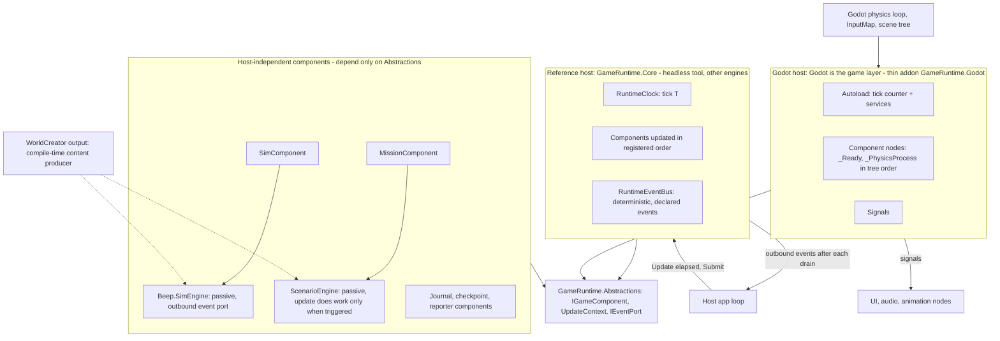

# Runtime layer: one game layer, one clock, components updated in order, events trigger changes

Status: **review and plan only.** Written 2026-10-26 from source reading, revised the same day after seven owner directions. No code, project or solution entry was added, and **no build or test was run** for this document. Counts come from text searches and are approximate. Test counts quoted from the repository's own evidence records are not re-run. NOT RUN is not PASS.

"Scenario manager" in the request is read as `src/ScenarioEngine` (no `ScenarioManager` type exists anywhere in the repo).

## 0. Binding owner requirements

| ID | Requirement (owner's words, condensed) | Where it is met |
| --- | --- | --- |
| R1 | The game layer is **thin: `Init` and `Update`**, with a **clock that works like any game-engine clock**, so Godot or any other engine can host it from its own loop. | 1.1, 1.2 |
| R2 | **SimEngine and ScenarioEngine must not have a clock or a game layer.** | 4 (end state), phases 5–6 |
| R3 | **Both use the same clock, held by the new singleton game layer.** | 1.2, 4 |
| R4 | **Everything is event driven.** | 1.3, 2.4, 5 |
| R5 | **Tests are not a concern.** Existing tests never constrain the design, ordering or scope; anything that depends on a removed member is adapted or retired afterwards. | 7, 9 |
| R6 | **There is no "step".** In `Update` each game component gets updated, and events trigger changes, like Godot. | 1.1, 1.3, 5 |
| R7 | **They must work easily on Godot**, and an engine like Godot *replaces* the game layer. | 1.4, 4, phase 2G |

The mapping to Godot, used throughout: **component ≈ Node**, `Init` ≈ `_ready`, `Update` ≈ `_physics_process` (fixed rate, so it stays deterministic), **event ≈ signal**, singleton ≈ Autoload. R7 turns this from an analogy into a design rule: in Godot, Godot's own physics loop, scene-tree order, signals and Autoload *are* the game layer, so nothing of this plan's clock, loop or event bus is instantiated there. Components and engines are written once against tiny contracts and run unchanged under either host (1.4).

"Game layer" is reserved for `GameRuntime` from now on. In the engines it means the lifecycle host (`SimGame`, `GameBase` and friends) and the pacing code, not their domain rules. Interpretation to note: ScenarioEngine's plugin interface is also *named* `IGameLayer`, which collides with R2; it is a domain-rules plugin, not a lifecycle, so it stays and is renamed late and mechanically (D16).

## 1. Decision in one paragraph

Add one parent layer, working name **`GameRuntime`**, in three parts: tiny engine-neutral **component contracts**, a small **reference host** for hosts that lack an engine loop (headless tool, other engines), and a thin **Godot host** where Godot itself is the game layer (1.4). The layer is the **only** place with an `Init`/`Update` lifecycle and a clock, created once per session (a single injected instance, never a static accessor). Its `Update` earns time from the host and, for each due tick, calls `Update` on every registered **game component** in a fixed order. Components change state when **events** reach them; every interaction between the host, the clock, SimEngine, ScenarioEngine, persistence and diagnostics is a typed, deterministic event, not a call. **SimEngine** (world simulation) and **ScenarioEngine** (mission graph) are wrapped as two components. They contain no pacing, no lifecycle host, no pause and no clock of their own; the layer hands them the tick.

### 1.1 Host contract: thin `Init` / `Update`, and the component model

The layer is something an engine *calls*. It has no main loop, window, rendering, input polling, threads or wall-clock reads. The host (Godot, another engine, a tool) owns the loop; its frame callback is the only thing that drives the layer:

```csharp
public interface IGameRuntime : IDisposable
{
    void Init(RuntimeStart start);                    // once: build and Init every component, publish tick 0
    int  Update(long elapsedMicroseconds);            // engine frame delta; runs the ticks that are due; returns ticks run
    IRuntimeClock Clock { get; }
    RuntimeSnapshot Snapshot { get; }                 // immutable, published once per Update
    IRuntimeEvents Events { get; }                    // outbound events; the host subscribes, never polls
    AdmissionResult Submit(CommandEnvelope command);  // input event; the outcome later arrives as an event
}

public interface IGameComponent                       // the Node of this layer
{
    string Id { get; }
    void Init(in ComponentContext context);           // like _ready: connect to events, receive services
    void Update(in UpdateContext context);            // once per due tick, in registered order; context carries the tick
}

public interface IEventPort                           // the signal of this layer; the only way components talk
{
    void Emit<T>(in T evt) where T : struct;          // queued; delivered after the emitting Update returns
    void Connect<T>(Action<T> handler) where T : struct;   // at Init only
}
```

`IGameComponent`, `UpdateContext`, `ComponentContext`, `IEventPort` and the event declarations live in a tiny `GameRuntime.Abstractions` assembly (`netstandard2.1`) with no clock, loop, bus or Godot reference. Components depend on nothing else from the layer, so any host that can call `Init`, call `Update` with a tick and provide an `IEventPort` can run them (1.4).

A headless tool or fast-forward simply passes more elapsed time to `Update`; there is no second stepping API. Components are registered once at composition with an explicit unique order, the same pattern SimEngine uses for its systems (`AddSystem(system, order)`). The layer repeats, one level up, the shape SimEngine's world already has inside (systems updated in explicit order each tick, plus a declared event bus); it cannot reuse SimEngine's because they are private to a world.

Save/restore and replay are opt-in interfaces (`ICheckpointable`, `IRecordable`) a component may implement; a host that only plays never sees them.

**Singleton means one owner, not a global.** Exactly one `GameRuntime` per session, registered once in the composition root and handed to whoever needs it; no `GameRuntime.Instance` (project rule against hand-rolled service locators). In Godot the natural form is a single Autoload node. A second `Init` or second instance in one composition is refused.

**Frame-rate-dependent work stays in the host engine.** The layer's `Update` is fixed-rate and deterministic. Interpolation, animation and rendering use the host's own `_process` and the clock's `Alpha`.

### 1.2 The one clock

`RuntimeClock` is the only clock and mirrors what engine clocks do (Godot: `Engine.time_scale`, `physics_ticks_per_second`, `max_physics_steps_per_frame`; Unity: fixed timestep, `timeScale`, `maximumDeltaTime`; property names to be checked against the installed Godot version when the adapter is built).

| Clock feature | Behaviour |
| --- | --- |
| Input | The host passes elapsed time. The clock never reads wall time. |
| Output | For each due tick the layer builds an `UpdateContext` (tick `T`, tick duration, alpha) and updates every component with it. The context is the shared clock reading; no component owns a counter that can diverge. |
| Fixed step | A **tick** is the one time coordinate (`T`). Pace comes from the sim time definition's authored `ticks_per_second` / `frame_ticks` (already in SimEngine content, so consumed, not ignored), or from the profile when there is no sim child. |
| Accumulator | Exact integer arithmetic (elapsed × rate × scale against a fixed budget per tick); remainder carried, no drift. |
| Time scale / pause | Rational scale, default 1/1; pause freezes earned time without discarding it. |
| Catch-up cap | Bounded ticks per `Update`; backlog retained; `IsRunningSlowly` set. |
| Alpha | Fraction of the next tick in [0,1) for render interpolation. |
| Timers | Not a clock feature. A component that needs time owns a tick timer (a scheduled tick `T`, checked against its `UpdateContext`) and raises `TimerFired`. They are deterministic tick timers, so Godot's frame-time `Timer` node cannot replace them (a demonstrated gap, not preference). |

**How both engines use the same clock.** Neither engine references `GameRuntime`, so no clock object is passed in; the **tick is passed as an argument** on the engine's update call and each engine refuses a wrong tick without changing anything (ScenarioEngine already does this with `TickInput.Tick`). The sim component and the mission component both receive the same `UpdateContext` on the same tick. Game time is converted by the one `ISimulationTime` of the sim setup, so a scenario deadline authored in game time and a sim duration mean the same instant. ScenarioEngine's hard-coded 50 ms step becomes a value derived from the context.

### 1.3 The event model (Godot-like signals, deterministic)

One event spine, `RuntimeEventBus`, owned by `GameRuntime`. Events are **synchronous, single-threaded and ordered**, because both engines are deterministic and replay must reproduce every run. Event-driven here does not mean asynchronous.

| Rule | Detail |
| --- | --- |
| Declared events (signals) | Every event has an id, a schema version and exactly one owner, declared at composition and frozen before `Init`; a subscriber connects to the exact id and version. This is the Register / Require / Subscribe pattern SimEngine's in-world `EventBus` uses. |
| Events trigger changes | A handler changes its component's own state (queue an observation, flag work, schedule a timer). The component does the resulting work in its next `Update`. Time is never polled: a component reads the tick from its context. |
| Dispatch | An event emitted during a component's `Update` (or during a handler) is queued and dispatched in publication order, to subscribers in connection order, as soon as that `Update` returns and before the next component updates. This is Godot's deferred signal connection, chosen as the default so a handler can never change a component in the middle of its own `Update` (the sim must not be read mid-tick). Handler-emitted events join the same drain. |
| Bounds | A per-drain event budget; exceeding it, or any handler exception, faults the session (fail-stop). Nothing is swallowed. |
| Commands are events | `Submit` queues `CommandSubmitted`. Queued input is dispatched at the start of the next tick, in submission order, stamped with that tick, so results never depend on when between frames the host called `Submit`. Routing, acceptance or refusal and results are later events correlated by command id; the synchronous return value is only the admission acknowledgement. |
| Time is events | A component's tick timer raises `TimerFired(key, T)` (Godot `Timer.timeout`). A mission's time conditions use declared timers. |
| Change, not polling | Facts cross between components as `FactChanged(key, value, T)` only when a value changes. Sampling a value is allowed only inside the adapter that owns the source, and only to *produce* a change event. |
| Outbound events | The host subscribes to a small outbound set and receives them **after** the tick's drain, so host handlers can never re-enter the simulation. In Godot each becomes a signal. |
| Journal | The session journal is the ordered input events (commands, tick counts, timer schedules) plus state-hash events; it reproduces a run without wall-clock data. Replay and persistence (D6) use it. |
| Diagnostics | Log, audit and exceptions are events consumed by the single reporter. A fault calls the reporter directly first, so the failure being recorded cannot depend on the bus that is failing. |

### 1.4 Godot: the engine is the game layer (R7)

Godot already provides everything the reference host provides, natively. The Godot host therefore **does not instantiate** `RuntimeClock`, `RuntimeSession` or `RuntimeEventBus`. It is a thin addon (`GameRuntime.Godot`) whose nodes only translate between Godot and the component contracts, and carry no game rule.

| Concept | Reference host (no engine) | Godot host (Godot replaces it) |
| --- | --- | --- |
| Game layer / singleton | one `GameRuntime` instance | one **Autoload** node that holds the tick counter and the shared services |
| Clock: fixed step, accumulator, catch-up cap, scale, pause | `RuntimeClock` | the physics loop: `Engine.physics_ticks_per_second` (default 60), `max_physics_steps_per_frame` (default 8), `time_scale`, SceneTree pause. **The tick is the count of `_PhysicsProcess` calls, never a sum of `delta`.** The addon sets the physics rate from the sim's authored `ticks_per_second` at startup. |
| `UpdateContext` | built by the session | built by the Autoload from its counter; component nodes read it |
| Components | `IGameComponent` instances in registered order | each component wrapped by a **Node** (`SimComponentNode`, `MissionComponentNode`, …): `_Ready` → `Init`, `_PhysicsProcess` → `Update`. Order is scene-tree order or `process_physics_priority`. |
| Events | `RuntimeEventBus` | **signals**. The node queues what its component emits and, when `Update` returns, emits the Godot signals in publication order, so both hosts deliver in the same order (D17). Handlers are ordinary signal connections, made in code or in the editor's Node dock. |
| Input | `Submit` | `InputMap` action → handler → `CommandSubmitted` |
| Logging / audit | reporter sink | the reporter's sink writes to Godot's logging (`GD.Print`, `GD.PushWarning`, `GD.PushError`) |
| Storage | file store | `FileAccess` under `user://` behind the existing `ISaveStore` |
| Configuration | profile file | a Godot `Resource` (`GameProfile`) whose inspector fields point at the sim content, the mission pack and the seed |
| Authoring | files | nodes registered with `[GlobalClass]` appear in the *Add Node* / *Create Resource* dialogs; `[Export]` fields configure them |

Rules that make a component run unchanged in both hosts:

- It depends only on `GameRuntime.Abstractions` (I13); no threads, wall clock, or static state, because Godot reloads the game assembly when it is rebuilt and static or long-lived registrations can block that (check the installed version's docs; its C# diagnostics page warns that held callables can prevent unloading) (I14).
- Events that cross to a host are **flat**: primitive fields (integers, booleans, strings) plus at most one JSON string. Godot signals take Godot-compatible argument types, so arbitrary C# records cannot cross; the Godot node maps each declared event to one signal mechanically (D21).
- A component is paused with its group: all component nodes share one process/pause group. If one misses a tick, its engine refuses the wrong tick and the session faults (I9), which is the intended fail-stop.

Platform scope (from Godot's C# documentation for 4.2–4.4; recheck for the installed version): desktop (Windows, Linux, macOS) is supported; Android and iOS are experimental; **web export is not available for C# projects**. Desktop is the first target; mobile needs a separate trimming/AOT review of the dependencies (notably `JsonSchema.Net` and logging), and web is out of scope. Godot's .NET projects target .NET 8, so every assembly the Godot host loads must target `net8.0` or `netstandard2.1`; the current `WorldCreator.Godot` project targets `net10.0` and is a separate question this plan does not change.

## 2. What exists today

### 2.1 SimEngine (`src/SimEngine`, assembly `Beep.SimEngine`)

| Aspect | Observed (file) |
| --- | --- |
| Size / target | ≈73K lines in 457 files; `netstandard2.1`, `LangVersion 9`, nullable off, **zero package references**, warnings as errors. 297 files / 51.6K lines are `Standard/` gameplay modules. |
| Model | Deterministic fixed-tick world. `GameModule` composes systems, services, commands, events, map layers, view features, world-gen stages. Each tick runs commands → scheduled systems (explicit order) → events → entity updates inside `World`. Fixed-point `Fix`, own `DetRandom`. Already Godot-shaped internally. |
| Host surface | `SimGame`: `Initialize`, `Update()`/`Update(µs)`, `RunTicks(n)` (ignores pace and pause), `Save`, `Hash`, `RecordReplay`, `StartLockstep`, `Updated`. `PlayerSeat`: `Submit`, `Preview`, `ReadResults`, `ReadNotifications`. `PlayerView.Feature<T>()` read models, `Observer`, entity-delta `GameSnapshot`. `World` is internal to `SimGame`. |
| Input | Typed `Command` classes registered by modules; sequence per seat and producer stream. The host can only use the `Player` stream. |
| Failure | No tick rollback. First exception latches `WorldFault`; the game stops. |
| Persistence | Binary save, strict `EngineInfo.Build = "beep-simengine-2.782.0"`, `SaveFormat = 166`, content fingerprint, **no migration**. |
| Own objectives | `ObjectiveModule`, `GameConditionsModule`, `ScenarioPressureModule`; `OutcomeObjectiveEffectDef` ends the world. |
| Health | Own `AGENTS.md`/tracker; plan P7.019 open. The OilFieldDays consumer cannot be verified here (fixtures absent). |

### 2.2 ScenarioEngine (`src/ScenarioEngine`)

| Aspect | Observed |
| --- | --- |
| Size / target | ≈2.0K lines in six libraries + Counter sample + headless simulator; `net8.0`, `LangVersion 12`, nullable on, `JsonSchema.Net`, central package versions. |
| Model | `IScenarioSimulation` (`Enqueue`, `Start`, `Pause`, `Resume`, `Step`) under `GameBase` (`Init`/`Update`). A domain is a registered `IGameLayer` whose `ILayerRuntime` is a *pure* function previous-snapshot → candidate-snapshot (JSON). The engine owns the commit: objective graph, typed fact conditions, priority endings, once-only effect keys, receipts, PCG32 streams, SHA-256 hash. |
| Edges | In: `CommandEnvelope` and `WorldFrame` observations (strict +1 sequence, schema-checked). Out: `EventEnvelope`s and `WorldRequest`s that take effect *after* the tick. |
| Constraints | `ProjectFacts` must equal the layer's registered fact set exactly. Step context is a hard-coded 50 ms. Ticks must be strictly consecutive. Static objective graph; an ending closes the session. Every update recomputes the full SHA-256 state hash. |
| Failure | Unexpected exception → `Faulted`, last committed snapshot retained; clean refusals leave state untouched. |
| Persistence | `SessionSnapshot` JSON in `SaveDocument` format 1, atomic store with previous-generation recovery, portable replay tape. |
| Not built | Godot host, Lost Soldier layer, and all **14 proposed game layers + 14 shared extensions** (SDD only). |

### 2.3 What must leave each engine (R2)

| | SimEngine | ScenarioEngine |
| --- | --- | --- |
| **Clock / pacing** | `Hosting/GameClock.cs` (161 lines: speed, pause, catch-up, alpha, accumulator, saved step index); `Core/GameClockContracts.cs` (`IGameClock` incl. `Paused`, `Speed`); sequenced pause/speed inside `Hosting/Lockstep.cs`; pause/speed comparison in `Kernel/EntityObservation.cs`; `World` owns the clock; authored `frame_ticks`/`ticks_per_second` in the time definition. | None. Only the hard-coded 50 ms `FixedStep` (`ScenarioEngine.cs:201`, `Simulation.cs:29`). |
| **Game layer (lifecycle host)** | `Hosting/SimGame.cs` (423: `Initialize`, `Update`, `Updated`, `GameState` with `Paused`/`Stalled`), `Hosting/GameCycle.cs` (`IGameCycle`, `GameUpdate`), `Hosting/GameFactory.cs` (164), and the whole `App/` folder (622 lines: an XNA-style `SimApp` with scenes, components, input map and presenter). | `GameBase.cs` (60), `GameFactory.cs` (19), `IGame`/`IGameFactory`/`GameStart` in `Simulation.cs`, plus `Start`/`Pause`/`Resume` and `SessionPhase.Ready`/`Paused`. |
| **Stays** | `Core/GameTime.cs` (`ISimulationTime`: quantum and calendar conversion); the saved tick counter as plain state; seats, views, snapshots; replay; the deterministic tick work. | `Enqueue`, `CancelQueued`, the commit, objectives/endings, save/replay codecs. |

The engines keep a plain per-tick **update entry that takes the tick from outside**; that is what the layer's components call. What goes is the clock, the pacing, the lifecycle host and its state machine.

In SimEngine, 8 source files mention `SimGame`; the rest of the footprint is consumers. By R5, consumers (existing tests, the `Beep.SimEngine.Testing` kit, the external OilFieldDays suite) are adapted or retired after the engine change and do not shape it. `InternalsVisibleTo` is limited to `Beep.SimEngine.Tests`; the runtime uses public contracts only.

### 2.4 Event readiness of each engine (R4)

| | SimEngine | ScenarioEngine |
| --- | --- | --- |
| **Publishes to a host today** | Little. Only **6** in-world events are declared (`sim.structure-built`, `sim.structure-removed`, `sim.entity-transformed`, `sim.entity-replaced`, a resource-flow fact, a business-sale fact). Module code handles them, and **an event with no handler is dropped**. The host sees: the command-result feed, the notification feed (only ≈13 `Notify` call sites), entity spawn/change/remove deltas in `GameSnapshot`, and cursor-based spatial region change feeds. Everything else (cash, stock, technology, objective state) is *state* readable only through view read models. | Already event-shaped on both edges: commands and observations in; `EventEnvelope`s (`core.objective_changed`, `core.ending_reached`, …) and `WorldRequest`s out. |
| **Reacts to events** | Internally yes (module `EventBus`, commands). Not as a host-driven component. | Not yet. It re-evaluates its graph and recomputes its hash on every consecutive tick even when nothing arrived. |
| **Gap to close** | A host-visible **outbound event port** and change events for the values a mission watches (D19). | An update that does work only when something triggered it (D18). |

## 3. Review findings

### 3.1 Overlap and mismatch matrix

| Capability | SimEngine | ScenarioEngine | Resolution |
| --- | --- | --- | --- |
| **Clock / tick** | `GameClock`: rational quantum, pacing | integer tick, fixed 50 ms | One clock in `GameRuntime`; both receive the context (1.2). |
| **Lifecycle (Init/Update)** | `SimGame` + `IGameCycle` + `SimApp` | `GameBase` + `IGame` | One `IGameRuntime` and `IGameComponent` (1.1). |
| **Events** | in-world bus, mostly invisible to a host | event stream out, observations in | One event spine; Sim gets an outbound port (D19). |
| Objectives / conditions / endings | `ObjectiveModule`, `GameConditions`, `World.End` | session objective graph, endings | True overlap; D1. |
| Commands | typed C# classes, seat + stream | JSON envelope, string controller, receipts | Routed as events; no shared type. |
| Save / replay / hash / RNG | binary strict build / tape / 64-bit / `DetRandom` | JSON snapshot / tape / SHA-256 / PCG32 | Composite manifest embeds both unchanged (D6); seeds derived (D7). |
| Content | module-keyed defs + fingerprint | JSON packs + schema + digest | Profile pins both identities. |
| Diagnostics | `WorldFault`, no logger | `IEngineReporter`, audit | Events into one reporter. |
| Visibility | per-seat `PlayerView` | none yet | D8. |
| Name | "scenario" = setup | "scenario" = mission | D3. |
| Framework | netstandard2.1 / C# 9 | net8.0 / C# 12 | Parent ≥ net8.0. |

### 3.2 ScenarioEngine's proposed layers duplicate SimEngine

The SDD proposes shared extensions `resource-transactions`, `activity-instances`, `logical-time`, `persistent-world`, `player-queries`, `checkpoint-history`, `generation-scale` and `multiplayer-authority`, and game layers such as `factory-economy` and `colony`. By file inventory and spot reads, SimEngine already contains substantially overlapping implementations: resource lots, reservations and transactions; work plans and recurring activities; calendar time; spatial layers; `PlayerView` + `Preview`; save, hash and replay; world-gen stages; lockstep; a tycoon economy. Coverage of `institution-management`, `rts` and `multiplayer-authority` is only partial. Building the full proposals as written would create a second owner of each fact (global rule 3).

**Rule:** a ScenarioEngine proposal whose domain SimEngine already covers is *not built as a second engine*; it becomes profile/adapter work in `GameRuntime`. Proposals SimEngine does not cover (`narrative-interactions`, `progression-scopes`, `play-contexts`, campaign RPG, roguelite, deckbuilding) stay ScenarioEngine-side. A package-by-package overlap map is a phase 0 deliverable, because this rests on a file-level survey. Nothing is deleted.

### 3.3 Options considered

| Option | Verdict |
| --- | --- |
| A. Keep independent; glue per game | Leaves two clocks, two lifecycles and no common events. Rejected (R2–R4). |
| B1. Scenario inside SimEngine | Loses the portable JSON/replay/Godot-world contract; every change bumps SimEngine's build id. Rejected. |
| B2. Sim as a ScenarioEngine domain plugin | Immutable JSON snapshot copied per tick vs a mutable 52K-line world. Rejected. |
| C. ScenarioEngine treats SimEngine as its "native world", no parent | Right data flow, but no owner for clock, lifecycle, events, save/replay, diagnostics. Adopted as the data-flow model **inside** D. |
| **D. Parent `GameRuntime`, engines wrapped as components, one event spine** | **Chosen.** Meets R1–R4 and R6. |

## 4. Target architecture

End state (after phase 6):



**GameRuntime owns only cross-cutting concerns:** the component contracts (1.1), and, in the reference host, the clock (1.2), the component order and the event spine (5); in every host, command routing and correlation, the observation-sequence counter ScenarioEngine demands, journal/checkpoint/tape/hash components, child fault policy, profile validation (exact identities of both children), one reporter path. **It must not own** any game rule, fact catalog, objective, resource, economy or map concept, and in Godot it owns **no** clock, loop or bus.

**Passive engines (end state).** SimEngine keeps seats/`Submit`, views, snapshots, `Save`/`Hash`, replay, a per-tick update entry that takes the tick from outside, and gains an **outbound event port**; it has no `Updated`, `Clock` pacing, `IGameCycle`, `GameState.Paused`, or `App/` shell. ScenarioEngine keeps `Enqueue`, `CancelQueued`, its per-tick update entry (renamed from `Step`) and its codecs; no `GameBase`, `IGame`, `IGameFactory`, `Start`, `Pause` or `Resume`. Pausing is simply not updating.

**Interim state (phases 1–4).** `GameRuntime` is built first against the engines' existing public methods (`SimGame.RunTicks`, `IScenarioSimulation.Step`) and existing feeds, inside the two components. The engines' own clocks and lifecycles still exist but a runtime session never uses them. This order is chosen so each member is removed only when the runtime has demonstrably replaced it with working code (no half-removed state), not because of tests (R5).

**Exchange vocabulary:** reuse `ScenarioEngine.Contracts` DTOs (`FactValue`, `WorldObservation`/`WorldFrame`, `WorldRequest`, `CommandEnvelope`, `EventEnvelope`, `ValidationReport`, `IEngineReporter`, `INotificationSink`) as event payloads instead of a third set (rule 3). Add only what is missing: child identity, journal and checkpoint records.

**Projects (proposed; central packages as ScenarioEngine):**

| Project | Target | Holds |
| --- | --- | --- |
| `GameRuntime.Abstractions` | `netstandard2.1` | `IGameComponent`, `UpdateContext`, `ComponentContext`, `IEventPort`, event declarations, the tick-timer helper. No clock, loop, bus or Godot reference. |
| `GameRuntime.Sim` | `net8.0` (references `Beep.SimEngine`) | `SimComponent`, `SimEventPort`, `SimEffectDispatcher`, bridge module |
| `GameRuntime.Scenario` | `net8.0` | `MissionComponent` |
| `GameRuntime.Services` | `net8.0` | `CommandRouter`, journal, checkpoint, replay and reporter components |
| `GameRuntime.Core` | `net8.0` | the reference host: `RuntimeSession`, `RuntimeClock`, `RuntimeEventBus` |
| `GameRuntime.Godot` | `net8.0` (Godot .NET) | the addon: Autoload, component nodes, signal mapping, `GameProfile` resource |
| headless tool | `net8.0` | drives the reference host |

Placement `src/GameRuntime/`, solution folder `/GameRuntime/`. Components reference only `Abstractions` plus their engine (I13).

### 4.1 One responsible class per capability

| Capability | Owner class | Variants |
| --- | --- | --- |
| Session lifecycle + component order (`IGameRuntime`) | `RuntimeSession` (partial files by concern) | none |
| Session clock (`IRuntimeClock`), reference host only | `RuntimeClock` | none; the only pacing implementation in the solution; not instantiated in Godot |
| Godot host | the `GameRuntime.Godot` Autoload and component nodes | one node class per component, translation only |
| Event delivery (`IEventPort`) | `RuntimeEventBus` in the reference host; Godot signals in the Godot host | one implementation per host, same delivery order (D17) |
| Sim engine as a component | `SimComponent` | none |
| Sim events/facts → spine | `SimEventPort` (inside the Sim adapter) | one source class per event source: notification feed, command results, snapshot deltas, region changes, forwarded in-world events, change probes |
| Mission engine as a component | `MissionComponent` | none |
| Mission requests → sim effects | `SimEffectDispatcher` | one `IDirectorEffect` class per effect type |
| Command routing | `CommandRouter` | none |
| Journal / checkpoint | `SessionJournal`, `CompositeCheckpointService` | uses the existing `ISaveStore` / `IRecoverableSaveStore` |
| Replay | `CompositeReplayService` | wraps the existing `IReplayService` and `IReplayRecorder` |
| Diagnostics | the existing `ApplicationDiagnostics` | extended, not duplicated |

## 5. The update loop and the event catalog

This is the **reference host's** loop. Godot performs the same sequence natively: its physics loop raises each tick, scene-tree order updates the component nodes, and the nodes emit signals after each component's `Update` returns (1.4).

```text
Update(elapsed):
  ticks = clock.Earn(elapsed)                       // bounded by the catch-up cap
  repeat ticks times, stopping at once on fault or ending:
      T = clock.Advance(); context = (T, tick duration, alpha)
      dispatch queued input events (submitted commands) in submission order
      fire timers due at T (TimerFired)
      for each component in registered order:       // Sim, then Mission, then journal/snapshot
          component.Update(context)
          drain events it emitted, to subscribers, in publication order
  publish one snapshot; deliver outbound events to the host
```

After every tick each component checks that its engine's tick equals `T`; a violation faults the session. The component order is fixed by the profile.

| Event | Producer | Subscribers (connection order) | Notes |
| --- | --- | --- | --- |
| `CommandSubmitted` | `IGameRuntime.Submit` | `CommandRouter` | Admission result returned synchronously; the outcome is a later event. |
| `SimCommandRequested` / `MissionCommandRequested` | `CommandRouter` | `SimComponent` / `MissionComponent` | Routed by operation namespace; translated to the engine's own command type; acted on in the component's next `Update`. |
| `TimerFired(key, T)` | the component that owns the timer (usually `MissionComponent`) | any component | Deterministic tick timers, including a mission's declared heartbeat. |
| `SimHappened(kind, payload)` | `SimEventPort` | `MissionComponent`, journal | From the notification feed, command results, snapshot deltas, region changes and forwarded in-world events. |
| `FactChanged(key, value, T)` | `SimEventPort` | `MissionComponent` | Only on change; `Fix`→integer with the binding's declared scale and rounding. |
| `MissionEvent` | `MissionComponent` (from `EventEnvelope`) | host (outbound), journal, reporter | Objective changes, endings. |
| `EffectRequested(kind, payload)` | `MissionComponent` (from `WorldRequest`) | `SimEffectDispatcher` for `sim.*`; host (outbound) for `host.*` | Reaches the sim on the **next** tick (once-only effect keys already exist). |
| `CommandResolved(id, engine, code)` | components | host (outbound), journal | Correlated receipt. |
| `TickSettled(T)` | `RuntimeSession` | journal, snapshot publisher | Last event of the tick. |
| `SessionEnded` / `SessionFaulted` | `RuntimeSession` | host (outbound), reporter | A fault calls the reporter directly first. |
| `Diagnostic` / `Audit` | any component | reporter | One log/audit/exception service. |

**How the mission component works (D18).** Its handlers only record what arrived (observations from `FactChanged`/`SimHappened`, commands, timers) into its inbox. Its `Update` hands the inbox to the engine; the engine does work only when something is pending. The mission component never reads the sim to find out whether something changed.

Failure policy (decided): **fail-stop.** SimEngine cannot roll a tick back and ScenarioEngine can, so the runtime never tries to un-run one engine. Any engine fault, handler exception, budget overflow, or a mission refusal after the sim already updated faults the session once, reports through the reporter, and recovery is restore-from-last-checkpoint. Observations are built by the trusted adapter, so a refusal is a defect, not an input case.

## 6. Decisions (researched and decided, with source basis)

| ID | Decision | Basis |
| --- | --- | --- |
| D1 | When a mission component is present it owns the **session** objectives and ending. SimEngine's objective module stays sim-internal and its states plus `World.Outcome` surface as events/facts. A sim outcome without a declared mission ending faults with the existing `ENDING_UNCOVERED`. | Ownership rule 3/6; ScenarioEngine SDD §9. Neither module is removed. |
| D2 | **One session clock, one tick coordinate** (1.2). Pace from the sim time definition's authored fields; durations through the sim setup's `ISimulationTime`; ScenarioEngine's 50 ms constant becomes a value derived from the context. | R3; SimEngine's "sole clock" rule at session level. |
| D3 | Vocabulary: **game profile** (parent), **sim setup** (SimEngine's "scenario"), **mission** (ScenarioEngine's "scenario"). Doc change only. | Name collision. |
| D4 | Reuse `ScenarioEngine.Contracts` as event payload vocabulary. | Global rule 3. |
| D5 | Sim-to-mission data uses the event sources in 2.4, in this order of preference: (1) events and feeds the sim already emits, (2) module change events added in phase 6, (3) change probes owned by the Sim adapter, evaluated once per tick and publishing only on change. A fact whose only source is (3) is listed in the profile so the remaining polling is explicit and shrinks as (2) lands. | R4; SimEngine publishes little to a host today. |
| D6 | The checkpoint embeds each engine's native bytes **unchanged** in one manifest (identities, tick, hashes, SHA-256), stored through the existing atomic store with previous-generation recovery; restore refuses on any mismatch; no migration is invented. The journal is the ordered input events plus state hashes. | SimEngine "no migration by design"; ScenarioEngine recovery contract. |
| D7 | One session seed; each engine's seed derived by a documented SHA-256 derivation of (session seed, engine id). RNG streams never shared. | Avoids correlated streams. |
| D8 | The director reads omniscient state; **nothing derived from it is shown to a player** until a visibility contract exists. | `player-queries` is design-only. |
| D9 | Director effects enter SimEngine as ordinary commands on the `Player` stream via the target seat, from a bridge `GameModule` in `GameRuntime.Sim` (public contracts only). Each carries a one-shot ticket; an unticketed bridge command is refused. Lockstep sessions are refused with an explicit diagnostic in v1. | Prevents forged director effects; recorded by SimEngine's replay path. |
| D10 | New projects target net8.0/C# 12. `Beep.SimEngine` and `ScenarioEngine.*` never reference `GameRuntime`. | Existing independence audits. |
| D11 | **Order of work: prove the runtime on the real engines first, then remove the engines' clocks and lifecycles.** Each removal is final (no deprecated shim) and happens once the runtime has replaced that member with working code. SimEngine changes follow its own process (tracker entry, `EngineInfo.Build` bump; a bump invalidates existing saves, as any SimEngine build change already does). | R2, R5; no half-removed state. |
| D12 | ScenarioEngine proposals that SimEngine covers are not implemented as engines (3.2). | Rule 3. |
| D13 | Host-facing contract is `IGameRuntime` only; checkpoint and replay are opt-in. No loop, wall clock, rendering, input polling or thread in the layer. | R1; Godot owns presentation, input, scheduling. |
| D14 | **Singleton = one owner, injected.** No static accessor. In Godot the singleton is one Autoload node, which also avoids static state across editor assembly reloads. | R3; no hand-rolled service locator; Godot Autoload. |
| D15 | **Relocate, don't destroy.** The `SimApp` shell (`App/`, 622 lines) is relocated to an optional runtime-side app shell or retired once nothing uses it. Lockstep's *input exchange and desync detection* stay in SimEngine; only its **clock-action sequencing** (pause/speed) leaves and is re-homed in the runtime when multiplayer is built. | Rule 6: investigate before deleting. |
| D16 | "Game layer" is reserved for `GameRuntime`. ScenarioEngine's `IGameLayer`/`ILayerRuntime`/`GameLayerRegistry` are renamed in code only (for example `IScenarioDomain`), late; persisted names (`layerId`, `layerVersion`) are unchanged because renaming them is a content/save format change. | Removes the R2 name collision at low cost. |
| D17 | **One event contract, two implementations** (1.3, 1.4): deterministic, synchronous, declared, ordered, bounded, delivered after the emitting component's `Update` returns, through `IEventPort`. The reference host implements it with `RuntimeEventBus`; the Godot host implements it with Godot signals emitted by the component node in the same order. It does not replace SimEngine's in-world bus. | R4, R6, R7; Godot signals; SimEngine's `EventBus` pattern. |
| D18 | **Every component is updated every tick; work happens only when triggered.** ScenarioEngine's update becomes inbox-driven: it evaluates the objective graph and recomputes its state hash only when commands, observations or timers are pending, and otherwise just records the tick. Ticks stay strictly consecutive (no gap handling), and time conditions become declared timers. Part of phase 5. | R6; Godot components that act on signals; removes the per-tick SHA-256. |
| D19 | **SimEngine gets an outbound event port** in phase 6: modules' declared events are delivered to a host-supplied sink (instead of being dropped when unhandled), and modules that own values a mission watches (cash, stock, technology, objective state) publish change events at the point of mutation. Until then the Sim adapter uses D5 (1)–(3). | R4; the gap in 2.4. |
| D20 | **Godot replaces the game layer.** In Godot none of `RuntimeClock`, `RuntimeSession` or `RuntimeEventBus` is instantiated: the Autoload holds the tick counter, component nodes are updated by the physics loop in tree order, and signals carry events. The reference host stays small (clock, ordered loop, bus) and exists only for hosts without these facilities. | R7; Godot-native-features standing rule: do not rebuild what Godot provides. |
| D21 | **Events that reach a host are flat**: primitive fields plus at most one JSON string, so one declared event maps mechanically to one Godot signal. Rich DTOs (`EventEnvelope`, `WorldRequest`) stay inside components or travel as the JSON string. | Godot signal argument types; R7. |
| D22 | **The tick in Godot is the count of physics callbacks.** The addon sets `Engine.physics_ticks_per_second` from the sim's authored pace at startup and never sums `delta`. Components check the tick they are given (I9). Heavy sims are bounded by `max_physics_steps_per_frame` (default 8) and slow the game down rather than spiralling; the per-tick cost of SimEngine is measured in phase 0. | R3, R7; Godot `Engine` reference. |
| D23 | **One Godot host owner.** ScenarioEngine's proposed `native-godot-host` package (`ScenarioGameHost`, with a 0.05 s physics `Timer` driving ticks) is folded into `GameRuntime.Godot` when phase 2G starts: tick driving comes from the physics callback (D22), and that package's native-world work (physics observations, perception, navigation, input mapping) becomes further components behind the same contracts. Its SDD is updated then, not now. | Rule 3: two Godot hosts would be two owners of one fact. |

## 7. Phased plan

Each phase is done when its listed outcome is observable. Per R5 there is no test schedule or test gate; verification, when implementation starts, is whatever focused check the engine owner's standing rules require, and it does not change the order or scope below.

| Phase | Deliverable | Done when |
| --- | --- | --- |
| **0 Baseline** | Record engine identities (`beep-simengine-2.782.0`, SaveFormat 166, ScenarioEngine contract set); package-by-package overlap map of the 28 ScenarioEngine SDD packages against SimEngine (3.2); survey of exactly which sim values and happenings a first mission needs and which event source (D5 tier) each has; measure what `RunTicks` costs per call (it publishes snapshots every call). **Godot spike (R7):** pick the installed Godot .NET version and confirm its target framework; load `Beep.SimEngine`, `ScenarioEngine.*` and their dependencies (`JsonSchema.Net`, logging) in a throwaway Godot .NET project; check editor assembly reload with a registered Autoload; measure one SimEngine tick against the 1/60 s physics budget and against the authored pace. | Every SDD package marked covered / partial / ScenarioEngine-only with a cited SimEngine source; every mission fact has a named tier; the Godot version, target framework, load result and per-tick cost are written down, with any blocker named. |
| **1 Runtime core** | `GameRuntime.Abstractions` (`IGameComponent`, `UpdateContext`, `IEventPort`, event declarations); the reference host `GameRuntime.Core` (`IGameRuntime`, `RuntimeClock`, `RuntimeEventBus`, `RuntimeSession`); `SimComponent` and `MissionComponent` on the engines' existing methods. A small demonstration game lives with the headless tool. | The same total elapsed time delivered in different frame sizes gives the same tick sequence and event order; pause, resume and cap behave as 1.2; `Update` before `Init`, a second `Init` or use after dispose is refused; a handler exception or budget overflow faults once with one reported cause. |
| **2 Sim events and effects** | `SimEventPort` sources on existing feeds and a forwarding bridge module; declared fact bindings with explicit `Fix`→integer scale and rounding; `CommandRouter`; `SimEffectDispatcher` with `IDirectorEffect` classes and tickets (D9). | A sim value crossing a threshold produces `FactChanged`, completes an objective and records the ending **once**; an unticketed bridge command is refused; one correlated `CommandResolved` per command whichever engine refused it. |
| **2G Godot host (early, R7)** | `GameRuntime.Godot` addon: Autoload, `SimComponentNode`, `MissionComponentNode`, signal mapping for the declared events (D21), `GameProfile` resource, Godot-logging sink, `FileAccess`-backed store, `InputMap` → `Submit`; physics rate set from the sim's authored pace (D22). Nodes registered with `[GlobalClass]`; a sample scene shows the nodes in tree order with an editor-connected signal to a UI node. | In a Godot project a developer adds the addon, drops the two nodes into a scene, assigns a `GameProfile`, and a mission completes from sim facts with signals reaching a `Label`; the same components produce the same event sequence under the reference host. **NOT RUN until built.** Needs Godot runtime evidence; no claim from the standalone tool. |
| **3 Journal, checkpoint, replay** | `SessionJournal`, `CompositeCheckpointService`, `CompositeReplayService`, strict identity refusal. | Save mid-run, restore, continue gives the same event sequence and state hash as the uninterrupted run; every mismatched identity is refused with its own code; replay names the first divergent event and tick. |
| **4 Diagnostics and audit** | One reporter: sim `WorldFault` and every catch go through it; audit for session start, ending, restore, fault. | No empty catch and no throwing default arm in new code; a fault yields a referenced durable record; with the sink down it degrades to the log line and says so. |
| **5 Extract from ScenarioEngine** | Remove `GameBase`, `IGame`, `IGameFactory`, `GameFactory`, `GameStart`, `Start`/`Pause`/`Resume`, `SessionPhase.Ready`/`Paused`; rename `Step` to the component update entry; make the update inbox-driven (D18) with the state hash computed only on change or on request; take step duration from the supplied context; bump the snapshot and replay-tape format versions and refuse old formats with an explicit code. `MissionComponent` replaces each removed member. | ScenarioEngine has no lifecycle host; an idle tick does no evaluation and no hashing; an old-format tape or snapshot is refused explicitly. |
| **6 Extract from SimEngine** | A per-tick update entry that takes the tick from outside and refuses a wrong tick without mutating; `GameClock` reduced to the saved tick counter; remove `IGameCycle`, `GameUpdate`, `Updated`, `GameState.Paused`/`Stalled` as lifecycle states, the pause/speed comparison in `EntityObservation`, and lockstep clock-action sequencing (D15); `GameFactory` builds a passive simulation; `App/` relocated (D15); outbound event port and module change events (D19); authored pace exposed read-only so the reference clock and the Godot addon read the same pace. SimEngine tracker entry and `EngineInfo.Build` bump. | SimEngine has no clock or lifecycle host; the runtime session runs unchanged; every phase 0 mission fact that had a polling probe has an event source or stays listed as a probe. |
| **7 Second consumer** | An unrelated demonstration game (different facts, timer-driven mission) through the same core. | No edit to `GameRuntime.Core` was needed. |
| **8 Native-world components (Godot)** | The work of ScenarioEngine's `native-godot-host` SDD (D23) as further components behind the same contracts: physical observations (collision, perception, navigation arrival) enter as `WorldFrame` observations; scene composition from approved scene roles; presentation stays in Godot nodes, animation and audio. | **NOT RUN until built.** Gated on phase 2G and Godot runtime evidence. |
| **9 Rename** | D16 mechanical rename and doc terminology. | Persisted field names unchanged. |
| **10 Content producers** | WorldCreator output compiles to sim setup content and mission zones/anchors. | Gated on the WorldCreator staged master plan; not started here. |

Out of scope with explicit refusals: lockstep/multiplayer, persistent regions and zone transitions (`core.change_zone`), player-visible director data (D8), GameArts or visual work, any Godot acceptance claim.

## 8. Invariants

Design rules that hold at every phase; how each is enforced is decided when it is implemented.

| ID | Invariant |
| --- | --- |
| I1 | `Beep.SimEngine` and `ScenarioEngine.*` never reference `GameRuntime.*`; `GameRuntime.Core` references no concrete engine or game. |
| I2 | No game-specific fact, effect or module name appears in `GameRuntime.Core`. |
| I3 | Every `catch` reports through the single reporter; no switch has a throwing or `_ =>` default arm. |
| I4 | Same profile, seed and input events produce the same event order and state hashes. |
| I5 | The same total elapsed time split into different frame sizes (under the cap) gives the same tick sequence. |
| I6 | In a runtime session nothing calls an engine's own pacing or lifecycle; `GameRuntime.Core` reads no wall clock, starts no thread, references no rendering or input. |
| I7 | After phases 5 and 6 the engines contain no clock, accumulator, pause/speed, `Updated` event or lifecycle state machine (`IGameCycle`, `GameBase`, `IGame`). A plain update entry that takes the tick from outside is allowed. |
| I8 | Exactly one pacing implementation and one `IRuntimeClock` exist in the reference host; in Godot none is instantiated (the physics loop is the clock). No static accessor to the runtime; `Init` succeeds once. |
| I13 | A component references only `GameRuntime.Abstractions` and its own engine, never `GameRuntime.Core` or `GameRuntime.Godot`; so any host that provides `Init`, `Update(tick)` and an `IEventPort` can run it. |
| I14 | A component starts no threads, reads no wall clock and holds no static state or long-lived registrations (Godot reloads the game assembly on rebuild). |
| I15 | An event that reaches a host has only primitive fields plus at most one JSON string (D21). |
| I16 | `GameRuntime.Godot` contains no game rule and no copy of the clock, loop or bus; every Godot behavior it uses (`Engine` properties, `InputMap`, `FileAccess`, logging, signals) is Godot's own. |
| I9 | An engine given a tick other than the expected one refuses without mutating state. |
| I10 | No component reads another component's state to learn about a change; it receives the event. Change probes (D5 tier 3) live only inside the adapter that owns the source and only publish on change. |
| I11 | Host handlers never run during a drain; the host cannot re-enter the simulation from an event callback. |
| I12 | A handler changes only its own component's state; the resulting work happens in that component's `Update`. |

## 9. Risks and mitigations

| Risk | Mitigation |
| --- | --- |
| Event order or cascades make runs non-deterministic or unbounded | Synchronous single-threaded spine; connection order fixed at composition; per-drain budget faults the session; journal records input events. |
| SimEngine publishes little to a host (2.4) | D5 tiers keep early phases possible; D19 adds the port and module change events; the profile lists which facts still rely on probes. |
| Hidden coupling through events | Events are declared contracts with owner, id and schema version; a subscriber connects to the exact version; unused or unowned events are rejected at composition freeze. |
| Every SimEngine source change bumps the build id and invalidates saves (no migration by design) | One bump per landed stage, recorded in its tracker; checkpoints embed the build id and refuse mismatches explicitly. |
| SimEngine is moving (build 2.782, open plan P7.019) | Adapter pins the exact build id; coordinate phase 6 with its tracker. |
| External consumer OilFieldDays uses the removed lifecycle and cannot be verified here | Write the required migration note in phase 6; do not keep a shim (D11). |
| No sim tick rollback | Fail-stop plus checkpoint cadence; measure real save cost in phases 0 and 3. |
| Per-call snapshot publication in `RunTicks` is costly at high tick rates | Measured in phase 0; removed as an interim cost when SimEngine becomes passive in phase 6. |
| ScenarioEngine format changes (no `Ready`/`Paused`, lazy hash, step duration) break old snapshots and tapes | Version bumps with explicit refusal; no silent upgrade. |
| Static fact catalog per domain (`ProjectFacts` must equal the registered set) | One thin bridge domain per game with its declared catalog; a content-driven capability hook deferred until a second game demands it. |
| Hidden-information leak | D8. |
| Duplicate-engine drift (3.2) | D12 plus a review note in the ScenarioEngine SDD index when work starts. |
| Godot loads only .NET 8 assemblies; `WorldCreator.Godot` currently targets `net10.0`; repo SDK is 10.0.402 | Every assembly the Godot host loads targets `net8.0` or `netstandard2.1` (table in 4); phase 0 confirms the installed Godot's framework before any code; `WorldCreator.Godot`'s target is a separate decision. |
| Godot physics rate is project-wide; a heavy SimEngine tick at 60 Hz cannot keep up (its own tracker records very long simulated days) | D22: set the physics rate from the sim's authored pace; `max_physics_steps_per_frame` bounds catch-up so the game slows instead of spiralling; per-tick cost measured in phase 0; a worker-thread sim with snapshot hand-off is a possible later design, not assumed. |
| Godot reloads the game assembly on rebuild; statics and held callables can block unloading | I14: no statics, Autoload as the singleton, handlers released in `_ExitTree`; phase 0 spike checks it on the installed version. |
| Mobile and web | Godot C# has no web export and mobile is experimental (1.4); desktop first; mobile needs a trimming/AOT review of `JsonSchema.Net` and logging. |
| Godot signals cannot carry arbitrary C# records | D21: flat events; mechanical signal mapping. |
| Two Godot hosts (this addon and ScenarioEngine's proposed `ScenarioGameHost`) | D23: fold into one when phase 2G starts. |
| Working tree has ~1,000 uncommitted changes unrelated to this plan | This document is the only file added or changed; nothing else was edited, staged or committed. |

## 10. Precedents consulted (2026-10-26, standard search; limits stated)

- Left 4 Dead's AI Director controls spawns, pacing, audio cues and item drops from the state of play; Mike Booth's GDC 2009 talk "From Counter-Strike to Left 4 Dead: Creating Replayable Cooperative Experiences" (title as reported by the search summary of a [GDC news page](https://www.gdconf.com/news/gdc_2009_adds_noby_noby_level), which I did not open; [Shacknews coverage](https://www.shacknews.com/article/57892/left-4-dead-at-gdc) likewise from search results only). Adopt: a director that *reads* simulation happenings and *requests* changes, never mutates simulation internals. I could not confirm the "intensity" metric, so none is assumed.
- RimWorld's storyteller is documented as modelled on that Director and chooses incidents from the colony's situation ([RimWorld Wiki](https://rimworldwiki.com/wiki/About_RimWorld)); modders report an incident's `CanFireNow` check is called before firing (anecdotal Steam Workshop log). Adopt: pre-fire guards; avoid: a throwing check halting all queued incidents, which supports fail-stop reporting over silent skipping.
- Bevy documents that systems without explicit ordering may run in varying order, so ordering must be declared (older example, API since changed; check current docs). Adopt: component and handler order are fixed at composition.
- Engine clocks (Godot, Unity) are one host-owned fixed-timestep clock with scale, pause and a catch-up cap that subsystems consume rather than each owning one; this is the model for R3. Godot's [`Engine` reference](https://docs.godotengine.org/en/latest/classes/class_engine.html) (seen only through search results) lists `physics_ticks_per_second` (60), `max_physics_steps_per_frame` (8) and `time_scale` (1.0) and says that when more ticks are needed than the cap allows the project slows down; this underpins D22. Godot's node model (`_ready`, `_physics_process`, signals with an optional deferred connection, `Timer.timeout`) is the model for R6 and D17; I did not open the signals page, so connection-flag behavior must be checked against the installed version.
- Godot's [C# documentation](https://docs.godotengine.org/en/4.4/tutorials/scripting/c_sharp/) (4.2–4.4, via search results): desktop supported, Android and iOS experimental, no web export for C#, .NET 8 for iOS; the 4.5-and-later pages were not found, so re-check. [C# global classes](https://docs.godotengine.org/en/4.4/tutorials/scripting/c_sharp/c_sharp_global_classes.html): `[GlobalClass]` types appear in the *Add Node* and *Create Resource* dialogs. The [GD0111 diagnostic page](https://docs.godotengine.org/pl/4.x/tutorials/scripting/c_sharp/diagnostics/GD0111.html) warns that held callables can stop the assembly unloading on reload; static-field behavior across reloads was not confirmed and is a phase 0 check.
- SimEngine's own in-world `EventBus` (declared id and schema version, `Require`, subscription order, dispatch budget, fail-on-handler-exception) and its ordered `GameSystem.Update` are the in-repo precedent for D17 and the component order.

These are design analogies, not evidence that this architecture performs well.

## 11. Rules check

Production-ready (phases ship only working paths, unsupported modes refuse); no fallbacks (missing profile identity fails fast); one owner per fact (one clock, one lifecycle, one event spine, 3.2, D1, D4, D12); every catch reports; no throwing default arm; every addition has a consumer in its phase; no Git or CI action taken; SimEngine and ScenarioEngine untouched by this document; removals follow D11/D15, never a half-removed state. Tests are not a driver here by owner direction (R5).

## Implementation record

**2026-10-26, phase 1 partially implemented** in `src/GameRuntime/` (added to `GameFrameWork.slnx`): `GameRuntime.Abstractions` (`IGameComponent`, `UpdateContext`, `IEventPort`, standard events), `GameRuntime.Core` (`RuntimeSession`, `RuntimeClock`, `RuntimeEventBus`), `GameRuntime.Scenario` (`MissionComponent` over the unchanged ScenarioEngine), `GameRuntime.Sim` (`SimComponent` over the unchanged SimEngine via `RunTicks(1)`), `GameRuntime.Tool` (headless demo). Evidence: `dotnet build GameRuntime.Tool -c Release` 0 warnings, 0 errors; the demo runs the Counter mission on the reference host and ends with `goal_reached` at tick 3; the same time delivered as ten 50 ms frames or one 500 ms frame gives an identical event log (the 500 ms case is within the 8-tick cap). **Not done:** `SimComponent` compiles but has not been run (no SimEngine game fixture is wired); the fault, `Init`-refusal, pause and cap paths are unexercised; phases 0, 2-10 and every engine extraction are not started; SimEngine and ScenarioEngine are unchanged. Simplification versus the text above: host `Submit<T>` takes an event, not a `CommandEnvelope`, so `Core` stays independent of ScenarioEngine.

**2026-10-26, engine extraction implemented (phases 1, 5 and most of 6).**

- **ScenarioEngine:** removed `GameBase`, `GameFactory`, `IGame`, `IGameFactory`, `GameStart` and `CounterGame`. Hosts use `IScenarioSessionFactory` and `IScenarioSimulation`. Not done: `Start`/`Pause`/`Resume` and `SessionPhase.Ready`/`Paused` remain, the step is still named `Step`, the update is not yet inbox-driven (D18), format versions not bumped. Evidence: the simulator passes (save, previous-generation recovery, continuation, replay); 44 tests in the five test classes I ported pass (`EngineTests`, `OperationalTests`, `PluginTests`, `SourceAndFactoryTests`, `ContentTests`). `GameLifecycleEnhancementTests` was deleted because it tested the removed host.
- **SimEngine:** `GameClock` is now only the tick counter and time converter (no speed, pause, scale, catch-up, alpha, pumps); `IGameClock` lost `Paused`/`Speed`; `IGameCycle`/`GameUpdate`, `SimGame.Update()`/`Update(µs)`/`RunTicks`/`Updated`/`Clock` and `GameState.Paused` are gone; `SimGame.Update(long tick)` runs exactly the tick the host names and refuses any other; lockstep's pause/speed sequencing and wire fields are removed; the `App/` shell (`SimApp`, `Standard`, `Coverage`) is excluded from the build but still on disk (deletion was not permitted); `InputAction`/`InputMap` moved into `App/InputMapDef.cs`; authored pace is exposed read-only as `SimGame.AuthoredTicksPerSecond`/`AuthoredFrameTicks`; `EngineInfo.Build` is now `beep-simengine-2.783.0`. Evidence: `Beep.SimEngine` builds with 0 warnings and 0 errors.
- **Integration:** `GameRuntime.Tool` runs the quickstart SimEngine game and the Counter mission in one `RuntimeSession`. The sim's tick drives the mission through a `SimProbe` (D5 tier 3) and the mission ends with `goal_reached` at tick 3; runtime, sim and mission ticks are 3/3/3; the sim hash `319398F538F63CE7` and the event log are identical for 50 ms and 250 ms frames. Also exercised: a throwing component faults the session once (reported once, event delivered), a second `Init` is refused, pause runs 0 ticks, and a 1 s frame at 20 Hz runs 8 ticks with 12 pending and `IsRunningSlowly`.
- **Known breakage (owner direction R5):** SimEngine's own `ExtensionProof` and `Beep.SimEngine.Tests` projects still use `Clock.Pause`/`Speed`/`Update()`/`RunTicks` in several hundred places and do not compile (the first compile pass alone reports 276 errors in `ExtensionProof`); `GameFrameWork.slnx` therefore does not build as a whole until they are migrated or retired. `Beep.SimEngine.Testing` was fixed and gains `SimGameDriver.RunTicks` (test-only). The external OilFieldDays consumer is not migrated.
- **Not done:** phases 0, 2 (SimEffectDispatcher, tickets), 3 (journal/checkpoint/replay), 4, 2G (Godot addon), 7–10; SimEngine's outbound event port and module change events (D19); ScenarioEngine inbox-driven update.

**2026-10-26, second implementation pass (supersedes the "Not done" lists above where they overlap).**

- **ScenarioEngine is now passive.** Removed `Start`/`Pause`/`Resume`, `SessionPhase.Ready`/`Paused`, `ReplayOperation.Start/Pause/Resume`; `Step` is now `Update`. Sessions begin `Running`. Added the optional `IIdleTickRuntime`: when no command and no observation arrived, the scenario has no `core.tick` condition, it has been evaluated once and the layer opts in (Counter does), the tick is recorded without resolving the layer or the objective graph (D18, without gap handling; the state hash is still computed each tick). Evidence: full ScenarioEngine suite 90/90 pass after porting tests to the new API (tests that exercised pause/resume were reduced to the remaining behavior), simulator PASS. Format versions were not bumped; old snapshots containing `Ready`/`Paused` phases are not handled (no consumer exists).
- **Mission to world.** `DirectorBridgeModule` (a SimEngine module compiled against public contracts), `DirectorTickets`, `IDirectorEffect`, `SimEffectDispatcher`. A `sim.*` request from the mission becomes a ticketed command applied on the next tick. Demonstrated: request at tick 2, `QUEUED`, sim notification at tick 3 returns as an observation, `APPLIED`; a command without a ticket is refused (`gf.director.no-ticket`). `MissionComponent` takes the observation kinds it listens to; other kinds are not forwarded.
- **Sim events to host.** `SimEventOutbox` plus forwarding of the four declared in-world events (`structure-built`, `structure-removed`, `entity-transformed`, `entity-replaced`) for the providers a game selects, drained by `SimComponent`. Compiled; **not exercised** because the quickstart game selects none of those providers.
- **Composite checkpoint.** `GameRuntime.Services`: `CompositeCheckpointService` embeds SimEngine's save and ScenarioEngine's save document unchanged with identities and a SHA-256; refusals `CHECKPOINT_DIGEST`, `CHECKPOINT_MISSION_IDENTITY`, `CHECKPOINT_SIM_BUILD`, `CHECKPOINT_TICK`, `CHECKPOINT_FORMAT`. Demonstrated: save at tick 2, restore into a fresh sim and mission, continue one tick; the result equals the uninterrupted run (sim hash `319398F538F63CE7`, mission hash equal, ending reached). `EngineReporterAdapter` is the single failure path into ScenarioEngine's reporter. `RuntimeClock` accepts a start tick for restored sessions.
- **Authored pace** is consumed: the demo's clock uses `SimGame.AuthoredTicksPerSecond` (30 for the quickstart).
- **Solution.** `GameFrameWork.slnx` builds with 0 warnings and 0 errors. The two SimEngine test projects that cannot compile against the pacing-free engine (`ExtensionProof`, `Beep.SimEngine.Tests`) were removed from the solution; their sources are untouched on disk.
- **Still not done:** persistent journal and tape replay (the checkpoint proves determinism for one resume, not a recorded replay); a unified reporter beyond the adapter (SimEngine still has no logger and reports only through the runtime's fault path); SimEngine module change events for values (D19 tier 2); App shell still on disk (excluded from build); OilFieldDays not migrated; Godot addon (phase 2G) not started; ScenarioEngine format-version bumps.

**2026-10-26, third implementation pass.**

- **Formats bumped.** ScenarioEngine save format 2 (`scenario-engine-0.2`) and replay format 2; old-format data is refused by the existing format checks. Suite 90/90.
- **Journal and replay.** `GameRuntime.Services`: `SessionJournal` (inputs with delivery tick, per-tick state hash, SHA-256 envelope), `JournalingRuntime`, `JournalComponent`, `JournalCodec` (named input types only), `JournalReplay.Verify`. Demonstrated: record a run with one submitted command, reload, replay on fresh engines: matches; replay without the recorded input: first divergence tick 2 (`REPLAY_STATE`); damaged bytes: `JOURNAL_DIGEST`.
- **Godot host (phase 2G), built and run.** `src/GameRuntime/GameRuntime.Godot` is a real Godot .NET project (Godot.NET.Sdk 4.7.2, `net8.0`): `GameFramework` Autoload (tick = count of physics callbacks, armed after composition, never a sum of delta), `ComponentNode` (`_Ready` runs Init, `_PhysicsProcess` runs Update, fail-stop reported through `GD.PushError`), `GodotEventPort` (events drained after each component's Update, one Godot signal `EventRaised` per event), `GodotLogger` (ScenarioEngine log and notices to Godot logging), `Main` demo. Evidence: `dotnet build` 0 errors; `Godot_v4.7.2-stable_mono_win64_console.exe --headless --path . --quit-after 600` runs the Counter mission under Godot's physics loop at 30 ticks/s, objective completes and `goal_reached` is raised at tick 3, framework tick 3, exit code 0. Two defects found by running it and fixed: ticks counted before composition finished (now `Arm`), and diagnostics disposed by an async `using`. Not yet in Godot: `SimComponent` and the director bridge (the demo hosts the mission only), `[GlobalClass]` editor registration, `GameProfile` resource, `InputMap` wiring. The project is not in `GameFrameWork.slnx` (it needs the Godot SDK package).

**2026-10-26, fourth pass (Godot, full integration).** The Godot project now hosts the whole integration: SimEngine (`SimComponent`, authored pace sets `Engine.PhysicsTicksPerSecond`), the director bridge and `SimEffectDispatcher`, and the Counter mission, all as `ComponentNode`s under Godot 4.7.2's physics loop, configured by a `GameProfile` resource (`default_profile.tres`: mission pack, sim content, sim scenario, seed). Headless run: mission effect request at tick 2, `QUEUED`, sim notification at tick 3, `goal_reached` at tick 3, effect `APPLIED`, physics rate 30, exit code 0. Still not built in Godot: `InputMap` wiring and editor-connected signal sample scene; the project is not in `GameFrameWork.slnx`.

**2026-10-26, fifth pass.** `InputMap` wiring built and run under Godot: the `mission_increment` action becomes a `MissionCommandRequested` event, the mission applies it (`input command input-1 applied=True APPLIED`, mission ends at tick 2 with the injected press). The Godot project is now in `GameFrameWork.slnx`; the full solution builds with 0 warnings and 0 errors. Open: editor-connected sample scene; SimEngine value change events and unexercised event forwarding; SimEngine's own `ExtensionProof`/`Beep.SimEngine.Tests` (several hundred pause/speed/`Update()` uses, many testing behavior that no longer exists) and OilFieldDays still need migration or retirement by the owner; the excluded `App/` shell is still on disk.

**2026-10-26, sixth pass.** Nothing deleted, two relocations: the former `App/` shell is in `src/GameRuntime/RelocatedSimApp/`, and SimEngine's uncompilable `ExtensionProof` and `Beep.SimEngine.Tests` projects are in `src/GameRuntime/RetiredSimEngineTests/` (with READMEs), removed from `Beep.SimEngine.slnx` too. `GameFrameWork.slnx` builds with 0 warnings and 0 errors. The OilFieldDays consumer suite (`tests/SimEngine.OilFieldDays`, outside the solution, 18 files that use the removed pacing API and need its content and game assembly) is not migrated.

**2026-10-26, seventh pass.** Sample scene built and run: `Main.tscn` contains a `StatusLabel` (`[GlobalClass]` UI node) that connects to the Autoload's `EventRaised` signal; headless run shows the label holding the last event (`MissionEvent ... core.ending_reached goal_reached`), exit code 0. Reporter: every runtime fault goes through `IRuntimeReporter` (`EngineReporterAdapter` to ScenarioEngine's reporter in the reference host; `GD.PushError` in Godot); SimEngine itself, being dependency-free by design, has no logger and surfaces failures as `WorldFault`, which the sim component rethrows into that path.

**2026-10-26, eighth pass.** `GameRuntime.Tests` (xunit.v3, in the solution) carries coverage onto the new API: component order and post-update event delivery, frame-split invariance, pause and catch-up cap, handler exception faults once and stops the session, `Init` once and `Update` before `Init` refused, journal round trip and tamper refusal. 6/6 pass. This does not replace SimEngine's retired suites.

**2026-10-26, ninth pass (D19 tier 2, first value).** SimEngine now announces cash changes: `BusinessCashChanged` (`sim.tycoon.cash-changed`) is published by `CashChangeSystem` (order 9000, in `TycoonModule`, only when money is enabled) once per company whose cash differs from the previous tick boundary; the baseline is re-read after a new game or a load and is not saved. It sits at the boundary because the accounts commit through four staged transactions, so no single mutation point sees every change. `DirectorBridgeModule` forwards it to the host outbox as `sim.event.cash-changed` when `sim.tycoon` is selected. `EngineInfo.Build` is `beep-simengine-2.784.0`. Evidence: `Beep.SimEngine` and the full solution build with 0 warnings and 0 errors; the quickstart demos (which do not select the tycoon module) are unchanged. **Not run:** no available game selects `sim.tycoon`, so the event itself has not been observed at runtime. Other values (stock, technology, objective state) still use probes.

**2026-10-26, tenth pass.** The cash event was observed at runtime. `GameRuntime.Tool` composes a tycoon game from the retired suite's tycoon content (`TycoonContent/`, scenario `accounts-only`, money enabled) plus a `credit` director effect: an effect request at tick 2 is queued, the sim credits 250 on tick 3, and `CashChangeSystem` publishes `sim.tycoon.cash-changed`, forwarded by the bridge and observed host-side as `t3 sim.event.cash-changed {"company":0,"before":2147483648000000,"after":2148557389824000}` (difference 250 x 2^32, the engine's fixed-point raw units); the command is then reported `APPLIED`. Full solution builds with 0 warnings and 0 errors. This is the first value moved from probe to engine event; stock, technology and objective state remain on probes.

**2026-10-26, eleventh pass (D19 tier 2, objective state).** SimEngine's objective system now announces `ObjectiveStateChanged` (`sim.objective-changed`, registered by `ObjectiveModule`) when a company's objective becomes active and when it settles as completed or failed; the bridge forwards it as `sim.event.objective-changed` when `sim.objectives` is selected. `EngineInfo.Build` is `beep-simengine-2.785.0`. Observed at runtime in `GameRuntime.Tool` with a one-objective fixture on the quickstart game (`ObjectiveContent/`: company 0, entity predicate "has a quick.marker"): `t1 ... {"company":0,"objective":"quick.first","state":"Active"}` then `... "state":"Completed"}`. Solution builds with 0 warnings and 0 errors. Cash and objective state are now engine events; stock and technology remain on probes.

**2026-10-26, twelfth pass.** `GameRuntime.Tests` now also carries SimEngine coverage on the pacing-free API (11/11 pass): `Update(tick)` runs exactly the named tick and refuses any other without changing state; same seed and ticks give the same hash and save/load continues identically; objective changes are announced as events; cash changes are announced once per change and never on a tick where cash is unchanged; a director command without a ticket is refused by the sim. This is a small, deliberate subset; the retired suites remain in `RetiredSimEngineTests` and are not migrated.

**2026-10-27, thirteenth pass.** Owner said the old SimEngine tests are not needed: `src/GameRuntime/RetiredSimEngineTests/` (ExtensionProof, Beep.SimEngine.Tests) deleted. New engine events: `TechnologyLearned` (`sim.technology.learned`, published when research completes; SimEngine build now beep-simengine-2.786.0) and stock via the existing `ResourceFlowFact`, both forwarded by `DirectorBridgeModule` as `sim.event.technology-learned` / `sim.event.stock-changed`. Built, `GameRuntime.Tests` 11/11; the two new forwards have no content to drive them and are unrun. OilFieldDays remains unmigrated (content and assembly absent).

**2026-10-27, fourteenth pass.** Technology and stock events are now proven end to end with real authored content (`GameRuntime.Tests/ResearchContent/`: sim.inventory bench with initial stock, sim.work timed executor, sim.knowledge, sim.technology `lab.basics`). `ResearchEventTests` posts the research order, runs a `RuntimeSession`, and asserts the mission receives `sim.event.stock-changed` (resource `lab.sample`, kind `Initialized`) and `sim.event.technology-learned` (`lab.basics`). `GameRuntime.Tests` 12/12. Stock payload now names the resource by content id. A second test (`ProducedAndConsumedStockChangesArriveWithTheirOwnKind`) changes stock through a director effect that commits the engine's own `IResourceTransaction.CommitInventory` (Produced, Consumed) and asserts those kinds arrive with `lab.sample`. Mutation check: breaking the stock forward in `DirectorBridge.cs` failed both stock tests (13 run, 2 failed); restored, solution builds 0 errors, 13/13. Not exercised: stock consumed by an authored work order (`inventory_effects`) — the engine requires a staffed node with a worker (`HasMachineWork`: `RequiresWorker` and positive duration) in the effect's ancestry, and the lab has no workers; transfers are likewise unexercised.

**2026-10-27, fourteenth pass addendum (transfers).** The lab now has a second endpoint (`lab.annex`, empty storage). `AnEndpointToEndpointTransferArrivesAsATransferFlow` moves samples bench→annex through a director effect using the engine's own protocol (`IInventory.ReserveOut`/`ReserveIn` tokens, `IResourceTransaction.Commit`) and asserts `sim.event.stock-changed` arrives with `kind` `StockTransfer`, `isTransfer:true` (added to the payload) and `lab.sample`. Mutation check: breaking the stock forward failed all three stock tests (14 run, 3 failed); restored, `GameFrameWork.slnx` 0 warnings/0 errors, `GameRuntime.Tests` 14/14. Deliberately not authored: a worker-driven transfer through staffed work content (worker roles, a worker entity, travel/work phases); the transfer here is mission-driven, not an authored hauling order.

**2026-10-27, fourteenth pass addendum (worker-driven transfer).** `GameRuntime.Tests/HaulContent/` is a real tile world: `tile_spaces`, `uniform_tile_navigation` (`land`), a bench and annex (immovable tile presence + storage), and a `lab.hauler` vehicle (`mover`, `worker` role `haul`, `storage`, `transporter` + `handling_profiles`, `work_policy`), with modules sim.tile-navigation, sim.work and sim.logistics. `HaulTransferTests` submits the engine's own `HaulResourcesCommand` (bench → annex, the hauler named as worker), runs the session until the hauler has driven, loaded and delivered, and asserts `sim.event.stock-changed` arrives with `isTransfer:true`, kind `StockTransfer`, naming `lab.sample`. Mutation check: breaking the stock forward failed 4 tests (15 run); restored, `GameFrameWork.slnx` 0 warnings/0 errors, `GameRuntime.Tests` 15/15. Note: the order is the engine's player haul command, not an authored activity graph with a staffed node plus effect; the engine's authored `inventory_effects` only dispose stock (consumed/destroyed/lost), so no authored activity can express a transfer — transfers come from haul orders, stock policies and requirement supply.

**2026-10-27, fifteenth pass.** Owner restated that old tests are not needed: `tests/SimEngine.OilFieldDays` (the consumer suite built from the retired Beep.SimEngine.Tests sources, which needed external OilFieldDays content) is deleted and is no longer an open item. It is tracked in git and recoverable. SimEngine coverage now lives in `GameRuntime.Tests` (15/15), including technology-learned and stock produced/consumed/transfer events, the transfer driven by a worker through a haul order.

**2026-10-27, sixteenth pass (revised): a headless game on the game layer (`src/GameRuntime/GameRuntime.Headless`).** A small tycoon that runs on the game layer: one `RuntimeSession`, one clock (`RuntimeClock`, owned by the session), and components whose `Update` runs once per clock tick, like a game-engine main loop. It is the first game built on the layer, not a demo of the engines' own loops (they still have none). The session updates, in order: `InputStateBridge` 10, `SimComponent` 100, `TycoonObservations` 150 (puts `sim.event.*` into the mission layer's `gf_tycoon.*` vocabulary, which a layer must own), `MissionComponent` 200, `PlayerComponent` 250, `SimEffectDispatcher` 300, host extras 400+, `JournalComponent` 900. The chain is event driven: the sim's `objective-changed` event makes the mission request a founding credit, the director effect lands on the next tick, the sim's `cash-changed` event reaches the mission, and sales request credit the same way, until profit >= 1500 (ending `profit`) or tick 900 (ending `timeout`). Stock is 40 units at 35 each plus a 100 bonus, so the goal needs every unit sold.
- **Time and the main loop.** `UpdateContext` now carries the tick (elapsed ticks), the fixed delta per tick and `TotalMicroseconds` (total game time, the XNA `GameTime` equivalent; the Godot `GameFramework.Context()` fills it too). Components never read a wall clock. The host is the engine loop: by default it reads `Stopwatch` and calls `runtime.Update(elapsed)`; `--frame-ms N` feeds fixed frames of virtual time, the reproducible mode used by tests and replays.
- **Deferred delivery (XNA / Godot model).** Verified in `RuntimeSession`/`RuntimeEventBus`/`GodotEventPort`: `Submit` queues for the start of the next tick, `Emit` queues for delivery after the emitting Update returns, host subscribers hear events only after the Update, and `InputState` only records. No path applied an effect at raise time, so nothing needed fixing. `DeferredDeliveryTests` prove it: input written and events submitted without an Update leave the sim hash (cash included), mission snapshot, receipts, pending commands and output unchanged; after one Update the submitted command is applied in that tick and the player's raised command is only queued until the next; an event raised by a later component is not seen by an earlier one's Update in the same tick; held state versus edges; the journal records the delivery tick.
- **Input and the player.** `InputState` (GameRuntime.Core) is the host-side `Keyboard.GetState`/Godot `Input` equivalent: `Press`/`Release` record just-pressed edges and held state between Updates and touch no game state; `InputStateBridge` lets a replay deliver the same edges as events. `PlayerComponent` polls it inside its Update (edges once, held state every tick) and raises `MissionCommandRequested`/`ClockRequested` through `IEventPort`; it learns from founded, cash-changed, objective-changed, mission, command-resolved and session-ended events. `--player greedy|cautious` (one class per policy behind `IPlayerPolicy`, seeded with SplitMix64) does not act directly: it presses keys on the same `InputState`, polled by the next tick, so every act of the player is an input edge. The journal records each edge with its delivery tick (`JournalCodec.Record`), and a replay submits the edges again with no policy. `--script` stays as an optional human input source (`sell`, `autosell`, `speed`, `pause`, `resume`). Decisions appear in the output (`player decide ...` when a policy decides, `player raise ...` when the player raises the command).
- **Policies play differently.** Greedy: speeds up, sells every tick, hits `NO_STOCK`, halves its lot and retries; seed 1 wins at tick 15. Cautious: small lots, waits for answers and a 45-tick cooldown, never refused; seed 1 wins at tick 319 (seed 3: tick 589).
- **Godot mapping (not done).** `InputState`/`PlayerComponent` have no engine dependency: a Godot `ComponentNode` would call `Press`/`Release` from `_UnhandledInput`/`InputMap` actions using the names in `PlayerActions`, and update the component per physics tick. The existing demo (`GameRuntime.Godot/Main.cs`) still maps its action straight to `MissionCommandRequested` through `Port.Emit` (queued, so still deferred); moving it onto `InputState` was not done and the Godot project was only rebuilt, not run, in this pass.
- **Other parts.** `TycoonMissionLayer` (ScenarioEngine `IGameLayer`, id `gf_tycoon`), `Mission/tycoon-mission.json`, `TycoonWorld` (the one owner of the sim modules and `Content/`, moved here from `GameRuntime.Tool/TycoonContent` and extended with a `company` scenario, objective and marker entity; the Tool and `SimEngineTests` use it), `CreditEffect` and `ContentOnlyModule`, `HeadlessSession`, `HeadlessEnvironment` (the goal is read from the mission content), `HeadlessGame`, `HeadlessOptions`, `InputScript`, `OutputLog`, `README.md`. `DirectorTickets.OpenCount` and `InputState.IsQuiet` make a checkpoint refuse (`CHECKPOINT_NOT_QUIESCENT`) unless in-flight effects and pending input settle within 4 ticks.
- **CLI and exit codes.** `--seconds --seed --frame-ms --player --script --save --load --journal --replay --audit`; one line per event plus `output-sha256=`; exit 0 ended or time reached, 1 runtime fault, 2 usage/content/file refusal, 3 checkpoint refused, 4 journal refused or replay diverged. Every failure goes through the engine reporter; the top-level `catch (Exception)` is the host boundary and says why.
- **Evidence.** The built executable was run end to end: `--player greedy` (win at tick 15, exit 0), `--player cautious` (win at tick 319, exit 0), a scripted human with `sell`, `autosell`, `speed` (journal then replay `matches=True`), both policies journaled then replayed (`matches=True`), the unplayed run reaching `timeout` at tick 900, save at tick 105 then load ending at the same hashes as the uninterrupted run, a replay with another seed diverging (exit 4), a damaged checkpoint (exit 3) and journal (exit 4), a bad argument (exit 2), and real-time mode (`Stopwatch`) for `none`, `greedy` and `cautious` (the same results as the fixed-frame runs for the two policies). `GameRuntime.Tests` is 43/43 (headless and deferred-delivery tests included); the solution builds with 0 warnings and 0 errors.
- **Mutation checks.** Not journaling the input edges makes 4 tests fail (both player replays, the journal-delivery-tick test and the deferred-delivery test); making `RuntimeEventBus.Emit` deliver immediately makes the same-tick-visibility test fail; making `JournalReplay.Verify` ignore state differences made the diverging-replay test fail (earlier pass). Each was restored and 43/43 pass.
- **Not covered / unrun.** `--load` cannot be combined with `--player` (a policy's own state is not in a checkpoint); `--journal` cannot be combined with `--load`; a replay needs the same `--seed`; `pause`/`resume` and requested speeds are pacing, not journaled; real-time runs are not reproducible; no test launches the compiled `.exe` as a subprocess (the end-to-end runs were by hand); the Godot host does not run this game and was not executed after the `UpdateContext` change.

**2026-10-27, seventeenth pass.** AlchemyEngine as a pure rules library plus its game-layer component and a headless alchemy game (`docs/ALCHEMY_ENGINE.md` has the layer decision, rules, research and the adapter that was not built).
- **Layer decision:** the resource ledger stays in SimEngine (saved, hashed, atomic inside a tick). Recipes and discoveries are the separate `src/AlchemyEngine/AlchemyEngine.Core` (no World, clock or static state). No shared `ResourceCore` yet: one consumer.
- **Built:** `AlchemyEngine.Core` (strict JSON loader, `AlchemyRules.Combine/WhatMakes/WhatDoes`, digest-checked `DiscoveryBook`); `GameRuntime.Alchemy` (`AlchemyComponent`, five events, `AlchemyCheckpoint`); `GameRuntime.Alchemy.Headless` (engine-style main loop, `InputState`, player component, `methodical` and `curious` policies, script, `--save/--load/--journal/--replay`, exit codes 0/1/2/3/4). Shared owners moved up: `EngineMainLoop`, `OutputLog` (Core), `InputEdgeJournal` (Services); the tycoon `HeadlessGame` now uses them.
- **XNA/Godot rule:** a combine request only queues; the component answers inside its Update. A request raised by the player (which runs after the rules component) is answered in the next tick.
- **Run by hand on the built executable:** methodical player wins at tick 2826 (17/17 elements, 12/12 recipes, 706 attempts); journal replay matches; replay with another seed diverges at tick 418 (exit 4); a checkpoint saved at tick 663 and loaded finishes with the same tick, book hash and counters as the uninterrupted run; curious runs differ by seed.
- **Tests:** `GameRuntime.Tests` 75/75 (32 new: validation refusals by code, determinism, order/catalyst/environment/chance, queries, book round trip and tamper refusals, deferred delivery, scripted human, both policies, real-time loop, save/load continuity, journal replay, damaged files and arguments, component fault exit). Mutation check: making the component answer inside the event handler failed `ASubmittedRequestIsAnsweredInTheNextTickAndAPlayerRaisedOneInTheTickAfter`; restored, 75/75.
- **Bugs found and fixed while building:** the book's starting-element consistency check read the book it had just filled, so it could never fail (now checks the saved body; covered by a test); a methodical policy that decided every second tick never left a quiet tick for a checkpoint (now every fourth).
- **Not done:** SimEngine recipe-source adapter (reasons in `docs/ALCHEMY_ENGINE.md`); Godot host for the alchemy game; no test launches the compiled executable as a subprocess; real-time mode is covered only by a one-second smoke test; element/recipe content is a 17-element demo set.

**2026-10-27, eighteenth pass.** SimEngine to alchemy bridge: alchemy reads the recipes a SimEngine game already defines, discovery gates ordering them through the engine's own technology knowledge, and a headless game proves it end to end (`docs/ALCHEMY_ENGINE.md`: research section, bridge section). The earlier mapping-document design was dropped on instruction; none of its code had been written.
- **Content chosen:** SimEngine's proof content "Planet X production" (two recipes: smelt 10 ore with a held crucible into 6 alloy and 4 slag; assemble 3 blanks with a held fixture into 1 finished part), the richest coherent set that loads on public modules. The other candidates (quickstart: resources only; tycoon: no transformations; research and haul test content: no transformations) are in the doc. Resources, recipes and the handling profile are copied unchanged from git history (read-only `git show`); the original world needed a point-space module that existed only in the deleted proof assembly, so the world is rewritten on the native tile space.
- **Built:** `GameRuntime.AlchemySim` (`SimRecipeSource`, `SimRecipeView`/`SimRecipe`/`SimRecipeFacts`/`SimRecipeExclusion`, `AlchemySimModule`, `DiscoverRecipeEffect`, `RecipeUnlockComponent`, `SimOrderComponent`, `AlchemySimConsistency`) and `GameRuntime.AlchemySim.Headless` (the workshop: world, gate document, player, `alchemist` policy, session, combined checkpoint, journal and replay, main loop). Small additions elsewhere: `DiscoveryBook.LearnRecipe` and the `RecipeLearnedExternally` event handled by `AlchemyComponent` (a recipe the sim learned by other means is taught to the book).
- **Run by hand (built executable):** the alchemist discovers the assemble recipe at tick 14, the sim learns the technology at tick 15, the order is raised at 17 and accepted at 19, the carrier hauls, and at tick 167 the sim reports 3 blanks consumed and 1 finished part produced (game ends `produced`, 7/7 elements, 2/2 recipes, drift 0). Journal replay matches on all 167 ticks. A checkpoint saved at tick 102 and loaded finishes at tick 167 with the same sim and book hashes as the uninterrupted run. A scripted order for an undiscovered recipe is answered `technology.locked` by the sim.
- **Tests:** `GameRuntime.Tests` 101/101 (26 new: 11 reader tests, 14 workshop tests, 1 for `LearnRecipe`). Build 0 warnings, 0 errors.

| Criterion | Result and evidence |
|---|---|
| A1 recipe fact owned by SimEngine content | Met. The alchemy view lists resources only; amounts, tool counts, ports, duration and cash are the engine's own values (reader test checks 10 ore, 1 crucible, 6 and 4 outputs). The new project ships no recipe data. |
| A2 alchemy holds only discovered-set knowledge | Met. The book is the alchemy library's class; the only addition is `LearnRecipe`. |
| A3 unlock enforced by the engine | Met. A test submits the enqueue command straight to the sim: `technology.locked` before discovery, accepted after; discovering smelting leaves assembling locked; a scripted early order is refused by the sim. |
| A4 one writer, two stores checked | Met with a limit. `DiscoverRecipeEffect` is the one writer. The check reports a disagreement and blocks a checkpoint (tested with the book ahead of the sim). The other direction (research finished in the sim) is covered by a stand-in observation only; no research was run. |
| A5 nothing silently dropped | Met. Six exclusion codes and the loader's ambiguity refusal are each tested against variants of the real content. |
| A6 events and deferred Update | Met. The sim learns a recipe the tick after it is discovered; the order is raised after the player saw it and answered in a later tick; nothing in the sim changes before the answering Update. |
| A7 replay and save/load | Met (above). |
| A8 gating mutation-checked | Met. Making the effect unlock every recipe failed `DiscoveringOneRecipeUnlocksOnlyThatRecipe`; making the unlock component never request failed 8 tests. Both restored.|

- **Limits:** the player orders only recipes that have exactly one processor; physical research as a second route is not run; the options and script parsers of the three headless games are similar but separate; no Godot host; the real-time loop is not exercised for the workshop; the bot orders each recipe once and does not manage stock.

**2026-10-27, nineteenth pass: resource and recipe catalog.** One strict, versioned JSON standard for resources, recipes, stations and skills (`docs/RESOURCE_RECIPE_CATALOG.md`: research and acceptance criteria written before coding, the standard, the capability matrix, results), with schemas in `schemas/catalog/`, a loader/validator library and CLI (`src/GameContent`), converters to AlchemyEngine and SimEngine, twelve original packs (`core` plus survival, factory, colony, city, tycoon, farming, alchemy, rpg, space, military, trading) and `--pack <id>` on the headless alchemy game.

Evidence: `GameFrameWork.slnx` 0 warnings/0 errors; `GameContent.Tests` 115/115 (34 validator refusal codes each tested, converter refusal/reduction tests, every pack validated, byte-identical round trip, no free cycle, converted to Alchemy, composed through SimEngine's readers); `GameRuntime.Tests` 107/107 including 6 pack-selection tests (a pack written to disk mid-test plays without a rebuild). Mutation check: loosening the conservation rule failed `ARecipeMayNotGainWhatItConsumes`; loosening the cycle relaxation failed `ALoopOfSingleInputRecipesThatGainsIsAFreeResourceMachine`; both restored. A flaky schema failure under parallel tests led to serializing schema evaluation (repeated 8 clean runs after).

| Feature | AlchemyEngine | SimEngine | Gap |
|---|---|---|---|
| Inputs to outputs, tools, byproducts | yes (kinds only; tools as catalysts) | yes, exact amounts and units | Alchemy has no quantities |
| Stations / skills / environment | environment tags | station processor (level 1); skills and environment refused | no skill or environment gate in SimEngine |
| Chance drops, ranged outputs, quality, spoilage | refused or reduced | refused or reduced | not modelled by either engine |
| No-input / no-output recipes | refused | refused | need sources and sinks, not recipes |

Unrun or out of scope: iOS/Apple builds and any CI run (not applicable; nothing pushed); packs are not play-balanced beyond the conservation and cycle rules; not committed. Coverage boundary: eleven genres; "all possible" is unbounded. Adding a genre is a new `Packs/<id>/` folder validated by the CLI (section 8 of the catalog document).

**2026-10-27, twentieth pass (second pass on the catalog, then equipment, vehicles and eras): checklist, updated as items finish.**

Second pass:
- [done] Audit written to `docs/RESOURCE_RECIPE_CATALOG.md` section 9 "Second pass audit".
- [done] (1) Alchemy keeps every recipe of the 19 shipped packs (0 refusals): gathering as tool use or the generated `world.hand` catalyst, consumption-only reactions, lone drop as recipe chance, other drops as separate tagged reactions, alternates by `method-` tags, spoilage as `time-passes`. AlchemyEngine now accepts catalyst-only and consume-only reactions.
- [done] (2) SimEngine: quality maps to `resource_qualities` plus `output_qualities`, station levels to one entity per level, no-input extraction runs. Still refused with exact requirement: random yield (no chance in a transformation; `World.Random` exists but nothing draws from it), skill gates (only technology unlock, player intent), environment tags (only `signal_transformation_gate` with a provider), spoilage (no stock age), recipes with no result.
- [done] (3) Balance warnings (value loop, value/duration/energy outliers, chokepoint), `stats`, `validate-all`; each mutation-checked; shipped packs trip none.
- [done] (4) Seven new packs: kitchen, kingdom, wasteland, electronics, naval, mining, pharmacy (19 packs total).
- [done] (5) `new-pack` scaffold, `--pack` proven for all 19 packs in the Alchemy headless game; the other two headless games are authored worlds (goals keyed to their ids) and keep loading their own JSON folders.
- [done] Extras: locale documents (`CatalogText`, no fallback), `base-price` read by balance rules, `cpc` carried by both converters, Origin rule, dead code `Provenance` removed, duplicate-name library rule for resources, stations and skills, duplicate findings reported once.

Equipment, vehicles and eras (coordinator addition):
- [done] Research and decisions recorded in the catalog document, section 10 "Equipment, vehicles and eras".
- [done] Standard: manifest `world`; documents `eras`, `availability`, `stats`, `items`; schemas, loader, writer, validator (era order/span/world/window/anachronism/lineage, stat unit/shape, item resource/stat/link/lineage/build/world), 15 new codes, tests, 4 mutation checks (ingredient era, made-before-exists, lineage direction, unit in dimension).
- [done] Converters: Alchemy item class and era tags; SimEngine vehicles as mover entities (speed stat, 1 tile = 1 km), combat and era notes.
- [done] Content: `gear`, `matter`, `ages`, `horizons` and five equipment packs (ancient, medieval, modern, future, fantasy): 146 items, 99 replacement links, 28 packs in all.
- [done] Headless proof (every pack but the `gear` vocabulary plays by `--pack`); layer boundary documented (a CombatEngine would consume the stat blocks).
- Numbers (final run): solution 0 warnings and 0 errors; GameContent.Tests 322 green; GameRuntime.Tests 136 green. 28 packs, 146 items, 99 replacement links. Mutation checks: balance rules (6), locale rules (2), converters (5), era and item rules (4), origin (1). Not done: a combat layer; unit rosters; many ammunition types; SimEngine skills, chance, spoilage and environment gates (engine features); play-balance of the content. Nothing committed or pushed.

**2026-10-27, twenty-first pass (CombatEngine, ammunition, units, intermediate ages, generator, skirmish): checklist, updated as items finish.**

Phase A (research first):
- [done] `docs/COMBAT_ENGINE.md`: dated research with sources, facts vs inferences, adopt/adapt/avoid, layer boundary, acceptance criteria A1 to A15, written before code.

Phase B (small green increments, each ends with 0/0 build and green tests):
- [done] B1a Catalog: stats `accuracy`, `penetration`, `structure`, `splash-radius`; item class `ammunition` (consumable in {each}, weapons must fire ammunition items no later than themselves); training level; `units` roster standard (5 codes, 9 tests).
- [done] B1b CombatEngine.Core (`src/CombatEngine`): strict JSON rules (6 codes), one damage rule, hit rule, seeded rolls, shot-by-shot resolution with explained log and state hash, simultaneous exchange; 45 tests; mutation checks: damage rule changed (8 tests fail), a second damage computation (source guard fails).
- [done] B1c Catalog adapter (`GameContent.Catalog.Combat`): the only code that knows stat ids; 8 tests over all 83 fighting items, 21 formations, 15 ammunition items; mutation: a +1 in the adapter fails the single-owner test; the catalog validator also refused range and rate on mounts until the vocabulary said otherwise.
- [done] B2 Content: 12 historical ages (copper, renaissance, atomic, information added) plus the space age (fictional); 15 ammunition items; 21 formations; 24 more items (171 arms items); all 28 packs valid with no warnings.
- [done] B3 Generator in the repository (`src/GameContent/GameContent.Generator`, tables in `Data*.cs`); regeneration equals the committed JSON byte for byte (2 tests).
- [done] B4 `GameRuntime.Combat` (CombatComponent, events, checkpoint) and `GameRuntime.Combat.Headless` (skirmish game: `--era`, `--pack`, `--pack-a`/`--pack-b`, `--side-a`/`--side-b`, three bot commanders, script, save/load, journal/replay, audit); 11 tests in GameRuntime.Tests (147 total); mutation: resolving at request time fails the deferred-Update test; executable run with replay verified.

**Result (2026-10-27):** `dotnet build GameFrameWork.slnx` 0 warnings, 0 errors; CombatEngine.Tests 45, GameContent.Tests 346, GameRuntime.Tests 147, all green. Not run: iOS/Godot hosts, any real-time (wall clock) soak, full-repository suites (by instruction). Capability matrix: SimEngine units and vehicles stay unconverted to combat (explicit no-combat-engine line); the catalog adapter refuses an item missing a stat (COMBAT_ADAPT_MISSING_STAT); the skirmish has two groups, no map, movement or morale beyond suppression and rout. Coverage boundary: balance of the numbers is plausible, not calibrated against historical data.

**2026-10-27, twenty-second pass (second pass over the combat layer and the twenty-first pass): checklist.** Audit in `docs/COMBAT_ENGINE.md`, section "Second pass audit".

- [done] Audit: gaps listed with evidence before any fix.
- [done] (1a) Determinism and numeric safety: invariant-culture formatting in rolls, hashes and checkpoints; checked arithmetic project-wide with overflow turned into `COMBAT_NUMERIC_RANGE`; per-battery shot limit and engagement time limit from the rules; every negative or impossible number in a group refused; same-side fire refused. Tests: culture (6 cultures), overflow, limits, 17 invalid-number cases.
- [done] (1b) Code guard extended to CombatEngine: every declared code must be raised in the engine and named in a test (it found `TargetDestroyed` untested); source guards for floating point, culture, checked arithmetic and single owner of morale.
- [done] (1c) Deferred-rule gap: the earlier test stayed green under mutation because a host submit is delivered at the start of the tick anyway. The observable difference is an earlier component seeing the state; a test with an observer at order 50 now fails when the request is resolved in the handler (mutation run).
- [done] (1d) Checkpoint: format 2 (morale, capacity, speed, last distance, engagement count); 14 tamper cases each refused with its own code; format 1 and 3 refused, never migrated; not-quiet refused.
- [done] (1e) Journal replay across eras (modern against ancient with marches); CLI failure paths (12 cases, one report each through the injected reporter, exit codes).
- [done] (2a) Morale (data-driven, per training), terrain (accuracy and going), march rule, resupply rule, n-way rounds with allies and enemies; rules format 2 with 5 new sections, 10 loader refusal tests.
- [done] (4) Sanity calibration tests (6) with stated tolerances; they say plausible, not historical.
- [done] (5) Copper-age formation added: every one of the 12 historical ages now introduces a formation (test); three-group proof run (see the audit section).
- [done] (7) Bounded real-time run of a three-group game (test, wall-clock bounded).
- [done] Property/fuzz tests: 400 random valid engagements, 200 random rounds, 60 repeated fights, mirrored fairness over 600 seeds.
- [not done] (2b) Vehicle crew and subsystem damage: the catalog has crew counts but a group has one health pool for people and platforms, so a crew shortfall cannot be modelled without splitting the pool; the catalog has no subsystem stats at all.
- [not done] (2c) Fuel logistics: no fuel burn model; only ammunition resupply is built.
- [not done] (3) SimEngine boundary: see the audit section for the exact requirement.
- [not done] (6) Godot hosting: the Alchemy component is not wired into the Godot addon either, so there is no pattern to follow cheaply; no Godot run was made.

**2026-10-27, twenty-third pass (CharacterFactory in SimEngine): checklist, updated as items finish.** Design, research and numbers in `docs/CHARACTER_FACTORY.md`.

Phase A (research first):
- [done] `docs/CHARACTER_FACTORY.md` sections 1 to 5: dated research with sources (Microsoft Learn GC, LOH, ArrayPool, ObjectPool, NoGCRegion; Unity/Flecs/EnTT storage; Total War/HOI4/RimWorld precedent as secondary sources; Godot MultiMesh and servers; determinism), facts vs inferences, adopt/adapt/avoid, layer boundary, acceptance criteria F1 to F14, written before code.

Phase B (measure, decide):
- [done] B1 Benchmark harness `src/GameRuntime/GameRuntime.CharacterBench` over the real creation path (PrepareCreation then CommitCreation in a director command): N = 100 / 1,000 / 5,000 / 10,000, walker and soldier shapes; creation, idle and marching ticks, churn, hash, save, load; allocations, GC counts and pauses; allocation-type sampling. Rows in `docs/measurements/character-bench-baseline-2026-10-27.csv`.
- [done] B2 Numbers in section 6 (1,000 soldiers idle 25.5 ms/tick and 8.8 MB/tick; 10,000 soldiers 230 ms/tick; 1,000 marching walkers 420 ms/tick; hash/save/load small) and the decision in section 7: aggregate squad entity with lazily materialized individuals; budgets set.

Phase C (implement, small green increments):
- [done] C1 Definitions in JSON (`character_stats`, `character_skills`, `character_traits`, `name_pools`, `character_archetypes`, `character_formations`; components `character` and `squad`), strict reading, resolve-time checks; 18 content-mistake tests each refused at load with a message naming it.
- [done] C2 `sim.characters` module (`src/SimEngine/src/Beep.SimEngine/Standard/Characters`): pure generator (SplitMix64 per seed and index), seeded casualty order (Feistel bijection), service `ICharacterFactory` (spawn squads, spawn individuals, materialize, casualties, kill, describe), whole-batch admission before any entity is made, events, checkpoint validation that refuses a character not made by the factory; 59 tests in `CharacterFactoryTests` including save/load/hash and a game with no map; mutations run: admission skipped, layout bounds ignored, index dropped from the seed, caller seed ignored (all caught).
- [done] C3 Game-layer bridge: `GameRuntime.Characters` (five director effects with strict payload reading, `characters.spawn-formation`, `spawn-individuals`, `materialize`, `casualties`, `kill`), event forwarding of the factory events in the director bridge, and the catalog adapter `GameContent.Catalog.Characters` (formation to archetype and formation definitions; headcount, role, training and equipment from the catalog only); 27 tests in `CharacterBridgeTests` (deferred rule, 21 refusals, event chain, repeatability, catalog agreement with the combat group for every arms-modern formation); 5 source guards.
- [done] C4 Aggregate squad representation (it is the squad: one entity, slots are a pure function of seed and slot, materialize one way, seeded casualty order); numbers in section 6.6: 1,000 soldiers idle 0.19 ms/tick, 10,000 idle 1.5 ms/tick, save 73 KB; marching budget missed (4.6 and 46.6 ms).
- [done, nothing adopted] C5 Pooling: the one measured hot allocation (observation `StateHasher`) was prototyped: allocation -17 to -26 percent, GC pause about halved, no wall-clock gain beyond noise; reverted (kernel files byte-identical).
- [done] C6 `GameRuntime.Field.Headless`: 1,000 and 10,000 soldiers raised from catalog formations as squads, fought by the combat rules, losses carried into the squads, checkpoint, journal, replay, timings; 7 tests; the executable was run (output in `docs/CHARACTER_FACTORY.md` 8.1).
- [not done] C7 Combat stock-flow bridge: not cheap; the engine path was verified in source (`IResourceTransaction.CommitInventory` with Consumed/Destroyed/Lost over an endpoint entity) but it needs a storage endpoint on squads, inventory resources for people and ammunition, initial flows and a layer above two modules; stays listed with that requirement.
- [done] C8 Final run: solution build 0 warnings 0 errors; CombatEngine.Tests 109, GameContent.Tests 351, GameRuntime.Tests 260, all green; no SimEngine-own test project exists in this tree.

**2026-10-27, twenty-fourth pass (improve: marching cost, stock-flow bridge, crew and fuel): checklist, updated as items finish.**

- [done] (1a) Profiled with `dotnet-trace` (`--march` mode in `GameRuntime.CharacterBench`): path search was about 11 percent; about 60 percent was `Mover.Sync` / `ValidatePayload` re-walking and re-validating the route (and re-selecting the tile geometry per step) under the observation guard, plus list growth in the snapshot. The pass-23 diagnosis ("path search") was wrong; corrected in `docs/CHARACTER_FACTORY.md` 6.6 and 6.7.
- [done] (1b) Five SimEngine changes in `Mover` and `GameSnapshot.Capture` (section 6.7); same-session before/after: marching 5.7 to 6.9 ms to 0.47 to 0.54 ms at 1,000 soldiers and 57 to 63 ms to 4.1 to 5.4 ms at 10,000 (steady state), 2.3 ms and 3.5 to 3.9 ms with default JIT. The hash/save format is unchanged. Every step was measured; none reverted. Raw rows in `docs/measurements/character-bench-marching-2026-10-27.csv`.
- [done] (1c) `MoverRouteTests` (3: save mid-route/load/continue to identical hash and bytes, new order replaces route, two runs equal at every tick). Mutation check: the memory of a checked route is not observable through the public API (only a tampered save could expose a stale flag, and loaded routes are always checked in full), so no test can fail on it; stated, not claimed. GameRuntime.Tests 263 and GameContent.Tests 351 green.
- [done] (2) Combat stock-flow bridge: new project `GameRuntime.CombatStock` above the inventory and character modules (`docs/COMBAT_STOCK_FLOW.md`). Squads have a storage; people and rounds are inventory resources; one class per flow kind (Issued/Initialized, Consumed, Destroyed, Lost, Abandoned/Lost-all); one director effect `stock.flows` checks a request whole against a running balance; `CombatStockBridge` carries combat events into it, capped at 40 lines a tick (`--stock-lines`); the field game prints a reconciled `ledger` line. 21 tests (`CombatStockTests`); 10 mutation checks all failed a test; one real defect found by running a lopsided fight (a destroyed group still fires in its round) and fixed. Engine change: the lot codec no longer copies the lot list on every hash (allocation -17 percent, no time gain). Cost at 10,000 soldiers: about 1.5 to 2 times the average tick, round frames about +15 ms; the numbers and their variance are in the doc.
- [not done, decided] (3) Crew and fuel: not cheap. A combat group has one health pool (a crew shortfall needs a split pool in the combat rules), there is no fuel burn rule in the engine or the combat rules. Nothing was started so nothing half-built is left.- [not started] Final: build 0/0, focused tests, faithful report.
- [done] Final run: solution build 0 warnings 0 errors; GameRuntime.Tests 284 (260 + 3 `MoverRouteTests` + 21 `CombatStockTests`), GameContent.Tests 351, CombatEngine.Tests 109, all green. Not run: GitHub Actions (allowance exhausted, not used), a Linux or Godot run, anything on a device. Nothing committed or pushed; WorldCreator untouched.

**2026-10-27, twenty-fifth pass (resupply and reinforcement, routed groups, ammunition per weapon, crew and fuel, stock overhead): checklist, updated as items finish.**

- [done] (1) Resupply and reinforcement. Engine: `ICharacterFactory.CheckReinforce/Reinforce` appends reinforcement slots to a squad (a wave of one roster entry after every existing slot, a fresh casualty order, event `SquadReinforced`, refusals `unknown-squad`, `bad-count`, `bad-roster-entry`, `too-many`), squad component schema 2; it also fixed a latent defect (a killed individual whose slot the casualty order later met made `Casualties` throw). Combat: `Logistics.Reinforce`, events `ReinforceRequested`/`Reinforced`, a routed or destroyed group takes in nobody (`COMBAT_GROUP_WITHDRAWN`). Stock layer: `stock.supply` and `stock.reinforce` effects over one `StockMoves` owner (depot to squad, checked whole against running balances, people move and members join as one step). Field game: a depot per side, `FieldQuartermaster` (the supply rule: batteries below half a load are offered rounds, groups below three quarters strength are offered people, never more than the depot holds, never more than is missing), `--depot-percent` (default 25), checkpoint format 2. Tests: 7 `SquadReinforcementTests`, 2 CombatEngine, 1 component, 12 more `CombatStockTests`, 6 `CombatSupplyTests`; 9 stock/field and 6 engine mutation checks, all failed a test.
- [done] (2) Routed groups: `WithdrawnFlow` (engine kind Lost) takes all people and rounds a routed group held, applied last in a request; the ledger expects zero for a routed or destroyed group and prints depots; routed is permanent in the combat rules, so Lost is right. Tests above.
- [done, decided against] (3) Ammunition per weapon: the catalog items do carry ammunition per weapon, but of the 22 formations in the packs only one (`arms-modern.rifle-platoon`, two batteries on one type) has weapons sharing a type, depots hold ammunition by type (a per-weapon ledger would make a depot hold "rounds for weapon X", which is not a thing), and combat resupply is already per battery, so a squad per-type ledger is exact in the sum. Not built; the reasoning and the count are in `docs/COMBAT_STOCK_FLOW.md`.
- [done] (4) Crew and fuel in CombatEngine (`docs/COMBAT_ENGINE.md`, pass 25): a group has a people pool and a platform pool, a hit lands in a pool by the share of health each holds (own roll), a platform battery fires only with standing, crewed platforms, `MovementRule.March` rides while a crewed platform stands and the fuel lasts then walks, `Logistics.Refuel`, catalog adapter builds the pools (people = strength, so the old inflated member count of a platform formation is gone), events `PlatformsLost`, `FuelBurned`, `Refuelled`. A group without platforms is byte-for-byte as before (111 old engine tests unchanged). Combat checkpoint format 3 (format 2 refused), field checkpoint format 2 (format 1 refused). 13 + 10 engine tests, 4 adapter, 3 runtime; 28 mutation checks failed a test, one did not (load-time bound with a forged digest, stated). Not done: subsystem damage (no catalog stats), speed falling with platform losses, crew for non-platform crewed weapons, fuel as a ledger resource.
- [done] (5) Overhead: a cache of the capacity quantum per resource cut allocation 15 percent in the 10,000-soldier fight (1.12 to 0.95 MB a tick, same session) and a flow line 33 to 25 KB (-24 percent) in a microbenchmark, time about -8 percent inside the noise; the per-tick budget is now in cost-weighted units (line 1, move or reinforcement 8, measured 0.145 against 1.2 ms) so a burst of reinforcements spreads over ticks; rounds that fall due while the books are open go when they settle. Tried and reverted: a table instead of reflection `Enum.IsDefined`, trimming the pre-check (0.03 of 0.145 ms a line). What remains is the engine guard cost per commit (about 0.1 ms) and per movement (about 1.2 ms); the notes forbid weakening the guards. Run-to-run drift of the machine is larger than most of these effects; only same-session figures are claimed.
- [done] Final run: solution build 0 warnings 0 errors; GameRuntime.Tests 314, GameContent.Tests 355, CombatEngine.Tests 134, all green. Not run: GitHub Actions (not used), Linux, Godot, any device. Nothing committed or pushed; WorldCreator untouched.

**2026-10-27, twenty-sixth pass (close the pass-25 left-undone list): checklist, updated as items finish.**

- [done] (1) Fuel is a ledger resource (`stock.fuel.<fuel>`): issued, consumed by marching, destroyed with platforms, reserved in depots; the quartermaster offers fuel below half a standing-platform tank and the Refuel action fills it (`docs/COMBAT_STOCK_FLOW.md` section 8). 2 field tests, 6 mutation checks.
- [done] (2) Column pace falls as platforms are lost (harmonic mean of ridden and walked shares); `Battery.CrewPerUnit` limits crewed non-platform weapons (binds only on oversubscribed formations; none ship). Combat checkpoint format 4. 4 + 3 tests, 12 mutation checks.
- [done] (3) `PlatformsLost` is recorded in the ledger (platform units and the fuel they carried, as destroyed) and reconciled; the commander has no reaction of its own (stated).
- [done] (4) `ReinforceByRoster`: largest-remainder spread over the formation roster, 7 table cases, refusal test, 3 mutation checks.
- [done] (5) Pool and fuel ranges are checked before the digest, so a forged digest does not help; 4 assertions, 2 mutation checks (the hole noted in pass 25 is closed and covered).
- [done, not built] (6) Subsystem damage: no standard data format exists (searched), no source for per-vehicle numbers, and inventing them would put made-up values into authoritative content; reasoning in `docs/COMBAT_ENGINE.md`, pass 26.
- [done] Final run: solution build 0 warnings 0 errors; GameRuntime.Tests 324, GameContent.Tests 356, CombatEngine.Tests 139, all green. Allocation per tick of the 10,000-soldier rifle fight rose 11 percent (811 to 902 KB), average tick unchanged. Not run: Actions, Linux, Godot, any device. Nothing committed or pushed; WorldCreator untouched.

**2026-10-28, twenty-seventh pass (DialogueEngine and AIEngine, one demo): checklist, updated as items finish.**

- [done] (1a) Evidence on what ScenarioEngine owns for missions and quest state; decision: objectives stay in ScenarioEngine/SimEngine, dialogue quests are a narrative journal reading objective status as an external fact (`docs/DIALOGUE_ENGINE.md` section 1).
- [done] (1b) Research and `docs/DIALOGUE_ENGINE.md` (adopt/adapt/avoid, criteria D1 to D11).
- [done] (1c) DialogueEngine core library, 154 tests, mutation checks (section 6 of the doc). Not done: a generated-graph property test.
- [done] (1d) GameRuntime.Dialogue component (12 tests including checkpoint and journal replay); the headless sample is the briefing in `GameRuntime.Briefing.Headless`.
- [done] (2a) Research and `docs/AI_ENGINE.md` with criteria A1 to A13 (sources actually read are marked P; IAUS formulas, add-on internals and Isla were not reached and are said so).
- [done] (2b) AIEngine core library, 155 tests, mutation checks, measured benchmark (1,000 agents: 0.08 to 0.16 ms and 44 to 51 KB a tick).
- [done] (2c) GameRuntime.AI component (18 tests); the hand-written skirmish policies, the field commander's targeting and cadence and the quartermaster's thresholds are replaced by AI documents; 41 configurations print the output hashes the hand-written code printed; the old classes are deleted. Left: the tycoon economy bots (`PlayerPolicies`) are not moved.
- [done] (3) `GameRuntime.Briefing.Headless`: dialogue briefing and quest with AI-led squads, 6 tests.
- [done] Final: projects in GameFrameWork.slnx; solution build 0 errors, 0 warnings; DialogueEngine.Tests 154, AIEngine.Tests 155, CombatEngine.Tests 139, GameContent.Tests 356 and the focused GameRuntime.Tests classes (dialogue, AI, migration, behaviour, sensing, source guard, demo, field, combat, stock, squads, character bridge) pass. Unkilled mutants and limits: `docs/AI_ENGINE.md` section 7. Nothing committed or pushed; no Actions runs.
**2026-10-28, twenty-eighth pass (SpatialEngine and Godot hosting): PARKED by coordinator override before the build began; resume from here later.**

- [done] (A1) Survey: CombatEngine has distance + terrain id only (no map/LOS); the field game has one constant distance; the three AI sensors tell agents the truth; SimEngine `PathSearch` is an octile A* over live world callbacks (occupancy, traffic yielding, motion clearance). Decisions in `docs/SPATIAL_ENGINE.md` section 1. The Mover decision (A8) is still to be measured; nothing about it was changed.
- [done] (A2) Research and `docs/SPATIAL_ENGINE.md`: adopt/adapt/avoid, criteria S1 to S15, a "Boundary with Godot" section with evidence from the installed Godot 4.7.2 docs, and a review of the existing Godot host (it contains a second event bus `GodotEventPort` and a second tick counter/scheduler `GameFramework`+`ComponentNode`; the doc lists them to be replaced by a node hosting `RuntimeSession`). **No host code was changed.** Godot 4.7.2 mono is installed at `H:\dev\Godot` (not run in this pass).
- [parked, started] (A3) `src/SpatialEngine/` holds only: `Directory.Build.props`, `SpatialEngine.Core.csproj` and `SpatialCodes.cs`, `Cell.cs` (Cell, Point), `Metric.cs` (exact integer distance), `TerrainDef.cs`. It builds on its own, has **no tests**, is **not in the slnx** and nothing references it. Untested code: treat as a sketch.
- [not started] (A3 rest) map format and loader, layers, checkpoint. (A4) paths, flow fields, LOS/FOV, spatial hash, fog. (A5) tests and mutation checks. (A6) GameRuntime.Spatial component. (A7) migrations (field distance from positions; fog-fed sensors). (A8) Mover evaluation.
- [not started] (B1 to B4) Godot hosting (inspect host, adapter without Godot types and its tests, Godot project hosting the field/briefing demo, source guard `GodotHostSourceGuardTests`, docs).

**2026-10-28, twenty-ninth pass (finish the AI): checklist, updated as items finish. Resume here: the first line that is not [done] is where work stopped.**

- [done] (1) Tycoon economy bots migrated to `tycoon-bots.json` (greedy, cautious); 31 hash-equivalence cases recorded from the old code before it was deleted (`TycoonMigrationEquivalenceTests`), 8 behaviour cases, 4 sensing cases, source guard extended. Alchemy policies are not part of this and stay hand-written.
- [done] (2) G07 and G08 exposed by `FieldSettlementTests` (an owed beat keeps the session unsettled; a supply look on the tick of a round waits) and killed. G02 (the commander told ready=false on the tick the fight ends) was **redundant**: the agents are told who is still standing in the same tick, so the line was deleted and `AFightThatEndsOnABeatTick...` proves a fight that ends on a beat orders no round without it; the mutant that stops telling them is killed by the supply test.
- [done] (3) Close research gaps: IAUS compensation and response curves, LimboAI/Beehave design, Isla's behaviour-tree talk; correct doc and code if memory was wrong.
- [done] (4) Reconsidered (no new source text readable; decision on the shipped behaviours, see AI_ENGINE 2b): Reconsider influence maps / GOAP / HTN with evidence; build influence maps only if small and needed by a shipped behaviour.
- [done] (5) Supply behaviour limits (2,000 groups / 16,000 batteries / work bound) and the 1e9 clamp: lift properly or document a tested reason.
- [done] (6) Trace/explain (`ThinkTrace`, `AIEngine.Cli check|explain`, 13+4 mutants killed): Trace/explain facility (deterministic, bounded) with tests; JSON validation tool in the Cli with refusal codes.
- [done] (7) Sensors read knowledge only; a test that fails on a cheating read.
- [done] Final: AIEngine.Cli in the slnx; solution build 0 errors 0 warnings; suites: ScenarioEngine 90, AIEngine 209, DialogueEngine 154, CombatEngine 139, GameContent 356, GameRuntime 498, all passing (WorldCreator, SimEngine and AlchemyEngine suites not run).

**2026-10-28, thirtieth pass (DialogueEngine audit, gaps and enhancements): checklist, updated as items finish. Resume here: the first line that is not [done] is where work stopped.**

- [done] (0) Audit: tree built 0/0, Briefing demo run for both answers twice, hashes stable (go: ended tick 47, combat state 3F8C289523D09C5B, output-sha256 201EA953...F219261; wait: running tick 600, state 4598F54278490605, output-sha256 7FEE8EF5...F71FEE).
- [done] (1) (`GraphGenerator`, `GeneratedGraphTests`: 250 seeds valid + 14 single defects each + 500 text-damaged documents; 11 mutants of the checks killed) Seeded generator of valid/invalid documents (dangling refs, cycles, duplicate ids, unreachable nodes, bad conditions): loader refusal codes, no crash.
- [done] (2) (CLDR table embedded as `cldr-plurals.json`, rule-language interpreter, all CLDR samples tested for 10 locales cardinal+ordinal, he added, decimals as text, select forms, FSI/PDI isolates for ar/he; 14 of 16 mutants killed, 2 equivalent) Plural/ordinal/decimal rules from the CLDR table (en, ar, ru, pl, fr, ja, he at least); select/gender forms; tests from CLDR examples.
- [done] (3) (subflows, variants, tags, voice/emotion, locale chains with fallback report, translator sheets with coverage, Cli check/explain/export-strings/import-strings/coverage/graph; 18 mutants of the locale/sheet/Cli code killed) Feature gaps vs Ink/Yarn/Fluent/Articy: subflows with return, once/cycle/shuffle/sequence variants, tags, visit counts, fallback choice, timed lines, locale fallback chains and missing-key report, string export/import with coverage, voice/portrait/emotion ids, Cli (check/explain/export-strings/coverage/graph).
- [done] (4) (`TraceTests`; a boundary test was added after a surviving mutant on the 512-character cut, then both cut mutants were killed) Dialogue trace/explain (why a choice hidden/available, which condition failed), bounded, deterministic.
- [done] (5) (`SaveReloadFeatureTests`: round trip after every call of a 14-call session through subflow, interruption, timeout and variant; forged frames refused as a state before the digest is read; old/future formats refused; 16 mutants killed) Save/load: mid-line, mid-choice, mid-subflow round trips; forged-digest/range checks before digest; format bump with old refused.
- [done] (6) (`ReloadMode.Refuse` default / `RestartConversation`, report names the closed conversation; tests) Hot reload with live conversations: defined behaviour (migrate/restart/refuse with code).
- [done] (7) (`DialogueMissionIntegrationTests`, 7 tests; 3 component mutants killed: frozen facts, reversed order, immediate answer) Quest/ScenarioEngine integration review.
- [done] (8) (`ScaleTests`; numbers in DIALOGUE_ENGINE.md section 7; 2 mutants killed) Performance.
- [done] (9) (`CheatFreeTests`, 7 cases; 3 fact-source mutants killed) Cheat-free conditions.
- [done] Final: slnx has Cli, Core, Tests; solution build 0 errors 0 warnings; DialogueEngine 646, AIEngine 209, CombatEngine 139, GameContent 356, GameRuntime 511, all passing.

**2026-10-28, thirty-first pass (DialogueEngine fresh adversarial audit, migration, import, fuzz): checklist, updated as items finish. Resume here: the first line that is not [done] is where work stopped.**

- [done] (0) Fresh audit (details and table in `docs/DIALOGUE_ENGINE.md` section 8.1): loader now refuses runs of more than 65 nodes that never wait (`DLG_SILENT_CHAIN`, was a play-time `DLG_STEP_LIMIT`); visit counts bounded at 1e9 and a save beyond it refused; size bounds on save, document and map; an enum `_ =>` throwing arm removed; line arguments percent-encoded; channels so two dialogue components no longer both answer every request; `DialogueInputComponent` for InputState polling; clock catch-up cap and deferred delivery verified.
- [done] (1) Hot reload with a `ReloadMap` (conversations, nodes, variables, quests, stages; `DLG_MAP_FORMAT`/`UNKNOWN_SOURCE`/`UNKNOWN_TARGET`/`CONFLICT`); visit counts, open cursor and call frames follow; component request carries the map; Cli `reload-map`. `ReloadMapTests` (29 cases) and 24 mutants killed.
- [done] (2) `YarnImporter`, `InkImporter`, `ImportCapabilities` matrices run as tests, Cli `import yarn|ink` and `import matrix`. `ImportTests` and `CliImportTests`; 27 mutants killed. Ink is untested against compiler output (not installed).
- [done] (3) Reversed-order mutant killed by a new arrival-order test in `DialogueMissionIntegrationTests`.
- [done] (4) Unreported-catch audit: 22 catches, none swallows; `CatchGuardTests` (textual, its own rule tested).
- [done] (5) `Seen` on lines and events (skip already-read text); autoAdvanceMs and tags already existed; history and content warnings left to the host (documented).
- [done] (6) Seeded fuzz/property tests: `FuzzTests` (engine, 400 + 12 seeds) and `DialogueHardeningComponentTests` (component, 60 seeds, pauses, journal replay, checkpoint resume).
- [done] (7) Component tests for map, escaping, input, channels, Seen, pauses.
- [done] (8) Docs: `docs/DIALOGUE_ENGINE.md` section 8; 95 mutants (9 first-run survivors, all fixed and killed), perf 1,236 to 1,244 bytes per step, Briefing demo hashes unchanged.
- [done] Final: slnx unchanged (no new projects), solution build 0 errors 0 warnings; DialogueEngine 803, AIEngine 209, CombatEngine 139, GameContent 356, GameRuntime 525, all passing. Nothing committed or pushed; no Actions runs.

**2026-10-28, thirty-second pass (DialogueEngine: unanswered requests, priority, history, content warnings, importer breadth, fuzz): checklist, updated as items finish. Resume here: the first line that is not [done] is where work stopped.**

- [done] (0) Read the real code; researched Yarn Spinner (detour, once, enum, functions, commands pages) and the Ink runtime JSON format spec and WritingWithInk; what was not reachable is listed in docs/DIALOGUE_ENGINE.md section 9.
- [done] (1) `DialogueChannels` registry: `DLG_CHANNEL_UNKNOWN` answered in Update on the channel asked, `DLG_CHANNEL_DUPLICATE` at Init, checkpoint refused while a refusal waits; one shared `DialogueRequestPort`. Limit: a game without the registry still gets silence (`DialogueChannelsAndPriorityComponentTests`, mutants killed).
- [done] (2) `priority` / `onBusy` (refuse, queue, preempt) / `interruptible` per conversation; preempt stack that resumes, bounded queue, saves, reload, `DLG_PRIORITY` / `DLG_NOT_INTERRUPTIBLE` / `DLG_QUEUE_FULL` / `DLG_ALREADY_QUEUED`. No reference system for priorities was found (docs section 9.1): the rule is this engine's own (`PriorityTests`, mutants killed).
- [done] (3) Bounded checkpointed history (`HistoryLog` ring), `History()` query, component request and events, `SkipSeen` (`HistoryTests`, `HistoryLogTests`, mutants killed).
- [done] (4) Declared `cw.` tags with a host policy fact, skip or replace, `DLG_CW_UNDECLARED` / `DLG_CW_FACT` / `DLG_CW_ALTERNATIVE`; signal arguments and line glue; documents and saves format 3, old refused (`ContentWarningTests`, `SignalArgsTests`, mutants killed).
- [done] (5) Yarn importer: once (block, line, option), detour and return, enum, commands with arguments, allowed functions (`DLG_IMPORT_FUNCTION`), `visited`, several start nodes. `ImportTests` matrix rows (every row runs) and `ImportFeatureTests`; mutants killed.
- [done] (6) Ink importer rewritten as a symbolic walker: variables, conditions, sequences/cycles/once/shuffle, CNT?, tunnels, threads that offer choices, glue, lists, allowed external functions. Hand-written JSON only; inklecate is not installed, so real compiler output is untested; matrix rows run as tests.
- [done] (7) `RichGraph` + `RichFuzzTests`: 200 seeds x 300 calls over documents with subflows, variants, quests, external facts, warnings, queue and preempt; walk with saves == straight play, refused calls change nothing, invariants after every call.
- [done] (8) Audit: 22 catches none swallowing; no throwing enum arm; two unused codes removed; `RefusalCodeTests` fails on a code no test names (shown by adding one).
- [done] Final: slnx 0 errors 0 warnings; DialogueEngine 1,087, AIEngine 209, CombatEngine 139, GameContent 356, GameRuntime 547, all passing; Briefing demo both answers twice, hashes identical to pass 31 (go 201EA953...F219261, wait 7FEE8EF5...F71FEE); perf and about 210 mutants in docs section 9.9. Nothing committed or pushed; no Actions run.

**2026-10-28, thirty-third pass (DialogueEngine: mandatory channel registry, Yarn random/visit scope, Ink scoping/threads/shuffle/glue, Roslyn guards): checklist. All items done; nothing remains to resume except what docs/DIALOGUE_ENGINE.md section 10.6 lists as left undone.**

- [done] (0) Read the real code. Pass 33 started from pass 32 (DialogueEngine 1,087, AIEngine 209, CombatEngine 139, GameContent 356, GameRuntime 547).
- [done] (1) Channel registry is mandatory: the registry's `Install(session)` is the only way to declare dialogue events (`DialogueEventCatalog` internal), it is the session's last component (same-tick refusal), `DialogueComponent` requires it (null refused) and fails its first Update when it does not run on its session, one registry serves one session, `DialogueCheckpoint.Capture(component)` reads it from the component. Briefing demo installs it; tests for two dialogues with a third channel refused. 12 mutants, all killed.
- [done] (2) Yarn `random()` / `random_range` / `dice` on the seeded, checkpointed roll (assignments up to 100 values, comparisons in conditions, `random()` only compared); visit counts were already document-wide (text and note corrected, test added); matrix rows each run; 18 mutants (1 equivalent, 1 observable only structurally and killed by a new test).
- [done] (3) Ink: temporaries per knot and stitch, threads that say text or set variables, shuffle once / stopping, glue after a divert that follows a said line; hand-written JSON only, shapes on memory said so, real compiler output untested; 18 mutants (1 equivalent, 2 survivors killed by new tests).
- [done] (4) Roslyn 4.14.0 (already in the local NuGet cache) as a test-only reference; `SyntaxGuards` / `SyntaxGuardTests` replace `CatchGuardTests` and `RefusalCodeTests`; 15 throwing discard arms the old guard could not see were rewritten as `?? throw` after the switch (change of form only); 20 mutants, 1 survivor killed.
- [done] (5) Audit: 22 catches, none added, none swallowing; 57 refusal codes, all referenced from a test.
- [done] Final: slnx 0 errors 0 warnings; DialogueEngine 1,200, AIEngine 209, CombatEngine 139, GameContent 356, GameRuntime 553, all passing; Briefing demo both answers twice, hashes identical to pass 32 (go 201EA953...F219261, wait 7FEE8EF5...F71FEE); measured numbers in docs/DIALOGUE_ENGINE.md section 10.5. Nothing committed or pushed; no Actions run.

**2026-10-28, thirty-fourth pass (CalendarEngine, the first of six planned engines: Calendar, Relationship, Economy, Tutorial/Onboarding, WorldEvents, Diplomacy): checklist, updated as items finish. Resume here: the first line that is not [done] is where work stopped.**

- [done] (0) Read the engine patterns (EngineCommon, AIEngine, DialogueEngine, GameRuntime.AI and Dialogue); researched calendars and schedules (what was not reached is listed in `docs/CALENDAR_ENGINE.md` section 2); the document has the adopt/adapt/avoid table, the contract later engines depend on (section 5) and the acceptance criteria C1 to C16.
- [done] (1) `CalendarEngine.Core`: strict JSON calendars (time units, months, leap rules, weeks, eras, day parts, seasons with daylight, moons, holidays, RFC 5545 subset), instant/date conversion and arithmetic, schedules with priorities, fallthrough, host-fact conditions and interrupts, `where/what at T`, calendar facts, locale names through the dialogue locale machinery, digest-checked save with ranges before the digest, 35 refusal codes each tested by a matrix.
- [done] (2) `GameRuntime.Calendar` component: Init + Update only, one clock (exact rational scale, bounded step with a backlog, pause, capped skip), requests with channels and refusals, deferred events, checkpoint, journal and replay.
- [done] (3) Integrations, one proof each: DialogueEngine facts (`Facts("ext.")`), AI percept bridge (`GameRuntime.Calendar.Ai`), SimEngine `ICalendar` (`CalendarEngine.Sim`, checked against a real `SimGame`). SimEngine has a time notion (tick as rational seconds, `ICalendar`), so the bridge was built; CombatEngine has no time notion (terrain is an id in the order), so only facts are offered.
- [done] (4) `GameRuntime.Calendar.Headless`: five villagers through 120 days (a 4 x 28 year and a turn of it) with weather, a storm interrupt, a sleep skip, a checkpoint and a replay of the rest that must match.
- [done] (5) `CalendarEngine.Cli`: check, explain, convert, month-view, coverage.
- [done] (6) Tests with source guards, 119 mutants checked (117 killed, 2 equivalent; document section 10.4); performance measured with repeats; slnx has all new projects.
- [done] Final: solution build 0 errors 0 warnings; CalendarEngine 192, GameRuntime.Calendar 87, AIEngine 209, CombatEngine 139, GameContent 356, GameRuntime 553, all passing (DialogueEngine.Tests, another pass's: 1,199 of 1,200, one timing test of the cost of 100,000 line steps failed on a loaded machine); headless demo run twice with the same hash (default 120 days: 22848928B5F0...A57C). Nothing committed or pushed; no Actions run.

**2026-10-28, thirty-fifth pass (A: one-owner consolidation after pass 34; B: RelationshipEngine, engine 2 of 6): checklist, updated as items finish. Resume here: the first line that is not [done] is where work stopped.**

- [done] (A1) Locale, plural, message-format, coverage and `MessageArg` (was `LineArg`) moved from DialogueEngine to `EngineCommon.Core/Locale` (namespace `EngineCommon`); codes now `LocaleCodes` (same `DLG_LOCALE_*` texts); CalendarEngine no longer references DialogueEngine; `CoverageRules` is the one coverage rule (Dialogue and Calendar both use it). No document or save digest changed.
- [done] (A2) One channel registry: `GameRuntime.Channels/ChannelRegistry` + `ChannelProtocol` (rank per engine, so several registries share a session: dialogue 0, calendar 1, relationship 2); `DialogueChannels` and `CalendarChannels` are thin sealed subclasses; the copy is gone.
- [done] (A3) Calendar dialogue proof now uses the real `DialogueComponent` on one session with the calendar component.
- [done] (A4) Shared test support `EngineCommon.TestSupport` (Roslyn syntax guards moved out of DialogueEngine.Tests; clock/float rule and duplicate-owner rules added); `EngineCommon.Tests` has the source guards for one locale owner and one channel registry (shown to fail with mutant files) plus registry and coverage tests. Calendar guards migrated to Roslyn; found and fixed 2 throwing `var other =>` arms and 1 conditional catch in Calendar.
- [done] (A5) Other duplicates: Combat's three SHA-256 hex digests now `EngineCommon.Digest.Of`; `CombatRoll` kept (different hash, changing it would change every combat outcome). `DeterministicRoll.Below` bound error is now `ArgumentException` (the dialogue rule bans ArgumentOutOfRangeException).
- [done] (A6) All suites re-run after (A): EngineCommon 50, Dialogue 1,200, Calendar 206, GameRuntime.Calendar 86, AI 209, Combat 139, GameContent 356, GameRuntime 553 (the one Dialogue timing test failed once under load and passed alone); three demo hashes identical (go 201EA953...F219261, wait 7FEE8EF5...F71FEE, calendar 22848928...A57C).
- [done] (B0) Research and `docs/RELATIONSHIP_ENGINE.md` sections 1-8 (what was not reached is listed in section 2).
- [done] (B1) `RelationshipEngine.Core` built (codes, definitions, strict reader, set, decay, runtime, facts, explain, save, names); `RelationshipEngine.Tests` 185 passing (matrix, decay oracle, needs, mood, edges, ladders/bonds, interactions, gossip, bounds with random sequences, save tamper, facts, names, determinism, Cli, scale). Found and fixed by the bounds test: evicting an edge left the partner with a symmetric bond.
- [done] (B2) `GameRuntime.Relationship`: component (channels rank 2, 24 events, requests, owed events, checkpoint, journal with steps and facts, replay); shared `JournalText` and `EventTranscript` moved to `GameRuntime.Channels` (Calendar uses them too). `GameRuntime.Relationship.Tests` 89.
- [done] (B3) `GameRuntime.Relationship.Bridges`: calendar (clock, document check, schedule activities), dialogue (facts and outcomes), AI (urgency percepts), characters (actor ids and trait check); proofs in GameRuntime.Relationship.Tests and GameRuntime.Tests (6).
- [done] (B4) `GameRuntime.Relationship.Headless` village demo (six villagers, Gregorian calendar, 60 days default, replay from a checkpoint).
- [done] (B5) `RelationshipEngine.Cli`: check, simulate, explain, coverage (tested).
- [done] (B6) Tests (RelationshipEngine 201, GameRuntime.Relationship 92, characters 6), Roslyn source guards, 137 mutants (133 killed, 4 survivors judged equivalent or unobservable; 16 boundary tests written from the survivors), perf of 1,000 actors x 20 edges measured three times in Release (ordinary step 1.3 to 1.6 ms median, a day first step 5.7 to 6.2 ms, save 2.9 MB written in 78 to 89 ms) - docs/RELATIONSHIP_ENGINE.md section 10.
- [done] Final: slnx 0 warnings 0 errors; RelationshipEngine 201, GameRuntime.Relationship 92, EngineCommon 50, Calendar 206, GameRuntime.Calendar 86, Dialogue 1,200, AI 209, Combat 139, GameContent 356, GameRuntime 559, all passing; demos: Briefing go 201EA953...F219261, wait 7FEE8EF5...F71FEE, calendar 22848928...A57C, all unchanged, and the village demo C0758AD7...DE2F twice the same with its replay (state same, events same). Docs: RELATIONSHIP_ENGINE.md sections 9-10, CALENDAR_ENGINE.md and DIALOGUE_ENGINE.md updated for the moves. Left undone (said in docs section 10.7): Versu-style practices, the four remaining engines (Economy, Tutorial/Onboarding, WorldEvents, Diplomacy), a Godot adapter, other locales. Nothing committed or pushed; no Actions run.

**2026-10-29, thirty-sixth pass (EconomyEngine, engine 3 of 6: Calendar, Relationship, Economy, Tutorial/Onboarding, WorldEvents, Diplomacy): checklist, updated as items finish. Resume here: the first line that is not [done] is where work stopped.**

- [done] (0) Read the real code (CalendarEngine and RelationshipEngine patterns, `EngineCommon`, `GameRuntime.Channels`, the stock-flow bridge of the combat layer) and researched markets (Victoria 3, EU4, RimWorld pages read; Offworld Trading Company and Anno by search only; Stardew and Dwarf Fortress not reached; Walras, Marshall's page, the quantity theory, PPP, amortisation); `docs/ECONOMY_ENGINE.md` sections 1-9 written before the code, with the adopt/adapt/avoid table and criteria E1-E17.
- [done] (1) `EconomyEngine.Core`: strict JSON (format 1), 35 refusal codes each reached by a test, integer and fixed-point arithmetic (128-bit products, rounding stated), price formation by Walras's rule with bounded elasticity, inertia and caps, trade routes with delay and capacity, sales/import/export taxes and subsidies, currencies with growth and rates following parity, loans (annuity and bullet), wages and upkeep with arrears, shocks and seasonal modifiers, price history, facts, explanations, digest-checked save with ranges before the digest and a conservation-of-money check.
- [done] (2) `GameRuntime.Economy`: Init + Update component, one clock (three clock types), eight requests, channels (rank 3), deferred and bounded events with back-pressure (`maxOwed`), checkpoint, journal and replay.
- [done] (3) Integrations, one proof each: calendar (clock, document check, `EconomyCalendarDates`: a decree on the 15th, pay days on Fridays, a holiday), dialogue (price facts as `ext.*`, a spoken trade written back one tick later; `DialogueTriggers` extracted from the relationship bridge), AI (market percepts for a merchant agent), SimEngine (`EconomySimLedger` writes trades through the existing `stock.flows` effect as inventory flows; a source guard keeps the bridge off the inventory's transaction interface; checked against a real `SimGame`).
- [done] (4) `GameRuntime.Economy.Headless`: three towns, six routes, a drought, printing, a devaluation, a plague, a loan, a blockade and a monthly decree over 120 days; prints `output-sha256` (0A9B16B3...59A33889), twice the same; replay from the checkpoint matches.
- [done] (5) `EconomyEngine.Cli`: check, simulate, explain, coverage (tested, every exit code).
- [done] (6) Tests: EconomyEngine 412, GameRuntime.Economy 118, EngineCommon 64 (14 new); Roslyn guards (two new shared rules); 344 mutants (311 killed, 18 survivors judged one by one, 15 did not compile; 50 first-round survivors in the core produced `BoundaryTests` and 7 forgery cases); 200 markets x 100 goods measured in Release three times (a period about 30 ms, 6 MB allocated, a 5.3 MB save written in 35 ms) in `docs/measurements/economy-scale-2026-10-29.csv`; `GameFrameWork.slnx` has all eight new projects.
- [done] Bugs and decisions found by the work (section 10.2): a deflated currency divided by zero; an unbounded owed-event queue (back-pressure added); the shared fact model's one-billion limit (facts saturate); allocation per call in the tag matcher.
- [done] Final: slnx 0 warnings 0 errors; EconomyEngine 412, GameRuntime.Economy 118, RelationshipEngine 201, GameRuntime.Relationship 92, EngineCommon 64, Calendar 206, GameRuntime.Calendar 86, Dialogue 1,200, AI 209, Combat 139, GameContent 356, GameRuntime 559, ScenarioEngine 90, all passing; demos: Briefing go 201EA953...F219261, wait 7FEE8EF5...F71FEE, calendar 22848928...A57C, village C0758AD7...DE2F, all unchanged, and the town demo 0A9B16B3...59A33889 twice the same with its replay. Left undone (docs/ECONOMY_ENGINE.md section 10.7): tycoon cash, a two-phase ledger trade, production chains and population, trade-balance-driven rates, the three remaining engines (Tutorial/Onboarding, WorldEvents, Diplomacy), a Godot adapter, other locales. Nothing committed or pushed; no Actions run.

**2026-10-29, thirty-seventh pass (TutorialEngine, engine 4 of 6: Calendar, Relationship, Economy, Tutorial/Onboarding, WorldEvents, Diplomacy): checklist, updated as items finish. Resume here: the first line that is not [done] is where work stopped.**

- [done] (0) Read the real code (EconomyEngine, RelationshipEngine and CalendarEngine patterns, `EngineCommon` with its Roslyn guards, `GameRuntime.Channels`, the relationship and economy components, bridges, demos and tests) and researched tutorials and onboarding (NN/g and the Talin paper fetched; GDC, Duolingo, Portal and Factorio by search only; Apple HIG, Material, Celeste, Stardew, Civilization and Hades not reached); `docs/TUTORIAL_ENGINE.md` sections 1-9 written before the code, with the adopt/adapt/avoid table and criteria T1-T18.
- [done] (1) `TutorialEngine.Core`: strict JSON (format 1) with steps (prerequisites, alternatives, branches, completion over events since the step began and host facts), hints that escalate by idle time, contextual one-shot tips (cooldown, gap, priority, acknowledgement), skills and mastery, skip/replay/resume, the first-run journey as a state machine (language, story, entry, done; replay; language change; intent), accessibility settings, 32 refusal codes each reached by a case, facts, explanations, locale keys and coverage, digest-checked save with ranges before the digest and what the state says about the document after it.
- [done] (2) `GameRuntime.Tutorial`: Init + Update component (one clock, three clock types, twenty request kinds as one event, channels rank 4, deferred bounded events with back-pressure, SaveNeeded after a change of progress, checkpoint, journal, replay) and `TutorialInputComponent` (polls `InputState`).
- [done] (3) `GameRuntime.Tutorial.Bridges`, one proof each: calendar (clock, document check, hint timing in game time, pause), dialogue (facts; a step spoken and finished by a conversation), economy and relationship (steps completed by real trades, bonds and accepted interactions), AI (a guide agent told by percept).
- [done] (4) `GameRuntime.Tutorial.Headless`: a newcomer and an expert on two channels over 5,000 ticks (journey, stalled hints, tips, a skipped step, the mayor's conversation as a step, refusals, replay, skip, story replay); prints `output-sha256` (21C23990...7536D6), the same every run; the replay from the checkpoint matches.
- [done] (5) `TutorialEngine.Cli`: check, simulate, explain, coverage (tested, every exit code). Samples under `src/TutorialEngine/samples`.
- [done] (6) Tests: TutorialEngine 170, GameRuntime.Tutorial 127, EngineCommon 64 (the duplicate-owner guard now covers the tutorial projects and five registries); Roslyn guards; 265 mutants (257 killed, 6 unkilled and judged one by one, 2 did not compile; the 40 survivors of the first round led to boundary tests for 33 of them, a new state rule, two dead statements removed and four judged equivalent or uncovered); 200 steps and 50 tips showing at once measured in Release three times (an evaluation 0.056 to 0.065 ms, 16,560 bytes, a 20 KB save written in about 0.35 ms) in `docs/measurements/tutorial-scale-2026-10-29.csv`; `GameFrameWork.slnx` has all seven new projects.
- [done] Bugs and decisions found by the work (docs section 10.2): a bypassed alternative merged branches at once; save rules that refused states the runtime really makes (and operations changed to leave valid states); a failure reported again on every tick; a query answered before the evaluation; a request number defaulting to a refused 0; MSBuild treating `valley.en.json` as a culture resource.
- [done] Final: slnx 0 warnings 0 errors; TutorialEngine 170, GameRuntime.Tutorial 127, EngineCommon 64, EconomyEngine 412, GameRuntime.Economy 118, RelationshipEngine 201, GameRuntime.Relationship 92, Calendar 206, GameRuntime.Calendar 86, Dialogue 1,200, AI 209, Combat 139, GameContent 356, GameRuntime 559, ScenarioEngine 90, all passing; demos: Briefing go 201EA953...F219261, wait 7FEE8EF5...F71FEE, calendar 22848928...A57C, village C0758AD7...DE2F, economy 0A9B16B3...3889, all unchanged, and the valley demo 21C23990...7536D6 twice the same with its replay. Left undone (docs/TUTORIAL_ENGINE.md section 10.7): the two remaining engines (WorldEvents, Diplomacy), a SimEngine bridge, permission prompts and account/host/join screens (the host's), other locales, device verification of right-to-left, enlarged text and screen readers, a Godot adapter, research not reached. Nothing committed or pushed; no Actions run.


**2026-10-29, thirty-eighth pass (WorldEventsEngine, engine 5 of 6: Calendar, Relationship, Economy, Tutorial/Onboarding, WorldEvents, Diplomacy): checklist. All items done; what is left is in docs/WORLD_EVENTS_ENGINE.md section 10.7.**

- [done] (0) Read the real code (Tutorial, Economy, Calendar patterns, `EngineCommon` with its Roslyn guards, `GameRuntime.Channels`); researched (RimWorld storytellers, Gutenberg-Richter, compartment models and Koeppen read; Markov weather generators and the Left 4 Dead director by search only; Dwarf Fortress, Crusader Kings, Oregon Trail, Civilization, Frostpunk not reached); `docs/WORLD_EVENTS_ENGINE.md` sections 1-8 written before the code, with the adopt/adapt/avoid table and criteria W1-W16.
- [done] (1) `WorldEventsEngine.Core`: strict JSON (format 1), 32 refusal codes each reached by a case and named by a test, integer and fixed-point arithmetic (128-bit products, stochastic rounding of whole people), seeded counter-based rolls only, weather (Markov with persistence and regimes, AR(1) temperature, snow, soil, river), hazards (severity ladder by tails, phases, escalation, exclusion, cooldown, reach, pacing), SIR/SEIR per region with travel links and interventions, a director with a deck, digest-checked save with ranges before the digest.
- [done] (2) `GameRuntime.WorldEvents`: Init + Update component (one clock, a cap of steps per Update, channels rank 5, deferred bounded events with back-pressure, checkpoint, journal with seasons, replay).
- [done] (3) `GameRuntime.WorldEvents.Bridges`, one proof each: calendar (day clock and seasons), economy (shock requests through the existing shock path), dialogue (facts and story triggers), tutorial (observations), AI (percepts), combat (terrain table). SimEngine: a hook exists (`RaiseIncidentCommand`) but nothing in the tree declares the incident content it needs, so no bridge was built.
- [done] (4) `GameRuntime.WorldEvents.Headless`: a year across three towns with a drought, a plague, storms and the director's pacing, with the economy beside it; prints `output-sha256` (0D9248C0...AEC3F), twice the same; replay from the checkpoint matches.
- [done] (5) `WorldEventsEngine.Cli`: check, simulate, explain, coverage (tested, every exit code). Samples under `src/WorldEventsEngine/samples`.
- [done] (6) Tests: WorldEventsEngine 162, GameRuntime.WorldEvents 111, EngineCommon 64 (the duplicate-owner guard covers the new projects and six registries); 265 mutants (246 killed, 14 unkilled and judged one by one, 5 did not compile; the 67 first-round survivors led to the BoundaryTests of both projects); 100 regions x 20 hazards x 20 diseases x 365 steps measured three times in Release in `docs/measurements/worldevents-scale-2026-10-29.csv`; `GameFrameWork.slnx` has the seven new projects (and the four GameRuntime.Tutorial projects that pass 37 had left out).
- [done] Final: slnx 0 warnings 0 errors; WorldEventsEngine 162, GameRuntime.WorldEvents 111, TutorialEngine 170, GameRuntime.Tutorial 127, EconomyEngine 412, GameRuntime.Economy 118, RelationshipEngine 201, GameRuntime.Relationship 92, Calendar 206, GameRuntime.Calendar 86, Dialogue 1,200, AI 209, Combat 139, EngineCommon 64, GameContent 356, GameRuntime 559, ScenarioEngine 90, all passing; demos: Briefing go 201EA953...F219261, wait 7FEE8EF5...F71FEE, calendar 22848928...A57C, village C0758AD7...DE2F, economy 0A9B16B3...3889, tutorial 21C23990...36D6 all unchanged, and the world demo 0D9248C0...AEC3F twice the same with its replay. Nothing committed or pushed; no Actions run.

**2026-10-29, thirty-ninth pass (DiplomacyEngine, engine 6 of 6: Calendar, Relationship, Economy, Tutorial/Onboarding, WorldEvents, Diplomacy): checklist. All items done except what is listed under "not done" in docs/DIPLOMACY_ENGINE.md section 10.6.**

- [done] (0) Read the real code (WorldEvents, Tutorial, Economy and Relationship engines, components, bridges and demos; `EngineCommon` with its Roslyn guards; `GameRuntime.Channels`); researched (EU4 wiki, Fearon's bargaining model, tit for tat, balance of power, Correlates of War read; the CK3 page was a disambiguation page and Victoria 3 and Stellaris were reached by search snippets only, so none of their mechanics were relied on); `docs/DIPLOMACY_ENGINE.md` sections 1-9 written before the code, with the adopt/adapt/avoid table and the acceptance criteria.
- [done] (1) `DiplomacyEngine.Core`: strict JSON (format 1), 46 refusal codes each reached by a case and named by a test, integer arithmetic only, seeded counter-based rolls, acceptance as a traced sum of fifteen factor sources, reputation axes and deeds that fade, treaties as clauses with obligations and breaches, wars with calls to arms and exhaustion, ceasefire and peace, coalitions with hysteresis, espionage with intelligence and capture, internal politics with succession, digest-checked save with ranges before the digest.
- [done] (2) `GameRuntime.Diplomacy`: Init + Update component (one clock, a cap of 366 steps per Update, channels rank 6, deferred bounded events with back-pressure, checkpoint only when quiet, journal, replay).
- [done] (3) `GameRuntime.Diplomacy.Bridges`, one proof each: calendar, economy (tribute payments and shocks), world events, dialogue (facts and outcomes), tutorial, AI percepts (a band for the other's might), relationship (leader regard in; bonds, axes and memories out). **Combat: no bridge was built**, because the combat engine has no war or peace hook (only an integer `Side`); stated in docs/DIPLOMACY_ENGINE.md 5.2.
- [done] (4) `GameRuntime.Diplomacy.Headless`: five realms over 240 days with the economy beside them (alliance, trade, marriage, embargo, a refused vassalage, a breach and war, a peace with tribute paid, an espionage incident with a capture, a coalition, two successions); prints `output-sha256` (19D3184D...B025D), twice the same; replay from the checkpoint matches in state and events.
- [done] (5) `DiplomacyEngine.Cli`: check, simulate, explain, coverage (tested, every exit code). Samples under `src/DiplomacyEngine/samples`.
- [done] (6) Tests: DiplomacyEngine 505, GameRuntime.Diplomacy 160, EngineCommon 72 (the duplicate-owner guard covers the new projects and expects seven registries; `EnumNames` shared helper); 91 core mutants (80 killed, 7 survived of which 6 are equivalent, 4 did not compile) and 55 game-layer mutants (51 killed, 3 equivalent survivors, 1 did not compile), after the first clean round's real survivors led to BoundaryTests in both suites; an earlier forced stop of the runner left two mutants in the tree, which a full rerun exposed and which were corrected, and the runner now checks its baseline; 64 realms x 200 treaties x 100 agents x 364 steps measured three times in Release in `docs/measurements/diplomacy-scale-2026-10-29.csv` (step median about 1.3 ms); `GameFrameWork.slnx` has the four GameRuntime.Diplomacy projects and the three DiplomacyEngine projects.
- [done] Final: slnx 0 warnings 0 errors (full rebuild); DiplomacyEngine 505, GameRuntime.Diplomacy 160, WorldEventsEngine 162, GameRuntime.WorldEvents 111, TutorialEngine 170, GameRuntime.Tutorial 127, EconomyEngine 412, GameRuntime.Economy 118, RelationshipEngine 201, GameRuntime.Relationship 92, Calendar 206, GameRuntime.Calendar 86, Dialogue 1,200, AI 209, Combat 139, EngineCommon 72, GameContent 356, GameRuntime 559, ScenarioEngine 90, all passing; demos: Briefing go 201EA953...F219261, wait 7FEE8EF5...F71FEE, calendar 22848928...A57C, village C0758AD7...DE2F, economy 0A9B16B3...3889, tutorial 21C23990...36D6, world 0D9248C0...AEC3F all unchanged, and the diplomacy demo 19D3184D...B025D twice the same with its replay. Nothing committed or pushed; no Actions run.

**2026-10-29, fortieth pass (EngineCommon.Graph, work item 1 of `docs/ENGINE_ALGORITHM_REVIEW.md`; the shared deterministic graph library the Economy, Relationship and WorldEvents upgrades will use): checklist. No engine is changed in this pass.**

- [done] (0) Read the review, the plan tail, `EngineCommon` and its Roslyn guards; checked the algorithms' standard definitions online (Bellman-Ford and EigenTrust pages read; the min-cost-flow page does not define successive shortest paths, so that rests on the oracle tests); record in `docs/ENGINE_GRAPH.md` section 4.
- [done] (1) `src/EngineCommon/EngineCommon.Graph`: immutable CSR graph and builder with named limits and 24 refusal codes (superseded: 26 codes since passes 44 and 46, `docs/ENGINE_GRAPH.md` sections 9 and 10); BFS and weak components; Dijkstra with the stated (cost, node) tie-break; Bellman-Ford with negative-cycle extraction; successive-shortest-path min-cost max-flow with potentials and path decomposition; deterministic asynchronous label propagation; fixed-point EigenTrust-style trust iteration with pre-trust and exact largest-remainder rounding; degree centrality with top-k. Integer only, `Int128` where needed, no throw, reusable scratch.
- [done] (2) `src/EngineCommon/EngineCommon.Graph.Tests` (both projects in `GameFrameWork.slnx`): hand-worked graphs, Floyd-Warshall, transitive-closure, brute-force-flow and dense-BigInteger oracles on fixed-seed random graphs, order-independence, optimality, conservation and sum-to-scale properties, refusal matrix (every code), Roslyn source guards run over the new project (stricter: no throw, no hash collection).
- [done] (3) Shared guard fix found by the work: `SyntaxGuards.ForbiddenNames` did not see generic names (`HashSet<int>`); fixed in `EngineCommon.TestSupport`. `DuplicationGuardTests` already scans the new project and now lists it.
- [done] (4) Measured at 10,000 x 20, 200 markets x 400 routes, 1,000 actors x 20 edges, Release, 15 repeats, three runs (`docs/measurements/graph-scale-2026-10-29.csv`, `docs/ENGINE_GRAPH.md` section 5). Trust iteration is 7.5 to 18 ms for 1,000 x 20, slower than the review's estimate (it sorts remainders each iteration to make the sum exact).
- [done] (5) Mutation check: 261 mutants of the 12 library files (operator swaps, one per line, deterministic sample of 504 candidates; runner outside the tree, files restored and verified by SHA-256 after every mutant, unmutated tree passed first): 229 killed (14 of them by timeout), 1 did not compile, 31 survived; each survivor was read: 19 judged equivalent or unobservable (initial values overwritten, `>`/`>=` at a limit never reached, stale heap slot reads, `Length < n` vs `<=` that only changes allocation); 12 were real gaps and got new tests, and on re-run 11 were killed and 1 still survives (Bellman-Ford `firstRelaxed < 0`: which node of the last pass names the cycle; not distinguished by any test). Every test file killed at least one mutant (BuilderAndTraversalTests 34, ShortestPathTests 67, FlowTests 64, CommunityTests 37, TrustTests 63, DegreeTests 24, RefusalMatrixTests 25, ScaleTests 104 by the allocation and budget assertions; counts are failing-test hits in the first round); SourceGuardTests killed 6 of 7 injected source mutants (a forbidden `throw`, `HashSet<int>`, `?? throw`, `DateTime`, an empty catch, `Math.Sqrt`; the seventh, `var x = 0.5`, did not compile). Final: slnx full rebuild 0 warnings 0 errors; EngineCommon.Graph 65, EngineCommon 72, DiplomacyEngine 505, GameRuntime.Diplomacy 160, WorldEventsEngine 162, GameRuntime.WorldEvents 111, TutorialEngine 170, GameRuntime.Tutorial 127, EconomyEngine 412, GameRuntime.Economy 118, RelationshipEngine 201, GameRuntime.Relationship 92, Calendar 206, GameRuntime.Calendar 86, Dialogue 1,200, AI 209, Combat 139, GameContent 356, GameRuntime 559, ScenarioEngine 90, all passing.
- Not done: no engine uses the library yet (items 2 to 8 of the review) (superseded: Economy, WorldEvents and Relationship use it since passes 41 to 43); WorldEvents' private BFS untouched; no betweenness, Leiden, multi-commodity flow; not measured at the stated limits. Nothing committed or pushed; no Actions run.

**2026-10-29, forty-first pass (Economy routing, work item 2 of `docs/ENGINE_ALGORITHM_REVIEW.md`; first engine to use `EngineCommon.Graph`): checklist. Details and numbers in `docs/ECONOMY_ENGINE.md` section 11.**

- [done] (1) Route capacity goes to the goods that pay most per unit (then gain ratio, then good id), not document order; routes load in id order; `PlanRoute`, `EconomyExplain.Route` and `Reach` say why each good got what it got.
- [done] (2) Landed-cost price field: one `Dijkstra` per good on the reversed routes with a sink; goods cross a middle market; a way that returns through the origin is not counted; weights above the graph bound are scaled (exact otherwise). Mode `routing.mode` = `direct` | `landed`. AI percept `reach_<good>`.
- [done] (3) Economy document format 2 (`routing`, reserved empty `recipes`; non-empty refused `ECON_RECIPES`; format 1 refused `ECON_FORMAT`), save format 2 (`economy-state-2`, format 1 refused `ECON_SAVE_FORMAT`), samples, CLI (`explain route`, `explain reach`), tests. Codes 35 to 37.
- [done] (4) Tests with independent oracles: hand-worked chain, brute force over every simple path (400 random networks, two currencies, tariffs), every ordering of up to five goods, shuffled-document equality, goods and money conservation, plan equals period. EconomyEngine 412 to 465, GameRuntime.Economy 118 to 120.
- [done] (5) Demo hash changed (document text, landed routing, capacity by gain): default `67BA46D3...0D65B` (3,349 events, was `0A9B16B3...`, 3,144), short `1A2A0CA3...6E2E`; two runs equal, replay equal. Diplomacy demo unchanged (`19D3184D...B025D`; superseded by pass 49: `8266A7D3...4029`), Tutorial unchanged; the world-events demo now prints `CC2DBBD7...193A` (share of this pass not isolated: pass 42 edits that engine).
- [done] (6) Cost (Release, loaded machine): `landed` period 83 to 88 ms against `direct` 45 to 51 (about 1.8 times; +9.7 MB allocation); the review's 1 to 3 ms estimate was wrong by about ten times (graph build dominates). `docs/measurements/economy-routing-2026-10-29.csv`.
- [done] (7) Mutation check: 104 mutants of the new logic (copy of the tree, SHA-256 restored), 91 killed, 13 survived; 11 gave new tests and were killed on rerun; 2 equivalent survivors; 0 non-compiling. Two injected guard violations caught.
- Not done: production chains (item 7); `maxHops`; min-cost flow across routes; graph reweighting in `EngineCommon.Graph`. Nothing committed or pushed; no Actions run.

**2026-10-29, forty-third pass (Relationship derived social state and AI opinion percepts, work items 4 and 5 of `docs/ENGINE_ALGORITHM_REVIEW.md`): checklist.**

- [done] (1) `RelationshipEngine.Core` on `EngineCommon.Graph`: communities (label propagation, previous community as starting label), standing (EigenTrust-style, pre-trust by trait), Heider balance pressure (bounded memory, seeded chance, daily allowance), once per day in `LiveDay`; facts `actor/target.community|community_size|standing`, `edge/reverse.same_community`; explanations (`Community`, `Standing`, `Balance`, opinion names the friend); format 2 document (`social` block, `REL_SOCIAL`, `REL_FORMAT_OLD`) and save (`REL_SAVE_FORMAT_OLD`, community/standing in state and digest, ranges before digest); Cli explain `community|standing|balance`.
- [done] (2) Game layer: events `RelationshipCommunityChanged`, `RelationshipStandingChanged`, `RelationshipBalanceShifted` (catalog, publication, transcript); `RelationshipAiOpinions` bridge (own opinions, ladder states, standing, community; nothing about what others think); demo prints them.
- [done] (3) Tests: RelationshipEngine 201 to 269, GameRuntime.Relationship 92 to 116 (AI proof with real `select`/`utility` nodes, dialogue conditions on the new facts, replay across day boundaries). Village demo hashes `273A8AA0...F3718E` (60 days) and `E32F03FB...9E1AB6` (20 days, checkpoint 7) (superseded by pass 45, then pass 47: `D3987D28...9656D3` and `84900AF4...FB205`), twice the same, replay equal; Diplomacy and Tutorial demos unchanged.
- [done] (4) Release cost (`docs/measurements/relationship-social-scale-2026-10-29.csv`, `docs/RELATIONSHIP_ENGINE.md` 11.4): the day's first step about 12 to 14 ms with the passes off and 45 to 56 ms with all three on (loaded machine; about 3.5 to 4 times slower, once a day); ordinary step unchanged (0.5 ms).
- [done] (5) Mutation check on a copy of the tree, checksum-restored: core 111 mutants (74 killed, 13 did not compile, 24 survived; 15 killed after `SocialGapTests`, 9 judged equivalent), game layer 12 (7 killed, 5 did not compile, 0 survived).
- Not done: gossip preferring the in-group, splitting the day pass across ticks, other-language locale tables, the 128 MB save bound test. Full solution build: 0 errors, only a file-lock warning from another process's running WorldCreator tests. Nothing committed or pushed; no Actions run.


**2026-10-29, forty-second pass (WorldEventsEngine format 2, work item 3 of `docs/ENGINE_ALGORITHM_REVIEW.md`: Hawkes self-excitation and weather correlated through the region graph): checklist. Details in `docs/WORLD_EVENTS_ENGINE.md` section 11.**

- [done] (0) Read the review, `docs/ENGINE_GRAPH.md`, the world-events doc and code; Hawkes page re-read (branching ratio and finiteness only; the recursive form and the cluster arithmetic are own derivations, tested).
- [done] (1) Core: `excite {jumpPpm, decayPermille, capPpm}` per hazard in recursive integer form, branching ratio below 1 enforced (`WE_NONSTATIONARY`, exact edge), seeded counter-based rolls, explain of own rate against excitation; `spill` per zone tilting a redraw by the neighbours' weather of the step before; the region graph built by `EngineCommon.Graph` (`WorldSet.Graph`), `Spread` on the shared `Bfs`; document and save format 2 (format 1 refused: `WE_FORMAT_SUPERSEDED`, `WE_SAVE_FORMAT`), ranges before digest, CLI `explain weather`, samples, scale test.
- [done] (2) Tests: WorldEventsEngine 200 (was 162), GameRuntime.WorldEvents 111; oracles: step-for-step recursion, cluster size 1.3135 +- 0.0065 against 1.3210 (resting step counted) and 1.3699 (textbook), dispersion 1.574 against 1.745, joint-chain stationary distribution for weather, closed form for frozen neighbours, format-1 equivalence hashes recorded from the old engine, SIR still matches the float integration.
- [done] (3) Demo: world demo hash was 0D9248C0...AEC3F, now `CC2DBBD74C92839DCD02D688B696B2495B5DE9B961CCB7FA27B741AA4252193A` (the sample changed and so does every region's weather); twice the same, replay from the checkpoint matches. Diplomacy demo 19D3184D...B025D unchanged (superseded by pass 49: `8266A7D3...4029`). The valley's plague seed rate was raised (600 to 3000) so the demo year still has a plague.
- [done] (4) Measured in Release, 3 runs (`docs/measurements/worldevents-scale-2026-10-29-pass42.csv`): step median 3.15 / 3.97 / 3.30 ms against a same-run control without the new rules of 2.76 / 3.02 / 2.82 ms: about 15% to 30% slower; save open and document load also slower (loaded machine, not investigated).
- [done] (5) Mutation check, capped at the new logic: 49 mutants, 45 killed, 4 unkilled (3 equivalent, 1 below rounding); 3 real gaps found and closed with tests. The game-layer suite and the old (pass 38) code were not mutated.
- Final: full rebuild 0 errors (2 warnings are file-lock notices from another agent's running test process, not compiler warnings); suites: WorldEventsEngine 200, GameRuntime.WorldEvents 111, EngineCommon 72, EngineCommon.Graph 65, GameRuntime.Diplomacy 160, DiplomacyEngine 505, Tutorial 170, GameRuntime.Tutorial 127, Calendar 206 + 86, AI 209, Combat 139, GameContent 356, ScenarioEngine 90, GameRuntime 559, GameRuntime.Relationship 116, GameRuntime.Economy 120 passing; Dialogue 1,199 of 1,200 (CostTests UnderASecond timing test failed under load), the Economy, Relationship and WorldCreator engine suites did not report within the 280 s limit on the loaded machine (other agents are changing the first two) and were not re-run. Nothing committed or pushed; no Actions run.


**2026-10-29, forty-fifth pass (Relationship: the day-boundary hitch, `social.schedule`): checklist. Details in `docs/RELATIONSHIP_ENGINE.md` section 12.**

- [done] (1) Profiled in Release: the day's first step ~33 ms = upkeep 7.1, communities 4.9, standing 10, balance 8.7, gossip 2.8; dirty tracking of the opinion graph rejected (drift and memory decay change the weights every day).
- [done] (2) New required document field `social.schedule` (`atomic` = old behaviour, `spread` = five stages in steps 0 to 4 of the day, from `Step % stepsPerDay`, so no new saved state; save format unchanged); one owner `RelationshipRuntime.Day.cs`; sample is spread.
- [done] (3) Worst step of a day at 1,000 x 20, same-process interleaved: atomic 29.7 / 31.6 / 32.8 ms, spread 8.4 / 9.2 / 10.6 ms (target 25 met); whole day unchanged; `docs/measurements/relationship-schedule-scale-2026-10-29-pass45.csv`.
- [done] (4) Tests: RelationshipEngine.Tests 288 (19 new), GameRuntime.Relationship.Tests 123 (7 new mid-pass checkpoint replays); mutation 26 mutants, 25 killed (2 after new tests), 1 equivalent survivor. Village demo hashes changed (document digest and spread): 60 days `84794AF4...DC60`, checkpoint-day 7 `C1B6808F...F00F` (superseded by pass 47: `D3987D28...` and `84900AF4...`).
- Not run (focused-tests rule): every other test project, including Diplomacy/Tutorial/GameRuntime tests that load the sample document; no solution build. Nothing committed or pushed; no Actions run.

**2026-10-29, forty-fourth pass (the Economy landed field profiled and made cheaper; `CsrGraph.Reweight`): checklist. Details in `docs/ECONOMY_ENGINE.md` section 12 and `docs/ENGINE_GRAPH.md` section 9.**

- [done] (1) Profiled first (Release, stopwatch per phase, allocation counters, 5 samples of 10 fields): of a 17.4 to 19.1 ms field, the per-route cost arithmetic was about 11 ms (60%), `Add` 2.0, `Build` 2.4 to 2.8, Dijkstra 1.7, read-back 0.55; allocation 9.7 MB a field, of which only 1.75 MB was graph arrays: the rest was `TariffRate` enumerating an `IReadOnlyList` with `foreach`. The pass 41 guess (graph build) was only about a quarter of the time.
- [done] (2) Fix: `CsrGraph.Reweight(weightsByInput)` (same CSR topology, weights by builder insertion order, parallel edges re-sorted in place, no allocation, refusals `GRAPH_WEIGHTS_LENGTH` (new, 25th code) and `GRAPH_WEIGHT_RANGE`, nothing changed on refusal); the Economy field keeps up to 8 topologies keyed by the set of markets a good trades in and reweights; `TariffRate` by index; each market's tariff rates found once per good. No throw added to the library.
- [done] (3) Results identical: Economy demo `67BA46D30317B3E5F3A3344940E16AAC5F3522A52752DAB82D15C0335B80D65B` and `--days 20 --checkpoint-day 7` `1A2A0CA38A21F5E8B4574C1DA977EB11A5C4D3B6286C445925FB6E1BD0AA6E2E` unchanged; the field was also compared equal, array for array, to the previous per-good code in the same process for 31 periods.
- [done] (4) Measured in the same process, interleaved, 3 runs of 15 repeats (`docs/measurements/economy-landed-reweight-2026-10-29.csv`): field alone 13.9 to 16.8 ms to 9.0 to 11.4 ms; landed period 48 to 52 to 42 to 47 ms against direct 33 to 36 ms; allocation of a landed period 9,965 KB to 3,145 KB (direct 3,123 KB). The cost arithmetic (about 7 ms) is now most of the field; not reduced further.
- [done] (5) Tests: `ReweightTests` (6; fresh-build oracle on 300 seeded graphs x 6 reweights, order independence, zero allocation, negatives, empty and refusals, parallel-edge order), refusal matrix extended, `LandedTests` +3 (goods with differing trading sets, shared and replaced topologies, vs enumerating every simple path; allocation under 256 KB). EngineCommon.Graph 65 to 71, EconomyEngine 465 to 468, GameRuntime.Economy 120.
- [done] (6) Mutation check of only the new reweight code (`Summarize`, `Reweight`, `SinkIntoPlace` in `CsrGraph.cs`): 30 mutants sampled, runner outside the tree, file restored and checked by SHA-256 after each; unmutated tree passed first; 1 did not compile; 29 run: 24 killed (4 of them by an endless loop that I terminated after 60 s, the first after 24 minutes because the runner had no timeout), 5 survived, each read and judged equivalent: `w < 0` to `<= 0` (negating 0), `a > largest` to `>=`, `run < end` to `<=` (the inner loop's guard short-circuits), `run + 1` to `run + 0` (the scan counts the first edge anyway), and capacity `>` to `>=` (swaps edges equal in all four keys). The Economy code was not mutated (out of the pass's cap).
- Tests run (focused only, Release): EngineCommon.Graph.Tests 71, EconomyEngine.Tests 468, GameRuntime.Economy.Tests 120, all passing; the Economy demo twice. **Not run:** the full solution build and every other suite (DiplomacyEngine, WorldEvents, Relationship, Dialogue, GameRuntime, etc.), by the user's focused-tests-only rule; WorldEvents and Relationship also use `EngineCommon.Graph` and were not re-run against the new `CsrGraph` constructor (only `GraphBuilder` calls it, and their projects were not built in this pass).
- Not done: further reduction of the per-route cost arithmetic; the Economy mutants; mutation of tests; nothing committed or pushed; no Actions run.

**2026-10-29, forty-sixth pass (Economy production chains, work item 7 of `docs/ENGINE_ALGORITHM_REVIEW.md`; Economy format 3; the Economy catalog converter): checklist. Details in `docs/ECONOMY_ENGINE.md` section 13, `docs/RESOURCE_RECIPE_CATALOG.md` section 11, `docs/ENGINE_GRAPH.md` section 10.**

- [done] (1) Owner decision after reading the catalog document in full: recipes are authored once in the catalog; Alchemy discovers only (kinds, no amounts); SimEngine runs a recipe per entity, the Economy per market; one recipe, one layer (`RecipeOwnership`, converters obey it, `EconomyRecipeLayers.Check` refuses a game with both: `ECON_RECIPE_DOUBLE_OWNER`).
- [done] (2) `EngineCommon.Graph.TopologicalSort` (new; lowest index first, names a cycle; code `GRAPH_CYCLE`, the 26th), 6 tests with a closure oracle and a quadratic-order oracle; Graph.Tests 78.
- [done] (3) Economy format 3 and save format 3 (`economy-state-3`): `recipes[]` real (`ECON_RECIPES` retired), `markets[].lines[]` (per-market capacity), format 2 refused by `ECON_FORMAT_2`; new codes `ECON_RECIPE`, `ECON_RECIPE_CYCLE`, `ECON_LINE`, `ECON_UNKNOWN_RECIPE`, `ECON_RECIPE_OPEN`, `ECON_NO_LINE` (43 codes; superseded: 47 codes and document formats 4 to 6 by passes 49, 51 and 57). Production pass: deliver, then lines in topological order market by market, runs = min(capacity, inputs, room), batches with durations, derived demand and supply through the existing spot flows, explain trace (`EconomyExplain.Production`, Cli `explain ... production`), saved state (unlocked set, line state, batches) digest-covered with ranges before the digest.
- [done] (4) Unlock: runtime request, not a set in the document (the document is immutable and digest-identified; discoveries are play state); journaled and replayed; `EconomyRecipeUnlocks` turns an alchemy `DiscoveryMade` into it. `EconomyAiBridge` takes the goods to tell about (a percept kind is capped at 16 attributes, three per good).
- [done] (5) `GameContent.Catalog.Economy` (`CatalogToEconomy`, `EconomyConversion.Compose`, `GameContent.Cli economy`), capability levels reported like the other converters; `CatalogToSim.Convert(set, ownership)`.
- [done] (6) Samples: `town.economy.json` (format 3, ten goods, five recipes, five lines, one locked recipe unlocked by the story on day 35, coal and grain shortages shown), `isles.economy.json` migrated. Demo hashes changed (document, goods, story, output): default `609B0FFD78F26829C1E4E30688FA7BF4293B174426EF7A118429301EC1D7000E`, `--days 20 --checkpoint-day 7` `E7DAFAE9059DA2FC28B8ED07C53725203DDE7999A63EDB60B1F98540FAAE3F95`, twice the same, replay from checkpoint same. Diplomacy demo unchanged; world-events demo `BCC24E34...A2C` (town economy changed) (all three economy hashes superseded by passes 49 and 51; Economy default now `BC3E1F6F...`).
- [done] (7) Tests: EconomyEngine.Tests 524, GameRuntime.Economy.Tests 128, EngineCommon.Graph.Tests 78, GameContent.Tests 404, GameRuntime.Diplomacy.Tests 160, GameRuntime.Tutorial.Tests 127, GameRuntime.WorldEvents.Tests 111, and `RelationshipCharacterTests` 6 (GameRuntime.Tests, this class only), all passing; Roslyn guards found a `?? throw` of mine, fixed. 120 random acyclic worlds equal a brute-force oracle over 14 periods; conservation each period; save/open after every period; 19 forged production states refused.
- [done] (8) Cost, Release, same process, interleaved, 3 runs (`docs/measurements/economy-production-2026-10-29.csv`): 30 recipes x 50 markets (1,500 lines) add 3.0 to 3.8 ms to a 35 to 53 ms direct period (7 to 8 percent) and 6.5 to 11.2 ms to a landed one; about 188 KB more allocation a period.
- [done] (9) Mutation check of the new logic only: 32 mutants, runner outside the tree on a copy, SHA-256 restore check, per-run timeout, unmutated copy first: 24 killed, 8 survived; new tests for 6 (all then killed; one was a real hole, the batch completion period was missing from the digest); 1 equivalent, 1 unobserved (the Deliver clamp, repeated by the price rule).
- Not run (focused-tests rule): the full solution build or any full-suite run; DialogueEngine (CostTests not run), GameRuntime (other than `RelationshipCharacterTests`), Relationship, Calendar, AI, Combat, ScenarioEngine and WorldCreator suites. Not done: a production-margin percept, a margin throttle, shocks acting on recipe output, cycles in chains, workers or energy as inputs (13.9). Nothing committed or pushed; no Actions run.

**2026-10-30, forty-seventh pass (Relationship document format 3; `REL_FORMAT_2`, modelled on `ECON_FORMAT_2`): checklist. Details in `docs/RELATIONSHIP_ENGINE.md` section 13.**

- [done] (1) `RelationshipLoader.Format` 3; format 2 refused by `REL_FORMAT_2` with and without `social.schedule` (message names the missing field and the migration: set format 3, add `social.schedule`); no shim; format 1 keeps `REL_FORMAT_OLD`; save format unchanged (2). Declared codes 41.
- [done] (2) Samples and embedded documents moved to format 3 (`village.relationship.json`, `RelationshipCharacterTests`); the other relationship tests derive from the sample.
- [done] (3) Tests: new `FormatThreeTests`; refusal matrix row for `REL_FORMAT_2` (and the old "format 3" row is "format 4"); `HeadlessTests` hashes updated. Village demo hashes changed because the document text changed: `84794AF4...` to `D3987D28...` (60 days), `C1B6808F...` to `84900AF4...` (20 days, checkpoint 7); twice the same; checkpoint replay state-same, events-same.
- Not run (focused-tests rule): the full suite and solution; mutation round limited to the new refusal logic.

**2026-10-30, forty-eighth pass (balance harness, work item 6 of `docs/ENGINE_ALGORITHM_REVIEW.md`; `simulate --seeds` and the offline tail tool): checklist. Details in `docs/WORLD_EVENTS_ENGINE.md` section 12, `docs/ECONOMY_ENGINE.md` and `docs/RELATIONSHIP_ENGINE.md` section 14.**

- [done] (1) Research first, with reached, snippet and unreachable statuses and adopt, adapt and avoid decisions (`WORLD_EVENTS_ENGINE.md` 12.1, review sources 34 to 39): the generalized Pareto page was fetched (no probability-weighted-moment text on it), the peaks-over-threshold page was unreachable (404), Hosking and Wallis 1987, the distribution-free median interval and replication analysis were search snippets only (papers and book not opened). Adopted: independent replications, peaks over threshold with a PWM fit, the sign-test median interval. Avoided: a t interval on a mean, block-maxima GEV, maximum likelihood.
- [done] (2) `src/EngineCommon/EngineCommon.Balance` (new, integers only): `SweepOptions` (13 `BAL_*` codes; superseded: 23 by pass 55), `SeedDocument.WithSeed`, `SampleStats` (nearest-rank percentiles, half-up fixed-point mean, exact BigInteger median interval from six values), `SeedSweep` (sequential in seed order, same metric names from every seed, strict report with a digest). Each tool supplies only a per-seed function; one private `Live` loop per tool serves both the single `simulate` and the sweep (single-run output byte-identical before and after for all three, compared by file hash).
- [done] (3) `simulate ... --seeds N [--from-seed S] [--days D] [--metrics a,b] [--rows]` in `WorldEventsEngine.Cli`, `EconomyEngine.Cli`, `RelationshipEngine.Cli` (new `*Cli.Balance.cs`; the `Simulate` files only had their loop moved into `Live`). Metric sets: WorldEvents 40, Economy 196 (town) and 184 (isles), Relationship 37.
- [done] (4) `src/EngineCommon/EngineCommon.TailTool` (new, offline, the only floating point): proposes `tailPpm` rungs from the `sample` rows of a sweep by a generalized Pareto fit (PWM) over a percentile threshold, prints its inputs, the fit to six places and the integer list; warns when the shape is outside -0.5 to 0.5; 8 `TAIL_*` codes (superseded: 11 by pass 52). Guards: no project references it except `EngineCommon.Balance.Tests`; the reducer is referenced only by `*.Cli` and `*.Tests`; no float, clock, random source or file access in the reducer or the three sweep files (except the scenario read).
- [done] (5) Measured, recorded honestly (`docs/measurements/balance-sweep-worldevents-valley-2026-10-30.csv`, `-relationship-village-`, `-economy-town-isles-`, `-summary-`): the shipped Economy documents have `price.noise` 0 so no metric differs between seeds (a scratch copy with noise 60 shows the spread, and shows noise also moves the average band occupancy); the Relationship village varies in one metric of 37 (gossip) because it draws 2 rolls in 90 days; the valley varies in 36 of 40 (flu fizzles or fills the valley; 5 of 200 seeds refuse the scripted storm; 0 of 200 seeds reach the `quake` or `great` rung, which a sweep of this size cannot test). Cost, Release: 1,000 valley seeds 10.0 s, 200 town seeds 10.5 s, 1,000 village seeds 21.5 s.
- [done] (6) Tests (focused): `EngineCommon.Balance.Tests` 55 (new project: hand-worked reducer oracles, options and refusals, tail tool against exponential and Pareto quantile grids and a hand-worked three-excess fit, the source and reference guards each shown to fail), `WorldEventsEngine.Tests.BalanceCliTests` 12, `EconomyEngine.Tests.BalanceCliTests` 13, `RelationshipEngine.Tests.BalanceCliTests` 11; each tool's `SourceGuardTests` and `CliTests` re-run and passing; the three headless demo hashes re-run through `GameRuntime.Relationship.Tests`, `GameRuntime.Economy.Tests` and `GameRuntime.WorldEvents.Tests` `HeadlessTests` and equal (Economy `609B0FFD...7000E`, Relationship village `D3987D28...9656D3`, WorldEvents `BCC24E34...A2C` unchanged).
- [done] (7) Mutation check of the new code: 33 hand-chosen mutants, runner outside the tree on a source-only copy, SHA-256 restore check after each (all ok), 240 s per-mutant timeout, tree never mutated: round 1 killed 28, 4 survived (PWM plotting position, continuity correction, Economy days conversion: tests too loose; and one guard mutant that did not compile and was rewritten); I added a hand-worked fit and a horizon assertion and round 2 killed all four. 33 of 33 killed at the end, none equivalent.
- [done] (8) `GameFrameWork.slnx`: `EngineCommon.Balance`, `EngineCommon.Balance.Tests`, `EngineCommon.TailTool` added (file re-read just before the edit). `docs/ENGINE_ALGORITHM_REVIEW.md`: status of item 6, sources 34 to 39.
- Not run (focused-tests rule): the full solution build, any full suite, the Release builds of the test projects, the `ScaleTests` timing tests (one, `RelationshipEngine.Tests.ScaleTests.ThousandActorsWithTwentyEdgesEachStepWithinTheBudgetAndKeepTheirLimits`, failed once in a whole-project run on a loaded machine; it is a timing budget test, not a gate, and was not repeated); the GameRuntime suites other than the three `HeadlessTests` classes. Not done: sequential stopping on interval width, an importance-split sampler for rungs rarer than a sweep can see, a per-onset magnitude metric, parallel seeds, rebalancing the Economy sample, a crowd scenario for the Relationship accept noise. Nothing committed or pushed; no Actions run.

**2026-10-30, forty-ninth pass (Economy follow-ups left by passes 46 and 48: sample noise, margin throttle, shocks on recipe output, AI production-margin percept, chain gaps, save cost; document and save format 4): checklist. Details in `docs/ECONOMY_ENGINE.md` section 15.**

- [done] (1) Research first, reached/snippet/unreached stated (`ECONOMY_ENGINE.md` 15.1, review sources 49-a to 49-d): OpenStax Principles of Microeconomics 3e 8.2 was fetched (shutdown rule; marginal cost above minimum average variable cost is the supply curve); course notes, Victoria 3 threads and the Dwarf Fortress wiki were search snippets only (the wiki fetch returned HTTP 429); Anno and Factorio were not searched. Adopted: output follows a margin, bounded and linear; a needed-but-kept input is an established mechanic. No claim of a Victoria 3 formula.
- [done] (2) Sample noise from `simulate --seeds` (50 seeds; `docs/measurements/economy-noise-pass49-2026-10-30.csv`): both shipped economies now have `price.noise` 20 (town: 80 of 196 metrics vary, `fair` occupancy 423 to 431; isles: 41 of 184 vary). Pass-48 tests that pinned "no spread" now run on a noise-0 copy.
- [done] (3) Margin throttle: optional per-line `throttle {stop, full}` in per mille of output value over input cost, linear between, integer, stateless, new `LineLimit.Margin`, `margin` and `yield` trace terms. Town flour at day 120: 12,370 (no throttle, noise 0) to 1 (shipped throttle 900 to 1,200; `economy-throttle-pass49-2026-10-30.csv`).
- [done] (4) Shocks and supply modifiers act on recipe output with the factors and order of a pair's own supply, in the period the outputs arrive; boosts are cut to the warehouse; the arrears cut stays a cut of runs.
- [done] (5) AI bridge: goods in kinds of at most 5, margins in kinds of at most 16 (`PlanGoods`, `PlanMargins`), each kind checked against the real AI document, nothing cut; tests with `AiLoader`, including that 17 attributes do not load.
- [done] (6) Chain gaps: cycles stay refused (also through a requirement); workers and energy are ordinary goods (`workshop.economy.json` plus a test); recipe `requires` (non-consumed required stock, `LineLimit.Held`) built after research, and the catalog converter reports supported, reduced and refused (`CATALOG_ECONOMY_*` codes; the two IGNORED codes retired).
- [done] (7) Save: batches grouped by line (canonical, order-independent digest) and a pair written as ten numbers. Release, 2,000 batches in flight on 1,500 lines: 6,391 KB to 4,477 KB, open median 305 to 220 ms, write 194 to 189 ms (noise); batches were only 1.3 percent of the save, so grouping alone changed 0.3 percent (`economy-save-cost-*.csv`).
- [done] (8) Formats: document 4 and save 4; `ECON_FORMAT_3` and `ECON_SAVE_FORMAT_3` refuse the old ones by name; samples, converter output and docs updated.
- [done] (9) Tests (focused): EconomyEngine.Tests 524 to 584, GameContent.Tests 404 to 408, GameRuntime.Economy.Tests 128 to 131, GameRuntime.WorldEvents.Tests 111 (one drought assertion rewritten: the new shock rule stops the riverton mill, which is the point), GameRuntime.Diplomacy.Tests 160, GameRuntime.Tutorial.Tests 127, all passing. Demo hashes: Economy default `562D70E230C82C2DD98A3B91CB66EA8DF62406B862B4BD4B110A66E5DD2F3FE6` (superseded by pass 51: `BC3E1F6F...B37C`), `--days 20 --checkpoint-day 7` `438F8A057B5FF7ECC7106C8A2D933C3FD7E71A02D38C26ACC1ED9BA3EF1A577C`, world-events `828C9303072970C1FE7B459DEA489BB271445A7BE129B12E3546CC66582BD314`, Diplomacy `8266A7D3101EFCC2783C6CF2AEB5685288C8BE7FFBE78E84131069A84A094029`; each run twice the same, replays state-same and events-same.
- [done] (10) Mutation check of the new logic: 31 mutants, runner outside the tree on a source-only copy, SHA-256 restore check after each, 900 s per run, the unmutated copy first for each project: round 1 22 killed, 7 survived, 2 did not compile; the 4 real holes got tests (shock factor missing from the margin; warehouse cut missing in the plan and the start of an at-once boosted run; the "requires its own output" message), the two that did not compile were replaced; round 2: **28 killed, 3 equivalent** (two by the continuity of the linear throttle at its ends, one redundant sort), none survived. A bug in one of my new tests was found by the unmutated baseline and fixed before the round was counted.
- Not run (focused-tests rule): the full solution build or any full suite; DialogueEngine (`CostTests` not run), Relationship, Calendar, AI, Combat, ScenarioEngine, WorldCreator suites; Release builds of other test projects. **Verification environment:** the pinned SDK 10.0.402 lost its .NET 10 runtime on this machine in the middle of the pass (nothing this pass ran removed it), so the later test runs, the demos and the mutation rounds ran in a source-only copy outside the tree under SDK 8.0.427; the first full runs of EconomyEngine.Tests (580) and GameContent.Tests (408), the Release save measurements of the first two columns and the first GameRuntime.Economy.Tests run (three failures, all fixed) ran in the repository under SDK 10.0.402. Not done: a rebalanced town, a full-profit margin, tool wear, cycles, a cheaper digest or history encoding (15.10). Nothing committed or pushed; no Actions run; `GameFrameWork.slnx` not edited.

**2026-10-30, fiftieth pass (follow-ups of the balance harness: a crowd scenario for Relationship, a rare-event sampler and per-onset magnitudes for WorldEvents; `docs/ENGINE_ALGORITHM_REVIEW.md` item 6 follow-ups): checklist.** Built: `RelationshipEngine/samples/crowd.relationship.json` + `crowd.scenario.json` (120 people, 2,070 interactions, 45 days; 3,391 rolls against the village's 2; 325 of 617 sweep metrics vary against 1 of 37) with its own demo digests (output SHA-256 `62506D10...05D4BD`, state `283E5F0D...F3503`, twice the same, resumed from day 20 the same) and `simulate ... --resume`; `WorldRuntime.Branch(set)` (a world continued under another seed), `simulate ... --rare hazard:rung` on the shared `EngineCommon.Balance.FixedEffortSplitting` (integer-only; mean, se, band, distribution-free median interval, extinct replications, runs used), `simulate ... --seeds N --onsets` (per-onset rung, steps and intensity area; per-outbreak deaths, peak and length; cut-off ones marked) and the tail tool reading `onset` rows. Measured: valley `quake` 7.54 million ppb (band 5.96 to 9.11) against 7.80 plain over 40,000 seeds, `great` 1.04 million against 1.05; exact agreement on a gambler's ruin and on a one-hazard world; **splitting is not more efficient than plain sweeps for a rung drawn at the instant of the onset** (documented with the reason); per-onset plague data show no outbreak reaches 2,000 deaths and a bimodal sample the Pareto fit cannot see, so the pass-48 plague proposal (`1000000,259107,18953,1766`, reproduced exactly) is not supported per outbreak. Found and fixed on the way: an outbreak peak not updated by people put straight into the infectious state made a save taken right after a seeding unopenable. Unchanged and re-run: Relationship village demo `D3987D28...9656D3` / `84900AF4...FB205`; the world-events demo prints `828C9303...BD314` before and after my changes (it no longer prints section 12's `BCC24E34...A2C`, which moved with the Economy samples it embeds, not with this pass). `GameRuntime.WorldEvents.Tests` has one Economy-integration failure that is the same without my change (the Economy samples were changed by another working copy). Tests: Balance 86, WorldEvents 234, the Relationship crowd, balance, CLI and guard classes, the Economy balance class; focused only, no `ScaleTests`, no full suite. Mutation: 27 hand-chosen mutants of the new logic on a copy outside the tree, 25 killed, 2 equivalent survivors (stable sort; round-up before an integer root), tree identical to the copy by SHA-256 at the end. Environment note: the .NET 10.0.402 SDK disappeared and returned as 10.0.403 while this ran (an installer), and the workload resolver failed once (`MSBuildEnableWorkloadResolver=false` got past it); the stray files `System.IO.MemoryStream` and `WorldCheckpoint.cs` in the repository root predate this pass and were left alone. Not done: a different effort per stage and a splitting design that redraws an onset's severity; a unimodality check in the tail tool; interaction-effect changes in the Relationship sweep metrics; `GameRuntime.Diplomacy.Tests`. Nothing committed or pushed; no Actions run.

**2026-10-30, fifty-first pass (follow-ups of the Economy margin throttle, `docs/ECONOMY_ENGINE.md` section 16): checklist.** Built: (1) a document-declared **profit margin**: the optional `costs` of a line's throttle (`wage`, `overhead`, `indexed`, per run) join the inputs in the cost, same stop/full ramp, the trace shows every term; without `costs` the old margin is unchanged; sales tax (paid by buyers, so already in the price), subsidy (paid on a pair's own production) and tariffs (shipping) were checked in the code and are deliberately **not** terms; fixed costs are excluded by the shutdown rule (OpenStax 8.2, reached). (2) **Tool wear**: the optional `wear` of a `requires` entry (`units` lost for every `runs` runs), deterministic integers, progress kept per line (saved, digest-covered, range-checked), a worn tool caps the runs (`LineLimit.Worn`), the stock floors at 0, the loss counts as demand so the market re-buys it, then the line is `Held`; explain and `check` report it; the catalog converter now converts a tool's `uses` exactly (`wear {units: batch, runs: uses}`) and `CATALOG_ECONOMY_TOOL_WEAR_NOT_MODELLED` is retired (the catalog does carry the field; none was invented). (3) The **town sample rebalanced by authored numbers only** (pairs, line and route capacities, flour price, staff and wage, plus `costs` on all five throttles and `wear` on the mill's and the bakery's tools): official sweep (50 seeds x 365 days) fair band 14.5 to 64.2 percent, periods in arrears riverton 282 to 0 and seaport 239 to 0, pairs short for over a quarter of the year 4 to 0, hillfort ore pile 85,128 (harness mean) to none; measurements `docs/measurements/economy-rebalance-pass51-2026-10-30.csv`; two exporters (hillfort iron, seaport cloth) stay at their floor and the smelter is demand-limited: said plainly in 16.4. **Formats:** document 5 and save 5; `ECON_FORMAT_4` and `ECON_SAVE_FORMAT_4` refuse the old ones by name; samples (town, workshop, isles), the converter's output and the docs updated. **Demo hashes** (each run twice the same, checkpoint replay equal): Economy default `BC3E1F6F...AB9B37C` (was `562D70E2...3FE6`), `--days 20 --checkpoint-day 7` `19BC196B...6F5` (was `438F8A05...577C`), world-events demo `D45BF003...F73` (was `828C9303...BD314`; its world state and events hashes did not move), Diplomacy demo `8266A7D3...4029` unchanged; `GameRuntime.Economy.Tests.HeadlessTests` pins updated. Tests (focused, six projects): EconomyEngine.Tests 584 to 608, GameContent.Tests 408 to 410, GameRuntime.Economy.Tests 131, WorldEvents 111, Diplomacy 160, Tutorial 127, all passing; two tests of other engines follow the sample's new numbers (the drought now throttles the mill instead of stopping it; the smelter's first shortage is ore). Mutation: 33 mutants of the new logic on a copy outside the tree, SHA-256 checked after every restore, 28 killed in round 1 and the 5 survivors killed after new tests, none equivalent left. Not done: fixed costs and self-adjusting wages, a tax or subsidy that falls on recipe output (new engine rules), a tool reserved across lines, the resource-level `durability.uses`, rebalancing the isles economy. Nothing committed or pushed; no Actions run; `GameFrameWork.slnx` not edited.


**2026-10-30, fifty-second pass (the two "not done" items of pass 50: a splitting design that redraws severity, and shape checks in the tail tool; `docs/WORLD_EVENTS_ENGINE.md` section 14): checklist.** Built: `WorldRuntime.BranchForcingOnset(set, ForcedOnset)` (additive: the trial of one hazard in one region passes in one step, its severity is drawn again below a bound by the engine's own draw, the hazard's other regions skip that step; new code `WE_FORCED_ONSET`), `simulate ... --rare hazard:rung --predraw` (`PredrawHazardModel`: checkpoints just before the severity draw, restarted with the severity redrawn inside the bound the ladder gives, so each stage after the first is a conditioned redraw) with `--efforts a,b,c` (a number of runs per stage) on the shared `FixedEffortSplitting` (equal efforts reproduce the uniform report byte for byte; a `work-steps` count for models that keep one), and in the tail tool `ModalityCheck` (a gap between values above the threshold: refused `TAIL_MULTIMODAL`; the threshold at a gap's edge: warning) and `BoundCheck` (200 resampled fits, bounded when 97.5% have a negative shape; a level above the largest value seen in a bounded tail: refused `TAIL_BOUNDED`). Measured (20 independent estimates each, 21 replications, variance times engine steps against plain Monte Carlo): lab world at 20 ppm, `great` exact 116,793 ppb: mean 118,000 (+1.0%), 17 of 20 bands cover it, **19 times** more efficient; valley `great` 1,001,017 ppb against 1,037,500 plain (83 of 80,000 seeds), 18 of 20 cover, **13.6 times**; valley `quake` 7,782,008 against 7,575,000, 19 of 20, **3.0 times**. **The honest reading:** it beats plain here, but only because the one draw that decides a rung is redrawn inside its known bound; after the onset nothing random is left to split on (the intensity curve is a fixed ramp; escalation is not part of the event), and a conditional estimator from the ladder's tails would have less variance still. Stated approximations: other regions' trials in the forced step are skipped (0 of 2,436 valley onsets in 40,000 seeds had a second one in the same step) and escalation is not a level. Tail tool on the pass-50 plague onsets (1,831 outbreaks, 1,500 steps): thresholds 50, 70, 80 refused `TAIL_MULTIMODAL` (no outbreak between 615 and 1,616 deaths), 90 and 95 refused `TAIL_BOUNDED` (all 200 resampled fits negative, the fit ends at 1,926 to 1,952, the largest outbreak 1,950): **the 2,000-death rung is declined at every threshold**; the pass-48 and pass-50 proposals for valid input (`1000000,259107,18953,1766`; `1000000,1550,369,137`; `1000000,260513,109230,109229`) are unchanged digit for digit. Gap test calibration: 0 false alarms in 2,700 simulated unimodal samples, 200 of 200 two-cluster mixtures found; the dip and Silverman tests are cited (snippets only), not implemented. One earlier tool test asserted the old behaviour for a uniform sample (1 ppm for a level beyond a hard end) and now expects `TAIL_BOUNDED`. The world-events headless demo prints `D45BF003...1F73` (it printed `828C9303...BD314`): the same value with my two edited places of `LiveHazards` put back, so it comes from the Economy samples another working copy changed, not from this pass. `GameRuntime.WorldEvents.Tests` has the same one Economy-integration failure as in pass 50. Tests (focused, Release): Balance 102, WorldEvents 246 without `ScaleTests` (new: `ForcedOnsetTests`, `PredrawCliTests`, the code in the refusal matrix), `GameRuntime.WorldEvents.Tests` 110 of 111, the Economy balance class 14, the Relationship balance, CLI, guard and crowd classes 37; no full suite, no `GameRuntime.Diplomacy.Tests`. Mutation: 27 hand-chosen mutants on copies outside the tree, real SHA-256 after each, 26 killed and 1 survivor that exposed an unread field of mine (removed); tree identical to the copy at the end. Not done: Hartigan's and Silverman's tests themselves; the conditional estimator; splitting on escalation; a second machine or Linux. Nothing committed or pushed; no Actions run.

**2026-10-31, fifty-third entry (plan, no code): remaining game-layer engine work recorded in `docs/ENGINE_REMAINING_WORK_PLAN.md`.** Status of the engine passes at this date: Calendar, Relationship, Economy, Tutorial, WorldEvents and Diplomacy built and verified (the `/goal`); algorithm passes 40 to 52 built and verified with focused tests (graph library; Economy routing, production chains, margin throttle, profit margin, tool wear, formats 2 to 5 (6 since pass 57); WorldEvents Hawkes hazards and format 2; Relationship social state, `social.schedule` and format 3; balance harness, rare-event splitting with `--predraw`, per-onset magnitudes and tail-tool shape checks). Nothing committed or pushed; no Actions run. **Open and planned (each optional, with a consumer or a trigger):** A) AIEngine integer-tree export (`AIEngine.Cli`, interchange schema, capability report, exactness test) and the documented LLM-draft to `check` to human-review pipeline in `docs/AI_ENGINE.md`; B) Economy: B1 catalog `durability.uses` mapping, B2 rebalance the isles economy, B3 a tool shared across lines (reservation rule, likely format bump), B4 recipe-output levy deferred until a named consumer, B5 wage and fixed-cost modelling kept out (decision paragraph only); C) rare-event and tail tools: C1 conditional estimator from the ladder's tails, C2 automatic effort choice, C3 dip and Silverman tests (offline, TailTool only), C4 splitting on escalation deferred until escalation is stochastic, C5 a second machine or Linux run (unverified until actually run), C6 the section 13.6 pointer note; D) parked until the owner says go and a hook exists: WorldEvents to SimEngine incident bridge, Diplomacy to Combat bridge, SpatialEngine, Godot hosting, subsystem damage, Ink real-compiler testing. Suggested passes: 53 = A, 54 = B1 + B5, 55 = C1 + C6 (disjoint folders, can run together), 56 = C2 + C3, 57 = B2 + B3. Housekeeping recorded: the stray repository-root files `System.IO.MemoryStream` and `WorldCheckpoint.cs` predate these passes and were left alone; edits under `src/ScenarioEngine` and `examples` seen in `git status` are not from these passes; a few Economy Core files may have changed line endings (LF to CRLF) in pass 51; `WorldCreator.Tests` has an unrelated failure that was never baselined. Nothing built in this entry.

**2026-10-31, pass 54 (Economy: catalog durability.uses mapping, wage/fixed-cost decision; docs/ENGINE_REMAINING_WORK_PLAN.md B1 + B5): checklist.**
- [x] B1 researched: schema read (`durability.uses` 1 to 2,000,000,000 on a tool/equipment/unique resource; recipe tool `uses` same range, "each run wears 1/uses of one item"); Minecraft Wiki "Durability" reached (summarised fetch), Factorio wiki unreachable (404); the two counts are different quantities, so no exact conversion exists without inventing a ratio.
- [x] B1 decision: kept reduced with its own code `CATALOG_ECONOMY_DURABILITY_NOT_MAPPED` (the generic `CATALOG_ECONOMY_RESOURCE_FIELDS_NOT_MODELLED` no longer names durability); the note says what was not read and which recipe `uses` (if any) wear the good. Only `CatalogToEconomy` and `EconomyConversionCodes` changed.
- [x] No Economy document or save meaning changed: formats stay 5 (superseded: Economy is format 6 since pass 57), no new refusal code, Economy samples untouched, so no demo hash moved (Economy default `BC3E1F6F...B37C` and `--days 20 --checkpoint-day 7` `19BC196B...76F5` are pinned by `GameRuntime.Economy.Tests` HeadlessTests, which pass; world-events and Diplomacy demos were not re-run, nothing they use changed).
- [x] Tests: `GameContent.Tests` 410 to 412 (full project run, passing), `GameRuntime.Economy.Tests` 131 passing. `EconomyEngine`, Diplomacy, WorldEvents and Tutorial test projects selected by the focused script were not run (no engine, document or sample change).
- [x] B5 and B4: decision paragraphs with reopen conditions in `docs/ECONOMY_ENGINE.md` section 16.7; matrix row and new row in `docs/RESOURCE_RECIPE_CATALOG.md` section 11; status notes on the B1 and B5 rows of `docs/ENGINE_REMAINING_WORK_PLAN.md`.
- [x] Mutation: all 14 planned mutants of the durability-note logic ran on a copy outside the tree (per-mutant 600 s timeout, SHA-256 of the file checked after every restore); 12 were killed by `EconomyConverterTests` at first (wear filter `>=`, good match `!=`, `Distinct` removed, `Order` removed, note-branch flip, `StackMax >= 1`, guard, code swap, message text, `Take(1)`, durability condition in the stack/grade note, `OrderDescending`) and 2 survived and exposed real test holes: removing the good filter (`h.Good == id`) and changing the "does not wear in the Economy" text. Tests were strengthened (a second tool good, `t.tongs` with uses 7, whose wear must not leak into the hammer's note; the full "does not wear" sentence is asserted) and both mutants are then killed; the 50 tests of the class pass unmutated. The real tree was never mutated; the real `CatalogToEconomy.cs` hash is unchanged.
- [ ] Not done: B2 (isles rebalance), B3, B4 code (deferred, no consumer). Nothing built or published beyond local focused tests; no Git, no Actions.

**2026-10-31, pass 53 (AIEngine integer-tree export and the LLM-draft pipeline; docs/ENGINE_REMAINING_WORK_PLAN.md package A): checklist.**
- [x] Researched (reached / snippet / unreachable stated in `docs/AI_ENGINE.md` 8.1): scikit-learn tree layout page reached; Colledanchise/Ogren decision-tree-to-behaviour-tree mapping, InTreeger and fixed-point tree papers, Ghostwriter coverage are search snippets only; no source on the accuracy cost of quantising thresholds was found.
- [x] Built: `AIEngine.Cli import-tree <tree.json> --id <doc-id> --out <file> [--trace <map>]` (exit 0 / 1 refused with codes / 2 usage), strict JSON interchange format 1, capability report (supported / reduced `TREE_BRANCH_UNREACHABLE` / refused: `TREE_FLOAT`, `TREE_NOT_FINITE`, `TREE_CATEGORICAL`, `TREE_MISSING_ROUTING`, `TREE_FEATURE_SOURCE`, `TREE_TOO_DEEP`, `TREE_TOO_BIG`, `TREE_NOT_A_TREE`, `TREE_REFERENCE` and the five reader codes), exact selector-over-sequence encoding (depth bound 5 splits, pinned to the engine's constants), trace map from each emitted node to its source node. Sample set in `src/AIEngine/samples/`. No change to `AIEngine.Core`, no runtime change, no new project, no solution entry.
- [x] Measured: reference evaluator and engine agree on a 9,261-point dense grid, every threshold boundary and 10,000 seeded points for the guard sample, on 60 seeded random trees and on balanced trees to the depth limit; the engine trace names the same source tests.
- [x] Tests run: `AIEngine.Tests` 209 to 303 (94 new, passing); the focused set for `-Changed src/AIEngine` (GameContent 412, Calendar 86, Diplomacy 160, Economy 131, Relationship 123, GameRuntime 559, Tutorial 127, WorldEvents 111) all passing. Not run: anything outside that selection, any full suite, timing tests.
- [x] Mutation: 26 mutants of the new logic on a copy outside the tree, per-mutant timeout, SHA-256 of the file checked after each restore; 25 killed by a failing test, 1 detected by a crash (cycle check removed). Tree never mutated.
- [x] Docs: `docs/AI_ENGINE.md` section 8 (research, interchange, capability matrix, draft-to-data pipeline, worked example with a refusal, a fix and a pass, result); package A status line in `docs/ENGINE_REMAINING_WORK_PLAN.md`.
- [ ] Not done: percept-attribute features, depth beyond 5 splits (flat encoding), ensembles, quantisation (all by decision, in the doc); human review of the sample; any Linux run. No Git, no Actions, nothing published.

**2026-10-31, pass 55 (conditional estimator for rare WorldEvents rungs; docs/ENGINE_REMAINING_WORK_PLAN.md C1 + C6): checklist.**
- [x] Built: `simulate ... --rare hazard:rung --conditional` (`ConditionalHazardModel` in the CLI, `EngineCommon.Balance.ConditionalEstimator`): a plain run weighs the engine's own onset chance at each trial times the rung's ladder tail and stops at the first onset that reaches the rung; the mean is exactly the probability (Wald's identity for the stopped compensator). Same report as `--rare` (mean, se, band, median and its distribution-free interval, runs, work-steps, digest) with `estimator conditional`. Engine, additive: `IHazardWatcher` / `WorldRuntime.Watch` (read-only, not carried by branch/restore/save) and `VetoOf` factored out of `LiveHazards`. No `WE_` code; new `BAL_CONDITIONAL_MIX`. Hawkes, conditions, exclusions and pacing supported (vetoed trial reports chance 0); spread-at-full-power hazards accepted.
- [x] Byte-identical: `--rare`, `--predraw`, `--seeds --onsets --rows` (lab and valley, 6 reports) against a build with this pass reverted; world-events headless demo `D45BF003...1F73` unchanged.
- [x] Finding: the lab's "exact" 1-(1-ct)^365 of passes 50/52 ignores that the step after an onset has no trial; engine-exact renewal chain: 116,790 / 1,167,091 / 87,741,101 / 11,589,623 ppb (old formula 116,793 / 1,167,320 / 87,887,180 / 11,612,238). Earlier conclusions stand.
- [x] Measured (20 estimates x 21 replications, `docs/measurements/rare-event-conditional-worldevents-2026-10-31.csv`): lab means within 0.002% to 0.07% of engine-exact; bands cover in 20/20, 19/20, 20/20 and **7/20 at 20 ppm (the 17-of-20 standard is not met there: most estimates contain no rare stop and sit on one value with se 1 ppb; the normal band cannot cover a point mass; not bias)**. Valley `great` 988,435 (sd 3,716), `quake` 7,755,740 (sd 30,136), consistent with plain pooled 1,037,500 / 7,575,000 (within 0.4 / 0.6 of the plain reference's own se) and pre-draw 1,001,017 / 7,782,008. Variance x steps: 23,000x / 2,600x better than plain, 1,700x / 900x better than pass-52 pre-draw (valley); lab ratios meaningless (near-deterministic). It cannot handle events built up after an onset; splitting stays for those.
- [x] C6: pointer in `WORLD_EVENTS_ENGINE.md` 13.6 to sections 14 and 15; new section 15 (research table with R/S/own, decisions, finding, measurements, tests, mutation); `ENGINE_ALGORITHM_REVIEW.md` status paragraph; status notes on the C1 and C6 rows of `ENGINE_REMAINING_WORK_PLAN.md`.
- [x] Tests (focused, Release): Balance 111 (new `ConditionalEstimatorTests` 9), WorldEvents 265 without `ScaleTests` (new `WatchTests` 7, `ConditionalCliTests` 13), `GameRuntime.WorldEvents.Tests` 111/111, Economy and Relationship `BalanceCliTests` 14 and 11. Not run: `ScaleTests`, any full suite, `GameRuntime.Diplomacy.Tests`.
- [x] Mutation: 25 hand-chosen mutants on a copy outside the tree, real SHA-256 after each restore, 300 s each; 22 killed first, 3 survivors exposed missing tests (stop at first event, same-step trials after the event, pacing count), tests added, 25 of 25 killed; copy and tree identical at the end (525 files, 0 differ).
- [ ] Not done: C2 (automatic efforts), C3, C5 (Linux/second machine); conditional estimate for build-up events. Nothing committed or pushed; no Git, no Actions.

**2026-10-31, gap audit of passes 40 to 55: checklist.** Scope: docs, guards, hygiene, line endings, unfinished traces, cross-engine consistency, scripts. Pass 56 (`EngineCommon.Balance`, `EngineCommon.TailTool`, `WorldEventsEngine`, `docs/WORLD_EVENTS_ENGINE.md`) and pass 57 (`EconomyEngine`, `DiplomacyEngine/samples`, `GameRuntime.Economy*`, `GameContent.Catalog.Economy`, `docs/ECONOMY_ENGINE.md`, `docs/RESOURCE_RECIPE_CATALOG.md`) were read, never edited. Status: fixed / reported / no gap.
- [fixed] (1a) Stale facts in docs, checked against the code: Relationship document format 3, save format 2, 41 codes (`RelationshipLoader.cs:8`, `RelationshipSave.cs:14`) contradicted the banner and sections 3, 6 and 11.2 of `RELATIONSHIP_ENGINE.md`: banner paragraph added after line 5. `DIPLOMACY_ENGINE.md:162` quoted the Diplomacy demo hash `19D3184D...B025D`; the demo prints `8266A7D3...4029` (changed in pass 49, `ECONOMY_ENGINE.md` 15.9; re-run in this audit): superseded note added. `ENGINE_ALGORITHM_REVIEW.md:3` ("Nothing here is implemented") and its section 9 ("No code has been written for them yet"): superseded notes. `ENGINE_REMAINING_WORK_PLAN.md:3` ("Plan only: nothing here is built yet"): superseded note (A, B1, B5, C1, C6 are built).
- [no gap] (1b) Counts that match the code: Relationship 41 codes (`RELATIONSHIP_ENGINE.md:144,350`), Tutorial 32 (`TUTORIAL_ENGINE.md:158`), Calendar 35 (`CALENDAR_ENGINE.md:140`), Graph 26 including `GRAPH_CYCLE` (`ENGINE_GRAPH.md:23,113`), Diplomacy 46; Tutorial and Calendar demo hashes re-run and equal to their docs; Relationship `D3987D28...` pinned by `GameRuntime.Relationship.Tests/HeadlessTests.cs:50`; GameRuntime channel ranks (dialogue 0, calendar 1, relationship 2, economy 3, tutorial 4, world events 5, diplomacy 6: the first argument at line 20 of every `*Channels.cs` equals its doc).
- [fixed] (1c) `RUNTIME_PIPELINE_INTEGRATION_PLAN.md` pass blocks contradicted by later passes got short "superseded" suffixes (13 places, the rest of the text untouched): pass 40 (24 Graph codes, "no engine uses the library"), 41 and 42 (Diplomacy hash), 43 and 45 (village hashes), 46 (43 Economy codes, three Economy demo hashes), 48 (13 `BAL_` and 8 `TAIL_` codes), 49 (Economy default hash), 53 and 54 ("formats 2 to 5", "formats stay 5": Economy is format 6 in the code now).
- [reported] (1d) Owned by pass 56 and 57: `WORLD_EVENTS_ENGINE.md:65` says "32 refusal codes `WE_*`"; `WorldCodes` declares 36. `ECONOMY_ENGINE.md:409` says the engine "now declares 43 codes"; `EconomyCodes` declares 47 (history of pass 46, no later note). Economy is document and save format 6 now (`EconomyLoader.cs:8`, `EconomySave.cs:14`; pass 57 in flight): its doc, the 16.5 table and the pass 51 and 54 blocks must say so when pass 57 closes.
- [fixed] (2) Guards. New `EngineCommon.Tests/RepositoryRuleTests.cs` (10 tests; 82 in the project) applies, from one place, the silent-catch, throwing catch-all arm, `?? throw` and `ArgumentOutOfRangeException` rules to Balance, TailTool, Graph, `AIEngine.Cli` and every Calendar, Relationship, Economy, Tutorial, WorldEvents and Diplomacy engine, CLI, component, bridge and demo project. Before it, `?? throw` was unguarded in Calendar (all projects) and the Relationship runtime (`RelationshipEngine.Tests/SourceGuardTests.cs` has no coalesce rule, `GameRuntime.Relationship.Tests/RuntimeSourceGuardTests.cs` neither), and `AIEngine.Cli` and `EngineCommon.TailTool` had no guard class at all. The first run found 30 `?? throw` sites and 4 `ArgumentOutOfRangeException` sites; all fixed (list in 5b). Also in it: every constant of `AiCodes`, `TreeCodes`, `GraphCodes`, `CalendarCodes`, `RelationshipCodes` and `TutorialCodes` is named by a test (`TreeCodes` had inline cases and no enforcement), and the calendar and relationship runtimes name no later engine. Each rule is shown to fail on a real file with a violation added (`TheSharedRulesCanFailOnARealShippedFileWithAViolationAdded`, `TheCodeRuleCanFailOnARealCodesFileWithACodeNobodyNamesAdded`, the forbidden-name probe), and the first run on the unfixed tree failed with the 34 sites listed. `DuplicationGuardTests.cs:15` `ShippedProjects` is now `internal` (one project list, no copy).
- [reported] (2b) Found by the new guard in pass 56's area and exempted by file name in `RepositoryRuleTests.OpenFindings` (a test fails when a listed file stops violating, so the entry cannot outlive the fix): `EngineCommon.TailTool/TailCli.cs:65` (the option switch throws from its `default:` section) and `SilvermanTest.cs:37` (`ArgumentOutOfRangeException`, a new file). Also there: `BalanceCodes.PilotWithoutAuto`, `BalanceCodes.AutoPilotEmpty` and `TailCodes.FitFailed` are declared and raised but named by no test (`EngineCommon.Balance.Tests` has no "every code is named" guard; Balance and Tail were left out of the new code rule on purpose, they are in flux).
- [reported] (2c) Older code that breaks the same rules and was not part of passes 40 to 55 (not touched, not guarded): throwing `default` or `_ =>` arms in `AIEngine.Core` (`AiReader.cs:47`, `AiReader.Exprs.cs:28,91,141`, `AiReader.Nodes.cs:148`) and in the older Headless demos (`GameRuntime.Alchemy.Headless/AlchemyOptions.cs:70`, `AlchemySim.Headless/WorkshopOptions.cs:61` and `WorkshopPlayerComponent.cs:55`, `Combat.Headless/SkirmishBot.cs:112`, `SkirmishOptions.cs:132`, `SkirmishOrder.cs:26`, `Field.Headless/FieldOptions.cs:92` and `FieldQuartermaster.cs:132`, `GameRuntime.Headless/HeadlessOptions.cs:64`, `InputScript.cs:47`, `PlayerComponent.cs:61`, `TycoonBot.cs:92`, `TycoonMissionLayer.cs:101`); `?? throw` in `GameRuntime.Sim` (13 sites), `GameRuntime.Scenario/MissionComponent.cs:24,40,78`, `GameRuntime.Services/SessionJournal.cs:35`; two catches that can finish without a reporting call: `GameRuntime.Core/RuntimeSession.cs:129` and `GameRuntime.Godot/addons/gameruntime/ComponentNode.cs:32`. No guard exists for "one class per file".
- [no gap] (3a) Projects: 110 of the 113 `.csproj` under `src` and `tests` are in `GameFrameWork.slnx`; the three others are `SpatialEngine.Core` (parked by the owner, `ENGINE_REMAINING_WORK_PLAN.md` D) and the two `SimEngine/help/quickstart` projects; not changed. Every engine folder has the same `Directory.Build.props` (nullable, LangVersion 12, warnings as errors, deterministic); Balance, TailTool, Graph, their tests, the Cli and Bridges projects inherit it. Every engine test project copies `../samples/*.json` (`AIEngine.Tests` too); `EngineCommon.Balance.Tests` reads none. No `bin` or `obj`, `.orig`, `.bak`, mutant or scratch file under `src` or `docs` (the `docs/evidence/*.log` files are evidence by design); `bin` and `obj` are in `.gitignore`.
- [reported] (3b) Stray root files, not deleted: `WorldCheckpoint.cs` (1,487 bytes, 2026-10-29 06:07, untracked) is byte-identical to `src/GameRuntime/GameRuntime.WorldEvents/WorldCheckpoint.cs`; no project compiles the repository root, so it is dead and harmless. `System.IO.MemoryStream` (0 bytes, 2026-10-28 13:27, untracked) is the file name a shell redirect or `Out-File` gets when a `MemoryStream` object is used as the path. No code, script or test writes either (searched `src`, `scripts` and `tests` for the names, for `File.Create`, `WriteAll*` and `StreamWriter` with a stream-named path, and for `Set-Content` and `Out-File` in the scripts): both came from an interactive agent command, not from the product. Safe for the owner to delete.
- [fixed] (4a) Line endings (git `core.autocrlf=true`, no `.gitattributes`, no `.editorconfig`; the engine folders are LF, older folders CRLF). Mixed inside one file and fixed: `docs/ENGINE_ALGORITHM_REVIEW.md` (226 CRLF, 2 LF), `docs/RELATIONSHIP_ENGINE.md` (2 CRLF, 390 LF), `GameRuntime.Characters/LayoutPayload.cs` (11 CRLF, 26 LF). Pure CRLF among LF siblings, converted (none holds a raw-string document): `EngineCommon.Graph/CsrGraph.cs` and `GraphBuilder.cs`, `EngineCommon.Graph.Tests/RefusalMatrixTests.cs` and `ReweightTests.cs`, `RelationshipEngine.Core/RelationshipCodes.cs`, `RelationshipLoader.cs` and `RelationshipReader.cs`, `GameRuntime.Relationship.Bridges/RelationshipDialogueOutcomes.cs`. My edits to the CRLF `RUNTIME_PIPELINE_INTEGRATION_PLAN.md` kept CRLF (this block too).
- [reported] (4b) Mixed endings in owned areas: `EconomyEngine/samples/town.en.json` (24 CRLF, 12 LF), `GameRuntime.Economy/EconomyEvents.cs` (318, 36), `EconomyEventCatalog.cs` (33, 3), `EconomyReplay.cs` (76, 1), `GameRuntime.Economy.Headless/TownDirector.cs` (74, 1), `docs/WORLD_EVENTS_ENGINE.md` (391, 54), `docs/measurements/tail-proposals-worldevents-valley-2026-10-30.csv` (6, 5). Pure CRLF among LF siblings in owned areas: 15 files in `EconomyEngine.Core`, 11 in `EconomyEngine.Tests`, 4 in `EngineCommon.Balance` (`PlainEstimate`, `RareOptions`, `SplitSummary`, `SweepOptions`), 12 in `WorldEventsEngine.Core`, 3 in `.Cli`, 3 in `.Tests`. Outside the owned areas but left alone on purpose, because they hold raw-string documents and a document's digest is the SHA-256 of its text bytes (`Digest.Of(_text)`, `RelationshipReader.cs:78`): `GameRuntime.Tests/RelationshipCharacterTests.cs`, `GameRuntime.WorldEvents.Tests/*` (7 files), `GameRuntime.Economy.Tests/DialogueIntegrationTests.cs`, `GameRuntime.WorldEvents/WorldComponent.cs` and `WorldReplay.cs`, `GameRuntime.WorldEvents.Bridges/WorldDialogueStory.cs` and `WorldTutorialObserver.cs`.
- [reported] (4c) Real hazard found by the line-ending scan: the digest of a document, and so every pinned demo hash, depends on the line endings of the sample file. `RelationshipEngine/samples/village.relationship.json` and `crowd.relationship.json` and `WorldEventsEngine/samples/tiny.world.json` and `valley.world.en.json` are CRLF here. With `core.autocrlf=true` git stores them as LF, and a Linux (or autocrlf-off) checkout reads LF, which gives other digests, so `D3987D28...` and the other pins would fail there; the Windows working tree and a Linux checkout cannot both satisfy the pins. Fix, which needs the owners because it moves pinned hashes in four engines: one `.gitattributes` rule (`src/**/samples/*.json text eol=lf`, and the same for test sources that embed documents), convert those samples to LF, re-run the demos, update the pins and the docs that quote them. Not done here: it changes hashes inside the areas of passes 56 and 57.
- [no gap] (5) Unfinished traces in non-owned code: no `TODO`, `FIXME`, `NotImplemented`, stub, empty catch or bare `catch (Exception)` (only the word "placeholder" in locale text); no throwing default arm and no `?? throw` in the guarded set after (2); codes declared but never raised: none (every constant of the Relationship, Tutorial, Calendar, Diplomacy, AI, Graph, Economy and World code classes is used in production and named in a test); `TREE_UNKNOWN_FIELD` is raised through `TreeCodes.ForDocument`.
- [fixed] (5b) The 34 sites of the new guard, behaviour-preserving except the exception type named last: `?? throw` on constructor arguments became `ArgumentNullException.ThrowIfNull(x); f = x;` (`CalendarSimCalendar.cs:25`, `CalendarComponent.cs:47-49`, `CalendarAiBridge.cs:41,45`, `RelationshipComponent.cs:46-49`, `RelationshipAiBridge.cs:40,44`, `RelationshipAiOpinions.cs:37,40`, `RelationshipCalendarActivities.cs:28`, `RelationshipDialogue.cs:22`); `var events = _events ?? throw ...("Update before Init")` became the `if (_events is null) throw ...; var events = _events;` form the Economy component uses (`CalendarComponent.cs:104`, `CalendarAiBridge.cs:74`, `TownDirector.cs:32`, `RelationshipComponent.cs:97`, `RelationshipAiBridge.cs:77`, `RelationshipAiOpinions.cs:89`, `VillageDirector.cs:63`); lookups became `x = ...; if (x is null) throw ...` (`AiCli.Explain.cs:64`, `CalendarCli.cs:75`, `CalendarNames.cs:48`, `CalendarHeadlessGame.cs:29`, `VillageHeadlessGame.cs:30`, `CalendarJournal.cs:82`, `CalendarReplay.cs:62`, `RelationshipJournal.cs:85`, `RelationshipReplay.cs:62`); `ArgumentOutOfRangeException` became `ArgumentException` with the same parameter name and message (`CalendarSimCalendar.cs:51,53,61`, `CalendarComponent.cs:50`; `CalendarComponentTests.cs:389` and `IntegrationTests.cs:268` now expect the exact `ArgumentException`, which a still-derived exception would fail).
- [no gap] (6) Cross-engine consistency: document formats in every sample and fixture equal the loaders (Relationship 3, WorldEvents 2, Diplomacy 1, Tutorial 1, Calendar 1, AI 1; the Economy samples, `Mini.cs`, `EconomyConverterTests.cs:38`, `RecipeLayerTests.cs:25`, `CatalogBridgeTests.cs:41` and `isles.economy.json` are 6, the loader's number today); no bridge, demo or fixture names an old format or a retired code; the Headless demos embed the current samples (`GameRuntime.Relationship.Headless.csproj:11`).
- [fixed] (7) Scripts: `scripts/focused-test-groups.json` gained `balance`, `tailtool`, `rare` (Balance, TailTool, `WorldEventsEngine.Cli`) and `guards` (TestSupport, `EngineCommon.Tests`); `-List` checked for each (`balance` selects 4 projects, `tailtool` selects `EngineCommon.Balance.Tests` and `EngineCommon.Tests`, `rare` 5, `ai` selects `AIEngine.Tests` through `AIEngine.Cli`, `graph` 11). Gap in the selector itself: `EngineCommon.Tests` reads sources from disk and references none of them, so the closure rule never selected it and a change that broke a repository-wide guard passed the focused run; `focused-tests.ps1` now adds it whenever a changed path owns a non-test project under the engine and game-layer folders (not with `-Direct`). Note: with `pwsh -File`, a comma-separated `-Changed a,b` arrives as one string; call it from `pwsh -Command` with an array, or one path at a time. The script scans only `src`, so `tests/WorldCreator.Tests` is never selected.
- [reported] (8) `.github/workflows/dotnet-ci.yml` builds `GameFrameWork.slnx` with `--warnaserror` but runs only the WorldCreator tests; no engine test project runs in CI. Not changed (Actions are closed by the standing rule; the engine suites run through the focused script).
- Tests run (focused; no timing test as a gate): `EngineCommon.Tests` 82 passing after each change; `CalendarEngine.Tests` 206, `GameRuntime.Calendar.Tests` 86, `GameRuntime.Relationship.Tests` 123, `AIEngine.Tests` 303, `GameRuntime.Tests` 559, `EngineCommon.Graph.Tests` 78, all passing; `RelationshipEngine.Tests` and `GameRuntime.Characters` built with 0 warnings after the line-ending change, not run; demos re-run: Tutorial and Calendar (equal to their docs), Diplomacy (new hash, see 1a). Not run: `EngineCommon.Balance.Tests`, `EconomyEngine.Tests`, `WorldEventsEngine.Tests`, `DiplomacyEngine.Tests`, `GameRuntime.Economy/WorldEvents/Diplomacy/Tutorial.Tests`, `GameContent.Tests`, `DialogueEngine.Tests` (owned areas or untouched by this audit's code changes), any full suite, any solution build. Nothing committed or pushed; no Actions.

**2026-10-31, pass 57 (Economy: tool shared across lines, isles rebalance; docs/ENGINE_REMAINING_WORK_PLAN.md B3 + B2): checklist.** Scope: `src/EconomyEngine` (Core, Cli, Tests), `src/DiplomacyEngine/samples/isles.economy.json`, the town, workshop samples (format number only), `GameRuntime.Economy.Tests` (hash pins), new `GameRuntime.Diplomacy.Tests/IslesEconomyBalanceTests.cs`, `docs/ECONOMY_ENGINE.md` (new section 17, 6, 16 notes, code count), `docs/RESOURCE_RECIPE_CATALOG.md` (catalyst and tool rows), `docs/ENGINE_REMAINING_WORK_PLAN.md` (B2, B3 status), `docs/measurements/economy-rebalance-isles-pass57-2026-10-31.csv`. No Git, no commit, no push, no Actions; stray root files untouched.
- [done] (B3) Research: Factorio wiki Inserters reached (summary of the first 100,000 of 115,812 characters); Victoria 3 wiki unreached (host did not resolve, then HTTP 404); Anno 1800 snippet only. The rule is a design choice on the engine's existing line order, not a claim of any source (ECONOMY_ENGINE 17.1).
- [done] (B3) Rule: a line that starts runs holds the amount it requires of each required good for the period; later lines see the free stock (stock less earlier holdings, never below 0); wear falls on the wearing line, first on the units it holds; a tool worn out mid-period leaves no negative stock and no double count; inputs cannot take held units; working state of the plan only, so no save or digest content changed. `EconomyRuntime.Production.cs` (`Free`, `Reserved`, reset in `StartPlan`), `EconomyRuntime.Wear.cs` (`HoldAndWearPlanned`, replaces `WearPlanned`).
- [done] (B3) Formats: document 5 to 6, save 5 to 6, `ECON_FORMAT_5` and `ECON_SAVE_FORMAT_5` refuse the old by name, digest text `economy-state-6`; samples town, workshop, isles and every test builder raised. Code count 47 to 49 (the audit's finding 1d for the Economy doc is fixed; the pass 51 and 54 blocks and 16.5 carry a note that format 5 and their hashes are historical).
- [done] (B3) Explain and `check`: `requires` term shows stock, held by earlier lines and held/missing; `Held` text changed; `check` prints a `shared requirement` line per good needed by more than one line of a market (the town prints one: riverton `tools`).
- [done] (B3) Catalog converter: no code change (it already emits `requires`); capability rows for catalysts and tools in `RESOURCE_RECIPE_CATALOG.md` now state the meaning (sum of amounts to run two recipes in one period); no note code, no new converter test (stated as a reading).
- [done] (B3) Tests: `SharedToolTests` 12 (hand-worked cases, the mid-period wear-out, an input against a holding, the stock-under-holding case, single-user twin equivalence, explain, `check`, formats and save round trip, and the 600-case run-by-run oracle over 1 to 4 lines for two periods); `TwoLinesSharingATool_...` (pass 51) rewritten with two hammers because one hammer now serves one line; digest, format and explain pins updated. `EconomyEngine.Tests` 619 passed (Scale and SaveCost timing classes excluded).
- [done] (B2) Isles rebalance by authored numbers only (production, consumption, starting stock of the 20 pairs and the ten route capacities): cloth and iron had no producer anywhere (47.5 percent of pair-periods at the ceiling, 49.6 percent short, fair band 10 to 11 percent). After: fair band 76.5 percent (static) and 69.0 percent (four seasons), ceiling 0, short 0.7, no market ever in arrears, largest stock 6,297 of a 100,000 warehouse. 30 seeds x 365 periods, harness outside the tree on the public API (`scratchpad/iso57`), about 600 search evaluations then rounding; csv before and after in `docs/measurements`. Guard `IslesEconomyBalanceTests` (3 cases) fails on the old file and passes on the new (file swapped, restored, SHA-256 compared).
- [reported] (B2) Could not fix by authoring: dune's iron and ember's cloth stay at their floor about 96 percent of the year (the engine prices a market by its own balance; exports leave only the surplus after settling, as in the town); aurel's cloth is cheap and ember's iron dear; the fair band is 69 to 77 percent, not 100; the ten routes share one capacity; no recipes in the isles, so no chains to starve; the five markets are no longer identical (design judgement).
- [done] Demo hashes, each run twice the same, replay equal. Economy default `BC3E1F6F...B37C` to `10CCBD044E511BA5C85523C233E46BD22502522C2F6782618470B7C83E8B3A83` (events hash `D751E7B96E4356FC` unchanged, 3,865 replayed). `--days 20 --checkpoint-day 7` `19BC196B...76F5` to `A65672F88F44A05BD4464054B795AE319E1DA964739FB82CB3DF55BD7647C5C8` (events `5CC22ECF9C0B936A` unchanged, 622 replayed). World-events demo `D45BF003...1F73` **unchanged** (it prints no economy digest; the town behaves the same; a 50-seed town sweep is still 64.2 percent fair, no arrears). Diplomacy demo `8266A7D3...4029` to `AE67CE0FD27A2CCBC6AAFF5BB131A19F72AED087091FF9CBBFF2D40089898466` (diplomacy state and events unchanged; the economy figures printed moved). Pins updated in `GameRuntime.Economy.Tests.HeadlessTests`; the Diplomacy and World-events tests pin none.
- [done] Mutation: 31 mutants of the new logic (holding and free-stock arithmetic 9, wear and holding in the plan 9, formats and refusals 5, explain 5, `check` 2, plus the digest text), on a copy of `src` in `scratchpad/mut57` (unique folder), one file per mutant, SHA-256 of the file compared with the tree after every restore (all equal), 900 s timeout per test run, the unmutated copy passed first (both rounds). Round 1: 25 killed, 4 survived (the free stock allowed to go negative, the stock allowed to go negative, the explain input term on raw stock, the explain wording condition) and 2 patterns were not unique (not run). Each real survivor got a test (a three-line case in which a later line's wear takes the stock under an earlier holding, with the explain text of a fourth line; an input explain against a holding). Round 2: the six outstanding mutants (the 4 survivors and the 2 repaired patterns) **all killed**; no equivalent mutant left, none timed out, none failed to compile. The tree was not mutated.
- [done] Focused tests (selected with `scripts/focused-tests.ps1 -Changed src/EconomyEngine,src/GameContent/GameContent.Catalog.Economy,src/DiplomacyEngine -List`: `DiplomacyEngine.Tests`, `EconomyEngine.Tests`, `GameContent.Tests`, `GameRuntime.Diplomacy.Tests`, `GameRuntime.Economy.Tests`, `GameRuntime.Tutorial.Tests`, `GameRuntime.WorldEvents.Tests`; all run): 505, 619 (Scale and SaveCost excluded), 412, 163, 131, 127, 111 passed. Not run: any full suite or solution build; the timing classes; other engines' suites; Release builds of the test projects.
- [reported] Not done: the Victoria 3 and Anno sources were not reached; the isles measurement uses no diplomacy scenario shocks; a converter test for two recipes sharing a tool; per-route capacities in the isles; a cheaper tool-hold encoding is moot (nothing saved).
